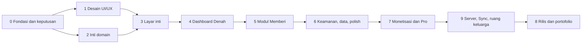

# Rizqflow — Roadmap

Breakdown proyek menjadi 15 tahap (0–14, plus v1.1 pasca-rilis). **File ini adalah status hidup** (diputuskan 2026-10-18, menggantikan tracking Notion): setiap pekerjaan nyata (commit, keputusan, riset, desain) langsung mengubah checkbox dan menambah catatan di sini, bukan di tempat lain.

Catatan progres dilakukan lewat skill `pengembangan-rizqflow` (lihat [CLAUDE.md](../CLAUDE.md)).

## Urutan dan ketergantungan

- Platform: **Android saja**, rilis di Google Play Store. Stack: **Kotlin + Jetpack Compose + Room** (2026-09-19).
- Arah visual: **opsi A**, pakai ulang identitas homepage roziqrizal.com (2026-09-19).
- Detail stack **disetujui 2026-09-20**: tiga modul Gradle (`:domain`, `:data`, `:app`), min SDK 26, DI manual, backup AES-GCM, tanpa SQLCipher untuk v1 (lihat [konsep.md](konsep.md)).
- Tahap 1 (desain) dan Tahap 2 (inti domain) bisa berjalan paralel setelah Tahap 0 selesai.
- **Server ikut rilis pertama** (diputuskan pemilik 2026-09-24): Tahap 9 tidak lagi opsional dan dikerjakan sebelum Tahap 8. Cakupan rilis 1: akun server, langganan Sync sejak rilis, sync terenkripsi antar-perangkat, ruang keluarga bersama, peran anggota, dan notifikasi anggota mencatat. Bot WhatsApp dan input AI berbasis LLM tetap sesudah rilis. Server di VPS milik pemilik (VPS Al-Kaukaba dulu, lihat [server-sync.md](server-sync.md)). Tahap 12 (infrastruktur server, dijalankan pemilik) dan Tahap 13 (enkripsi dan kunci) ditambahkan 2026-09-24 dan mendahului Tahap 9.
- Tahap 10 (fitur wajib dari riset pasar) dan Tahap 11 (input cerdas on-device) ditambahkan 2026-09-23. Keduanya tidak bergantung pada Tahap 8; urutan terhadap rilis ditentukan pemilik (usulan: butir High Tahap 10 sebelum rilis, sisanya sesudah).

## Tahap 0 — Fondasi dan keputusan (In Progress)

Menetapkan keputusan yang menentukan arah teknis dan bisnis sebelum kode ditulis.

- [x] Diskusi konsep, posisi produk, dan nama Rizqflow
- [x] Buat repo dan dokumen konsep awal
- [x] Rumuskan model bisnis freemium ([monetisasi.md](monetisasi.md))
- [x] Susun breakdown tahap, spesifikasi layar, dan flow UI
- [x] Pasang tracking Notion, skill `pengembangan-rizqflow`, dan CLAUDE.md repo (tracking Notion **dihentikan 2026-10-18**, diganti markdown repo — lihat CLAUDE.md bagian "Status dan tracking")
- [x] Putuskan platform: Android, rilis di Play Store (2026-09-19); **diperluas 2026-10-18** — web juga dibuat, lihat Tahap 14
- [x] Putuskan stack Android: Kotlin + Jetpack Compose + Room (2026-09-19)
- [x] Setujui detail stack Android: modul, min SDK 26, DI manual, enkripsi (2026-09-20)
- [x] Cek ketersediaan nama (2026-09-21): pencarian "rizqflow" di Google Play dan pangkalan merek DJKI tanpa hasil; rizqflow.com dipegang pihak lain, rizqflow.app dan .id bebas ([konsep.md](konsep.md))
- [x] Putuskan sumber harga emas: input manual (gratis), otomatis lewat API (Pro); riset API dilakukan di Tahap 7 (2026-09-20)
- [x] Putuskan kalender Hijriyah untuk haul: Umm al-Qura di balik antarmuka `HijriCalendar`; hisab Al-Kaukaba bisa menyusul (2026-09-21)
- [x] Tetapkan asumsi fikih default zakat mal: 85 g emas, 2,5%, haul 1 tahun Hijriyah (2026-09-20); default sementara, menunggu verifikasi kitab oleh pemilik
- [ ] Validasi minat lewat landing page dan daftar tunggu

## Tahap 1 — Desain UI/UX (Selesai)

Spesifikasi teks sudah ada di [ui-flow.md](ui-flow.md); tahap ini mengubahnya menjadi desain visual.

- [x] Putuskan arah visual: opsi A, pakai ulang identitas homepage (2026-09-19)
- [x] Tetapkan design tokens dan komponen dasar ([design/tokens.css](design/tokens.css))
- [x] Wireframe seluruh layar (S01–S31), termasuk keadaan kosong ([wireframe.md](wireframe.md), 2026-09-21)
- [x] Hi-fi layar kunci: Denah, Catat + Pratinjau alokasi, Detail ruang, Kartu haul (prototipe HTML di [design/](design/README.md); disetujui pemilik 2026-09-20)
- [x] Prototipe klik untuk flow F1–F9 dan seluruh layar S01–S28 (2026-09-21); pembayaran, izin, dan notifikasi tetap disimulasikan
- [x] Uji prototipe dengan pola data nyata dari Transaksi Harian di Ruang Finansial (2026-09-21): dua perbaikan tata letak di teks 200% dan temuan model data (lihat [design/README.md](design/README.md) dan [model-data.md](model-data.md))

## Tahap 2 — Inti domain, tanpa UI (Selesai)

Logika bisnis yang benar dan teruji sebelum ada layar.

- [x] Rancang model data dan skema penyimpanan lokal: [model-data.md](model-data.md), skema Room versi 1 di `:data` dengan berkas skema JSON (2026-09-21)
- [x] Value object Money (bilangan bulat, aritmetika eksak) (2026-09-20)
- [x] Aturan pembulatan alokasi: metode sisa terbesar, prioritas sebagai pemutus seri (2026-09-21)
- [x] Rule engine alokasi persentase: `AllocationEngine`, basis point, 20 tes (2026-09-21)
- [x] Definisikan arti "terpenuhi" per tipe ruang, ambang 85% untuk Mencukupi (2026-09-20, lihat [konsep.md](konsep.md))
- [x] Strategi modul Memberi: `zakat-haul-hijri` dan `percentage` (2026-09-21)
- [x] Kalkulator nisab dan haul Hijriyah, dengan dua kebijakan haul yang bisa diganti (2026-09-21)
- [x] Strategi unit test domain: [strategi-unit-test.md](strategi-unit-test.md), ditulis dari nol (2026-09-21)
- [x] Stub lapisan entitlement: `Entitlements`, `Feature`, `Plan`, `PlanEntitlements` (2026-09-21)
- [x] Setup proyek Android: modul domain terpisah, unit test, CI dasar (2026-09-20; CI pertama di GitHub hijau, 2026-09-20)
- [x] Lapisan buku kas: layanan onboarding, pencatatan, dan aturan alokasi di `:domain`; repositori Room dan satu database per akun di `:data`; 268 tes hijau (2026-09-21, lihat [model-data.md](model-data.md))

**Selesai bila:** unit test hijau untuk alokasi, nisab, dan haul (termasuk kasus tepi); tidak ada floating point untuk uang; skema penyimpanan punya jalur migrasi.

**Status 2026-09-21:** semua kriteria terpenuhi (82 tes domain hijau, skema Room versi 1 dengan berkas skema JSON dan larangan migrasi destruktif). Android Studio Quail 4 sudah terpasang dan build dengan JDK bawaannya lulus; image emulator API 37 sudah ada dan aplikasi berjalan di emulator (2026-09-21).

## Tahap 3 — Layar inti: onboarding, catat, transaksi (Selesai)

- [x] Tema Compose dari design tokens (warna terang dan gelap, font Manrope dan Libre Caslon Text, warna ruang dan status) dan kerangka navigasi (bottom nav empat tab, tombol Catat) (2026-09-21)
- [x] Splash dan halaman masuk dengan Google dan Gmail (S29, S30), riwayat masuk, dan ikon aplikasi (2026-09-21); proyek Google Cloud dan client ID sudah dibuat, masuk dengan Google teruji di emulator (2026-09-21); izin Gmail belum disiapkan ([auth-google.md](auth-google.md))
- [x] Masuk dengan nama pengguna dan sandi serta halaman Daftar (S30, S31): akun lokal dengan hash PBKDF2, tanpa server (2026-09-21)
- [x] Onboarding S02–S04 (S01 digantikan S30): pola ruang, pembagian persen (total selalu 100%), akun pertama dengan papan angka; Mulai kosong melewati langkah persentase; tiap akun membuka database sendiri (2026-09-21)
- [x] Catat transaksi (S06): tab Pemasukan, Pengeluaran, Transfer; ruang, kategori, akun, tanggal, catatan; banner lembut bila jatah bulan itu terlampaui; snackbar Urungkan (2026-09-21). Chip "Terakhir" dan "Jadikan favorit" menunggu S24
- [x] Pratinjau alokasi (S07): rezeki terlihat mengalir sebelum disimpan, "Ubah sekali ini" (aturan tidak berubah), bagian belum dialirkan (2026-09-21)
- [x] Daftar transaksi dan detail/edit (S08–S09): per bulan dan tanggal, cari catatan dan nominal, filter jenis, sheet saringan akun/ruang/kategori; detail memakai layar Catat (ubah semua kolom; nominal pemasukan dihitung ulang dengan potret alokasi), hapus dengan konfirmasi, Urungkan setelah ubah dan hapus (2026-09-21). Banner hari kosong dan baris draf menunggu Tahap 6 dan v1.1
- [x] Daftar ruang dan aturan alokasi (S10, S12): urutan naik/turun (= prioritas sisa pembulatan), arsipkan dan pulihkan (persen kembali 0%), tambah ruang (batas 5 ruang gratis; kategori awal Lain-lain dan Tak terlacak), pola Tiga hak untuk akun kosong, banner bila total bukan 100%; Aturan alokasi dengan slider dan +/- 1% untuk semua ruang, simpan hanya bila pas 100%, Buang perubahan?, Urungkan (2026-09-21). Aturan lanjutan (Pro) baru berupa pesan; status per ruang menunggu Tahap 4
- [x] Kelola akun, kategori, dan favorit (S13): tab Akun (tambah dengan saldo awal, ubah nama dan jenis, arsipkan, pulihkan, batas 3 akun gratis, dicabut 2026-09-24: lihat Tahap 10), tab Kategori per ruang (tambah, ganti nama, arsipkan; kategori sistem terkunci; ruang selalu punya satu kategori biasa), tab Favorit (ubah nama dan nominal, hapus, paling banyak 6); "Jadikan favorit" di Catat untuk pengeluaran baru (2026-09-21). Akun dan kategori hanya diarsipkan, tidak dihapus. Urutan favorit otomatis menurut pemakaian karena skema belum punya kolom urutan (seret untuk mengurutkan ditunda). Cocokkan saldo menunggu S25 (Tahap 6)
- [x] Catat kilat (S24): bottom sheet pengeluaran cepat dari pintasan ikon (tekan lama) dan tile Quick Settings; ketuk favorit langsung menyimpan dengan Urungkan, atau ketik nominal (ruang dan kategori terakhir, akun bisa dipilih); teruji di emulator (2026-09-21). Widget masuk Pro (Tahap 7); tindakan di notifikasi malam menunggu S26 (Tahap 6); chip favorit di layar Catat penuh ditunda
- [x] Mode demo dengan data contoh (S22): dari Coba data contoh di Denah kosong atau menu Lainnya; database demo terpisah yang diisi tiga ruang, tiga akun, dua bulan transaksi, dan empat favorit, lalu dihapus saat keluar; penanda Mode demo di header Denah (2026-09-21). Tema dan bahasa (bagian lain S22) menyusul di Tahap 6

**Selesai bila:** flow F1–F4 berjalan end-to-end tanpa jaringan; data bertahan; setiap layar punya empty state.

**Status 2026-09-21:** semua kriteria terpenuhi: onboarding, catat pemasukan dan pengeluaran dan transfer, ubah aturan alokasi, kelola akun dan kategori dan favorit, dan mode demo berjalan di emulator tanpa jaringan; data tersimpan di Room; tiap layar punya keadaan kosong. Yang ditunda ke tahap lain tercatat di butir masing-masing di atas.

## Tahap 4 — Dashboard Denah (Selesai)

- [x] Denah: ringkasan, grid ruang, perlu perhatian (S05): rezeki bulan ini dengan bar pembagian, kartu ruang (cincin, sisa, status ikon plus teks), Perlu perhatian maksimal 3 butir, navigator bulan, keadaan kosong; teruji di emulator (2026-09-21). Belum ada: tanggal Hijriyah dan butir haul (Tahap 5), butir saldo belum dicocokkan (Tahap 6), mode demo dari keadaan kosong (S22), kartu bisa dibuka ke S11
- [x] Detail ruang (S11): cincin progres, terpakai dari jatah, status ikon plus teks dengan penjelasan arti per tipe, pos dengan batang (pembanding: irisan jatah menurut bobot, kosong = seluruh jatah ruang), lima pengeluaran terbaru yang bisa dibuka ke Detail transaksi, Atur aturan, dan Arsipkan ruang dengan konfirmasi dan Urungkan yang mengembalikan urutan dan persentase; dibuka dari kartu di Denah dan baris di Ruang (2026-09-21). Kartu Zakat untuk ruang Memberi menunggu Tahap 5
- [x] Logika status ruang per tipe dan tesnya: `RoomStatusRules` (ambang 85% Mencukupi, batas inklusif) dan `DenahLoader` (rezeki bulan itu, belum dialirkan, kartu per ruang, butir Perlu perhatian maksimal 3), 18 tes (2026-09-21). Menunggu konfirmasi: penilaian Mencukupi di akhir bulan dan label bulan lalu yang belum tercapai
- [x] State tepi: bulan kosong, banyak ruang, font besar, mode gelap (2026-09-22). Dicek di emulator untuk Denah dan daftar Ruang dengan 7 ruang (paket Pro sementara untuk melewati batas 5, lalu dikembalikan ke gratis): grid dua kolom tetap rapi dengan baris ganjil, satu kolom di font 200%, terbaca di mode gelap, ringkasan Pembagian rezeki membungkus benar. Temuan sekalian: menurunkan paket dari Pro ke gratis saat ruang aktif melebihi batas tidak menghapus ruang yang sudah ada, hanya memblokir tambahan baru dengan pesan "Batas ruang paket gratis tercapai" — perilaku yang benar

**Selesai bila:** status benar untuk ketiga tipe ruang; semua state punya tampilan; terbaca di font 200% dan mode gelap.

**Status 2026-09-22:** semua kriteria terpenuhi dan teruji di emulator termasuk kasus tepi >5/>6 ruang. Kartu Zakat (Memberi) dan butir haul/saldo di Denah menunggu Tahap 5 dan 6 seperti tercatat di atas.

## Tahap 5 — Modul Memberi: zakat dan haul (Selesai)

Pembeda utama produk.

- [x] Beranda Zakat dan profil harta (S14–S15) (2026-09-22): ZakatService (overview, saveWealth, payZakat) di `:domain` dan `:data`; layar Zakat dengan kartu status, nisab, harga emas, riwayat; Profil harta dengan harga emas per gram, baris bawaan (emas dalam gram, uang dan tabungan, investasi, piutang lancar), harta bebas tambah, dan hutang jangka pendek. Jalan masuk: kartu Zakat di Detail ruang untuk ruang bertipe Menunaikan. Teruji di emulator: isi harta lengkap, nisab dan harta bersih cocok skenario tes, data tersimpan dan termuat ulang benar
- [x] Kartu haul dan rincian perhitungan (S16) (2026-09-22): digabung ke kartu status S14 (Belum mencapai nisab, Haul berjalan dengan hari ke-n dari total dan jatuh tempo Hijriyah, Haul genap) memakai `HaulTracker`, bukan layar rincian terpisah — penyederhanaan cakupan
- [x] Tunaikan zakat menjadi transaksi (S17) (2026-09-22): bottom sheet dengan nominal bawaan 2,5% dari harta bersih (bisa diubah), akun sumber, kategori Zakat mal otomatis di ruang itu; menyimpan mencatat pengeluaran biasa dan memulai haul baru. Diuji lewat ZakatTest (Room sungguhan): haul genap sampai tunaikan tersimpan dan haul baru mulai. Belum diuji manual di emulator karena perlu memutar kalender sistem untuk mencapai haul genap
- [x] Pengingat haul (notifikasi): dikerjakan di Tahap 6 (2026-09-22) karena memakai infrastruktur notifikasi S26 yang sama, bukan diduplikasi di sini
- [x] Putuskan pengingat haul untuk satu profil: tetap gratis, multi-profil Pro (disetujui pemilik 2026-09-24, [monetisasi.md](monetisasi.md))
- [x] Mode alternatif persentase donasi (2026-09-22): sakelar "Persentase donasi biasa" di S14, memakai `PercentageGivingStrategy` yang sudah ada sejak Tahap 2; ruang Memberi bawaan pola Tiga hak mulai di mode ini, bisa dipindah ke zakat mal kapan saja tanpa kehilangan data harta
- [x] Tes kasus tepi haul dan nisab (2026-09-22): `HaulTrackerTest` dan `ZakatCalculatorTest` (Tahap 2) plus `ZakatServiceTest` baru (mulai haul, genap, reset di bawah nisab, tunaikan sebelum dan sesudah genap) dan `ZakatTest` di lapisan data
- [x] Disclaimer dan tampilan sumber fikih (S23) (2026-09-22): versi ringkas di footer S14 dan layar Tentang lengkap (versi aplikasi, privasi, asumsi fikih dengan penanda belum diverifikasi, disclaimer, Kebijakan privasi dan Lisensi pihak ketiga sebagai sheet dalam aplikasi, Kirim masukan lewat email); jalan masuk baris Tentang di menu Lainnya, teruji di emulator

**Selesai bila:** flow F5 berjalan end-to-end termasuk reset haul; asumsi fikih dan disclaimer tampil; modul bisa dimatikan tanpa merusak aplikasi.

**Status 2026-09-22:** semua kriteria terpenuhi (flow F5 teruji lewat ZakatTest dan emulator, disclaimer ringkas dan layar Tentang lengkap tampil, modul bisa dimatikan lewat sakelar persentase donasi tanpa kehilangan data). Pengingat haul (notifikasi) semula tersisa, lalu dikerjakan di Tahap 6 karena butuh infrastruktur notifikasi yang sama dengan S26 (selesai 2026-09-22). Keputusan tier pengingat haul (satu profil gratis, multi-profil Pro) disetujui pemilik 2026-09-24, sehingga seluruh kriteria terpenuhi dan tahap ditutup.

## Tahap 6 — Keamanan, data, dan polish (In Progress)

- [x] Kunci PIN dan biometrik (S19): PIN 6 angka diketik dua kali, lima kali salah menahan sementara 30 detik tanpa menghapus data, biometrik hanya bisa aktif setelah ada PIN dan bila tersedia di perangkat, kunci otomatis (segera/1/5/15 menit) diperiksa lewat lifecycle Activity saat kembali dari latar belakang, start dingin selalu terkunci bila ada PIN, FLAG_SECURE menyembunyikan nominal di tampilan aplikasi terakhir dan tangkapan layar; menu Lainnya > Keamanan untuk ubah PIN dan matikan kunci (keduanya minta PIN sekarang dulu); teruji ujung ke ujung di emulator termasuk lockout, kedua mode kunci otomatis, dan tampilan aplikasi terakhir (2026-09-22)
- [x] Backup dan restore terenkripsi (S20) (2026-09-22): menu Lainnya > Backup dan data. Cadangkan menyalin berkas SQLite Room apa adanya (checkpoint WAL dulu supaya lengkap) dan mengenkripsinya AES-256-GCM dengan kunci PBKDF2-HMAC-SHA256 dari sandi pengguna (`BackupCrypto` di `:domain`, garam dan IV acak per cadangan, sandi minimal 6 karakter, dua kali ketik); berkas dibagikan lewat Storage Access Framework. Pulihkan meminta berkas lalu sandi dengan konfirmasi eksplisit menimpa data; sandi salah atau berkas rusak menampilkan pesan tanpa menyentuh data sekarang. Restore menutup ruang kerja, menimpa berkas database (menghapus sisa `-wal`/`-shm` lama), lalu membuka ulang — menu dan tab kembali ke Denah dengan data baru. Diuji: `BackupCryptoTest` (bolak-balik, sandi salah, berkas rusak, berkas terlalu pendek) di `:domain`; `:app:assembleDebug` dan unit test `:app`/`:data` lulus
- [x] Ekspor dan impor CSV: menu Lainnya > Ekspor dan impor CSV. Ekspor menulis seluruh transaksi apa adanya (nama akun/ruang/kategori, bukan pengenal) lewat Storage Access Framework. Impor mengurai ekspor CSV Notion "Transaksi Harian" lewat nama kolom (bukan posisi), mencocokkan nama akun/kategori persis (tanpa membedakan huruf besar/kecil) ke data aplikasi, menyatukan pasangan pemasukan/pengeluaran yang tanggal-nominal-akunnya cocok jadi satu Transfer, dan menampilkan pratinjau (siap/dilewati dengan alasan) sebelum tombol Impor menyimpan apa pun; baris yang akunnya atau kategorinya tidak dikenali dilewati dengan alasan, tidak ditebak. Teruji ujung ke ujung di emulator: ekspor ditarik dan diperiksa isinya, impor CSV Transaksi Harian mengimpor pengeluaran/pemasukan/satu pasangan transfer dengan benar dan melewati baris tak dikenal (2026-09-22)
- [x] Mode gelap, skala font, aksesibilitas: audit formal atas seluruh layar. Ditemukan dan diperbaiki: 6 tombol stepper persen (Review pemasukan, onboarding, Aturan alokasi) 44dp naik ke 48dp (target sentuh minimal); pemilih ikon ruang baru membacakan kunci mentah ("heart") ke TalkBack, diganti label Indonesia; ikon peringatan (statusWarning) di mode terang hanya berkontras ~1,6:1 terhadap pita peringatannya sendiri (di bawah 3:1 WCAG), digelapkan khusus mode terang setelah dikonfirmasi pemilik produk, mode gelap dibiarkan (sudah ~10:1); 6 teks satu baris (judul/subjudul transaksi, label bulan, label tab Catat) ditambah TextOverflow.Ellipsis supaya terpotong rapi di font besar, bukan mentah. Tidak ditemukan: kekurangan contentDescription pada elemen ikon-saja (semua sudah lewat IconButton dengan label), warna literal yang lolos dari tema (kecuali satu pengecualian sengaja mengikuti pedoman merek Google di tombol masuk). Kontras token warna (teks vs latar, tombol utama, identitas ruang, dan kini statusWarning) dijaga otomatis lewat RizqflowTokensTest (10 tes) supaya tidak rusak diam-diam. Belum diverifikasi visual layar demi layar di skala font 200%/mode gelap pasca-S19: FLAG_SECURE (S19) memblokir tangkapan layar dan perekaman layar aplikasi ini di semua metode termasuk adb, jadi verifikasi mengandalkan tinjauan kode dan tes kontras otomatis, bukan piksel; Denah dan daftar Ruang sudah diverifikasi visual sebelum S19 (lihat Tahap 4) (2026-09-22)
- [x] Layar Tampilan: saklar tema Otomatis/Terang/Gelap di menu Lainnya (diminta pemilik produk setelah audit aksesibilitas; sebelumnya cuma mengikuti sistem tanpa saklar, seperti dicatat di komentar `Theme.kt` sejak awal). `ThemePreference` menyimpan pilihan di SharedPreferences terpisah dari akun, dibaca reaktif lewat StateFlow; gaya ikon status/navigasi bar dihitung ulang tiap tema berubah, bukan cuma sekali di `onCreate`, supaya tetap kontras saat tema dipaksa berbeda dari sistem. Teruji di emulator: ketiga pilihan tersimpan benar dan bertahan lewat start dingin (2026-09-22)
- [x] Lokalisasi Indonesia dan Inggris (2026-09-22): seluruh string UI (~290 resource, termasuk plural dan dua `string-array` baru untuk singkatan bulan dan nama bulan Hijriyah) diterjemahkan ke `values-en/strings.xml`, default `values/strings.xml` tetap Indonesia. Label tanggal "Hari ini"/"Kemarin" dan singkatan bulan Masehi di `Format.kt`, yang sebelumnya di-hardcode di luar sistem resource, sekarang lewat string resource (`formatDate`/`formatMonth` jadi Composable; inti murni `formatDateWith`/`formatMonthWith` dipertahankan supaya tetap bisa diuji lewat kotlin.test tanpa Robolectric). Nama bulan Hijriyah di `HijriDate.format()` (`:domain`) menerima parameter opsional supaya `:app` bisa melewatkan versi Inggris tanpa `:domain` bergantung ke resource Android. Notasi Rupiah dan persen (titik ribuan, koma desimal) sengaja tidak diubah karena mata uangnya tetap Rupiah di kedua bahasa. Diverifikasi: `:app:assembleDebug` dan seluruh unit test `:domain`/`:data`/`:app` lulus, serta dicek langsung di emulator lewat `cmd locale set-app-locales ... en-US`: tab, tanggal, dan label status berganti ke Inggris; nama ruang/kategori buatan pengguna tetap seperti aslinya (data, bukan string aplikasi)
- [x] Pengingat malam dengan balasan langsung dan tindakan "Tidak ada" (S26): jam dan aktif/tidak bisa diatur, WorkManager menjadwalkan satu notifikasi per hari, balasan semacam "kopi 25000" tersimpan sebagai pengeluaran (ruang dan kategori pengeluaran terakhir), izin notifikasi Android 13+ diminta sekali setelah transaksi pertama tersimpan; teruji di emulator ujung ke ujung termasuk kedua aksi notifikasi (2026-09-22)
- [x] Pengingat haul (2026-09-22): `HaulReminderService` (`:domain`) menumpang pengecekan di `ReminderWorker` yang sudah ada (S26) alih-alih worker/scheduler terpisah — sesuai keputusan di atas. Menyapa sekali per ambang batas per ruang Memberi bermode zakat (penanda `haul_reminder_notified_<ruang>` di `SettingsRepository`, bukan tiap hari), dengan dua pemicu: mendekati genap (≤7 hari lagi) dan genap. `ReminderNotifier.showHaul` memakai channel dan id notifikasi terpisah dari pengingat malam (channel `reminder_haul`, importance default), tanpa aksi Balas/Tidak ada. Sengaja hanya jalan bila pengingat malam aktif, supaya tidak menduplikasi jadwal WorkManager. Diuji lewat `HaulReminderServiceTest` (mendekati, genap, ditandai supaya tidak berulang, tunaikan memulai haul baru dan menghentikan pengingat lama); `:domain:test`, `:app:assembleDebug`, dan unit test `:app`/`:data` lulus. Belum diuji manual di emulator (perlu memutar kalender sistem untuk mencapai ambang haul, sama seperti S17)
- [x] Koreksi saldo (S25): menu Lainnya, pilih akun, saldo sebenarnya dibandingkan catatan; selisih lebih kecil dicatat pengeluaran Tak terlacak di ruang usulan (dari pengeluaran terakhir akun itu), lebih besar dicatat pemasukan biasa yang dialirkan seperti pemasukan lain, sama hanya memperbarui tanggal cocok; teruji di emulator untuk akun tunai dan bank (2026-09-22)
- [x] Petunjuk hari kosong di daftar transaksi (2026-09-22): S08, banner lembut "Kemarin belum ada catatan pengeluaran" dengan Catat sekarang (buka Catat kilat S24) dan Tidak ada, hanya saat daftar tidak difilter akun. Berbagi penanda `day_check` yang sama dengan pengingat malam S26 (`ReminderService.shouldShowEmptyDayHint`/`dismissEmptyDayHint`), hanya beda hari yang ditandai (kemarin, bukan hari ini) dan tidak tampil sebelum transaksi pertama. Diuji: 5 tes baru `ReminderServiceTest`; `:app:assembleDebug` dan unit test `:app`/`:data` lulus
- [x] "Perlu perhatian: saldo belum dicocokkan" di Denah untuk akun yang lama tidak dikoreksi (2026-09-23): `AttentionItem.AccountNotReconciled` di `DenahLoader`, prioritas terakhir setelah ruang lewat/mendekati jatah dan rezeki belum dialirkan (sesuai urutan di [ui-flow.md](ui-flow.md)). Akun aktif yang `lastReconciledOn`-nya lebih dari 7 hari lalu ditandai; akun yang belum pernah dicocokkan sama sekali sengaja tidak ditandai (baru "berumur" sejak koreksi pertamanya, bukan sejak dibuat — tidak ada kolom tanggal dibuat di skema akun). Baris di Denah membuka Koreksi saldo (S25) langsung ke akun itu, memakai state `reconcileAccount`/`ReconciliationScreen(initialAccountId=...)` yang sama dengan jalan masuk menu Lainnya. Diuji: 5 tes baru `DenahTest` (belum pernah dicocokkan, batas tepat 7 vs 8 hari, urutan setelah rezeki belum dialirkan, banyak akun diurutkan dari paling lama, akun terarsip tidak ikut ditandai); `:domain:test`, `:app:assembleDebug`, dan unit test `:app`/`:data` lulus

**Selesai bila:** PIN/biometrik tidak bisa dilewati; backup lalu restore di perangkat lain menghasilkan data identik; koreksi saldo mencatat selisih dengan benar untuk akun tunai, e-wallet, dan bank.

**Status 2026-09-23:** seluruh tugas terdaftar di atas sudah selesai (termasuk butir Denah terakhir). Dua dari lima kriteria "Selesai bila" di atas masih menunggu verifikasi manual: **restore di perangkat fisik lain** (baru diuji bolak-balik di emulator/`BackupCryptoTest`, belum lintas perangkat) dan **berkas ekspor CSV dibuka di aplikasi spreadsheet sungguhan** (baru diperiksa isinya di emulator, belum di Sheets/Excel). PIN/biometrik dan koreksi saldo sudah terverifikasi sesuai kriteria.

## Tahap 7 — Monetisasi dan Pro (In Progress)

- [x] Paywall bottom sheet dan titik penguncian (S21) (2026-09-23): `PaywallSheet` (`ui/paywall/`), tiga manfaat dari `Feature` yang memicu (butir yang memicu didahulukan, lalu diisi dari tiga manfaat mockup ui-flow.md), harga placeholder Rp 129.000 (belum final, lihat monetisasi.md). Titik penguncian ruang (S10, ruang ke-6) dan akun (S13) membuka S21 langsung, bukan sekadar pesan seperti sebelumnya. Baris "Rizqflow Pro" baru di menu Lainnya (S18), subjudul mengikuti status pembelian. `PurchaseStore` (`:app`, SharedPreferences app-wide seperti `ThemePreference`) dan `LivePlanEntitlements` (`:domain`, membaca ulang paket tiap dipanggil) menggantikan `PlanEntitlements()` yang dulu selalu kosong (`AccountWorkspace`) — tetapi **belum terhubung ke Google Play Billing sungguhan**: tombol Beli dan Pulihkan pembelian sengaja hanya menampilkan pesan "belum tersedia" (`pro_purchase_unavailable`), tidak membuka Pro, supaya tidak ada jalan buka-Pro-gratis yang tidak sengaja. `PurchaseStore.grant()` sudah ada sebagai seponsel Billing Client menyusul, tapi belum dipanggil dari mana pun. Diuji: 1 tes baru `EntitlementsTest` (LivePlanEntitlements membaca ulang, bukan potret sekali dibuat); `:domain:test`, `:app:assembleDebug`, dan unit test `:app`/`:data` lulus
- [x] Saklar Pro (uji) untuk build debug (2026-09-26): baris di menu Lainnya yang menyalakan dan mematikan `Plan.PRO` lewat `PurchaseStore.grant()`/`revoke()` tanpa pembayaran, supaya fitur Gratis dan Pro bisa diuji di perangkat. Hanya tampil bila `BuildConfig.DEBUG`; build rilis tidak punya jalur ini. Diuji `PurchaseStoreTest` (5 tes)
- [ ] Integrasi pembelian (Google Play Billing) dan pulihkan pembelian — butuh produk in-app terdaftar di Play Console (Tahap 8) dulu; `PurchaseStore.grant()` adalah seponsel yang akan dipanggil dari sini
- [x] Pro: ruang peran tak terbatas dan sistem per peran (2026-09-23): batas jumlah ruang sudah dibuka otomatis begitu `Plan.PRO` dimiliki (`Entitlements.roomLimit`, sejak Tahap 2); sistem per peran adalah modul opsional per ruang (`RoleService`, `Feature.ROLE_SYSTEMS`, layar S32 dari kartu Peran di Detail ruang). **Trader:** modal dan risiko per trade menghasilkan batas rupiah; pengeluaran di ruang itu yang melewatinya memunculkan banner lembut di Catat. **Investor:** jadwal DCA bulanan (nominal, tanggal 1 sampai 28, akun, kategori) yang dicatat sebagai pengeluaran di ruang itu (bukan transfer, sesuai keputusan investasi = pengeluaran); status Selesai/Jatuh tempo/Akan datang dihitung dari transaksi, dan pengingat sekali per bulan menumpang `ReminderWorker` (`DcaReminderService`, hanya jalan bila pengingat malam aktif, seperti pengingat haul). Persistensi: tabel `trader_profile` dan `dca_plan` (migrasi `MIGRATION_2_3`, skema versi 3). Turun paket tidak menghapus data, hanya membuat peringatan dan pengingat diam; melepas peran selalu boleh. Diuji: 22 tes `RoleServiceTest` (domain), 5 tes `RoleTest` dan 1 tes migrasi baru (`:data`); `:app:assembleDebug` lulus; teruji di emulator (Pro dipasang lewat SharedPreferences): Trader menghasilkan batas Rp 100.000 dari modal Rp 10 juta di 1%, banner muncul di Rp 1.000.000 dan tidak di tepat Rp 100.000, DCA jatuh tempo lalu Catat sekarang menjadikannya Selesai, lepas peran tersimpan. Belum diuji manual: notifikasi pengingat DCA (perlu memutar tanggal sistem) dan banner risiko di Catat kilat (S24, jalur favorit menyimpan langsung tanpa banner). Belum ada: kolom urutan atau jurnal trade, batas risiko harian, banyak jadwal DCA per ruang
- [x] Pro: aturan alokasi lanjutan (2026-09-23): mode waterfall (`AllocationMode`, `AllocationEngine.allocateWaterfall`) — satu toggle untuk seluruh ruleset (bukan campur per ruang), ruang diisi berurutan menurut prioritas (`sort_order`, sama seperti pemutus seri persentase) sampai batas atas rupiahnya (`AllocationCap`, kosong = tak terbatas), kelebihan mengalir otomatis ke ruang berikutnya. Potretnya tetap persentase seperti biasa (`AllocationEngine.impliedShares`) supaya perubahan nominal transaksi (S09) tetap memakai mekanisme lama tanpa kolom snapshot baru. Persistensi: kolom baru `allocation_rule.cap_amount` (migrasi Room `MIGRATION_1_2`, skema naik ke versi 2) dan mode tersimpan di `app_setting` (tanpa tabel baru). S12 punya dua chip mode; memilih "Lanjutan" tanpa Pro membuka paywall (`Feature.ADVANCED_ALLOCATION_RULES`). Mengubah salah satu mode membawa serta nilai mode lain (ganti persentase tidak menghapus batas atas tersimpan, dan sebaliknya). Diuji: 8 tes baru `AllocationEngineTest`, 6 tes baru `RuleServiceTest`, 4 tes baru `LedgerServiceTest` (termasuk memastikan pengeditan nominal memakai potret persentase, bukan menjalankan ulang waterfall), 1 tes migrasi baru (`MigrationTest`, lihat catatan `MigrationTestHelper` di model-data.md); `:domain:test`, `:data:test`, `:app:assembleDebug`, dan unit test `:app` lulus. Belum ada: UI drag-reorder prioritas di S12 (pakai urutan yang sudah ada di S10); Urungkan belum ditawarkan untuk simpan aturan lanjutan (hanya mode persentase)
- [x] Pro: multi-profil haul (2026-09-23): profil harta tambahan (mis. istri, usaha) di modul Memberi, tiap profil dengan harta, haul, riwayat zakat, dan pengingatnya sendiri. Profil pertama (Utama) gratis dan dibuat otomatis; profil tambahan butuh `Feature.MULTI_ZAKAT_PROFILE` (Pro). `ZakatRepository.activeProfile()` diganti `profiles()` (urut menurut pembuatan) dan `findProfile()`; `ZakatService` menerima `profileId` di `overview`, `saveWealth`, dan `payZakat`, plus `addProfile`, `renameProfile`, `archiveProfile` (profil aktif terakhir tidak bisa diarsipkan). Tanpa perubahan skema: kolom `zakat_profile.archived` dan `name` sudah ada sejak versi 1, urutan memakai rowid. Profil yang baru ditambah belum punya pemeriksaan harta, jadi statusnya meminta harta diisi (bukan belum mencapai nisab). Turun paket tidak mengunci profil yang sudah ada (hanya menambah yang baru), dan ganti nama serta arsip selalu boleh. Pengingat haul kini per ruang dan per profil (`haul_reminder_notified_<ruang>_<profil>`; penanda lama per ruang tidak dipakai lagi, jadi ambang yang sedang aktif bisa disapa sekali lagi setelah pembaruan), menyebut nama profil bila ada lebih dari satu, dan tanpa Pro hanya profil pertama yang disapa (default kerja menunggu konfirmasi, lihat monetisasi.md). Zakat yang ditunaikan mencatat nama profil di catatan transaksi bila ada lebih dari satu profil. Layar: pemilih profil (chip, + Profil, Ubah nama, Arsipkan) di S14; profil tambahan tanpa Pro membuka S21. Diuji: 14 tes baru `ZakatProfilesTest`, 1 tes `ZakatTest` (Room); teruji di emulator (Pro lewat SharedPreferences): tambah profil Istri, pindah profil, arsipkan dengan konfirmasi, dan tanpa Pro profil yang ada tetap terlihat. Belum diuji manual: notifikasi haul per profil dan alur Tunaikan zakat untuk profil kedua (perlu memutar kalender sistem, sama seperti S17). Belum ada: kebijakan haul berbeda per profil di layar (kolom `haul_break_policy` sudah per profil), memindahkan harta antar profil
- [ ] Info lembut di kartu profil haul tambahan: "Pengingat aktif hanya untuk profil pertama" bila tanpa Pro, supaya pengingat yang diam tidak mengejutkan
- [ ] Pro: harga emas otomatis (butuh riset API)
- [ ] Pro: laporan dan insight, multi-mata uang, widget, tema
- [ ] Uji alur pembelian dengan penguji lisensi

**Selesai bila:** semua penguncian lewat satu lapisan entitlement; akses tidak hilang setelah pasang ulang atau ganti perangkat.

**Status 2026-09-23:** paywall, titik penguncian, aturan alokasi lanjutan, sistem per peran, dan multi-profil haul selesai; sisanya (billing sungguhan, harga emas otomatis, laporan/insight/multi-mata uang/widget/tema, uji penguji lisensi) menunggu, sebagian bergantung pada akun developer Play Console (Tahap 8).

## Tahap 8 — Rilis dan portofolio (Backlog)

- [ ] Akun developer, profil pembayaran, dan pajak
- [ ] Kebijakan privasi, deklarasi fitur finansial, dan data safety
- [ ] Uji tertutup Play Console (cek syaratnya sejak awal; memengaruhi jadwal)
- [ ] Store listing
- [ ] Case study di roziqrizal.com, README Inggris, video demo

## Tahap 9 — Server, Sync, dan ruang keluarga (Planning, wajib sebelum rilis)

Diputuskan pemilik 2026-09-24: server ikut rilis pertama, dengan cakupan penuh (ruang keluarga) dan Sync dijual sebagai langganan sejak rilis. Alasan: pemilik butuh angka pengguna, Pro, dan Sync, dan sync keluarga memang butuh server; lebih baik dibangun sekali daripada rilis dua kali dengan janji privasi yang berubah. Prinsip yang tetap: aplikasi tetap berfungsi penuh offline, dan server tidak boleh bisa membaca data keuangan (enkripsi ujung ke ujung).

- [x] Putuskan stack backend, hosting VPS, dan model keamanan server (2026-09-24): Laravel di VPS Al-Kaukaba yang sudah ada, dengan pemisahan aplikasi, database, PHP-FPM, dan Nginx; pelaksanaannya di Tahap 12 ([server-sync.md](server-sync.md))
- [ ] Riset arsitektur sync terenkripsi end-to-end: model kunci sudah diputuskan (2026-09-24, dikerjakan di Tahap 13); sisa: model konflik data dan aturan akun lintas ruang (High)
- [ ] Akun server: verifikasi ID token Google, hapus akun dari dalam aplikasi dan lewat web (syarat Play bila ada pembuatan akun) (High)
- [ ] Langganan Sync dan backend minimal: backup dan sinkron antar-perangkat terenkripsi (High). Harga awal disetujui 2026-09-24: Rp 19.000 per bulan atau Rp 149.000 per tahun, satu langganan untuk keluarga sampai 5 anggota, trial 7 hari ([monetisasi.md](monetisasi.md))
- [ ] Catat dan verifikasi pembelian Pro dan langganan Sync di server (Play Developer API, notifikasi waktu nyata) (High)
- [ ] Ruang keluarga bersama (High)
- [ ] Peran anggota keluarga (pengelola, pemberi jatah, anggota pencatat, anak) dan amplop uang bulanan (Medium)
- [ ] Notifikasi saat anggota keluarga mencatat (push dari backend sync) (Medium)
- [ ] Metrik pengguna anonim: jumlah pengguna, Pro, dan Sync (Medium)

Sesudah rilis (tidak masuk rilis 1): bot WhatsApp resmi tersinkron ke aplikasi (WhatsApp Business API; riset biaya dan verifikasi bisnis dulu) dan input AI berbasis LLM dengan kuota per paket, hanya bila parser on-device Tahap 11 belum cukup.

**Konsekuensi yang harus diikuti tahap lain:** Tahap 8 (Data safety dan kebijakan privasi menyebut server, UU PDP, dan Google Play mewajibkan hapus akun bila ada pembuatan akun); Tahap 7 (Google Play Billing untuk langganan Sync selain produk Pro); skema Room perlu dirancang ulang untuk sync (penanda waktu ubah, penanda hapus, pengenal perangkat) dan itu menyentuh hampir semua tabel; `auth-google.md` dan teks "Datamu tetap di ponselmu" di halaman masuk.

## Tahap 10 — Celah riset: fitur wajib (In Progress)

Menutup kesenjangan fitur wajib dari [riset pasar](research-market/research.md) (kecocokan sekitar 47% sebelum tahap ini, target sekitar 65–70%). Semua tanpa server. Ditambahkan 2026-09-23; disarankan selesai sebelum Tahap 8, atau minimal butir prioritas High.

- [x] Sisa aman hari ini di Denah dan Catat (High) (2026-09-24): `SafeToSpend` di `:domain` dengan 15 tes (termasuk lewat `DenahLoader` dengan pemasukan dan pengeluaran nyata); kartu di Denah bulan berjalan, dan baris "Sisa aman hari ini" / "setelah ini" di Catat untuk pengeluaran baru bertanggal hari ini serta di Catat kilat (S24). Rumus di [konsep.md](konsep.md). Teruji di emulator (2026-09-24): Denah, Catat, dan Catat kilat menampilkan angka yang sama dan berubah benar setelah pengeluaran
- [x] Transaksi berulang: harian, mingguan, bulanan (High) (2026-09-24): `RecurringService` di `:domain` (jadwal dihitung dari tanggal awal supaya tidak bergeser di bulan pendek, pengenal transaksi tetap per kemunculan sehingga mengejar yang terlewat tidak menggandakan, jeda, tanggal akhir, kemunculan yang tertahan dilaporkan) dengan 30 tes; tabel `recurring_rule` dan migrasi 3 ke 4 di `:data` (skema versi 4) dengan 4 tes Room dan 1 tes migrasi; layar S33 dari menu Lainnya. Pencatatan berjalan saat aplikasi dibuka dan tiap kembali ke depan, tanpa penjadwal latar belakang, jadi tidak ada notifikasi saat kemunculan tercatat. Teruji di emulator (2026-09-24): tambah aturan bulanan, kemunculan pertama langsung tercatat, buka ulang aplikasi tanpa duplikat, jeda dan lanjutkan, hapus aturan dengan transaksi tetap ada, dan migrasi pada data lama. Belum ada: mengejar kemunculan yang terlewat belum diuji di emulator (perlu memutar tanggal sistem; sudah diuji lewat tes domain dan Room), notifikasi saat tercatat, tanggal mulai di masa lalu, dan Urungkan untuk hasil pencatatan otomatis
- [x] Pengingat tagihan dan cicilan (High) (2026-09-24): entitas `Bill` terpisah dari transaksi berulang karena pembayarannya terjadi di luar aplikasi, jadi tidak pernah dicatat otomatis; pengguna mengetuk Bayar, barulah pengeluaran tercatat dan jatuh tempo maju. Sekali bayar, bulanan, atau mingguan, dengan jumlah cicilan opsional (kosong = tanpa batas) dan "sudah dibayar sebelumnya" untuk cicilan yang sudah berjalan; jatuh tempo boleh sudah lewat (terlambat). Membayar lewat `LedgerService` (`origin = BILL`, pengenal tetap `bill-<id>-<jatuh tempo>` supaya tidak ganda), nominalnya boleh diubah (listrik dan air), dan bisa diurungkan. `BillReminderService` menumpang `ReminderWorker` seperti haul dan DCA, jadi hanya jalan bila pengingat malam aktif: tiga hari sebelum, hari-H, dan sekali saat terlambat, lalu diam sampai dibayar; layar memberi petunjuk bila pengingat malam mati. Tabel `bill` dan migrasi 4 ke 5 (skema versi 5), layar S34 dari menu Lainnya. Diuji: 35 tes domain, 6 tes Room, dan 1 tes migrasi baru; seluruh 782 tes hijau. Teruji di emulator (2026-09-24): cicilan 3 kali, Bayar tercatat "Cicilan motor (1/3)" dengan jatuh tempo maju dan Urungkan mengembalikannya, tanggal lampau bisa dipilih, dan notifikasi "Internet is due in 2 days" muncul saat worker dipaksa jalan. Belum ada: tagihan di "Perlu perhatian" Denah, Lewati bulan ini, tanggal bayar selain hari ini, bayar dari notifikasi, tagihan di mode demo, dan pengujian notifikasi tahap hari-H dan terlambat di emulator (perlu memutar tanggal sistem; sudah diuji lewat tes domain dan Room)
- [x] Utang-piutang, terhubung ke profil harta zakat (High) (2026-09-24): entitas `Debt` (piutang `LENT` atau utang `BORROWED`, nama pihak, pokok, jatuh tempo opsional, catatan, lancar atau macet) dengan pelunasan sebagian atau penuh (`DebtPayment`); sisa dihitung dari pelunasan, tidak disimpan. Perpindahan uangnya memakai dua jenis transaksi baru, `LOAN_OUT` dan `LOAN_IN`, yang **hanya menggeser saldo akun**: meminjamkan bukan pengeluaran (tidak memakan jatah ruang) dan meminjam bukan pemasukan (tidak dialirkan ke ruang, tidak masuk Sisa aman hari ini); rumus saldo Room, ekspor CSV, dan daftar Transaksi ikut menanganinya, dan transaksi pinjaman tidak bisa diubah dari Detail (ketukannya membuka layar Utang-piutang). Pinjaman lama yang uangnya bergerak sebelum dicatat bisa dicatat tanpa menyentuh saldo. Hapus utang menghapus pelunasan dan transaksi saldonya (saldo kembali); hapus satu pelunasan dan Urungkan tersedia. Pengingat jatuh tempo (tiga hari sebelum, hari-H, sekali saat terlambat) memakai aturan bersama `DueReminders` dengan tagihan dan menumpang `ReminderWorker`. **Tautan zakat:** `DebtService.zakatSuggestion` menghasilkan sisa piutang lancar dan sisa utang jangka pendek (jatuh tempo dalam 12 bulan atau tanpa jatuh tempo); di S15 muncul sebagai saran dengan tombol Pakai, tidak pernah masuk otomatis (asumsi lancar/macet dan batas 12 bulan belum diverifikasi dengan kitab). Tabel `debt` dan `debt_payment`, migrasi 5 ke 6 (skema versi 6), layar S35 dari menu Lainnya. Diuji: 29 tes domain, 8 tes Room, dan 1 tes migrasi baru; seluruh 820 tes hijau. Teruji di emulator (2026-09-24): piutang Rp 200.000 dengan jatuh tempo, pelunasan Rp 50.000 dengan sisa Rp 150.000, baris "Pinjaman ke Budi" dan "Pelunasan dari Budi" di daftar Transaksi (mengetuknya membuka S35), notifikasi "Loan to Budi is due in 3 days", dan saran "Dari Utang-piutang: Rp 150.000" di S15 dengan Pakai. Belum ada: utang-piutang di "Perlu perhatian" Denah, mengubah pokok atau akun setelah dicatat, tanggal pelunasan selain hari ini, pelunasan dari notifikasi, data contoh di mode demo, dan notifikasi tahap hari-H dan terlambat di emulator (perlu memutar tanggal sistem; sudah diuji lewat tes)
- [x] Laporan dasar gratis dan perbandingan bulan lalu (Medium; laporan PDF dan tahunan tetap Pro di Tahap 7) (2026-09-24): `ReportLoader` menghitung pemasukan, pengeluaran, dan sisa (pemasukan dikurangi pengeluaran) satu bulan dari transaksi seperti Denah, tidak ada yang disimpan; `MonthComparison` memberi selisih nominal dan persen ke bulan lalu, null persennya bila bulan lalu nol. Pengeluaran per ruang dan lima kategori terbesar, terbesar dulu; ruang dan kategori yang sudah diarsipkan tetap terhitung karena ini ringkasan retrospektif, beda dari Denah yang hanya ruang aktif. Layar S36 dari menu Lainnya dengan navigator bulan yang sama dengan Denah, batang berwarna sesuai warna ruang, dan ikon naik/turun/sama netral (bukan hijau-merah) untuk perbandingan. Diuji: 10 tes domain baru; seluruh 884 tes hijau. Teruji di emulator: ringkasan September cocok data (pemasukan Rp3.000.000, pengeluaran Rp3.300.000, sisa -Rp300.000), rincian ruang dan kategori benar, navigasi ke bulan tanpa data menampilkan keadaan kosong yang tepat, dan bulan depan tidak bisa dipilih.
- [x] Template pos lokal: arisan, THR dan Lebaran, kiriman orang tua, paylater (Medium) (2026-09-24): `LOCAL_CATEGORY_TEMPLATES` (Arisan, THR & Lebaran, Kiriman orang tua, Cicilan & paylater) muncul sebagai chip usulan di sheet "Kategori baru" (S13, Kelola akun dan kategori); mengetuk chip mengisi kolom nama tapi tetap bisa diubah, dan usulan yang sudah dipakai di ruang itu tidak ditawarkan lagi. Tanpa perubahan skema (hanya daftar nama, disimpan seperti kategori biasa). Teruji di emulator: chip mengisi nama dengan benar, tersimpan dan muncul di daftar kategori, dan usulan yang sudah dipakai hilang saat sheet dibuka lagi.
- [x] Putuskan batas gratis akun dan ruang (Medium) (2026-09-24): akun tidak dibatasi (batas 3 dicabut karena riset menyebut multi-dompet terkunci premium adalah keluhan pengguna), ruang tetap 5. `Feature.UNLIMITED_ACCOUNTS`, `accountLimit`, `LedgerError.ACCOUNT_LIMIT_REACHED`, dan teks batas di S13 dihapus; `ManagementService` tak lagi bergantung pada `Entitlements`. Tes: akun ke-11 diterima, akun terarsip bisa dipulihkan tanpa batas
- [x] Pintasan simpan cadangan ke Google Drive lewat Storage Access Framework (Low) (2026-09-24): `BackupShortcutFolder` di menu Lainnya > Backup dan data, bagian "Pintasan folder": folder SAF (`OpenDocumentTree`, mis. folder di Google Drive) dipilih sekali dengan izin permanen (`takePersistableUriPermission`), lalu Cadangkan berikutnya menulis langsung ke sana tanpa dialog "Simpan sebagai" berulang. Tanpa API atau OAuth Google Drive; SAF bekerja dengan penyedia dokumen mana pun yang terpasang, jadi bukan hanya Drive. Tombol Ganti dan Hapus; folder yang izinnya dicabut dari luar aplikasi (dihapus, akun dicabut) ditandai "tidak lagi bisa diakses" alih-alih gagal diam-diam. Tanpa pintasan, tombol Cadangkan tetap memakai dialog "Simpan sebagai" seperti sebelumnya (kompatibel mundur). Menambah dependensi `androidx.documentfile`. Teruji di emulator: pilih folder Documents, Cadangkan langsung menulis tanpa dialog, berkas terverifikasi ada di `/sdcard/Documents/` dengan nama dan ukuran benar, Hapus mengembalikan ke keadaan belum diatur.
- [ ] Multi-mata uang (Pro, Low): menyentuh model inti `Money`; dipindah dari butir Pro Tahap 7

**Selesai bila:** transaksi berulang tidak menggandakan transaksi saat aplikasi lama tidak dibuka; utang-piutang bisa dicatat, dilunasi, dan piutang lancar mengalir ke harta zakat; sisa aman hari ini benar untuk bulan kosong dan jatah terlampaui; penguncian tetap lewat lapisan entitlement.

## Tahap 11 — Input cerdas on-device (In Progress)

Mengurangi friksi input tanpa server, sesuai temuan riset bahwa input manual adalah penyebab utama berhenti. Ditambahkan 2026-09-23. Tangkap otomatis dari notifikasi tetap di v1.1 di bawah.

- [x] Parser bahasa natural Indonesia ("gojek 23rb dari gopay") di `:domain` dengan golden test (High; tier Gratis adalah usulan) (2026-09-24): `SmartInputParser` berbasis aturan tanpa jaringan, hasilnya hanya mengisi draf; 54 golden test
- [x] Layar konfirmasi hasil input cerdas, memakai ulang pola Draf S27 (High) (2026-09-24): sheet satu baris dengan pratinjau langsung dari ikon Catat cerdas di layar Catat, mengisi ulang draf yang sama sehingga semua kolom bisa diubah sebelum Simpan; teruji di emulator
- [ ] Input suara lewat `SpeechRecognizer` (Pro, Medium)
- [ ] OCR struk on-device dengan ML Kit (Pro, Medium)
- [ ] OCR screenshot mutasi e-wallet dan bank serta e-statement PDF (Pro, Medium)

**Selesai bila:** hasil parse, suara, dan OCR selalu lewat layar konfirmasi sebelum tersimpan; tidak ada data keuangan keluar dari perangkat; akurasi OCR diukur pada sekitar 30 contoh nyata dan dicatat.

## Tahap 12 — Infrastruktur server dan deploy (Backlog, dijalankan pemilik)

Ditambahkan 2026-09-24 sebagai pelaksanaan keputusan "mulai di VPS Al-Kaukaba, mudah pindah ke VPS khusus" ([server-sync.md](server-sync.md)). **Diganti:** VPS tujuan sekarang IDCloudHost `103.54.170.198` (Docker, bersama habitflow), dicatat di repo build-server; web sudah ter-deploy di sana 2026-10-18 (Tahap 14). Butir di bawah yang menyebut PHP-FPM, Certbot, dan Nginx per aplikasi berganti padanan Docker, Cloudflare Origin Certificate, dan nginx host. Sebagian besar butir dijalankan **pemilik sendiri di VPS**, terpisah dari pekerjaan kode, dan mendahului atau berjalan bersama Tahap 9. Claude tidak menyentuh VPS produksi tanpa izin eksplisit.

- [ ] Cek spesifikasi VPS (`free -m`, `df -h`, swap) dan putuskan apakah muat untuk aplikasi ketiga (High, pemilik)
- [ ] Subdomain API Rizqflow: DNS dan SSL Certbot (High, pemilik)
- [ ] Aplikasi Laravel Rizqflow terpisah dengan database dan pengguna MySQL sendiri, pool PHP-FPM dan pengguna sistem sendiri, dan `.env` sendiri (High, pemilik)
- [ ] Konfigurasi Nginx dan skrip deploy disimpan di repo, bukan hanya di `/etc/nginx/` (High)
- [ ] Backup database Rizqflow terjadwal dan uji restore (High, pemilik)
- [ ] Token API yang kedaluwarsa dan bisa dicabut, tidak meniru token permanen Al-Kaukaba (High)
- [ ] Alamat API di aplikasi bisa dikonfigurasi supaya pindah ke VPS khusus mudah (Medium)

**Selesai bila:** API Rizqflow terjangkau lewat subdomain dengan SSL, terisolasi dari aplikasi lain di VPS, bisa dideploy ulang lewat skrip di repo, dan backup-nya terbukti bisa dipulihkan.

## Tahap 13 — Enkripsi ujung ke ujung dan kunci (In Progress)

Ditambahkan 2026-09-24; rancangannya disetujui pemilik dan tertulis di [server-sync.md](server-sync.md). Dijalankan nanti, sebelum Tahap 9 membangun sync sungguhan.

- [x] Kunci akun acak di perangkat, disimpan di Android Keystore, memakai Google Tink (High) (2026-10-18): `AccountKeyProvider`/`SyncAead` (`:domain`, `com.roziqrizal.rizqflow.domain.sync`) adalah kontrak murni tanpa Tink/Android supaya `:domain` tetap bebas dependensi; implementasi sungguhan `AndroidKeystoreAccountKeyProvider` (`:data`) memakai `AndroidKeysetManager` Tink dengan `withKeyTemplate(KeyTemplates.get("AES256_GCM"))` dan `withMasterKeyUri("android-keystore://...")` — keyset AES-256-GCM dibuat acak sekali saat pertama dipanggil, tersimpan di SharedPreferences dalam bentuk terbungkus kunci Keystore (bukan byte mentah), dan dimuat ulang sama pada pemanggilan berikutnya; kode ini sendiri tidak pernah melihat byte kunci, hanya primitif `Aead` dari Tink. Dependensi `com.google.crypto.tink:tink-android:1.24.0` ditambahkan ke `:data` saja. 4 tes baru (`AndroidKeystoreAccountKeyProviderTest`, Robolectric): bolak-balik enkripsi/dekripsi, associated data yang beda menolak dekripsi, keyset yang sama termuat ulang di instance provider baru, dan instans `Aead` di-cache per provider. **Catatan lingkungan penting, bukan soal kode**: tes ini gagal di JDK 17.0.2 (`C:\Program Files\Java\jdk-17.0.2`) dengan `NoSuchAlgorithmException: DIGEST_AND_KEY_TYPE_NOT_SUPPORTED` — bukan bug Tink/Keystore, terbukti lewat probe `Cipher.getInstance("AES/GCM/NoPadding")` polos yang juga gagal sama persis di JDK itu (konflik Conscrypt bawaan Robolectric dengan verifikasi jar provider JCE di patch JDK 17.0.2 ini). Lulus bersih di JBR 25 bawaan Android Studio (`C:\Program Files\Android\Android Studio\jbr`) — lihat catatan baru di CLAUDE.md. 96 tes `:data` dan 716 tes `:domain` hijau (`--rerun-tasks`, JBR 25), `:app:assembleDebug` lulus. Belum diuji di emulator sungguhan (perlu Android Keystore perangkat asli, bukan cuma shadow Robolectric). Belum ada: ekspor byte kunci untuk dibungkus kode pemulihan (task berikutnya di bawah), pemanggilan dari UI/`Application`.
- [ ] Kode pemulihan wajib saat Sync diaktifkan (24 kata, ditampilkan sekali); salinan kunci akun terbungkus kode itu di server (High)
- [ ] Kunci terpisah per ruang keluarga yang dibagi, supaya ruang pribadi tidak ikut terbuka (High)
- [ ] Undang pasangan lewat pemindaian QR bertemu langsung (High)
- [ ] Keluarkan anggota: ganti kunci ruang untuk data berikutnya dan jelaskan ke pengguna bahwa data lama tetap terbaca (Medium)
- [ ] Notifikasi push generik tanpa nominal; isi diambil dan didekripsi di aplikasi (Medium)
- [ ] Putuskan aturan tampilan akun lintas ruang di ruang keluarga (High, keputusan pemilik)

**Selesai bila:** server terbukti tidak menyimpan kunci atau data terbaca; kunci bisa dipulihkan dengan kode pemulihan di perangkat baru; ruang pribadi tidak pernah terbuka bagi anggota keluarga; pengeluaran anggota dari ruang bersama muncul tanpa membocorkan nominal lewat notifikasi.

## Tahap 14 — Web Rizqflow (In Progress)

Ditambahkan 2026-10-18: web dibuat (seperti habitflow.roziqrizal.com), membatalkan keputusan lama "web tidak dibuat". Urutan disepakati pemilik: scaffold UI dengan data contoh dulu, sinkron data asli menyusul setelah Tahap 9 dan 13 selesai (lihat [konsep.md](konsep.md) bagian "Keputusan yang masih terbuka").

- [x] Scaffold Laravel 12 + Livewire 4 + Blade di `server/`, SQLite dev, auth email+sandi sementara
- [x] Layout dan token desain web disalin dari `docs/design/tokens.css`
- [x] Halaman Denah (S05), Transaksi (S08, panel catat baru tampilan), Ruang (S11 disederhanakan), Zakat (S14/S16) dengan data contoh/seed
- [x] Breakdown Pos di halaman Ruang (2026-10-18): tabel `categories` (pos per ruang, bobot, pos sistem, arsip) dan `transactions.category_id`; `Room::categoryBreakdown` mengikuti `RoomDetailLoader` di `:domain` (pos berbobot dibanding irisan jatah ruang, tanpa bobot dibanding seluruh jatah, pos terarsip dan sistem hanya tampil bila dipakai bulan itu, urut dari pengeluaran terbesar). Seed Keluarga berbobot 5:2:3 (80%, 113%, 55%), Memberi dan Diri tanpa bobot; 7 tes fitur
- [ ] Sinkron ke data asli lewat protokol Tahap 9 — browser perlu mendekripsi data e2e, mekanismenya belum diputuskan
- [ ] **Scope diperluas 2026-10-18**: web jadi dashboard monitoring dan analisa penuh (mobile tetap fokus catat kilat). 20 task rincian di bawah (dipindah dari Notion ke sini 2026-10-18); urutan kerja belum ditentukan pemilik, prioritas tercantum per butir.

  Porting fitur manajemen mobile (Gratis):
  - [x] Daftar dan kelola ruang (tambah, urutkan, arsipkan) (2026-10-18): halaman baru `RuangDaftar` di `route('ruang')` tanpa parameter (dipisah dari detail ruang S11, sekarang `route('ruang.detail', $room)`). Tambah ruang mengisi nama dan tipe (Menunaikan/Menumbuhkan/Mencukupi), otomatis membuat kategori "Lain-lain" dan "Tak terlacak" (sistem), dan mendapat slot warna 4–8 berikutnya yang belum pernah dipakai (slot tidak didaur ulang dari ruang yang sudah diarsipkan, sama seperti Android). Urutkan lewat tombol ↑↓ yang menukar `sort_order` dengan tetangga. Arsipkan mengosongkan `allocation_percent` (dengan konfirmasi `wire:confirm`) tapi riwayat transaksinya tetap ada; dipulihkan dari bagian "Diarsipkan" dan ditaruh di akhir urutan. Banner lembut muncul bila total alokasi ruang aktif belum 100%. Migrasi baru `rooms.archived`; Denah dan Detail ruang ikut menyaring ruang aktif saja (`Room::scopeActive`). Detail ruang (S11) kini menolak akses ke ruang milik user lain (403) karena route-nya tidak lagi opsional. **Belum ada**: batas 5 ruang gratis belum ditegakkan di web (belum ada lapisan entitlement/Pro di web sama sekali, beda dengan Android) — dicatat sebagai keterbatasan sementara, bukan diabaikan. **(Ditutup 2026-10-18 lewat task "Lapisan entitlement web" di bawah.)** 11 tes fitur baru (`RuangDaftarTest`) plus 1 tes baru dan 2 tes diubah di `RoomCategoryBreakdownTest` (route detail berganti nama); 30 tes fitur hijau (`php artisan test`). Diverifikasi manual lewat curl ke server dev: `/ruang` dan `/ruang/1` render benar setelah login demo.
  - [x] Aturan alokasi persentase dasar (2026-10-18): halaman baru `AturanAlokasi` di `/ruang/aturan` (link "Atur alokasi" dari daftar ruang dan "Atur aturan" dari detail ruang). Input persen per ruang aktif kecuali ruang terakhir menurut urutan S10, yang otomatis menerima sisa dan tampil read-only ("Sisa, otomatis") — sama seperti slider onboarding S03. Tombol Simpan nonaktif bila total melebihi 100% atau belum ada perubahan; total di bawah 100% tetap boleh disimpan (sisa tersimpan sebagai belum dialirkan, sama seperti mobile). Satu ruang aktif otomatis dapat 100% tanpa form; tanpa ruang aktif mengarahkan ke halaman Ruang. Mengubah aturan tidak menyentuh transaksi yang sudah tercatat. 6 tes fitur baru (`AturanAlokasiTest`, termasuk memastikan update tidak bisa menyentuh ruang milik user lain lewat scoping `$user->rooms()`); 36 tes fitur hijau. Diverifikasi manual lewat curl ke server dev.
  - [x] Kelola akun, kategori, dan favorit (2026-10-18): halaman baru `/akun` (S13) dengan tiga tab. **Akun**: model `Account` baru (tunai/bank/e-wallet, saldo awal, tidak dibatasi jumlahnya) — transaksi sebelumnya menyimpan akun sebagai teks bebas (`transactions.account`), diganti relasi `account_id` lewat migrasi (aman karena data masih seed, bukan data sungguhan). **Kategori**: tambah/ubah nama/arsipkan per ruang lewat model `Category` yang sudah ada; kategori sistem (Tak terlacak, Zakat mal) terkunci, dan pos biasa terakhir di sebuah ruang tidak bisa diarsipkan (ruang selalu punya minimal satu). **Favorit**: model `QuickEntry` baru (nama, nominal, kategori, akun), ubah nama/nominal, hapus, dibatasi 6 — versi web disederhanakan dari `quick_favorite` Android (tanpa room_id dan use_count/last_used_at, urutan tampil mengikuti dibuat). **Belum ada**: saldo akun belum otomatis bergerak mengikuti transaksi (masih statis sejak dibuat) — menyusul bersama Edit transaksi dan Koreksi saldo. 16 tes fitur baru (`KelolaTest`); 52 tes fitur hijau. Diverifikasi manual lewat curl ke server dev (seed diperbarui: 3 akun, 2 favorit).
  - [x] Edit dan hapus transaksi (detail transaksi) (2026-10-18): halaman baru `/transaksi/{transaction}` (S09, `TransaksiDetail`) dibuka dengan mengetuk baris di daftar Transaksi (S08) atau "Transaksi terbaru" di detail ruang. Pengeluaran: ubah nominal, ruang, kategori, akun, tanggal, catatan. Pemasukan: ubah nominal, sumber (teks bebas, maks 40 karakter), akun, tanggal, catatan — ruang tidak diedit dari sini (web belum punya alokasi pemasukan per ruang sama sekali, beda dengan potret alokasi Android). Transfer tidak ditangani karena belum ada di model data transaksi web. Validasi mengikuti `LedgerService.updateTransaction` di `:domain`: nominal harus positif, catatan maks 200 karakter, akun/ruang/kategori harus milik user, dan boleh tetap memakai akun/ruang/kategori yang sudah terarsip selama tidak diganti ke yang lain. Hapus dengan konfirmasi `wire:confirm` (tanpa Urungkan dulu, menyusul). **Saldo akun kini ikut bergerak** (menyelesaikan catatan "belum ada" di task Kelola di atas): pengeluaran mengurangi saldo akunnya, pemasukan menambah, keduanya disesuaikan ulang saat nominal/akun diubah atau transaksinya dihapus — tapi karena belum ada cara mencatat transaksi baru di web (panel Catat masih scaffold), pergerakan saldo ini belum bisa diuji dari nol, hanya lewat data seed yang sudah ada. 11 tes fitur baru (`TransaksiDetailTest`); 63 tes fitur hijau (`php artisan test`). Diverifikasi manual lewat curl ke server dev: daftar transaksi tertaut ke `/transaksi/{id}`, detail pengeluaran dan pemasukan render dengan kolom yang benar, akses transaksi milik user lain 403.
  - [x] Profil harta zakat (profil pertama) dan tunaikan zakat (2026-10-18): halaman `/zakat` (`Zakat`) yang sebelumnya cuma tampilan sekarang punya dua aksi. **Ubah profil harta**: nama, harta bersih, nisab hari ini, plus label haul (mulai, jatuh tempo) dan hari ke-/total hari haul sebagai isian manual — web belum bisa menghitung tanggal haul sungguhan karena metode kalender Hijriyah belum diputuskan (lihat konsep.md), jadi berbeda dari `HaulTracker` di `:domain` yang menghitung dari tanggal asli. `status` (belum_nisab/haul_berjalan/haul_genap) dihitung ulang otomatis dari nisab dan isian haul itu setiap disimpan, bukan dipilih manual, supaya tidak ada kombinasi yang tidak masuk akal. Profil pertama dibuat lewat tombol "+ Profil harta" di keadaan kosong; profil kedua belum bisa (satu profil per user, sesuai scaffold — multi-profil harta tetap task Pro terpisah di bawah). **Tunaikan zakat**: form nominal (bawaan 2,5% dari harta bersih, bisa diubah) dan akun sumber, menghasilkan transaksi pengeluaran kategori Zakat mal di ruang Memberi (dicari lewat kategori sistem "Zakat mal" milik user, bukan nama ruang karena nama ruang bisa diubah pengguna) dan ikut menggerakkan saldo akun itu (pola sama seperti TransaksiDetail). Setelah tunai, haul baru dimulai: `haul_day` kembali ke 0, label jatuh tempo dikosongkan, `status` dihitung ulang dari nisab (pembayaran tidak otomatis mengurangi harta bersih — itu diperbarui manual saat haul berikutnya ditinjau, sesuai S15). 10 tes fitur baru (`ZakatTest`); 73 tes fitur hijau. Diverifikasi manual lewat curl ke server dev: halaman `/zakat` dengan data seed menampilkan "Ubah profil harta" dan "Tunaikan Rp 3.800.000" (2,5% dari Rp 152.000.000), tanpa galat.
  - [x] Transaksi berulang (2026-10-18): halaman baru `/transaksi/berulang` (S33, `TransaksiBerulang`, link "Berulang" dari daftar Transaksi) untuk kelola aturan — pemasukan dan pengeluaran saja, transfer belum ditangani (belum ada di model data transaksi web, konsisten dengan TransaksiDetail). Tabel baru `recurring_rules` dan kolom `transactions.recurring_rule_id` (unik bersama `occurred_on` per aturan, jadi aman dicatat ulang tanpa menggandakan — dipakai `App\Support\RecurringRunner` menggantikan pengenal transaksi string `rec-<aturan>-<tanggal>` di Android karena transaksi web pakai id auto-increment). `App\Support\RecurrenceSchedule` porting langsung `RecurrenceSchedule` di `:domain` (kemunculan dihitung dari tanggal awal, bukan dari kemunculan sebelumnya, supaya aturan bulanan tanggal 31 jatuh di akhir bulan pendek lalu kembali ke 31, bukan tertinggal) — 9 tes unit menyalin kasus uji Kotlin apa adanya (akhir bulan, tahun kabisat, lintas tahun). Tidak ada penjadwal latar belakang di web juga: `RecurringRunner::runDue` dipanggil dari `Denah::mount()` setiap halaman itu dibuka (padanan "setiap aplikasi dibuka"), mencatat semua kemunculan yang jatuh tempo (dibatasi 400 per aturan per panggilan), menggerakkan saldo akun (pola sama seperti TransaksiDetail/Zakat), dan menampilkan banner "N transaksi berulang dicatat" atau jumlah aturan tertahan. Aturan yang akunnya (atau ruang/kategorinya untuk pengeluaran) sudah diarsipkan tertahan di tempat (baris lain tetap jalan) dan ditandai "Tertahan" di daftar. Jeda/Lanjutkan (melanjutkan tidak mengejar yang terlewat) dan Hapus aturan (transaksi yang sudah tercatat tetap ada, `recurring_rule_id`-nya jadi null). Tanggal mulai tidak boleh sebelum hari ini saat dibuat atau saat jadwalnya diubah; jadwal yang sama saat diubah melanjutkan dari `next_due` lama. **Belum diterapkan**: "Tidak jalan di mode demo" dari ui-flow.md (istilah "mode demo" di sana tidak ditemukan konsepnya untuk web — diasumsikan tidak berlaku di sini, beda dari demo login lokal). 12 tes fitur baru (`RecurringTransactionTest`) plus 9 tes unit (`RecurrenceScheduleTest`); 94 tes hijau total. Diverifikasi manual lewat curl ke server dev dan `tinker`: aturan harian jatuh tempo 2 hari lalu dibuat langsung lewat model, membuka `/denah` mencatat 3 kemunculan sekaligus ("3 transaksi berulang dicatat"), saldo akun bertambah 75.000 (3×25.000), tanpa galat.
  - [x] Tagihan dan cicilan (2026-10-18): halaman baru `/tagihan` (S34, `Tagihan`, link "Tagihan" dari daftar Transaksi). Beda dari transaksi berulang: pembayarannya tidak pernah otomatis — tombol **Bayar** mencatat pengeluaran di ruang dan kategori tagihan (nominal boleh beda dari nominal tagihan, misal listrik yang berubah tiap bulan), menggerakkan saldo akun, lalu memajukan `next_due` lewat `App\Support\RecurrenceSchedule` yang sama dengan transaksi berulang (dan juga menolak maju bila pengulangannya `null`/sekali bayar atau cicilannya baru mencapai batas — tagihan jadi lunas). Tabel baru `bills` dan kolom `transactions.bill_id` (nullable, tetap null bila tagihannya dihapus — pengeluaran yang sudah tercatat tidak hilang). Tambah/ubah: nama (maks 40 karakter), nominal, ruang, kategori, akun, pengulangan (Sekali bayar/Mingguan/Bulanan), jatuh tempo berikutnya (tanggal lampau boleh — langsung tampil Terlambat), jumlah cicilan (opsional, kosong = tanpa batas, divalidasi harus lebih dari yang sudah dibayar), sudah dibayar sebelumnya, catatan. Jatuh tempo yang diubah menjadi jangkar jadwal baru; tidak berubah berarti jangkar lama dipertahankan (persis `BillService.update` di `:domain`). Status (Terlambat/Hari ini/Segera ≤3 hari/Mendatang/Dijeda/Lunas) dihitung dari jarak ke jatuh tempo, bukan disimpan; daftar diurutkan lunas dan dijeda ke bawah. Jeda tidak menggeser jatuh tempo (beda dari Lanjutkan di transaksi berulang yang bisa melompat ke hari ini). Tagihan yang akun/ruang/kategorinya terarsip ditandai dan tombol Bayar nonaktif. **Tidak diterapkan**: pengingat notifikasi jatuh tempo (`BillReminderService` di `:domain`) — web tidak punya sistem notifikasi sama sekali, konsisten dengan keputusan sebelumnya soal notifikasi malam. 18 tes fitur baru (`BillTest`); 112 tes hijau total (gabung dengan `RecurrenceScheduleTest` dan test lain yang sudah ada, logika jadwalnya dipakai bersama transaksi berulang jadi tidak diuji ulang di sini). Diverifikasi manual lewat curl ke server dev dan `tinker`: keadaan kosong tampil benar, tagihan listrik jatuh tempo 3 hari lalu dibuat lewat model langsung tampil berstatus "Terlambat" dengan tombol Bayar, tanpa galat.
  - [x] Utang-piutang (2026-10-18): halaman baru `/utang-piutang` (S35, `UtangPiutang`, link "Utang-piutang" dari daftar Transaksi). Ringkasan Sisa piutang dan Sisa utang (hanya yang belum lunas) di atas daftar. **Beda penting dari Bill/RecurringRule**: perpindahan uangnya (pinjaman awal dan tiap pelunasan) **tidak pernah** dicatat sebagai baris di `transactions` — tabel itu tidak punya jenis transaksi pinjaman sama sekali di model data web (konsisten dengan transfer yang juga belum ada) — melainkan `Account.balance_minor` digerakkan langsung dari `UtangPiutang`, supaya tidak ikut terhitung di jatah ruang mana pun maupun di `Room::categoryBreakdown`. Tabel baru `debts` (pokok, arah piutang/utang, akun yang digerakkan—nullable untuk pinjaman lama yang uangnya sudah bergerak sebelum dicatat, "Diperkirakan kembali" untuk piutang) dan `debt_payments` (riwayat pelunasan, akun per pelunasan—juga boleh nullable lewat saklar "Ubah saldo akun"). Catat baru: pilih Piutang/Utang, nama pihak (maks 40 karakter), nominal, tanggal pinjam, jatuh tempo opsional, saklar perpindahan saldo dan akunnya. Terima/Bayar: nominal (tidak boleh melebihi sisa), saklar Ubah saldo akun. Mengetuk baris membuka rincian (expand inline, bukan halaman terpisah seperti S35 di mobile — dipilih untuk menghemat kerja sambil tetap memenuhi semua fungsinya): akun, catatan, Ubah (nama/jatuh tempo/catatan/Diperkirakan kembali — pokok dan arah tidak bisa diubah, mengikat pada perpindahan uang awalnya), riwayat pelunasan terbaru dulu dengan tombol Hapus per baris (membalik saldo), dan Hapus utang-piutang (membalik saldo pinjaman awal dan semua pelunasannya, dengan konfirmasi). Status (Terlambat/Hari ini/Segera ≤3 hari/Berjalan/Lunas, beda istilah dari "Mendatang" di Tagihan — mengikuti ui-flow.md persis) dihitung dari jarak ke jatuh tempo; daftar diurutkan terlambat dan terdekat dulu, lalu tanpa jatuh tempo, lalu yang lunas di bawah. **Tidak diterapkan**: pengingat notifikasi jatuh tempo (`DebtReminderService` di `:domain`, konsisten dengan keputusan Tagihan soal notifikasi), dan saran nilai ke profil harta zakat ("Dari Utang-piutang: Rp X" dengan tombol Pakai di S15) — keduanya enhancement lintas-fitur yang bisa menyusul terpisah. 18 tes fitur baru (`DebtTest`); 130 tes hijau total. Diverifikasi manual lewat curl ke server dev dan `tinker`: keadaan kosong tampil benar, piutang Rp 500.000 dengan pelunasan Rp 100.000 tampil sisa Rp 400.000 berstatus "Segera" dengan tombol Terima, tanpa galat.
  - [x] Ekspor CSV (2026-10-18): link "Ekspor CSV" dari daftar Transaksi, `TransactionExportController@csv` di `/transaksi/ekspor` (controller biasa, bukan Livewire, supaya bisa `streamDownload`). Berkas `transaksi-rizqflow-<tanggal>.csv` berisi semua transaksi milik user (tanggal, jenis, ruang, kategori, akun, nominal, catatan), diurut tanggal naik (perlu `reorder()` karena relasi `User::transactions()` sudah punya `orderByDesc` bawaan yang kalau cuma ditambah `orderBy()` malah menumpuk, bukan menggantikan). Selalu Gratis sesuai CLAUDE.md. 3 tes fitur baru (`TransactionExportTest`); 133 tes hijau total. Diverifikasi manual lewat curl ke server dev: unduhan header dan isi CSV benar dari data seed.
  - [ ] Backup dan restore terenkripsi (Medium) — **terhambat**: S20 di ui-flow.md minta berkas cadangan bersandi (minimal 6 karakter), tapi metode enkripsinya belum diputuskan untuk web (sama seperti blocker sinkron data asli di atas, lihat Tahap 13 dan "Keputusan yang masih terbuka" di konsep.md). CLAUDE.md mewajibkan backup terenkripsi, jadi sengaja tidak dibuat versi tanpa enkripsi sebagai pengganti sementara — menunggu keputusan itu dulu.
  - [x] Pencarian dan filter transaksi lintas tahun (2026-10-18): kolom cari (catatan dan nominal, `like` pada `note` dan cocok persis pada `amount_minor` bila yang dicari berisi angka) dan filter cepat Semua/Masuk/Keluar (tanpa Transfer, belum ada di model data transaksi web) di atas daftar Transaksi, keduanya `wire:model.live`. Sambil mengerjakan ini, dibenahi bug laten di pengelompokan tanggal: label grup tadinya `j F` (tanpa tahun) jadi akan menyatukan tanggal yang sama di tahun berbeda begitu ada data lintas tahun — sekarang `j F Y`. Pesan keadaan kosong membedakan "Belum ada transaksi" dari "Tidak ada transaksi yang cocok" saat pencarian/filter tidak menemukan apa pun. 5 tes fitur baru (`TransaksiSearchTest`); 138 tes hijau total. Diverifikasi manual lewat curl ke server dev.

  Porting fitur lanjutan (Pro, konsisten dengan tier yang sama di mobile):
  - [x] Lapisan entitlement web (2026-10-18, prasyarat sebelum task Pro di bawah — keputusan pemilik): `App\Support\Plan` (pro/sync), `App\Support\Feature` (porting `Feature` enum di `:domain`, tiap fitur punya `requiredPlan()`), dan `App\Support\Entitlements` (porting `PlanEntitlements`, satu-satunya tempat yang menjawab "boleh atau tidak" — lihat CLAUDE.md). Kolom baru `users.plans` (JSON array string paket, mis. `["pro"]`); `User::entitlements()` dan `User::isPro()` membacanya. **Belum ada pembayaran sungguhan di web** (Google Play Billing untuk Pro masih Tahap 8, checkout web belum diputuskan) — untuk sekarang `plans` cuma bisa diisi lewat `tinker` (`$user->update(['plans' => ['pro']])`), bukan lewat UI apa pun. Langsung dipakai untuk menutup keterbatasan yang dicatat di task "Daftar dan kelola ruang" di atas: `RuangDaftar::addRoom()` kini menolak ruang ke-6 tanpa Pro (`Entitlements::FREE_ROOM_LIMIT = 5`, pesan "Ruang gratis paling banyak 5. Upgrade ke Pro untuk ruang tak terbatas."), ruang terarsip membuka slot lagi. 5 tes unit (`EntitlementsTest`) plus 3 tes fitur baru di `RuangDaftarTest`; 146 tes hijau total. Diverifikasi manual lewat `tinker`: batas 5 ruang aktif, `isPro()` dan `canAddRoom()` berubah benar setelah `plans` diisi.
  - [x] Aturan alokasi lanjutan (prioritas dan batas atas) (2026-10-18): halaman `/ruang/aturan` (`AturanAlokasi`) kini punya toggle Persentase/Prioritas dan batas atas di atas — mode lanjutan ditandai "(Pro)" dan ditolak (`switchMode`) kalau `Entitlements::isEnabled(Feature::AdvancedAllocationRules)` false, tanpa mengganti mode. Prioritas memakai `rooms.sort_order` yang sama dengan mode persentase (tidak perlu kolom prioritas baru); ruang terakhir menurut urutan itu selalu "Sisa, tak terbatas" (dipaksa `allocation_cap_minor = null`), sama seperti ruang terakhir di mode persentase. Kolom baru `rooms.allocation_cap_minor` (nullable, rupiah) dan `users.allocation_mode` ('persentase'/'lanjutan', berlaku untuk seluruh ruleset sekaligus, bukan per ruang — porting `AllocationMode` di `:domain`). `App\Support\AllocationEngine::allocateWaterfall()` adalah porting murni `AllocationEngine.allocateWaterfall` (ruang diisi berurutan sampai batasnya, kelebihan mengalir ke ruang berikutnya, aritmetika eksak tanpa pembulatan) — **belum dipanggil dari mana pun** karena web belum punya proses pencatatan pemasukan sungguhan sama sekali (sama seperti mode persentase dasar yang juga murni konfigurasi, lihat task "Aturan alokasi persentase dasar" di atas: "Mengubah aturan tidak menyentuh transaksi yang sudah tercatat"). 4 tes unit (`AllocationEngineTest`, menyalin kasus waterfall dari Kotlin — validasi ruang ganda/batas negatif tidak diulang karena ditangani form, bukan kelas kalkulatornya) plus 4 tes fitur baru di `AturanAlokasiTest`; 154 tes hijau total. Diverifikasi manual lewat curl ke server dev dan `tinker`: label "(Pro)" tampil untuk user gratis, form batas atas dan "Sisa, tak terbatas" tampil benar setelah `plans` diisi `['pro']`.
  - [x] Multi-profil harta zakat (2026-10-18): halaman `/zakat` kini punya satu chip per profil harta aktif plus tombol "+ Profil" (ditandai "(Pro)" dan ditolak oleh `startAddProfile` lewat `Entitlements::isEnabled(Feature::MultiZakatProfile)` begitu sudah ada satu profil — profil pertama selalu Gratis, sama seperti task sebelumnya). Mengetuk chip (`selectProfile`) memindahkan semua yang di bawahnya (harta bersih, nisab, haul, Tunaikan) ke profil itu. **Arsipkan** per profil dengan konfirmasi, ditolak bila itu satu-satunya profil aktif ("Profil harta aktif terakhir tidak bisa diarsipkan") — datanya tidak terkunci atau terhapus saat turun paket, hanya pindah ke bagian "Profil diarsipkan" dengan **Pulihkan**, mengarsipkan profil yang sedang terpilih otomatis memindahkan pilihan ke profil aktif lain. Kolom baru `zakat_profiles.archived`. Catatan transaksi Tunaikan kini menyebut nama profil hanya bila ada lebih dari satu (sebelumnya selalu disebut) — sesuai docs/ui-flow.md S14: "catatan transaksi zakat memuat nama profil bila ada lebih dari satu". 9 tes fitur baru; 163 tes hijau total. Diverifikasi manual lewat curl ke server dev: chip "Utama" dan label "+ Profil (Pro)" tampil benar untuk user gratis.
  - [x] Ruang peran tak terbatas dan sistem per peran (Trader/Investor) (2026-10-18): bagian "tak terbatas" sudah tertutup oleh batas 5 ruang gratis di task "Lapisan entitlement web" di atas (monetisasi.md: "5 ruang total — 3 inti + 2 peran", jadi satu batas yang sama, bukan batas terpisah untuk ruang peran). Yang baru di task ini: kartu **Peran** (S32) di halaman detail ruang (`/ruang/{room}`, ruang selain Memberi), modul opsional lewat tabel baru `room_roles` (satu ruang paling banyak satu peran). Memasang/mengubah peran butuh `Feature::RoleSystems` (Pro, ditandai "(Pro)" pada tombol Trader/Investor dan ditolak oleh `startPickRole` tanpa Pro); **melepas selalu boleh** tanpa Pro, transaksi yang sudah tercatat tidak berubah — sesuai monetisasi.md: "turun paket hanya membuat peringatan dan pengingat diam", di web itu berarti melepas tetap bebas. **Trader**: modal dan risiko per trade (0,25–10% lewat input, divalidasi sampai 50% mengikuti batas asli `TraderProfile` di `:domain`), batas rupiah per trade dihitung `capital_minor x risk_bp / 10000` (`RoomRole::maxRiskPerTradeMinor()`) — murni tampilan, **peringatan lembut saat pengeluaran melewati batas belum bisa diterapkan** karena web belum punya proses pencatatan pengeluaran yang sungguhan (sama alasan dengan task alokasi lanjutan). **Investor**: jadwal DCA bulanan (nominal, tanggal 1–28, akun, kategori); tombol **Catat sekarang** benar-benar mencatat pengeluaran dan menggerakkan saldo akun (pola sama seperti `Bill::pay()`), lalu menandai `dca_last_recorded` bulan itu — status Selesai/Jatuh tempo/Akan datang dihitung dari situ, bukan dari tabel riwayat terpisah. 9 tes fitur baru (`RoomRoleTest`); 172 tes hijau total. Diverifikasi manual lewat curl ke server dev: kartu Peran tampil di ruang Diri dengan label "(Pro)" untuk user gratis, tidak tampil di ruang Memberi.

  Fitur analisa baru yang web-only, tidak ada padanan di mobile (Pro, sejalan dengan "laporan dan insight bulanan/tahunan, PDF" yang sudah Pro di monetisasi.md):
  - [x] Grafik tren pengeluaran dan pemasukan multi-bulan/tahun per ruang dan kategori (2026-10-18): hub baru `/laporan` (`Laporan`, link "Laporan" di nav utama, kartu bertambah mengikuti task analisa berikutnya) dan halaman pertamanya `/laporan/tren` (`GrafikTren`), Pro lewat `Feature::ReportsAndInsights` — tanpa Pro halaman menampilkan pesan upsell, bukan grafik. Filter rentang (6/12/24 bulan), ruang (opsional), kategori (opsional, bergantung ruang terpilih, otomatis reset saat ruang diganti). **Pemasukan selalu total seluruh akun** (tidak difilter ruang/kategori) karena web belum mengalirkan pemasukan ke ruang tertentu (lihat TransaksiDetail); filter hanya menyaring sisi pengeluaran. Dipakai Chart.js 4.4.4 lewat CDN (jsdelivr) — pustaka chart pertama di repo ini. Data dikirim dari PHP ke JS lewat `$this->dispatch('trend-chart-data', series: ...)` (browser event bawaan Livewire 4, bukan hook internal yang gampang berubah antar versi); kanvasnya `wire:ignore` supaya aman dari morph Livewire saat filter berubah, event listener di `window` menggambar ulang chart tiap kali data baru datang — dipilih karena tidak terikat nama API internal Livewire yang bisa berubah antar versi. 7 tes fitur baru (`GrafikTrenTest`, memverifikasi array `series` lewat `assertDispatched` dengan callback, bukan parsing HTML) plus 2 tes (`LaporanTest`); 181 tes hijau total. Diverifikasi manual lewat curl ke server dev dan `tinker` (demo user dijadikan Pro): payload `trend-chart-data` di HTML awal cocok persis dengan data seed (Oktober 2026: pemasukan Rp 8.500.000, pengeluaran Rp 5.300.000) — rendering kanvas Chart.js sungguhan di browser belum diuji visual (tidak ada alat browser di sesi ini), tapi data dan markup kanvas/script sudah dipastikan benar.
  - [x] Proyeksi cashflow dari transaksi berulang dan tagihan terjadwal (2026-10-18): kartu keempat di hub `/laporan`, halamannya `/laporan/cashflow` (`ProyeksiCashflow`), Pro lewat `Feature::ReportsAndInsights`. `App\Support\CashflowProjector::project()` memulai dari total saldo semua akun sekarang, lalu memproyeksikan kemunculan ke depan (30/60/90 hari pilihan) dari `RecurringRule` dan `Bill` yang aktif dan bisa dicatat (`isUsable()`, memakai `RecurrenceSchedule` yang sama dengan Transaksi berulang/Tagihan) — **sengaja tidak mengikutkan utang-piutang**, sesuai judul task. Tagihan sekali bayar hanya satu kemunculan; tagihan bercicilan berhenti di sisa cicilannya. Hasilnya grafik Chart.js saldo harian plus daftar kemunculan dengan saldo berjalan per kejadian. **Bug nyata ketemu dan diperbaiki saat menulis tes**: aturan/tagihan yang jatuh temponya sudah lewat (`next_due` di masa lalu, belum sempat dikejar `RecurringRunner`/dibayar) akan diproyeksikan dengan tanggal lampau yang tidak pernah cocok dengan jendela hari ini-ke-depan, jadi dampaknya hilang diam-diam dari grafik — diperbaiki dengan menjepit tanggalnya ke hari ini. 9 tes fitur baru (`CashflowProjectorTest`, termasuk kasus jatuh tempo lewat di atas); 205 tes hijau total. Diverifikasi manual lewat curl ke server dev dan `tinker`: tagihan listrik jatuh tempo 5 hari lagi menurunkan proyeksi dari Rp 4.930.000 ke Rp 4.730.000, cocok dengan data seed.
  - [x] Kekayaan bersih (net worth) sepanjang waktu, gabungan semua akun dan profil harta zakat (2026-10-18): kartu kedua di hub `/laporan`, halamannya `/laporan/kekayaan-bersih` (`KekayaanBersih`), Pro lewat `Feature::ReportsAndInsights`. **Web tidak punya riwayat saldo akun atau harta zakat** — keduanya cuma angka "sekarang" yang ditimpa tiap berubah (`Account.balance_minor`, `ZakatProfile.net_wealth_minor`), jadi grafik ini **tidak bisa direkonstruksi mundur**, beda dari Grafik tren yang membaca langsung dari riwayat `transactions`. Solusinya tabel baru `net_worth_snapshots` (satu baris per hari per user, unik lewat `[user_id, snapshot_date]`) yang diisi `App\Support\NetWorthSnapshotter::captureIfMissing()` dari `Denah::mount()` setiap halaman itu dibuka — persis pola `RecurringRunner`, tanpa penjadwal latar belakang, dan dijalankan untuk **semua user** (bukan hanya Pro) supaya riwayat sudah terbentuk begitu upgrade. Tiap baris menjumlah saldo semua akun (termasuk yang diarsipkan — uangnya tidak hilang karena akunnya disembunyikan) ditambah harta bersih semua profil zakat **aktif** saja. Halaman menampilkan kartu "Hari ini" (total + rincian akun/zakat) selalu, lalu grafik Chart.js (dua garis putus-putus akun & zakat, satu garis tebal total) hanya kalau sudah ada ≥2 hari riwayat — kalau belum, pesan jelas bahwa riwayat baru mulai tercatat sejak fitur ini dipasang, bukan sejak akun dibuat. **Bug nyata ketemu dan diperbaiki saat menulis tes**: pengecekan "sudah ada snapshot hari ini?" memakai `where('snapshot_date', $date)` yang gagal cocok dengan nilai yang tersimpan (format datetime penuh vs tanggal polos), jadi `captureIfMissing` dipanggil dua kali di hari yang sama akan gagal kena unique constraint — diganti `whereDate()` yang aman dari perbedaan format penyimpanan. 8 tes fitur baru (`NetWorthTest`, termasuk kasus duplikat-hari-yang-sama yang menangkap bug di atas); 189 tes hijau total. Diverifikasi manual lewat curl ke server dev dan `tinker`: 3 hari snapshot dibuat, total cocok persis dengan data seed (Rp 4.930.000 saldo akun + Rp 152.000.000 harta zakat = Rp 156.930.000).
  - [x] Heatmap kalender pencatatan setahun (gaya kontribusi GitHub) (2026-10-18): kartu kelima di hub `/laporan`, halamannya `/laporan/heatmap` (`HeatmapPencatatan`), Pro lewat `Feature::ReportsAndInsights`. Murni CSS grid (53 minggu x 7 hari, label bulan di atas), tanpa Chart.js — datanya cuma hitungan transaksi per hari, bukan nominal. Warna makin gelap makin banyak transaksi hari itu (4 level relatif terhadap hari tersibuk setahun ini); kartu ringkasan "Hari dengan catatan" dan "Beruntun sampai hari ini" (hitung mundur dari hari ini, berhenti di hari pertama tanpa catatan). **Bug nyata ditemukan dan diperbaiki saat menulis tes, lalu ternyata sudah ada sejak sebelum Tahap 14 dan menyebar ke 3 fitur lain yang sudah di-ship sesi ini**: `whereBetween('occurred_on', [..., $tanggal->toDateString()])` dengan batas atas berupa string tanggal polos membandingkannya sebagai teks terhadap nilai tersimpan yang selalu berwaktu "00:00:00" — "2026-10-31 00:00:00" lebih besar secara leksikografis daripada "2026-10-31", jadi transaksi tepat di hari terakhir rentang **tersingkir diam-diam** dari hasil query. Diperbaiki dengan `endOfDay()` di batas atas pada empat tempat: `Room::categoryBreakdown()` (bug dari task "Breakdown Pos", sudah ada sejak sebelum sesi ini — pengeluaran di hari terakhir bulan hilang dari Pos ruang), `GrafikTren`, `BandingkanPeriode`, dan `HeatmapPencatatan` ini sendiri. Regresi dikunci lewat test baru di `RoomCategoryBreakdownTest` ("hari terakhir bulan tidak tersingkir diam-diam"). 8 tes fitur baru (`HeatmapPencatatanTest`) plus 1 tes regresi; 213 tes hijau total. Diverifikasi manual lewat curl ke server dev dan `tinker`: grid render tanpa galat, "8 hari dengan catatan" dan "beruntun 2 hari" cocok dengan data seed.
  - [x] Ekspor laporan PDF (2026-10-18, keputusan pemilik soal library): dipakai `barryvdh/laravel-dompdf` (pure PHP, tidak perlu Chromium/Node di VPS kecil — cocok dengan constraint Tahap 12), bukan `spatie/laravel-pdf`/Browsershot yang butuh Chromium terpasang di server. Tombol **Unduh PDF** di halaman Bandingkan periode (`/laporan/bandingkan/pdf?granularity=&periodA=&periodB=`, `ReportPdfController`) — belum jadi laporan tersendiri, memakai data yang sedang dilihat di layar itu. Logika perbandingannya diekstrak dari `BandingkanPeriode` ke `App\Support\PeriodComparator` (dipakai bersama oleh halaman dan controller PDF) supaya angka di unduhan selalu sama persis dengan yang tampil di layar, sekaligus menyederhanakan `BandingkanPeriode` jadi murni UI. Tampilan PDF-nya tabel HTML/CSS sederhana (DomPDF tidak mendukung flexbox/grid, beda dari CSS web biasa di Blade lain). Periode dari query string divalidasi dengan regex sebelum dipakai; nilai tidak sah jatuh ke bawaan (bulan/tahun ini vs sebelumnya) daripada error 500. 5 tes fitur baru (`ReportPdfTest`, termasuk memastikan responsnya benar-benar berawalan `%PDF-`, bukan cuma status 200); 218 tes hijau total. Diverifikasi manual lewat curl ke server dev: unduhan `Content-Type: application/pdf` dengan nama berkas `bandingkan-october-2026-vs-september-2026.pdf`, isinya dicek punya `MediaBox` A4, `/Font`, dan `stream` konten asli (bukan berkas kosong).
  - [x] Impor transaksi massal dari CSV mutasi bank/e-wallet (2026-10-18): kartu terakhir di hub `/laporan`, halamannya `/laporan/impor-csv` (`ImporCsv`, `Livewire\WithFileUploads`), Pro lewat `Feature::ReportsAndInsights`. **Bukan deteksi otomatis format tiap bank** (BCA, Mandiri, GoPay, dst. semua beda kolom) — format yang didukung sengaja sederhana dan tetap: tiga kolom Tanggal/Nominal (bertanda: negatif pengeluaran, positif pemasukan)/Catatan, header baris pertama terdeteksi otomatis (dilewati bila kolom tanggalnya tak terurai) dan tetap jalan tanpa header. Parsing murni di `App\Support\CsvTransactionImporter` (dipisah dari komponen Livewire supaya diuji tanpa upload berkas sungguhan): pecahan rupiah tidak didukung (semua karakter selain digit dan minus dibuang, jadi "1.000.000" dan "1,000,000" sama-sama Rp 1.000.000 — uang di Rizqflow selalu bilangan bulat), nominal nol atau tanggal tak terurai dilewati dan dihitung di `skipped`, catatan terlalu panjang dipotong bukan ditolak. **Pasangan transfer sengaja tidak disatukan** (beda dari F7 di ui-flow.md yang soal format internal "Transaksi Harian" pemilik, bukan mutasi bank/e-wallet pihak ketiga). Alur: unggah → pratinjau (jumlah baris valid/dilewati, dampak saldo, 20 baris pertama) → pilih akun tujuan (wajib) dan ruang+kategori (wajib hanya bila ada baris pengeluaran, pemasukan tidak butuh ruang) → konfirmasi menulis semua baris sebagai `Transaction` sekaligus menggerakkan saldo akun (pola sama seperti impor umumnya di repo ini — TransaksiDetail, Bill, dst). 10 tes unit (`CsvTransactionImporterTest`) plus 9 tes fitur (`ImporCsvTest`); 237 tes hijau total — **menutup seluruh 20 task rincian Tahap 14** kecuali "Backup dan restore terenkripsi" yang tetap terhambat menunggu keputusan metode enkripsi (lihat task itu di atas). Diverifikasi manual lewat curl ke server dev: halaman render tanpa galat untuk user Pro.
  - [x] Bandingkan dua periode berdampingan (bulan/tahun ini vs lalu) (2026-10-18): kartu ketiga di hub `/laporan`, halamannya `/laporan/bandingkan` (`BandingkanPeriode`), Pro lewat `Feature::ReportsAndInsights`. Lebih bebas dari kartu "vs bulan lalu" yang sudah baku di Laporan mobile (S36, selalu bulan berjalan vs sebelumnya): di sini satuan (Bulan/Tahun) dan kedua periode bisa dipilih bebas, bawaan bulan/tahun ini vs sebelumnya, reset ke bawaan baru saat satuan diganti. Tiga baris ringkasan (Pemasukan, Pengeluaran, Sisa) dengan beda persen dan arah netral (↑/↓/=, bukan warna hijau-merah — sama seperti S36), lalu breakdown **Pengeluaran per ruang** (batang berdampingan A/B, digabung walau sebuah ruang hanya dipakai di salah satu periode) dan **Kategori terbesar** (gabungan dua periode, diambil 5 teratas). Transfer dan transaksi pinjaman tidak ikut terhitung — tidak perlu penyaringan tambahan karena keduanya memang tidak pernah masuk tabel `transactions` di web (beda dari :domain yang perlu menyaringnya secara eksplisit). 7 tes fitur baru (`BandingkanPeriodeTest`); 196 tes hijau total. Diverifikasi manual lewat curl ke server dev dan `tinker`: Oktober 2026 (data seed) vs September 2026 (kosong) menampilkan pemasukan Rp 8.500.000 vs Rp 0, pengeluaran Rp 5.300.000 vs Rp 0, sisa Rp 3.200.000, breakdown ruang Memberi/Diri/Keluarga tampil benar.

  Yang sengaja **tidak** dipindah 1:1 ke web: catat kilat (S24, didesain untuk jempol), notifikasi malam dan tangkap otomatis (S26–S28, soal perangkat Android), onboarding pola ruang pertama kali (S01–S04). Detail keputusan di [konsep.md](konsep.md) bagian "Posisi web diperluas".
- [x] Autentikasi web final (2026-10-18): **ikut akun Google Android** (keputusan pemilik). Tombol Google Identity Services memakai client ID Web yang sama dengan Android; server memverifikasi ID token lewat `google/apiclient` di balik `GoogleIdTokenVerifier`, akun dikenali dari `sub` (akun lama dengan email sama dihubungkan). Daftar dan email+sandi dihapus; masuk demo hanya di lingkungan lokal. 7 tes fitur. Origin produksi sudah ditambahkan pemilik dan masuk dengan Google teruji berhasil di https://rizqflow.roziqrizal.com (2026-10-18)
- [x] Deploy produksi (2026-10-18, **live** di https://rizqflow.roziqrizal.com; DNS Cloudflare dan JavaScript origin Google sudah diisi pemilik, dicek dari luar: http 301 ke https, `/` 302 ke `/login`, `/login` 200 lewat Cloudflare dengan cookie `secure`, tombol Google tampil; **masuk dengan Google sungguhan berhasil** oleh pemilik, akun produksi pertama tercipta dengan `google_sub` tanpa sandi dan tanpa galat di log): VPS IDCloudHost `103.54.170.198` bersama roziqrizal.com dan habitflow (bukan VPS Al-Kaukaba, sesuai aturan di repo build-server), domain `rizqflow.roziqrizal.com`. Container `rizqflow` healthy di `127.0.0.1:8082`, database `rizqflow` di `shared-mysql`, nginx site siap; langkah di [server/DEPLOY.md](../server/DEPLOY.md). **Sisa pemilik:** DNS A record di Cloudflare dan Authorized JavaScript origin `https://rizqflow.roziqrizal.com` di klien Web Google Cloud. Catatan: deploy pertama sempat menimpa container habitflow sekitar 2 menit karena nama project compose bentrok; sudah dipulihkan dan diperbaiki (`name: rizqflow`)

**Selesai bila:** halaman web menampilkan data sync asli milik pengguna (bukan seed), autentikasi final terpasang, dan sudah live di domain produksi.

## Versi 1.1 setelah rilis: tangkap otomatis (Pro)

Disetujui 2026-09-20; rancangan dan batasannya ada di "Disiplin mencatat" di [konsep.md](konsep.md). Tidak masuk 10 tahap di atas dan tidak menunda rilis pertama.

- [ ] Riset kebijakan Play Store untuk akses notifikasi (deklarasi, data safety, kebijakan data pengguna)
- [ ] Parser notifikasi per aplikasi, dimulai dari aplikasi yang paling sering dipakai, dengan unit test memakai contoh teks
- [ ] Layar Draf dan Tangkap otomatis (S27, S28)
- [ ] Deteksi transaksi ganda ("Mungkin sudah dicatat")
- [ ] Penguncian lewat lapisan entitlement (Pro)
