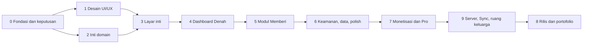

# Rizqflow — Roadmap

Breakdown proyek menjadi 15 tahap (0–14, plus v1.1 pasca-rilis), ditambah jalur pemasaran paralel Tahap P0–P4 di bagian akhir (strateginya di [pemasaran.md](pemasaran.md)). **File ini adalah status hidup** (diputuskan 2026-10-18, menggantikan tracking Notion): setiap pekerjaan nyata (commit, keputusan, riset, desain) langsung mengubah checkbox dan menambah catatan di sini, bukan di tempat lain.

Catatan progres dilakukan lewat skill `pengembangan-rizqflow` (lihat [CLAUDE.md](../CLAUDE.md)).

## Urutan dan ketergantungan

- Platform: **Android saja**, rilis di Google Play Store. Stack: **Kotlin + Jetpack Compose + Room** (2026-09-19).
- Arah visual: **opsi A**, pakai ulang identitas homepage roziqrizal.com (2026-09-19).
- Detail stack **disetujui 2026-09-20**: tiga modul Gradle (`:domain`, `:data`, `:app`), min SDK 26, DI manual, backup AES-GCM, tanpa SQLCipher untuk v1 (lihat [konsep.md](konsep.md)).
- Tahap 1 (desain) dan Tahap 2 (inti domain) bisa berjalan paralel setelah Tahap 0 selesai.
- **Server ikut rilis pertama** (diputuskan pemilik 2026-09-24): Tahap 9 tidak lagi opsional dan dikerjakan sebelum Tahap 8. Cakupan rilis 1: akun server, langganan Sync sejak rilis, sync terenkripsi antar-perangkat, ruang keluarga bersama, peran anggota, dan notifikasi anggota mencatat. Bot WhatsApp dan input AI berbasis LLM tetap sesudah rilis. Server di VPS milik pemilik (VPS Al-Kaukaba dulu, lihat [server-sync.md](server-sync.md)). Tahap 12 (infrastruktur server, dijalankan pemilik) dan Tahap 13 (enkripsi dan kunci) ditambahkan 2026-09-24 dan mendahului Tahap 9.
- Tahap 10 (fitur wajib dari riset pasar) dan Tahap 11 (input cerdas on-device) ditambahkan 2026-09-23. Keduanya tidak bergantung pada Tahap 8; urutan terhadap rilis ditentukan pemilik (usulan: butir High Tahap 10 sebelum rilis, sisanya sesudah).
- **Tahap 8 dikerjakan paling akhir** (keputusan pemilik 2026-10-24): semua yang butuh Play Console digeser ke sana. Bagian Tahap 8 di dokumen ini sengaja diletakkan setelah Tahap 14 mengikuti urutan kerja; nomornya dipertahankan supaya rujukan lama (CLAUDE.md, monetisasi.md, pemasaran.md, kode) tetap valid.

## Jalur ke rilis (ringkasan kerja tersisa, 2026-10-23)

Ringkasan ini **menyimpulkan, bukan menggantikan** checklist lengkap di tiap Tahap di bawah — dibuat untuk melihat jarak sebenarnya ke Tahap 8 (rilis) dalam satu pandangan. Diminta pemilik 2026-10-23 setelah target rilis 2 minggu disepakati di sesi lain; lihat "Catatan realita" di bagian bawah sebelum menganggap 2 minggu itu pasti cukup. **Diperbarui 2026-10-24** mengikuti progres hari itu (FLAG_SECURE, berkas CSV contoh, riset API harga emas dan library QR, login Google tersambung ke server) — detail lengkap tiap perubahan ada di checklist Tahap masing-masing, bukan diulang di sini. **Diperbarui lagi 2026-10-25**: token API yang kedaluwarsa dan alamat API yang bisa dikonfigurasi selesai di kode (Tahap 12), hanya terbukti lewat tes otomatis. **Diperbarui lagi 2026-10-25 (lanjutan)**: layar kode pemulihan dan alur pulihkan kunci selesai di kode (Tahap 13), hanya terbukti lewat tes otomatis dan baru memulihkan kunci akun yang saat ini tidak mengenkripsi apa pun. **Diperbarui lagi 2026-10-25 (sinkron entitas penuh)**: hanya Tahap 1 dari 7 (Fondasi: skema Room v8, pagar migrasi, pencatat perubahan, penyimpanan sinkron, amplop) yang selesai di kode, hanya terbukti lewat tes otomatis; mesin sinkron entitas belum ada, jadi jarak ke rilis di kelompok sinkron tidak berubah banyak, dan Tahap 2 menunggu keputusan pemilik #0 dan #2. Ditambahkan juga: `lintDebug` gagal dengan 78 error lama yang harus dibereskan sebelum rilis (butir Tahap 8).

**Urutan menuju rilis:** ~~Tahap 6~~ **Selesai** (2026-10-24) → Tahap 7 (dibuka lagi 2026-10-24 untuk langganan Sync lewat Billing, **ditutup lagi di hari yang sama**: Pro dan langganan Sync sudah selesai di kode, uji pembelian nyata keduanya ada di Tahap 8) → Tahap 9+12+13 (server, sync, enkripsi — **blocker terbesar**) → **Tahap 8 (semua yang butuh Play Console, dikerjakan paling akhir setelah tahap lain selesai — keputusan pemilik 2026-10-24)**. Tahap 10 dan 11 sudah cukup untuk rilis (semua butir High selesai; sisanya Pro/Low, boleh menyusul tanpa menahan rilis).

### Blocker terbesar yang belum jadi baris tersendiri di manapun

~~**Lapisan jaringan (HTTP client) Android**~~ **selesai 2026-10-24**: login, hapus akun, dan kini ruang keluarga (join/members/sync transaksi) semuanya beneran memanggil server lewat `AccountWorkspace` (lihat task Tahap 9). **Blocker yang tersisa sekarang**: uji Google Play Billing sungguhan (kode Pro dan langganan Sync selesai di Tahap 7 dan sudah diuji dengan gateway palsu, tetapi belum pernah menyentuh Play; butuh produk `rizqflow_pro` dan `rizqflow_sync` terdaftar — bergantung Play Console aktif, Tahap 8; verifikasi pembelian di server, kodenya selesai 2026-10-24, juga baru bisa dibuktikan setelah itu karena butuh akun layanan Play API dan RTDN) dan verifikasi manual di dua perangkat fisik untuk ruang keluarga (belum bisa dilakukan di mesin ini, lihat catatan `adb install` macet di Tahap 6/9) — keduanya lebih kecil dari "UI ruang keluarga dari nol" yang sebelumnya jadi blocker terbesar.

### Sisa kerja per kelompok

**Kode Android:**
- ~~Klien HTTP + penyimpanan token~~ **sudah ada** (2026-10-23), ~~login~~, ~~hapus akun Google~~, dan ~~trigger sync push/pull~~ **sudah tersambung** (2026-10-24, lihat task Tahap 9) — sisa: peran anggota, amplop bulanan, keluarkan anggota, notifikasi push
- ~~Layar tampilkan-sekali kode pemulihan + kirim kunci terbungkus ke server (Tahap 13)~~ dan ~~alur pulihkan di perangkat baru (Tahap 13)~~ **selesai di kode 2026-10-25** (`RecoveryKeyService`, `RecoverySetupScreen`, `RecoveryRestoreScreen`; hanya terbukti lewat tes otomatis) — **tetapi yang tersimpan baru kunci akun, yang saat ini tidak mengenkripsi apa pun, dan kunci ruang keluarga tidak ikut dibungkus**; sisa: keputusan pemilik soal kunci ruang (format versi 2) dan `FLAG_SECURE` layar tampil-sekali (butir Tahap 13), serta menjaga data lama saat pulihkan begitu sinkron entitas akun ada (Tahap 9)
- ~~Perender/pemindai QR sungguhan untuk undang pasangan~~ **diimplementasikan 2026-10-24** (`RuangKeluargaScreen`/`QrScanScreen`, CameraX + ML Kit + `qrcode-kotlin`, lihat task Tahap 9) — belum diuji manual di dua perangkat fisik
- ~~UI ruang keluarga bersama~~ **inti selesai 2026-10-24** (lihat task Tahap 9) — sisa: peran anggota + amplop bulanan (Tahap 9, Medium)
- Sinkron entitas penuh (Tahap 9, High): ~~fondasi~~ **Tahap 1 dari 7 selesai di kode 2026-10-25** (skema Room v8, pagar migrasi, pencatat perubahan, penyimpanan sinkron, amplop; hanya terbukti lewat tes otomatis) — sisa Tahap 2 sampai 7 (mesin generik, cakupan pribadi, entitas lanjutan, keluarkan anggota, sync otomatis, retensi); Tahap 2 menunggu keputusan pemilik #0 dan #2
- Wiring Firebase Cloud Messaging sungguhan (Tahap 13) — dependensi belum ditambahkan
- ~~Integrasi Google Play Billing untuk Pro, plus pulihkan pembelian (Tahap 7)~~ **kode Pro selesai 2026-10-24**, uji nyata di Tahap 8; ~~langganan Sync (SUBS) belum dikodekan~~ **langganan Sync (SUBS) selesai di kode 2026-10-24** (ikut rilis 1 per keputusan pemilik 2026-10-24, membalik pemindahan ke 1.1 di hari yang sama), diuji dengan gateway palsu; uji nyata di Tahap 8
- ~~Info lembut profil haul tambahan, laporan/insight, widget, tema (Tahap 7)~~ **selesai di kode 2026-10-24**; harga emas otomatis dipindah ke Versi 1.1 setelah rilis; multi-mata uang dipindah ke Versi 1.1 setelah rilis

**Kode server (ada, tapi belum lengkap):**
- ~~Catat dan verifikasi pembelian Pro/Sync — Play Developer API + notifikasi waktu nyata (Tahap 9, High)~~ **selesai di kode 2026-10-24** (`server/app/Play/`, `POST /api/purchases/claim`, `POST /api/play/notifications`, `play:reconcile`; Android melapor lewat `PurchaseClaimCoordinator`) — hanya terbukti lewat tes dengan klien Play palsu; sisa: akun layanan Play dan RTDN (Tahap 8), cron `schedule:run` dan variabel `PLAY_*` di VPS (Tahap 12), uji nyata (Tahap 8), token langganan pengganti dan jalur cadangan refund (butir baru Tahap 9)
- ~~Filter akses pull berdasarkan keanggotaan ruang keluarga~~ **selesai 2026-10-24** (tabel `room_members`, lihat task Tahap 9)
- ~~Token API yang kedaluwarsa dan bisa dicabut (Tahap 12, High)~~ **selesai di kode 2026-10-25** (`ApiTokenService`, `config/sanctum.php` yang sebelumnya tidak ada, `POST /api/auth/refresh`/`logout`, `DELETE /api/auth/tokens`, `sanctum:prune-expired`; Android memutar token lewat `TokenRefresher` dan menangani 401 lewat `ServerSession`) — hanya terbukti lewat tes otomatis; sisa: cron `schedule:run` untuk prune, IP asli di VPS untuk throttle login, keputusan masa tenggang rotasi (pemilik), daftar perangkat di Profil (Tahap 14)
- Endpoint yang mengirim push notifikasi sync (Tahap 9, 13)
- Metrik pengguna anonim (Tahap 9, Medium)

**Infrastruktur, kerja pemilik sendiri (Tahap 12):**
- Subdomain `rizqflow-api.roziqrizal.com` + SSL — baru relevan begitu kerja Tahap 9 di atas mulai
- Salin konfigurasi Nginx site ke repo (baru ada di VPS)
- Uji restore backup database `rizqflow` (backup terjadwal sudah jalan, restore belum pernah dicoba)
- Periksa IP asli terbaca lewat Cloudflare dan nginx (`trustProxies`) untuk throttle login API, dan putuskan masa tenggang token lama setelah rotasi (keduanya butir baru Tahap 12, 2026-10-25)
- Cron `schedule:run` kini melayani dua perintah terjadwal: `play:reconcile` (03:30) dan `sanctum:prune-expired` (03:45)

**Verifikasi manual yang masih berutang (kode sudah selesai, belum dibuktikan):**
- ~~Tahap 6: restore cadangan di perangkat fisik lain; file ekspor CSV dibuka di Sheets/Excel sungguhan~~ **selesai dikonfirmasi 2026-10-24** — restore di dua HP fisik menghasilkan data identik, CSV terbuka normal di Excel/Sheets; Tahap 6 ditutup Selesai (lihat Status Tahap 6)
- Tahap 13: **semua tes kripto yang lulus di Robolectric belum membuktikan Android Keystore sungguhan** — Tink diam-diam jatuh ke penyimpanan cleartext saat Keystore gagal di lingkungan tes, jadi "aman karena Keystore" baru boleh dipercaya setelah dicoba di emulator/perangkat dengan Keystore asli (lihat catatan JDK di CLAUDE.md)
- Tahap 13 (ditambahkan 2026-10-25): **layar kode pemulihan dan alur pulihkan belum pernah dicoba di perangkat atau emulator, di MySQL, atau terhadap server hidup** — hanya terbukti lewat tes otomatis (SQLite di memori, remote dan penyimpanan palsu, Robolectric yang jatuh ke cleartext); layar Compose, Back, rotasi, dialog berlapis, papan ketik, dan pembaca layar hanya lolos kompilasi, waktu PBKDF2 300.000 iterasi di ponsel sungguhan belum diukur, dan kunci akun yang dipulihkan saat ini belum mengenkripsi apa pun (daftar lengkap di dua butir Tahap 13)
- Tahap 9 (ditambahkan 2026-10-24): **verifikasi pembelian di server belum pernah menyentuh Google Play, server hidup, atau perangkat** — kode server dan Android selesai dan teruji hanya dengan klien palsu; bentuk jawaban Play asli, token OIDC Pub/Sub sungguhan, refund Pro, dan masa tenggang langganan masih asumsi (daftar di butir Tahap 9 dan Tahap 8 "Uji verifikasi pembelian server dengan pembelian nyata")
- Tahap 9: **ruang keluarga (join, undang QR, sync transaksi) belum pernah dicoba ujung-ke-ujung di dua perangkat sungguhan** — `adb install` macet permanen di mesin ini (sama isu dengan verifikasi Tahap 6), jadi baru terbukti lewat kompilasi dan tes otomatis, belum lewat alur scan-QR-ke-QR nyata antara dua akun Google berbeda
- Tahap 9 (ditambahkan 2026-10-25): **fondasi sinkron entitas penuh (Tahap 1 dari 7) belum pernah dijalankan di perangkat atau emulator** — migrasi Room 7 ke 8 dan `PreMigrateGuard` hanya terbukti lewat Robolectric dan SQLite JVM; belum dicoba pada data besar, Android 8 (SQLite 3.18), database WAL sungguhan, ruang penuh, atau dengan ukuran performa (tiap penulisan kini +1 transaksi pembungkus dan beberapa query; impor CSV 10 ribu baris belum diukur); vektor emas amplop belum dijalankan di klien web atau PHP (daftar lengkap di butir "Sinkron entitas selain pengeluaran")
- Tahap 12 (ditambahkan 2026-10-25): **token API yang kedaluwarsa dan alamat API yang bisa dikonfigurasi belum pernah dicoba di perangkat atau emulator, di MySQL, atau terhadap server hidup** — hanya terbukti lewat tes otomatis (SQLite di memori, remote palsu) dan manifest gabungan yang dibaca langsung; cleartext debug belum dibuktikan dengan panggilan http sungguhan, deadlock InnoDB dan penerbitan token di MySQL belum teruji, dan penyambungan Compose di `AppRoot`/`MainHost` hanya lolos kompilasi (daftar lengkap di butir Tahap 12)

**Pemasaran berjalan paralel sejak 2026-10-24** (jalur Tahap P0–P4 di akhir file, strategi di [pemasaran.md](pemasaran.md)): daftar tunggu dan konten dibangun sekarang supaya saat rilis sudah ada orang yang menunggu; P2 (beta) dan P3 (rilis) menumpang uji tertutup dan rilis Tahap 8.

**Tahap 8 (birokrasi rilis) — dikerjakan PALING AKHIR** (keputusan pemilik 2026-10-24, menggantikan saran lama "mulai paralel, bukan di akhir"). Risiko yang diterima: masa tunggu di luar kendali (review Google, dan uji tertutup bila akun ternyata kena syarat 20 penguji/14 hari) baru mulai setelah tahap lain selesai; kemungkinannya kecil karena akun ini sudah punya aplikasi Production (Al-Kaukaba). Isinya:
- ~~Akun developer Play Console~~ **sudah ada** (dipakai sejak Al-Kaukaba, dikonfirmasi 2026-10-23) — tinggal tambah aplikasi Rizqflow baru di konsol yang sama. Yang masih perlu dicek: profil pembayaran untuk terima hasil penjualan (mungkin belum pernah disiapkan kalau Al-Kaukaba gratis), dan apakah akun ini sudah lewat syarat uji tertutup developer baru dari riwayat Al-Kaukaba
- Kebijakan privasi + deklarasi data safety (menyebut server dan UU PDP — lihat catatan "Konsekuensi" di Tahap 9)
- Uji tertutup Play Console (ada masa tunggu/syarat jumlah penguji)
- Store listing, case study roziqrizal.com, README Inggris, video demo

### Keputusan yang masih punya pemilik (jangan dikerjakan sebelum dijawab)

- ~~Cara browser web mendekripsi data sync e2e~~ **diputuskan 2026-10-24: kode pemulihan 24 kata** ([konsep.md](konsep.md), butir "Desain web baru"); sisanya **diputuskan 2026-10-24 (pemilik setuju usulan)**: kunci hanya di memori tab, kunci otomatis sekitar 15 menit, penurunan kunci mengikuti `RecoveryCode` dan `AccountKeyRecoveryCrypto`
- ~~Metode masuk web~~ **diputuskan 2026-10-24: email+sandi dan Google** (mengikuti mockup, mencabut keputusan 2026-10-18; [konsep.md](konsep.md)). Masih terbuka: penyedia pengiriman email untuk kode verifikasi dan reset sandi di produksi
- Kebijakan haul saat harta turun di bawah nisab di tengah tahun (fikih, perlu rujukan kitab)
- Kunci ruang keluarga ikut bungkusan kode pemulihan sebagai format versi 2 sebelum rilis, atau menerima undang ulang lewat QR setelah pulih (butir Tahap 13, 2026-10-25)
- `FLAG_SECURE` khusus layar tampil-sekali kode pemulihan, batas waktu kode di memori saat ke latar, dan penyeragaman `KeyboardType` (butir Tahap 13, 2026-10-25); verifikasi 3 kata dan gating `PUT` butuh Sync, `GET`/`DELETE` tidak, adalah usulan Claude yang belum dikonfirmasi
- Harga final Pro (placeholder Rp129rb, belum final)
- ~~Firebase Analytics dipakai atau tidak~~ **diputuskan 2026-10-24: dipakai di rilis 1**, bersama FCM (tanpa data keuangan di event; lihat Tahap 9, butir "Metrik pengguna anonim")

### Keputusan scope rilis (2026-10-23): Opsi A

Pemilik memilih **Opsi A** — pertahankan keputusan 24 Sept, rilis 1 tetap mencakup Sync + ruang keluarga. Konsekuensi: target waktu realistis **4-8 minggu** paruh waktu di sela kantor (dominan karena lapisan jaringan Android + Play Billing + ruang keluarga UI dari nol, di luar masa tunggu review Google di Tahap 8) — **bukan 2 minggu seperti target awal di sesi sebelumnya**; target waktu perlu direvisi mengikuti ini. Rentang 4 vs 8 minggu bergantung seberapa banyak polish Tahap 7 (laporan/insight, multi-mata uang, widget, tema) ikut dipangkas — itu bisa dikurangi tanpa melanggar alasan 24 Sept, karena yang disebut di sana cuma soal Sync/server/privasi, bukan fitur kosmetik Pro.

**Ditegaskan 2026-10-24:** Sync dan ruang keluarga tetap masuk rilis 1, dan **semua pekerjaan sync harus selesai sebelum rilis** (pemilik menegaskan Opsi A; pemindahan Sync ke 1.1 yang sempat disetujui di hari yang sama dibatalkan). Konsekuensi: langganan Sync lewat Billing masuk Tahap 7 lagi (**selesai di kode di hari yang sama**, lihat Tahap 7), Firebase (FCM dan Analytics) ikut rilis 1, dan butir sync yang tadinya "ditunda ke putaran berikutnya" kini wajib (rinciannya di Tahap 9).

### Urutan kerja berikutnya dan tindakan pemilik (2026-10-24)

Dicatat supaya sesi baru bisa melanjutkan dari dokumen, bukan dari ingatan percakapan. **Urutan di bawah adalah usulan Claude, belum dikonfirmasi pemilik** (pemilik belum menjawab "mulai dari mana"). Semua pekerjaan Claude di sini hanya bisa dibuktikan lewat tes otomatis (dan screenshot Playwright untuk web), bukan di perangkat, karena `adb install` macet di mesin pengembang; tiap butir harus dicatat jujur sebagai "belum diuji di perangkat".

**Bisa dikerjakan Claude tanpa menunggu pemilik, urut ketergantungan:**
1. ~~Tahap 7: langganan Sync lewat Play Billing (SUBS), diuji dengan gateway palsu~~ **selesai di kode 2026-10-24** (belum diuji dengan pembelian nyata dan belum dilihat di perangkat; lihat Tahap 7)
2. ~~Tahap 9: verifikasi pembelian di server (Pro dan Sync) dan tautan token ke akun; Android mengirim token setelah masuk~~ **selesai di kode 2026-10-24** (server dan Android; belum diuji terhadap Play sungguhan, server hidup, atau perangkat, dan akun layanan Play, RTDN, serta cron belum disiapkan; lihat Tahap 9, daftar BELUM di butirnya)
3. ~~Tahap 12: token API yang kedaluwarsa dan bisa dicabut; alamat API yang bisa dikonfigurasi dan varian build untuk HP fisik~~ **selesai di kode 2026-10-25** (server dan Android, plus varian build debug HP fisik; hanya terbukti lewat tes otomatis, tidak pernah diuji di perangkat atau emulator, di MySQL, atau terhadap server hidup; rincian dan daftar BELUM di butirnya di Tahap 12, sisanya jadi butir baru: IP asli di VPS dan masa tenggang rotasi di Tahap 12, daftar perangkat yang masuk di Tahap 14)
4. ~~Tahap 13: layar kode pemulihan, endpoint dan penyimpanan kunci terbungkus di server, alur pulihkan di perangkat baru~~ **selesai di kode 2026-10-25** (server `/api/account/recovery-key`, Android `RecoveryKeyService` dan dua layar; hanya terbukti lewat tes otomatis, tidak pernah diuji di perangkat, Android Keystore asli, MySQL, atau server hidup; **yang dipulihkan baru kunci akun, yang saat ini tidak mengenkripsi apa pun, dan kunci ruang keluarga tidak ikut dibungkus**; rincian dan daftar BELUM di butirnya di Tahap 13, sisanya jadi butir baru: keputusan pemilik kunci ruang ke bungkusan versi 2 dan `FLAG_SECURE` layar tampil-sekali di Tahap 13, deploy migrasi `recovery_keys` di Tahap 12)
5. Tahap 9: sinkron entitas selain pengeluaran — **Tahap 1 dari 7 (Fondasi) selesai di kode 2026-10-25** (skema Room v8, `PreMigrateGuard`, `SyncRecorder`, `SyncStore`, `SyncEnvelope`, dan lainnya; `:domain` 855 menjadi 902, `:data` 243 menjadi 330, `:app` 356 tetap, 0 gagal; hanya terbukti lewat tes otomatis, migrasi belum dicoba di perangkat; desain masih usulan Claude, [sync-desain.md](sync-desain.md)). **Berikutnya Tahap 2, yang menunggu keputusan pemilik #0 (akun anggota virtual) dan #2 (pengeluaran pasangan ikut "terpakai" ruang) sebelum UI-nya** (butir di Tahap 9). Butir 5 belum dicoret, tersisa Tahap 2 sampai 7
6. Tahap 9: sinkron penghapusan, keyset baru ke anggota yang tetap, sync otomatis
7. Tahap 9: konfirmasi tambahan Hapus akun, metrik anonim sisi server
8. Tahap 14 (jalur paralel lewat subagen `rizqflow-worker`, tidak menyentuh file Android): kekurangan Pro di web (laporan tahunan, insight, PDF, tema, banner Trader)
9. Tahap 14: endpoint email+sandi untuk akun server Android dan layar masuk Android
10. Tahap 11: input suara, lalu OCR struk dan OCR mutasi/e-statement (akurasi baru bisa diukur setelah pemilik menyediakan contoh)
11. Tahap 13: tes aturan akun lintas ruang
12. Tahap 14: butir Low dari mockup dan sembilan butir "Kesejajaran web dengan Tahap 8–13" yang tidak menunggu protokol
13. Tahap 14: sinkron data asli di web. **Terakhir**, setelah butir 4 dan 5 final supaya format protokolnya sudah tetap

**Menunggu pemilik:**
- Proyek Firebase untuk `com.roziqrizal.rizqflow` dan `google-services.json` (menahan wiring FCM, notifikasi anggota mencatat, dan Firebase Analytics)
- Brevo SMTP di produksi (DNS dan kunci rahasia)
- VPS: uji restore backup ke database uji, salin konfigurasi Nginx ke repo, DNS dan SSL `rizqflow-api`, cron `schedule:run` supaya `play:reconcile` dan `sanctum:prune-expired` berjalan, dan (setelah verifikasi pembelian di-deploy) variabel `PLAY_*` di `.env.production` beserta migrasi `play_purchases` (nama variabel di butir Tahap 12; akun layanan Play API dan RTDN ada di Tahap 8)
- Periksa di VPS bahwa IP asli pengguna terbaca (`trustProxies`, Cloudflare, nginx) supaya throttle login 30 per menit per IP tidak berlaku untuk semua pengguna sekaligus (butir Tahap 12, ditambahkan 2026-10-25)
- Saat server di-deploy: migrasi `recovery_keys` dan `route:cache` ulang untuk rute `/api/account/recovery-key`, serta periksa `client_max_body_size` Nginx dan `post_max_size` PHP (butir Tahap 12, ditambahkan 2026-10-25)
- Putuskan kunci ruang keluarga ke bungkusan versi 2 dan `FLAG_SECURE` layar tampil-sekali (dua butir Tahap 13, ditambahkan 2026-10-25)
- Putuskan keputusan #0 (akun anggota virtual menggantikan pencocokan akun lokal) dan #2 (pengeluaran pasangan ikut "terpakai" ruang, bukan saldo) sebelum UI Tahap 2 sinkron entitas penuh (dua butir Tahap 9, ditambahkan 2026-10-25; keputusan lain #1 dan #3 sampai #16 ada di [sync-desain.md](sync-desain.md) bagian J)
- Putuskan masa tenggang token API lama setelah rotasi, dan apakah sesi perlu batas keras umur (butir Tahap 12, keputusan keamanan, ditambahkan 2026-10-25)
- Sesi uji dua HP fisik dengan APK debug dipasang manual: bagian A (widget, PDF, tema, grafik, Keystore) bisa sekarang, bagian B (QR dan sinkron) setelah API hidup (cara membangun APK debug yang mengarah ke server lain: butir Tahap 9 "Sesi uji dua HP fisik")
- Sekitar 30 contoh OCR yang disamarkan (nanti, saat OCR siap diukur)
- Rancangan peran anggota dan amplop bulanan: Claude menulis usulan rancangan, pemilik menyetujui, baru dikodekan (hak tiap peran belum didefinisikan di mana pun)
- Tiga usulan web yang belum diputuskan (lihat Tahap 14, butir "Kesejajaran web dengan Tahap 8–13") dan konfirmasi sync otomatis (Tahap 9)
- Harga final Pro; seluruh Tahap 8 (Play Console); jalur pemasaran P0–P4

**Risiko yang berlaku sekarang:** web yang sudah live (`rizqflow.roziqrizal.com`) menyimpan data pencatatan dalam bentuk terbaca di server (scaffold), sedangkan produk menjanjikan data terenkripsi. Selama sinkron terenkripsi belum ada, jangan promosikan web ke publik dan arahkan daftar tunggu ke aplikasi, bukan ke web.

### Urutan eksekusi yang disarankan (lintas-Tahap, berdasar ketergantungan nyata)

**Sekarang juga, paralel (tidak saling menunggu):**
- ~~Tambah aplikasi Rizqflow baru di akun Play Console yang sudah ada (dipakai sejak Al-Kaukaba); cek profil pembayaran dan status syarat uji tertutup developer baru (Tahap 8)~~ — **digeser ke akhir (2026-10-24)**: profil pembayaran sudah telanjur diurus pemilik (status In review); sisanya menunggu Tahap 8
- Salin konfigurasi Nginx ke repo + uji restore backup (Tahap 12) — tidak butuh kode baru
- Jalankan tes kripto Tahap 13 yang sudah ada di emulator/perangkat dengan Keystore asli (bukan cuma Robolectric) — membuktikan klaim "aman" yang masih tertunda

**Sudah selesai (2026-10-23):**
- ~~Bangun lapisan HTTP client Android~~ — selesai (`AccountRemote`/`SyncRemote`/`ApiTokenStore` + implementasi Retrofit, lihat task baru di Tahap 9), 13 tes hijau.

**Sudah selesai (2026-10-24):**
- ~~2 verifikasi manual Tahap 6 (restore di 2 HP fisik, buka CSV di Excel/Sheets)~~ — keduanya hasil baik, Tahap 6 ditutup **Selesai**
- ~~Login Google disambungkan ke server~~ — 2 keputusan pemilik dijawab (klien HTTP per `AccountWorkspace`, `GoogleAuthProvider` diubah menangkap dan meneruskan `idToken`) dan dikerjakan sekaligus, lihat task baru Tahap 9
- ~~Hapus akun disambungkan ke server~~ — baris baru di menu Lainnya, lihat task baru Tahap 9.
- ~~Riset sumber API harga emas~~ dan ~~pilih library QR scanner~~ — selesai diriset (kandidat Emas API ID untuk emas; ML Kit+CameraX/`qrcode-kotlin` untuk QR), harga emas belum final/diimplementasi (Tahap 7); QR **sudah diimplementasikan** (lihat baris di bawah)
- ~~FLAG_SECURE dihapus~~ — keputusan pemilik: kontrol screenshot/share data jadi di tangan user (Tahap 6, commit `7d88d9e`), termasuk tulis ulang bullet layar masuk S30 (commit `bd55957`)
- ~~Ruang keluarga bersama: join/undang QR/daftar anggota/sync transaksi~~ — inti selesai, lihat task Tahap 9. Belum diuji manual di dua perangkat fisik (`adb install` macet di mesin ini)

**Sudah selesai (2026-10-25):**
- ~~Token API yang kedaluwarsa dan bisa dicabut~~ dan ~~alamat API yang bisa dikonfigurasi, plus varian build debug untuk HP fisik~~ — selesai di kode (Tahap 12, lihat dua butirnya), hanya terbukti lewat tes otomatis; belum diuji di perangkat, MySQL, atau server hidup. Menurunkan satu hambatan sesi uji dua HP (bagian B, Tahap 9): APK debug kini bisa diarahkan ke server lain tanpa mengubah kode
- ~~Layar tampilkan-sekali kode pemulihan 24 kata, kirim kunci akun terbungkus ke server~~ dan ~~alur pulihkan kunci di perangkat baru~~ — selesai di kode (Tahap 13, lihat dua butirnya), hanya terbukti lewat tes otomatis (server 1012 menjadi 1059, `:domain` 785 menjadi 855, `:data` 198 menjadi 243, `:app` 328 menjadi 356; 0 gagal). **Jujur soal cakupan:** kunci akun yang dipulihkan saat ini tidak mengenkripsi apa pun (sync yang ada hanya transaksi pengeluaran ruang keluarga dengan kunci ruang, dan kunci ruang tidak ikut dibungkus), jadi pulihkan di perangkat baru belum mengembalikan data; belum diuji di perangkat, Android Keystore asli, MySQL, atau server hidup
- Fondasi sinkron entitas penuh, Tahap 1 dari 7 (Tahap 9) — selesai di kode: skema Room v8 (`sync_record`, `sync_cursor`, `sync_issue`, `shared_room`, `account.shared_from`, `TransactionOrigin.SHARED`), `PreMigrateGuard`, `SyncRecorder`, `RoomSyncStore`, `SyncBootstrap`, `SyncEnvelope` dan kelas `:domain/sync` lain (`:domain` 855 menjadi 902, `:data` 243 menjadi 330, `:app` 356 tetap; 0 gagal). **Hanya terbukti lewat tes otomatis**; butir Tahap 9 "Sinkron entitas selain pengeluaran" tetap terbuka (Tahap 2 sampai 7 belum). Desainnya masih usulan Claude

**Sekarang (lanjutan langsung, sebagian bisa paralel):**
- ~~Alur kode pemulihan: tampilkan sekali, kirim ke server, pulihkan di perangkat baru~~ **selesai di kode 2026-10-25** (lihat butir 4 di atas); sisa: keputusan pemilik soal kunci ruang dan `FLAG_SECURE`, dan uji di perangkat
- Peran anggota keluarga + amplop bulanan, keluarkan anggota (redistribusi keyset), notifikasi push "anggota mencatat"
- Wiring Firebase Cloud Messaging + endpoint server yang mengirim push
- Sync untuk entitas selain transaksi pengeluaran (transfer, pemasukan, utang-piutang, tagihan, transaksi berulang, akun, kategori, aturan alokasi) dan penghapusan transaksi di ruang yang dibagi

**Begitu Play Console aktif — kini dikerjakan di Tahap 8, paling akhir (keputusan pemilik 2026-10-24; sebelumnya disarankan jalan di latar belakang sejak awal):**
- Daftarkan produk in-app Pro dan Sync
- Integrasi Google Play Billing sungguhan (Tahap 7) dan verifikasi pembelian di server (kodenya selesai di Tahap 9 2026-10-24; yang tersisa di sini: akun layanan Play API, RTDN, dan uji dengan pembelian nyata, lihat Tahap 8)
- Subdomain `rizqflow-api.roziqrizal.com` + SSL (Tahap 12)

**Terakhir, sebelum submit:**
- Uji alur pembelian dengan penguji lisensi
- ~~Sisa polish Tahap 7 (info profil haul, laporan/insight, widget, tema)~~ — selesai di kode 2026-10-24; tinggal verifikasi manual di perangkat (butir di Tahap 8). Multi-mata uang dipindah ke Versi 1.1 setelah rilis
- Kebijakan privasi + data safety, uji tertutup Play Console, store listing, case study

## Tahap 0 — Fondasi dan keputusan (In Progress)

Menetapkan keputusan yang menentukan arah teknis dan bisnis sebelum kode ditulis.

- [x] Diskusi konsep, posisi produk, dan nama Rizqflow
- [x] Buat repo dan dokumen konsep awal
- [x] Rumuskan model bisnis freemium ([monetisasi.md](monetisasi.md))
- [x] Susun breakdown tahap, spesifikasi layar, dan flow UI
- [x] Pasang tracking Notion, skill `pengembangan-rizqflow`, dan CLAUDE.md repo (tracking Notion **dihentikan 2026-10-18**, diganti markdown repo — lihat CLAUDE.md bagian "Status dan tracking")
- [x] Putuskan platform: Android, rilis di Play Store (2026-09-19); **diperluas 2026-10-18** — web juga dibuat, lihat Tahap 14
- [x] Putuskan stack Android: Kotlin + Jetpack Compose + Room (2026-09-19)
- [x] Setujui detail stack Android: modul, min SDK 26, DI manual, enkripsi (2026-09-20)
- [x] Cek ketersediaan nama (2026-09-21): pencarian "rizqflow" di Google Play dan pangkalan merek DJKI tanpa hasil; rizqflow.com dipegang pihak lain, rizqflow.app dan .id bebas ([konsep.md](konsep.md))
- [x] Putuskan sumber harga emas: input manual (gratis), otomatis lewat API (Pro); riset API dilakukan di Tahap 7 (2026-09-20)
- [x] Putuskan kalender Hijriyah untuk haul: Umm al-Qura di balik antarmuka `HijriCalendar`; hisab Al-Kaukaba bisa menyusul (2026-09-21)
- [x] Tetapkan asumsi fikih default zakat mal: 85 g emas, 2,5%, haul 1 tahun Hijriyah (2026-09-20); default sementara, menunggu verifikasi kitab oleh pemilik
- [ ] Validasi minat lewat landing page dan daftar tunggu
  - [x] Landing page dan form daftar tunggu dibangun (2026-10-24, repo `roziqrizalcom` commit `6bdedd5`): `/karya/rizqflow` di roziqrizal.com, kartu baru di homepage Karya. Hero pakai ilustrasi konsep alokasi (Memberi/Diri/Keluarga/ruang lain), bukan tangkapan layar, karena aplikasinya belum dibangun. Form email (`POST /waitlist/{project}`, tabel baru `waitlist_signups`, unik per project+email, ditulis generik untuk dipakai proyek Karya lain juga) menyimpan ke database, lalu menampilkan pesan terima kasih; duplikat email tidak menggandakan baris. 5 tes fitur hijau, diverifikasi juga manual lewat curl ke server dev (submit nyata → redirect `#daftar-tunggu` → pesan tampil → baris tersimpan). **Live** di roziqrizal.com sejak 2026-10-24 (deploy + migrasi produksi terverifikasi lewat submit nyata ke https://roziqrizal.com/karya/rizqflow). **Belum**: trafik dan pendaftar sungguhan — item utama ini baru tertutup kalau sudah ada sinyal minat nyata, bukan cuma halamannya berdiri dan live. Ambang "minat tervalidasi" belum ditentukan pemilik

## Tahap 1 — Desain UI/UX (Selesai)

Spesifikasi teks sudah ada di [ui-flow.md](ui-flow.md); tahap ini mengubahnya menjadi desain visual.

- [x] Putuskan arah visual: opsi A, pakai ulang identitas homepage (2026-09-19)
- [x] Tetapkan design tokens dan komponen dasar ([design/tokens.css](design/tokens.css))
- [x] Wireframe seluruh layar (S01–S31), termasuk keadaan kosong ([wireframe.md](wireframe.md), 2026-09-21)
- [x] Hi-fi layar kunci: Denah, Catat + Pratinjau alokasi, Detail ruang, Kartu haul (prototipe HTML di [design/](design/README.md); disetujui pemilik 2026-09-20)
- [x] Prototipe klik untuk flow F1–F9 dan seluruh layar S01–S28 (2026-09-21); pembayaran, izin, dan notifikasi tetap disimulasikan
- [x] Uji prototipe dengan pola data nyata dari Transaksi Harian di Ruang Finansial (2026-09-21): dua perbaikan tata letak di teks 200% dan temuan model data (lihat [design/README.md](design/README.md) dan [model-data.md](model-data.md))

## Tahap 2 — Inti domain, tanpa UI (Selesai)

Logika bisnis yang benar dan teruji sebelum ada layar.

- [x] Rancang model data dan skema penyimpanan lokal: [model-data.md](model-data.md), skema Room versi 1 di `:data` dengan berkas skema JSON (2026-09-21)
- [x] Value object Money (bilangan bulat, aritmetika eksak) (2026-09-20)
- [x] Aturan pembulatan alokasi: metode sisa terbesar, prioritas sebagai pemutus seri (2026-09-21)
- [x] Rule engine alokasi persentase: `AllocationEngine`, basis point, 20 tes (2026-09-21)
- [x] Definisikan arti "terpenuhi" per tipe ruang, ambang 85% untuk Mencukupi (2026-09-20, lihat [konsep.md](konsep.md))
- [x] Strategi modul Memberi: `zakat-haul-hijri` dan `percentage` (2026-09-21)
- [x] Kalkulator nisab dan haul Hijriyah, dengan dua kebijakan haul yang bisa diganti (2026-09-21)
- [x] Strategi unit test domain: [strategi-unit-test.md](strategi-unit-test.md), ditulis dari nol (2026-09-21)
- [x] Stub lapisan entitlement: `Entitlements`, `Feature`, `Plan`, `PlanEntitlements` (2026-09-21)
- [x] Setup proyek Android: modul domain terpisah, unit test, CI dasar (2026-09-20; CI pertama di GitHub hijau, 2026-09-20)
- [x] Lapisan buku kas: layanan onboarding, pencatatan, dan aturan alokasi di `:domain`; repositori Room dan satu database per akun di `:data`; 268 tes hijau (2026-09-21, lihat [model-data.md](model-data.md))

**Selesai bila:** unit test hijau untuk alokasi, nisab, dan haul (termasuk kasus tepi); tidak ada floating point untuk uang; skema penyimpanan punya jalur migrasi.

**Status 2026-09-21:** semua kriteria terpenuhi (82 tes domain hijau, skema Room versi 1 dengan berkas skema JSON dan larangan migrasi destruktif). Android Studio Quail 4 sudah terpasang dan build dengan JDK bawaannya lulus; image emulator API 37 sudah ada dan aplikasi berjalan di emulator (2026-09-21).

## Tahap 3 — Layar inti: onboarding, catat, transaksi (Selesai)

- [x] Tema Compose dari design tokens (warna terang dan gelap, font Manrope dan Libre Caslon Text, warna ruang dan status) dan kerangka navigasi (bottom nav empat tab, tombol Catat) (2026-09-21)
- [x] Splash dan halaman masuk dengan Google dan Gmail (S29, S30), riwayat masuk, dan ikon aplikasi (2026-09-21); proyek Google Cloud dan client ID sudah dibuat, masuk dengan Google teruji di emulator (2026-09-21); izin Gmail belum disiapkan ([auth-google.md](auth-google.md))
- [x] Masuk dengan nama pengguna dan sandi serta halaman Daftar (S30, S31): akun lokal dengan hash PBKDF2, tanpa server (2026-09-21)
- [x] Onboarding S02–S04 (S01 digantikan S30): pola ruang, pembagian persen (total selalu 100%), akun pertama dengan papan angka; Mulai kosong melewati langkah persentase; tiap akun membuka database sendiri (2026-09-21)
- [x] Catat transaksi (S06): tab Pemasukan, Pengeluaran, Transfer; ruang, kategori, akun, tanggal, catatan; banner lembut bila jatah bulan itu terlampaui; snackbar Urungkan (2026-09-21). Chip "Terakhir" dan "Jadikan favorit" menunggu S24
- [x] Pratinjau alokasi (S07): rezeki terlihat mengalir sebelum disimpan, "Ubah sekali ini" (aturan tidak berubah), bagian belum dialirkan (2026-09-21)
- [x] Daftar transaksi dan detail/edit (S08–S09): per bulan dan tanggal, cari catatan dan nominal, filter jenis, sheet saringan akun/ruang/kategori; detail memakai layar Catat (ubah semua kolom; nominal pemasukan dihitung ulang dengan potret alokasi), hapus dengan konfirmasi, Urungkan setelah ubah dan hapus (2026-09-21). Banner hari kosong dan baris draf menunggu Tahap 6 dan v1.1
- [x] Daftar ruang dan aturan alokasi (S10, S12): urutan naik/turun (= prioritas sisa pembulatan), arsipkan dan pulihkan (persen kembali 0%), tambah ruang (batas 5 ruang gratis; kategori awal Lain-lain dan Tak terlacak), pola Tiga hak untuk akun kosong, banner bila total bukan 100%; Aturan alokasi dengan slider dan +/- 1% untuk semua ruang, simpan hanya bila pas 100%, Buang perubahan?, Urungkan (2026-09-21). Aturan lanjutan (Pro) baru berupa pesan; status per ruang menunggu Tahap 4
- [x] Kelola akun, kategori, dan favorit (S13): tab Akun (tambah dengan saldo awal, ubah nama dan jenis, arsipkan, pulihkan, batas 3 akun gratis, dicabut 2026-09-24: lihat Tahap 10), tab Kategori per ruang (tambah, ganti nama, arsipkan; kategori sistem terkunci; ruang selalu punya satu kategori biasa), tab Favorit (ubah nama dan nominal, hapus, paling banyak 6); "Jadikan favorit" di Catat untuk pengeluaran baru (2026-09-21). Akun dan kategori hanya diarsipkan, tidak dihapus. Urutan favorit otomatis menurut pemakaian karena skema belum punya kolom urutan (seret untuk mengurutkan ditunda). Cocokkan saldo menunggu S25 (Tahap 6)
- [x] Catat kilat (S24): bottom sheet pengeluaran cepat dari pintasan ikon (tekan lama) dan tile Quick Settings; ketuk favorit langsung menyimpan dengan Urungkan, atau ketik nominal (ruang dan kategori terakhir, akun bisa dipilih); teruji di emulator (2026-09-21). Widget masuk Pro (Tahap 7); tindakan di notifikasi malam menunggu S26 (Tahap 6); chip favorit di layar Catat penuh ditunda
- [x] Mode demo dengan data contoh (S22): dari Coba data contoh di Denah kosong atau menu Lainnya; database demo terpisah yang diisi tiga ruang, tiga akun, dua bulan transaksi, dan empat favorit, lalu dihapus saat keluar; penanda Mode demo di header Denah (2026-09-21). Tema dan bahasa (bagian lain S22) menyusul di Tahap 6

**Selesai bila:** flow F1–F4 berjalan end-to-end tanpa jaringan; data bertahan; setiap layar punya empty state.

**Status 2026-09-21:** semua kriteria terpenuhi: onboarding, catat pemasukan dan pengeluaran dan transfer, ubah aturan alokasi, kelola akun dan kategori dan favorit, dan mode demo berjalan di emulator tanpa jaringan; data tersimpan di Room; tiap layar punya keadaan kosong. Yang ditunda ke tahap lain tercatat di butir masing-masing di atas.

## Tahap 4 — Dashboard Denah (Selesai)

- [x] Denah: ringkasan, grid ruang, perlu perhatian (S05): rezeki bulan ini dengan bar pembagian, kartu ruang (cincin, sisa, status ikon plus teks), Perlu perhatian maksimal 3 butir, navigator bulan, keadaan kosong; teruji di emulator (2026-09-21). Belum ada: tanggal Hijriyah dan butir haul (Tahap 5), butir saldo belum dicocokkan (Tahap 6), mode demo dari keadaan kosong (S22), kartu bisa dibuka ke S11
- [x] Detail ruang (S11): cincin progres, terpakai dari jatah, status ikon plus teks dengan penjelasan arti per tipe, pos dengan batang (pembanding: irisan jatah menurut bobot, kosong = seluruh jatah ruang), lima pengeluaran terbaru yang bisa dibuka ke Detail transaksi, Atur aturan, dan Arsipkan ruang dengan konfirmasi dan Urungkan yang mengembalikan urutan dan persentase; dibuka dari kartu di Denah dan baris di Ruang (2026-09-21). Kartu Zakat untuk ruang Memberi menunggu Tahap 5
- [x] Logika status ruang per tipe dan tesnya: `RoomStatusRules` (ambang 85% Mencukupi, batas inklusif) dan `DenahLoader` (rezeki bulan itu, belum dialirkan, kartu per ruang, butir Perlu perhatian maksimal 3), 18 tes (2026-09-21). Menunggu konfirmasi: penilaian Mencukupi di akhir bulan dan label bulan lalu yang belum tercapai
- [x] State tepi: bulan kosong, banyak ruang, font besar, mode gelap (2026-09-22). Dicek di emulator untuk Denah dan daftar Ruang dengan 7 ruang (paket Pro sementara untuk melewati batas 5, lalu dikembalikan ke gratis): grid dua kolom tetap rapi dengan baris ganjil, satu kolom di font 200%, terbaca di mode gelap, ringkasan Pembagian rezeki membungkus benar. Temuan sekalian: menurunkan paket dari Pro ke gratis saat ruang aktif melebihi batas tidak menghapus ruang yang sudah ada, hanya memblokir tambahan baru dengan pesan "Batas ruang paket gratis tercapai" — perilaku yang benar

**Selesai bila:** status benar untuk ketiga tipe ruang; semua state punya tampilan; terbaca di font 200% dan mode gelap.

**Status 2026-09-22:** semua kriteria terpenuhi dan teruji di emulator termasuk kasus tepi >5/>6 ruang. Kartu Zakat (Memberi) dan butir haul/saldo di Denah menunggu Tahap 5 dan 6 seperti tercatat di atas.

## Tahap 5 — Modul Memberi: zakat dan haul (Selesai)

Pembeda utama produk.

- [x] Beranda Zakat dan profil harta (S14–S15) (2026-09-22): ZakatService (overview, saveWealth, payZakat) di `:domain` dan `:data`; layar Zakat dengan kartu status, nisab, harga emas, riwayat; Profil harta dengan harga emas per gram, baris bawaan (emas dalam gram, uang dan tabungan, investasi, piutang lancar), harta bebas tambah, dan hutang jangka pendek. Jalan masuk: kartu Zakat di Detail ruang untuk ruang bertipe Menunaikan. Teruji di emulator: isi harta lengkap, nisab dan harta bersih cocok skenario tes, data tersimpan dan termuat ulang benar
- [x] Kartu haul dan rincian perhitungan (S16) (2026-09-22): digabung ke kartu status S14 (Belum mencapai nisab, Haul berjalan dengan hari ke-n dari total dan jatuh tempo Hijriyah, Haul genap) memakai `HaulTracker`, bukan layar rincian terpisah — penyederhanaan cakupan
- [x] Tunaikan zakat menjadi transaksi (S17) (2026-09-22): bottom sheet dengan nominal bawaan 2,5% dari harta bersih (bisa diubah), akun sumber, kategori Zakat mal otomatis di ruang itu; menyimpan mencatat pengeluaran biasa dan memulai haul baru. Diuji lewat ZakatTest (Room sungguhan): haul genap sampai tunaikan tersimpan dan haul baru mulai. Belum diuji manual di emulator karena perlu memutar kalender sistem untuk mencapai haul genap
- [x] Pengingat haul (notifikasi): dikerjakan di Tahap 6 (2026-09-22) karena memakai infrastruktur notifikasi S26 yang sama, bukan diduplikasi di sini
- [x] Putuskan pengingat haul untuk satu profil: tetap gratis, multi-profil Pro (disetujui pemilik 2026-09-24, [monetisasi.md](monetisasi.md))
- [x] Mode alternatif persentase donasi (2026-09-22): sakelar "Persentase donasi biasa" di S14, memakai `PercentageGivingStrategy` yang sudah ada sejak Tahap 2; ruang Memberi bawaan pola Tiga hak mulai di mode ini, bisa dipindah ke zakat mal kapan saja tanpa kehilangan data harta
- [x] Tes kasus tepi haul dan nisab (2026-09-22): `HaulTrackerTest` dan `ZakatCalculatorTest` (Tahap 2) plus `ZakatServiceTest` baru (mulai haul, genap, reset di bawah nisab, tunaikan sebelum dan sesudah genap) dan `ZakatTest` di lapisan data
- [x] Disclaimer dan tampilan sumber fikih (S23) (2026-09-22): versi ringkas di footer S14 dan layar Tentang lengkap (versi aplikasi, privasi, asumsi fikih dengan penanda belum diverifikasi, disclaimer, Kebijakan privasi dan Lisensi pihak ketiga sebagai sheet dalam aplikasi, Kirim masukan lewat email); jalan masuk baris Tentang di menu Lainnya, teruji di emulator

**Selesai bila:** flow F5 berjalan end-to-end termasuk reset haul; asumsi fikih dan disclaimer tampil; modul bisa dimatikan tanpa merusak aplikasi.

**Status 2026-09-22:** semua kriteria terpenuhi (flow F5 teruji lewat ZakatTest dan emulator, disclaimer ringkas dan layar Tentang lengkap tampil, modul bisa dimatikan lewat sakelar persentase donasi tanpa kehilangan data). Pengingat haul (notifikasi) semula tersisa, lalu dikerjakan di Tahap 6 karena butuh infrastruktur notifikasi yang sama dengan S26 (selesai 2026-09-22). Keputusan tier pengingat haul (satu profil gratis, multi-profil Pro) disetujui pemilik 2026-09-24, sehingga seluruh kriteria terpenuhi dan tahap ditutup.

## Tahap 6 — Keamanan, data, dan polish (Selesai)

- [x] Kunci PIN dan biometrik (S19): PIN 6 angka diketik dua kali, lima kali salah menahan sementara 30 detik tanpa menghapus data, biometrik hanya bisa aktif setelah ada PIN dan bila tersedia di perangkat, kunci otomatis (segera/1/5/15 menit) diperiksa lewat lifecycle Activity saat kembali dari latar belakang, start dingin selalu terkunci bila ada PIN, ~~FLAG_SECURE menyembunyikan nominal di tampilan aplikasi terakhir dan tangkapan layar~~ (dihapus 2026-10-24, keputusan pemilik: kontrol atas screenshot/share pengeluaran ada di tangan user sendiri, sistem tidak boleh membatasi — lihat `MainActivity.kt`); menu Lainnya > Keamanan untuk ubah PIN dan matikan kunci (keduanya minta PIN sekarang dulu); teruji ujung ke ujung di emulator termasuk lockout, kedua mode kunci otomatis, dan tampilan aplikasi terakhir (2026-09-22)
- [x] Backup dan restore terenkripsi (S20) (2026-09-22): menu Lainnya > Backup dan data. Cadangkan menyalin berkas SQLite Room apa adanya (checkpoint WAL dulu supaya lengkap) dan mengenkripsinya AES-256-GCM dengan kunci PBKDF2-HMAC-SHA256 dari sandi pengguna (`BackupCrypto` di `:domain`, garam dan IV acak per cadangan, sandi minimal 6 karakter, dua kali ketik); berkas dibagikan lewat Storage Access Framework. Pulihkan meminta berkas lalu sandi dengan konfirmasi eksplisit menimpa data; sandi salah atau berkas rusak menampilkan pesan tanpa menyentuh data sekarang. Restore menutup ruang kerja, menimpa berkas database (menghapus sisa `-wal`/`-shm` lama), lalu membuka ulang — menu dan tab kembali ke Denah dengan data baru. Diuji: `BackupCryptoTest` (bolak-balik, sandi salah, berkas rusak, berkas terlalu pendek) di `:domain`; `:app:assembleDebug` dan unit test `:app`/`:data` lulus
- [x] Ekspor dan impor CSV: menu Lainnya > Ekspor dan impor CSV. Ekspor menulis seluruh transaksi apa adanya (nama akun/ruang/kategori, bukan pengenal) lewat Storage Access Framework. Impor mengurai ekspor CSV Notion "Transaksi Harian" lewat nama kolom (bukan posisi), mencocokkan nama akun/kategori persis (tanpa membedakan huruf besar/kecil) ke data aplikasi, menyatukan pasangan pemasukan/pengeluaran yang tanggal-nominal-akunnya cocok jadi satu Transfer, dan menampilkan pratinjau (siap/dilewati dengan alasan) sebelum tombol Impor menyimpan apa pun; baris yang akunnya atau kategorinya tidak dikenali dilewati dengan alasan, tidak ditebak. Teruji ujung ke ujung di emulator: ekspor ditarik dan diperiksa isinya, impor CSV Transaksi Harian mengimpor pengeluaran/pemasukan/satu pasangan transfer dengan benar dan melewati baris tak dikenal (2026-09-22)
- [x] Mode gelap, skala font, aksesibilitas: audit formal atas seluruh layar. Ditemukan dan diperbaiki: 6 tombol stepper persen (Review pemasukan, onboarding, Aturan alokasi) 44dp naik ke 48dp (target sentuh minimal); pemilih ikon ruang baru membacakan kunci mentah ("heart") ke TalkBack, diganti label Indonesia; ikon peringatan (statusWarning) di mode terang hanya berkontras ~1,6:1 terhadap pita peringatannya sendiri (di bawah 3:1 WCAG), digelapkan khusus mode terang setelah dikonfirmasi pemilik produk, mode gelap dibiarkan (sudah ~10:1); 6 teks satu baris (judul/subjudul transaksi, label bulan, label tab Catat) ditambah TextOverflow.Ellipsis supaya terpotong rapi di font besar, bukan mentah. Tidak ditemukan: kekurangan contentDescription pada elemen ikon-saja (semua sudah lewat IconButton dengan label), warna literal yang lolos dari tema (kecuali satu pengecualian sengaja mengikuti pedoman merek Google di tombol masuk). Kontras token warna (teks vs latar, tombol utama, identitas ruang, dan kini statusWarning) dijaga otomatis lewat RizqflowTokensTest (10 tes) supaya tidak rusak diam-diam. Belum diverifikasi visual layar demi layar di skala font 200%/mode gelap pasca-S19: saat ditulis, FLAG_SECURE (S19) memblokir tangkapan layar dan perekaman layar aplikasi ini di semua metode termasuk adb, jadi verifikasi mengandalkan tinjauan kode dan tes kontras otomatis, bukan piksel; **FLAG_SECURE dihapus 2026-10-24** (lihat catatan di baris PIN/biometrik di atas), jadi verifikasi piksel lewat screenshot/adb kini bisa dilakukan lagi tapi belum diulang; Denah dan daftar Ruang sudah diverifikasi visual sebelum S19 (lihat Tahap 4) (2026-09-22)
- [x] Layar Tampilan: saklar tema Otomatis/Terang/Gelap di menu Lainnya (diminta pemilik produk setelah audit aksesibilitas; sebelumnya cuma mengikuti sistem tanpa saklar, seperti dicatat di komentar `Theme.kt` sejak awal). `ThemePreference` menyimpan pilihan di SharedPreferences terpisah dari akun, dibaca reaktif lewat StateFlow; gaya ikon status/navigasi bar dihitung ulang tiap tema berubah, bukan cuma sekali di `onCreate`, supaya tetap kontras saat tema dipaksa berbeda dari sistem. Teruji di emulator: ketiga pilihan tersimpan benar dan bertahan lewat start dingin (2026-09-22)
- [x] Lokalisasi Indonesia dan Inggris (2026-09-22): seluruh string UI (~290 resource, termasuk plural dan dua `string-array` baru untuk singkatan bulan dan nama bulan Hijriyah) diterjemahkan ke `values-en/strings.xml`, default `values/strings.xml` tetap Indonesia. Label tanggal "Hari ini"/"Kemarin" dan singkatan bulan Masehi di `Format.kt`, yang sebelumnya di-hardcode di luar sistem resource, sekarang lewat string resource (`formatDate`/`formatMonth` jadi Composable; inti murni `formatDateWith`/`formatMonthWith` dipertahankan supaya tetap bisa diuji lewat kotlin.test tanpa Robolectric). Nama bulan Hijriyah di `HijriDate.format()` (`:domain`) menerima parameter opsional supaya `:app` bisa melewatkan versi Inggris tanpa `:domain` bergantung ke resource Android. Notasi Rupiah dan persen (titik ribuan, koma desimal) sengaja tidak diubah karena mata uangnya tetap Rupiah di kedua bahasa. Diverifikasi: `:app:assembleDebug` dan seluruh unit test `:domain`/`:data`/`:app` lulus, serta dicek langsung di emulator lewat `cmd locale set-app-locales ... en-US`: tab, tanggal, dan label status berganti ke Inggris; nama ruang/kategori buatan pengguna tetap seperti aslinya (data, bukan string aplikasi)
- [x] Pengingat malam dengan balasan langsung dan tindakan "Tidak ada" (S26): jam dan aktif/tidak bisa diatur, WorkManager menjadwalkan satu notifikasi per hari, balasan semacam "kopi 25000" tersimpan sebagai pengeluaran (ruang dan kategori pengeluaran terakhir), izin notifikasi Android 13+ diminta sekali setelah transaksi pertama tersimpan; teruji di emulator ujung ke ujung termasuk kedua aksi notifikasi (2026-09-22)
- [x] Pengingat haul (2026-09-22): `HaulReminderService` (`:domain`) menumpang pengecekan di `ReminderWorker` yang sudah ada (S26) alih-alih worker/scheduler terpisah — sesuai keputusan di atas. Menyapa sekali per ambang batas per ruang Memberi bermode zakat (penanda `haul_reminder_notified_<ruang>` di `SettingsRepository`, bukan tiap hari), dengan dua pemicu: mendekati genap (≤7 hari lagi) dan genap. `ReminderNotifier.showHaul` memakai channel dan id notifikasi terpisah dari pengingat malam (channel `reminder_haul`, importance default), tanpa aksi Balas/Tidak ada. Sengaja hanya jalan bila pengingat malam aktif, supaya tidak menduplikasi jadwal WorkManager. Diuji lewat `HaulReminderServiceTest` (mendekati, genap, ditandai supaya tidak berulang, tunaikan memulai haul baru dan menghentikan pengingat lama); `:domain:test`, `:app:assembleDebug`, dan unit test `:app`/`:data` lulus. Belum diuji manual di emulator (perlu memutar kalender sistem untuk mencapai ambang haul, sama seperti S17)
- [x] Koreksi saldo (S25): menu Lainnya, pilih akun, saldo sebenarnya dibandingkan catatan; selisih lebih kecil dicatat pengeluaran Tak terlacak di ruang usulan (dari pengeluaran terakhir akun itu), lebih besar dicatat pemasukan biasa yang dialirkan seperti pemasukan lain, sama hanya memperbarui tanggal cocok; teruji di emulator untuk akun tunai dan bank (2026-09-22)
- [x] Petunjuk hari kosong di daftar transaksi (2026-09-22): S08, banner lembut "Kemarin belum ada catatan pengeluaran" dengan Catat sekarang (buka Catat kilat S24) dan Tidak ada, hanya saat daftar tidak difilter akun. Berbagi penanda `day_check` yang sama dengan pengingat malam S26 (`ReminderService.shouldShowEmptyDayHint`/`dismissEmptyDayHint`), hanya beda hari yang ditandai (kemarin, bukan hari ini) dan tidak tampil sebelum transaksi pertama. Diuji: 5 tes baru `ReminderServiceTest`; `:app:assembleDebug` dan unit test `:app`/`:data` lulus
- [x] "Perlu perhatian: saldo belum dicocokkan" di Denah untuk akun yang lama tidak dikoreksi (2026-09-23): `AttentionItem.AccountNotReconciled` di `DenahLoader`, prioritas terakhir setelah ruang lewat/mendekati jatah dan rezeki belum dialirkan (sesuai urutan di [ui-flow.md](ui-flow.md)). Akun aktif yang `lastReconciledOn`-nya lebih dari 7 hari lalu ditandai; akun yang belum pernah dicocokkan sama sekali sengaja tidak ditandai (baru "berumur" sejak koreksi pertamanya, bukan sejak dibuat — tidak ada kolom tanggal dibuat di skema akun). Baris di Denah membuka Koreksi saldo (S25) langsung ke akun itu, memakai state `reconcileAccount`/`ReconciliationScreen(initialAccountId=...)` yang sama dengan jalan masuk menu Lainnya. Diuji: 5 tes baru `DenahTest` (belum pernah dicocokkan, batas tepat 7 vs 8 hari, urutan setelah rezeki belum dialirkan, banyak akun diurutkan dari paling lama, akun terarsip tidak ikut ditandai); `:domain:test`, `:app:assembleDebug`, dan unit test `:app`/`:data` lulus

**Selesai bila:** PIN/biometrik tidak bisa dilewati; backup lalu restore di perangkat lain menghasilkan data identik; koreksi saldo mencatat selisih dengan benar untuk akun tunai, e-wallet, dan bank.

**Status 2026-09-23:** seluruh tugas terdaftar di atas sudah selesai (termasuk butir Denah terakhir). Dua dari lima kriteria "Selesai bila" di atas masih menunggu verifikasi manual: **restore di perangkat fisik lain** (baru diuji bolak-balik di emulator/`BackupCryptoTest`, belum lintas perangkat) dan **berkas ekspor CSV dibuka di aplikasi spreadsheet sungguhan** (baru diperiksa isinya di emulator, belum di Sheets/Excel). PIN/biometrik dan koreksi saldo sudah terverifikasi sesuai kriteria.

**Status 2026-10-24:** percobaan menyiapkan kedua verifikasi lewat emulator terhambat infrastruktur (uiautomator deadlock, `adb install` macet permanen di "Performing Streamed Install" walau RAM dan exclusion Defender sudah dibenahi — kemungkinan khusus mesin ini, belum ditemukan akar pastinya). Sebagai gantinya: **berkas CSV contoh sudah dihasilkan dan diverifikasi formatnya** lewat jalur `CsvExporter` asli (data dari `DemoData.seed`, test sementara dihapus setelah dipakai, tidak masuk repo) — tersimpan di `C:\Users\roziq\Downloads\rizqflow-export-contoh.csv`, header dan escape CSV terbukti benar; tinggal dibuka manual sekali di Excel/Sheets untuk menutup kriteria ini sepenuhnya. **Restore lintas-perangkat fisik tidak bisa dipintas** cara yang sama — intinya menguji Android Keystore dan SQLite sungguhan di hardware asli, dan catatan di atas (`AndroidKeySetManager` jatuh ke cleartext di Robolectric) justru membuktikan ini tidak bisa disimulasikan di JVM/emulator; tetap menunggu 2 perangkat fisik. Juga: **FLAG_SECURE pada baris PIN/biometrik di atas dihapus** (keputusan pemilik 2026-10-24, lihat commit `7d88d9e`) — screenshot/tangkapan layar aplikasi ini kini tidak lagi diblokir di tingkat sistem.

**Status 2026-10-24 (lanjutan):** kedua verifikasi manual yang masih berutang di atas dikonfirmasi pemilik selesai hari ini dengan hasil baik — berkas CSV contoh terbuka normal di aplikasi spreadsheet sungguhan (Excel/Sheets), dan restore cadangan terenkripsi di dua HP fisik menghasilkan data identik dengan sumbernya. Seluruh kriteria "Selesai bila" di atas kini terpenuhi; tahap ditutup **Selesai**.

## Tahap 7 — Monetisasi dan Pro (Selesai)

- [x] Paywall bottom sheet dan titik penguncian (S21) (2026-09-23): `PaywallSheet` (`ui/paywall/`), tiga manfaat dari `Feature` yang memicu (butir yang memicu didahulukan, lalu diisi dari tiga manfaat mockup ui-flow.md), harga placeholder Rp 129.000 (belum final, lihat monetisasi.md). Titik penguncian ruang (S10, ruang ke-6) dan akun (S13) membuka S21 langsung, bukan sekadar pesan seperti sebelumnya. Baris "Rizqflow Pro" baru di menu Lainnya (S18), subjudul mengikuti status pembelian. `PurchaseStore` (`:app`, SharedPreferences app-wide seperti `ThemePreference`) dan `LivePlanEntitlements` (`:domain`, membaca ulang paket tiap dipanggil) menggantikan `PlanEntitlements()` yang dulu selalu kosong (`AccountWorkspace`) — tetapi **belum terhubung ke Google Play Billing sungguhan**: tombol Beli dan Pulihkan pembelian sengaja hanya menampilkan pesan "belum tersedia" (`pro_purchase_unavailable`), tidak membuka Pro, supaya tidak ada jalan buka-Pro-gratis yang tidak sengaja. `PurchaseStore.grant()` sudah ada sebagai seponsel Billing Client menyusul, tapi belum dipanggil dari mana pun. Diuji: 1 tes baru `EntitlementsTest` (LivePlanEntitlements membaca ulang, bukan potret sekali dibuat); `:domain:test`, `:app:assembleDebug`, dan unit test `:app`/`:data` lulus
- [x] Saklar Pro (uji) untuk build debug (2026-09-26): baris di menu Lainnya yang menyalakan dan mematikan `Plan.PRO` lewat `PurchaseStore.grant()`/`revoke()` tanpa pembayaran, supaya fitur Gratis dan Pro bisa diuji di perangkat. Hanya tampil bila `BuildConfig.DEBUG`; build rilis tidak punya jalur ini. Diuji `PurchaseStoreTest` (5 tes)
- [x] Integrasi pembelian (Google Play Billing) dan pulihkan pembelian, bagian kode — **kode selesai 2026-10-24; uji dengan pembelian nyata dipindah ke Tahap 8** (keputusan pemilik 2026-10-24: semua yang butuh Play Console dikerjakan paling akhir; pengujiannya butuh aplikasi terpasang dari Play, produk `rizqflow_pro` aktif, dan penguji lisensi, lihat Tahap 8). Play Billing Library 9.1.0 (terbaru di Google Maven hari itu; artefak `billing` biasa, bukan `billing-ktx`). `BillingGateway` (kontrak tanpa tipe Google: `price`, `purchase`, `queryOwned`, `acknowledge`) diimplementasikan tipis oleh `PlayBillingGateway` (satu instans per proses di `RizqflowApplication`); semua keputusan ada di `PurchaseController` yang diuji dengan gateway palsu: paket dibuka hanya dari pembelian berstatus PURCHASED (PENDING tidak membuka apa pun), pembelian di-acknowledge (Google mengembalikan dana bila tidak dalam 3 hari; gagal acknowledge tidak menarik paket, dicoba lagi saat sync), `ITEM_ALREADY_OWNED` dipulihkan bukan dianggap gagal, dan **kegagalan toko tidak pernah mencabut Pro** (offline tidak menghilangkan akses). Pemulihan diam-diam `sync()` tiap `MainHost` dibuka memenuhi "akses tidak hilang setelah pasang ulang atau ganti perangkat"; paket yang hilang dari toko (pengembalian dana) dicabut hanya di build rilis (`revokeMissing = !BuildConfig.DEBUG`), supaya saklar "Pro (uji)" tidak tercabut. Harga **dibaca dari Play Console** (`formattedPrice`), placeholder Rp 129.000 di kode dihapus; tanpa koneksi toko, sheet menampilkan "Harga tampil dari Google Play saat membeli". Tombol Beli dan Pulihkan di S21 sekarang sungguhan dan dikunci selama berjalan; pesan hasil jujur untuk granted/pending/already-owned/unavailable/failed (ID dan EN). 14 tes baru `PurchaseControllerTest`; seluruh 95 tes `:app` dan `:app:assembleDebug` hijau, izin `com.android.vending.BILLING` masuk manifest hasil gabungan. **Belum ada**: uji dengan pembelian nyata; produk langganan Sync (belum dikodekan saat butir ini ditulis; Sync kembali ke rilis 1 per keputusan pemilik 2026-10-24 dan **kini sudah dikodekan**, lihat butir "Langganan Sync" di bawah); verifikasi pembelian di sisi server (Tahap 9; **dikoreksi 2026-10-24**: perlu untuk Sync **dan** untuk Pro, karena web hanya bisa tahu seseorang sudah Pro lewat server, lihat Tahap 14 butir "Sumber paket Pro di web"; **diperbarui 2026-10-24: kodenya kini ada di server dan Android, teruji dengan klien palsu, belum terhadap Play sungguhan**); layar status "tersambung ke Google Play atau tidak" di menu Pro
- [x] Pro: ruang peran tak terbatas dan sistem per peran (2026-09-23): batas jumlah ruang sudah dibuka otomatis begitu `Plan.PRO` dimiliki (`Entitlements.roomLimit`, sejak Tahap 2); sistem per peran adalah modul opsional per ruang (`RoleService`, `Feature.ROLE_SYSTEMS`, layar S32 dari kartu Peran di Detail ruang). **Trader:** modal dan risiko per trade menghasilkan batas rupiah; pengeluaran di ruang itu yang melewatinya memunculkan banner lembut di Catat. **Investor:** jadwal DCA bulanan (nominal, tanggal 1 sampai 28, akun, kategori) yang dicatat sebagai pengeluaran di ruang itu (bukan transfer, sesuai keputusan investasi = pengeluaran); status Selesai/Jatuh tempo/Akan datang dihitung dari transaksi, dan pengingat sekali per bulan menumpang `ReminderWorker` (`DcaReminderService`, hanya jalan bila pengingat malam aktif, seperti pengingat haul). Persistensi: tabel `trader_profile` dan `dca_plan` (migrasi `MIGRATION_2_3`, skema versi 3). Turun paket tidak menghapus data, hanya membuat peringatan dan pengingat diam; melepas peran selalu boleh. Diuji: 22 tes `RoleServiceTest` (domain), 5 tes `RoleTest` dan 1 tes migrasi baru (`:data`); `:app:assembleDebug` lulus; teruji di emulator (Pro dipasang lewat SharedPreferences): Trader menghasilkan batas Rp 100.000 dari modal Rp 10 juta di 1%, banner muncul di Rp 1.000.000 dan tidak di tepat Rp 100.000, DCA jatuh tempo lalu Catat sekarang menjadikannya Selesai, lepas peran tersimpan. Belum diuji manual: notifikasi pengingat DCA (perlu memutar tanggal sistem) dan banner risiko di Catat kilat (S24, jalur favorit menyimpan langsung tanpa banner). Belum ada: kolom urutan atau jurnal trade, batas risiko harian, banyak jadwal DCA per ruang
- [x] Pro: aturan alokasi lanjutan (2026-09-23): mode waterfall (`AllocationMode`, `AllocationEngine.allocateWaterfall`) — satu toggle untuk seluruh ruleset (bukan campur per ruang), ruang diisi berurutan menurut prioritas (`sort_order`, sama seperti pemutus seri persentase) sampai batas atas rupiahnya (`AllocationCap`, kosong = tak terbatas), kelebihan mengalir otomatis ke ruang berikutnya. Potretnya tetap persentase seperti biasa (`AllocationEngine.impliedShares`) supaya perubahan nominal transaksi (S09) tetap memakai mekanisme lama tanpa kolom snapshot baru. Persistensi: kolom baru `allocation_rule.cap_amount` (migrasi Room `MIGRATION_1_2`, skema naik ke versi 2) dan mode tersimpan di `app_setting` (tanpa tabel baru). S12 punya dua chip mode; memilih "Lanjutan" tanpa Pro membuka paywall (`Feature.ADVANCED_ALLOCATION_RULES`). Mengubah salah satu mode membawa serta nilai mode lain (ganti persentase tidak menghapus batas atas tersimpan, dan sebaliknya). Diuji: 8 tes baru `AllocationEngineTest`, 6 tes baru `RuleServiceTest`, 4 tes baru `LedgerServiceTest` (termasuk memastikan pengeditan nominal memakai potret persentase, bukan menjalankan ulang waterfall), 1 tes migrasi baru (`MigrationTest`, lihat catatan `MigrationTestHelper` di model-data.md); `:domain:test`, `:data:test`, `:app:assembleDebug`, dan unit test `:app` lulus. Belum ada: UI drag-reorder prioritas di S12 (pakai urutan yang sudah ada di S10); Urungkan belum ditawarkan untuk simpan aturan lanjutan (hanya mode persentase)
- [x] Pro: multi-profil haul (2026-09-23): profil harta tambahan (mis. istri, usaha) di modul Memberi, tiap profil dengan harta, haul, riwayat zakat, dan pengingatnya sendiri. Profil pertama (Utama) gratis dan dibuat otomatis; profil tambahan butuh `Feature.MULTI_ZAKAT_PROFILE` (Pro). `ZakatRepository.activeProfile()` diganti `profiles()` (urut menurut pembuatan) dan `findProfile()`; `ZakatService` menerima `profileId` di `overview`, `saveWealth`, dan `payZakat`, plus `addProfile`, `renameProfile`, `archiveProfile` (profil aktif terakhir tidak bisa diarsipkan). Tanpa perubahan skema: kolom `zakat_profile.archived` dan `name` sudah ada sejak versi 1, urutan memakai rowid. Profil yang baru ditambah belum punya pemeriksaan harta, jadi statusnya meminta harta diisi (bukan belum mencapai nisab). Turun paket tidak mengunci profil yang sudah ada (hanya menambah yang baru), dan ganti nama serta arsip selalu boleh. Pengingat haul kini per ruang dan per profil (`haul_reminder_notified_<ruang>_<profil>`; penanda lama per ruang tidak dipakai lagi, jadi ambang yang sedang aktif bisa disapa sekali lagi setelah pembaruan), menyebut nama profil bila ada lebih dari satu, dan tanpa Pro hanya profil pertama yang disapa (default kerja menunggu konfirmasi, lihat monetisasi.md). Zakat yang ditunaikan mencatat nama profil di catatan transaksi bila ada lebih dari satu profil. Layar: pemilih profil (chip, + Profil, Ubah nama, Arsipkan) di S14; profil tambahan tanpa Pro membuka S21. Diuji: 14 tes baru `ZakatProfilesTest`, 1 tes `ZakatTest` (Room); teruji di emulator (Pro lewat SharedPreferences): tambah profil Istri, pindah profil, arsipkan dengan konfirmasi, dan tanpa Pro profil yang ada tetap terlihat. Belum diuji manual: notifikasi haul per profil dan alur Tunaikan zakat untuk profil kedua (perlu memutar kalender sistem, sama seperti S17). Belum ada: kebijakan haul berbeda per profil di layar (kolom `haul_break_policy` sudah per profil), memindahkan harta antar profil
- [x] Info lembut di kartu profil haul tambahan (2026-10-24): `ProfileBar` (`ZakatFlow`, S14) menampilkan "Pengingat aktif hanya untuk profil pertama. Pengingat profil lain menyala dengan Rizqflow Pro." di bawah pemilih profil, hanya bila tanpa Pro (`!overview.canAddProfile`) dan profil yang dipilih bukan profil pertama; muncul pada profil tambahan yang tersisa setelah turun paket. String ID dan EN. `:app:assembleDebug` dan 95 tes `:app` hijau. **Belum diuji di emulator** (butuh profil kedua lalu mematikan Pro lewat saklar uji)
- ~~Pro: harga emas otomatis~~ — **dipindah ke "Versi 1.1 setelah rilis" (2026-10-24)** sesuai persetujuan pemilik di bawah ("dipindah ke setelah rilis bila Tahap 7 ditutup"); riset dan keputusannya tetap tercatat di sini. Riwayat butir: **riset sumber API selesai (2026-10-24)**: tidak ada API resmi Antam/Logam Mulia (situs resminya cuma halaman web, bukan feed terdokumentasi; media yang memuat harga "Antam hari ini" terbukti scraping halaman itu, bukan API). Opsi terbaik yang ditemukan: **Emas API ID** ([emas.maulanar.my.id](https://emas.maulanar.my.id/), [dokumentasi](https://emas.maulanar.my.id/docs)) — REST/JSON dengan auth API key, cakupan Antam/UBS/Galeri 24/Pegadaian/Hartadinata/dll, ada tingkat gratis dan berbayar. Alternatif lebih murah tapi lebih rapuh: proyek scraping open-source seperti [logam-mulia-api](https://github.com/iamutaki/logam-mulia-api) (gratis, bisa berhenti berfungsi kapan saja kalau situs sumbernya berubah) — risiko ini masuk akal untuk fitur gratis, tapi untuk janji fitur Pro berbayar, Emas API ID (vendor pihak ketiga individual, bukan API resmi Antam — tetap ada risiko keberlangsungan) terasa lebih aman dipakai. Belum diputuskan/diintegrasikan — tunggu konfirmasi pemilik sebelum commit ke vendor ini. **Ditunda (disetujui pemilik 2026-10-24)**: harga emas tetap input manual (gratis) sampai ada server sendiri (Tahap 12) yang mengambil harga sekali sehari lalu dilayani ke semua pengguna, supaya kunci vendor tidak ada di APK dan satu panggilan melayani semua. Tidak menahan Tahap 7 selesai; baris ini dipindah ke "setelah rilis" bila Tahap 7 ditutup.
- [x] Pro: tema (palet warna aksen) (2026-10-24): `ThemePalette` (`ui/theme/`) — Sage (bawaan, gratis) plus tiga palet Pro: Laut, Pasir, Anggur. Hanya enam peran keluarga warna utama yang berganti (`withAccent` di `Color.kt`); latar, teks, status, dan warna identitas ruang tetap sama supaya makna status dan ruang tidak berubah antar palet (ruang ke-4 dan seterusnya, yang memakai warna utama, ikut berganti). Dikunci lewat `Feature.THEMES` dan `effective()` — satu-satunya tempat yang memutuskan; palet Pro tersimpan yang tidak lagi dibuka paket kembali ke Sage tanpa menghapus pilihan (turun paket tidak menghapus data), dan Pro lagi mengembalikannya. Layar Tampilan (S22) punya bagian "Warna aksen" berisi chip bercontoh warna; memilih palet Pro tanpa Pro membuka paywall dengan manfaat tema didahulukan. `ThemePreference` menyimpan pilihan palet (SharedPreferences privat, app-wide seperti mode terang/gelap). `PurchaseStore.shared(context)` menjadikan satu instans untuk seluruh proses (sebelumnya satu per ruang kerja, jadi membeli Pro tidak terlihat oleh tema di level aplikasi sampai dibuat ulang). 7 tes baru `ThemePaletteTest` (gerbang Pro, hanya Sage gratis, tiap palet unik, **kontras teks 4,5:1 di semua palet dan mode untuk onPrimary, onPrimaryContainer, label chip, dan warna utama di atas latar**, latar/status tidak berubah, ruang netral mengikuti palet); seluruh 102 tes `:app` dan `:app:assembleDebug` hijau. **Belum diuji tampilannya di emulator/perangkat** (`adb install` macet di mesin ini); nama dan warna palet adalah keputusan bawaan, bukan hasil desain — ubah di `ThemePalette.kt` dan `Color.kt` bila pemilik ingin warna lain
- [x] Pro: laporan tahunan, insight, dan unduh PDF (2026-10-24): S36 kini punya tab **Bulanan** (tetap Gratis) dan **Tahunan** (Pro lewat `Feature.REPORTS_AND_INSIGHTS`); tanpa Pro, tab Tahunan dan tombol PDF membuka paywall dan data tahunan tidak dimuat sama sekali (tab tersimpan dari sesi sebelumnya juga tidak berlaku bila paket turun). Domain murni di `:domain/ledger`: `YearlyReportLoader` (12 baris bulan termasuk bulan kosong, total tahun vs tahun lalu memakai pasangan `MonthComparison`, pengeluaran per ruang, 10 kategori terbesar; agregasi `roomSpendOf`/`topCategoriesOf` dipakai bersama laporan bulanan dan tahunan) dan `ReportInsights` — aritmetika murni atas laporan, tanpa model statistik: tren (rata-rata 3 bulan aktif terakhir vs 3 sebelumnya, butuh minimal 5 bulan berpengeluaran, datar bila selisih di bawah 5%), tingkat tabungan, porsi ruang terbesar, kategori terbesar, bulan paling boros/hemat (butuh minimal 2 bulan aktif), rata-rata per bulan **berpengeluaran** (bulan kosong tidak menurunkan rata-rata); lebih baik diam daripada menyimpulkan dari satu bulan. Layar Tahunan: ringkasan dengan perbandingan tahun lalu, grafik 12 bulan (pemasukan dan pengeluaran, disembunyikan dari pembaca layar karena angkanya ada di baris per bulan di bawahnya), per ruang, kategori, dan insight. **PDF** lewat `android.graphics.pdf.PdfDocument` bawaan Android (tanpa pustaka, tanpa jaringan, selalu berlatar putih dengan warna cetak apa pun tema aktif), disimpan lewat pemilih berkas (SAF) seperti ekspor CSV; ada untuk laporan bulanan dan tahunan. Tata letak dipisah murni (`PdfPaginator`: pemenggalan halaman, judul bagian ikut blok sesudahnya, pemenggalan paragraf) dari penggambar (`PdfReportWriter`). Kalimat insight dan perbandingan satu pemetaan (`ReportDocuments.kt`) untuk layar dan PDF, ID dan EN. **Sejajar dengan web sebagian saja** (dikoreksi 2026-10-24 setelah dicek ke kode `server/`; klaim lama "semuanya sudah ada di web" terlalu luas): web punya tren multi-bulan, bandingkan dua periode, PDF Bandingkan periode, heatmap, kekayaan bersih, dan proyeksi cashflow di atas data contoh, tetapi **tidak punya laporan tahunan utuh, insight berbentuk kalimat, maupun PDF laporan bulanan dan tahunan**; kekurangannya tercatat di Tahap 14, butir "Kesejajaran web dengan Tahap 7". Android sengaja lebih ringkas pada grafik. 20 tes domain baru (`YearlyReportLoaderTest` 9, `ReportInsightsTest` 11; 10 tes laporan bulanan lama tetap hijau setelah refaktor agregasi) dan 10 tes `PdfPaginatorTest`; 771 tes `:domain` dan 112 tes `:app` hijau, `:app:assembleDebug` lulus. **Belum diuji di emulator/perangkat** (`adb install` macet di mesin ini): terutama **gambar PDF sungguhan** (`PdfReportWriter` tidak punya tes otomatis, butuh runtime Android), keterbacaan teks yang dipenggal dengan perkiraan lebar huruf (0,55 x ukuran, bukan pengukuran Paint), dan grafik 12 bulan di layar sempit. **Belum ada**: PDF multi-mata uang (mengikuti Tahap 10), tren lintas lebih dari satu tahun, dan laporan per ruang di luar bagian "per ruang" setahun
- [x] Pro: widget layar utama "Sisa aman hari ini" dengan tombol Catat (2026-10-24, bentuk dipilih pemilik: tombol plus sisa aman, bukan tombol saja): `SafeToSpendWidget` + `SafeToSpendWidgetProvider` (`widget/`), RemoteViews biasa tanpa pustaka Glance (isinya cuma teks dan satu tombol). Menampilkan sisa aman hari ini dan jatah harian dari `DenahLoader.safeToSpend` (angka yang sama dengan Denah dan Catat kilat); tombol **Catat** membuka Catat kilat (S24) lewat aksi `ACTION_QUICK_CATAT` yang sama dengan pintasan ikon dan tile Quick Settings, area lain membuka aplikasi. Dikunci lewat `Feature.HOME_WIDGET` (Pro); tanpa Pro (termasuk setelah turun paket) widget yang sudah terpasang berubah jadi ajakan membuka aplikasi, tanpa data. Keputusan tampilan di `WidgetStateResolver` (murni, diuji): Pro lebih dulu, lalu akun, lalu kunci, baru data, dan data hanya dibaca bila semua syarat lolos supaya database tidak dibuka sia-sia. **Keputusan privasi (bawaan saya, mohon dikoreksi bila tidak cocok): bila kunci aplikasi (PIN) aktif, nominal disembunyikan ("Rp •••", "Dikunci") karena widget terlihat di layar utama tanpa membuka kunci dan menampilkan nominal di sana melewati PIN yang dipasang pengguna.** Belum ada pengaturan "tampilkan nominal walau terkunci". Jatah terlampaui tampil "Rp 0" dengan teks "Jatah hari ini sudah terpakai" (tenang, tanpa warna merah). Disegarkan: berkala oleh sistem (30 menit, batas terendah yang dihormati), saat tanggal/jam/zona waktu berubah (supaya ganti hari tanpa menunggu), oleh aplikasi tiap transaksi atau paket berubah (`MainHost`, memakai ruang kerja yang sudah terbuka agar tidak membuka koneksi database kedua), dan setelah balasan notifikasi malam menyimpan pengeluaran. Mode terang dan gelap lewat `values-night`; warna aksen widget tetap sage (belum mengikuti palet tema Pro). 8 tes baru `WidgetStateTest`; seluruh 120 tes `:app` hijau, `:app:assembleDebug` lulus, receiver masuk manifest gabungan. **Belum diuji di emulator/perangkat** (`adb install` macet di mesin ini): tampilan RemoteViews (`autoSizeTextType` di RemoteViews, tinggi 1 sel di berbagai launcher), kapan tepatnya sistem memanggil pembaruan berkala dan siaran DATE_CHANGED pada perangkat dengan penghemat baterai, dan kegagalan tampil di launcher yang membatasi widget. **Belum ada**: ukuran lebih besar dengan rincian ruang, pengaturan tampil/sembunyi nominal, dan widget yang mengikuti palet tema. Multi-mata uang dilacak di Tahap 10, bukan di sini — dipindah 2026-09-23 dan baris ini dirapikan 2026-10-24 supaya tidak ganda
- [x] Langganan Sync lewat Google Play Billing (High, ditambahkan 2026-10-24 setelah Sync dikembalikan ke rilis 1) — **kode selesai 2026-10-24; uji dengan pembelian nyata dipindah ke Tahap 8** (produk `rizqflow_sync` belum ada di Play Console; lihat butir "Buat produk langganan Sync" di Tahap 8). Rencana awal butir ini: produk langganan (SUBS) dengan base plan bulanan Rp 19.000 dan tahunan Rp 149.000 untuk keluarga sampai 5 anggota, trial 7 hari ([monetisasi.md](monetisasi.md)), harga dibaca dari Play Console seperti Pro. Yang dikodekan: produk `rizqflow_sync` (SUBS, `BillingProduct.SYNC`) dengan dua base plan berID `monthly` dan `yearly`; **tidak ada harga maupun lama uji coba di kode**, keduanya dibaca dari toko (`formattedPrice` fase harga berulang per masa; teks uji coba hanya bila penawaran yang dikembalikan toko punya fase harga gratis yang lamanya bisa dinyatakan persis dalam hari). `BillingGateway` tetap tanpa tipe Google, bertambah `subscriptionOffers()` dan `purchase(plan, period, activity)` dengan `BillingPeriod` (MONTHLY, YEARLY), dan `queryOwned()` kini mengueri INAPP **dan** SUBS lalu mengembalikan `OwnedSnapshot` yang memuat jenis produk (`ProductKind`) mana yang kuerinya berhasil. Pemilihan penawaran ada di `chooseOffer` (murni, `SubscriptionOffers.kt`, diuji tanpa Google Play): ambil penawaran milik base plan masa yang dipilih, utamakan yang punya fase harga gratis, kalau tidak ada pakai base plan polos (`offerId` null), dan `offerToken` dikirim di `ProductDetailsParams` (wajib untuk SUBS). `PurchaseController`: `Plan.SYNC` dibuka hanya dari pembelian berstatus PURCHASED (PENDING tidak membuka apa pun), pembelian di-acknowledge seperti Pro, `ITEM_ALREADY_OWNED` pada langganan dipulihkan. `sync()` mencabut paket hanya bila `revokeMissing` **dan kueri jenis produk yang memegang paket itu sukses** (INAPP memegang Pro, SUBS memegang Sync): kegagalan satu jenis (mis. `FEATURE_NOT_SUPPORTED` untuk langganan di perangkat tertentu) tidak mencabut paket jenis lain dan tidak menghalangi pemberian paket dari jenis yang berhasil, dan toko yang tidak terjangkau tidak pernah mencabut apa pun. **Beda dari Pro:** Sync yang hilang dari toko berarti langganan berakhir atau ditahan (account hold), perilaku normal dan bukan hanya pengembalian dana; langganan dalam masa tenggang atau yang sudah dibatalkan tetapi belum berakhir tetap dikembalikan Play, jadi aksesnya tetap terbuka (pengaturan `includeSuspendedSubscriptions` sengaja tidak dinyalakan). `restore()` jujur: `NOTHING_FOUND` hanya bila semua kueri sukses dan kosong, `UNAVAILABLE` bila ada kueri gagal dan tidak ada paket yang terbuka, dan pembelian tertunda yang ditemukan tetap dilaporkan `PENDING` walau kueri lain gagal. Pro dan Sync independen: membeli atau mencabut satu tidak memengaruhi yang lain. Layar: S21 punya varian Sync (`SyncPaywallSheet`, terpisah dari `PaywallSheet` Pro; `MainHost` memilih varian lewat `paywallPlanFor` dari paket yang dibutuhkan `Feature` pemicu), berisi manfaat sync terenkripsi dan ruang keluarga sampai 5 anggota, pilihan Bulanan dan Tahunan (tombol radio, harga dari toko, bulanan terpilih dulu), catatan satu langganan untuk keluarga dan tidak termasuk Pro, cadangan lokal terenkripsi dan ekspor data tetap gratis, serta langganan dikelola dan dibatalkan di Google Play; status aktif ditandai ikon dan teks, bukan hanya warna. **Titik penguncian Sync sebelumnya tidak punya pintu masuk ke paywall**: `Feature.ENCRYPTED_SYNC` dan `SHARED_FAMILY_ROOM` tidak dipakai di klien, layar Ruang Keluarga dan pemindai undangan tidak memeriksa `Plan.SYNC` (hanya server yang menolak, 403 "Butuh langganan Sync", yang di klien tampil sebagai pesan gagal umum). Ditambahkan baris "Rizqflow Sync" di menu Lainnya yang membuka S21 varian Sync, subjudulnya mengikuti status (Aktif atau ajakan). Pesan hasil beli dan pulihkan per paket (ID dan EN). **Perbaikan setelah review (2026-10-24):** (1) Pulihkan kini mengembalikan rincian per paket (`RestoreReport`: dibuka, tertunda, tak bisa dipastikan) sehingga pesannya jujur untuk paket di layar: kueri jenis produk yang gagal dibaca "belum bisa memastikan", bukan "belum aktif di akun ini" atau "tidak punya", dan pembayaran tertunda milik paket lain tidak lagi tampil sebagai kabar paket di layar; (2) `sync()` memotret paket sebelum bertanya ke toko, jadi paket yang dibuka `buy()` atau `restore()` selagi kueri berjalan tidak ikut dicabut oleh jawaban toko yang lebih lama; (3) pembelian yang datang di luar `buy()` (pembayaran tertunda yang lunas, kode promo) diisyaratkan gateway (`externalUpdates`) dan `MainHost` menjalankan `sync()` lagi, jadi janji "aktif otomatis" benar tanpa membuka ulang aplikasi; (4) `ITEM_ALREADY_OWNED` untuk langganan yang tidak dikembalikan aktif oleh kueri langganan yang sukses (ditahan atau berakhir) dilaporkan `OWNED_INACTIVE` dengan petunjuk ke Google Play, `ITEM_ALREADY_OWNED` dengan pembelian tertunda dilaporkan tertunda (bukan gagal), dan `FEATURE_NOT_SUPPORTED` dibedakan dari koneksi (`BillingError.NOT_SUPPORTED`, pesannya menyuruh memperbarui Google Play); (5) terjemahan jawaban Play dipisah menjadi fungsi murni di `BillingTranslation.kt` (`snapshotOf`, `ownedFromStore`, `billingErrorOf`, `BillingProduct`) dan diuji, dan pembelian produk kita dengan status tak dikenal membuat kuerinya dianggap gagal (tidak mencabut) alih-alih dibuang diam-diam; (6) S21 Sync menandai masa yang tidak ditawarkan toko sebagai "Tidak tersedia saat ini" dan memindahkan pilihan ke masa yang tersedia. 89 tes baru (`SyncPurchaseControllerTest` 43, `SubscriptionOffersTest` 14, `PaywallMessagesTest` 15, `BillingTranslationTest` 13, `SyncPaywallPeriodTest` 4; tiruan toko dipisah ke `BillingTestDoubles.kt`; 14 tes `PurchaseControllerTest` lama tetap hijau, hanya nama tiruan toko di dalamnya yang diganti); seluruh 209 tes `:app` (sebelumnya 120) dan `:app:assembleDebug` hijau. **Belum ada**: uji dengan pembelian nyata, termasuk bentuk jawaban toko yang sebenarnya (ID base plan `monthly` dan `yearly`, fase harga gratis, format durasi, urutan penawaran); verifikasi pembelian langganan di server (Tahap 9; token `rizqflow_sync` belum dikirim ke server saat butir ini ditulis; **diperbarui 2026-10-24: sudah dikodekan di server dan Android, teruji dengan klien palsu, belum terhadap Play sungguhan**); tampilan S21 varian Sync dan baris menu di perangkat (belum pernah dilihat di emulator atau perangkat, `adb install` macet di mesin ini; belum dicek di layar sempit dan font besar); penguncian di klien untuk layar Ruang Keluarga (masih bergantung 403 server, tidak diubah di butir ini); tombol "Kelola langganan" ke halaman langganan Play (hanya teks petunjuk); uji coba berdurasi bulan atau tahun tidak ditampilkan lamanya (hanya hari dan minggu); pemanggilan `BillingClient` di `PlayBillingGateway` (koneksi, layar bayar, pendengar pembelian, pembacaan `ProductDetails`) tetap tanpa tes otomatis karena butuh Google Play, sedangkan terjemahan jawaban Play yang menentukan pencabutan sudah diuji lewat fungsi murni; penanda "langganan ditahan" dari `includeSuspendedSubscriptions` (kini langganan ditahan hanya terbaca sebagai tidak dikembalikan toko, jadi aksesnya dicabut dan paywall menawarkan langganan lagi) juga belum ada
- ~~Uji alur pembelian dengan penguji lisensi~~ — dipindah ke Tahap 8 (2026-10-24), butir "Uji alur pembelian Pro dengan penguji lisensi"

**Selesai bila:** semua penguncian lewat satu lapisan entitlement. (Kriteria "akses tidak hilang setelah pasang ulang atau ganti perangkat" dipindah ke Tahap 8 bersama uji pembelian nyata, keputusan pemilik 2026-10-24: kodenya sudah ada, tetapi pembuktiannya butuh Play Console.) Ditambah 2026-10-24: `Plan.SYNC` juga dibuka lewat pembelian langganan di lapisan yang sama.

**Status 2026-09-23:** paywall, titik penguncian, aturan alokasi lanjutan, sistem per peran, dan multi-profil haul selesai; sisanya (billing sungguhan, harga emas otomatis, laporan/insight/multi-mata uang/widget/tema, uji penguji lisensi) menunggu, sebagian bergantung pada akun developer Play Console (Tahap 8).

**Status 2026-10-24:** info lembut profil haul selesai; kode Play Billing untuk Pro selesai tapi **belum diuji dengan pembelian nyata** (butuh aplikasi Rizqflow di Play Console, Tahap 8). Tema (palet aksen Pro) selesai di kode. Laporan tahunan, insight, PDF, dan widget Sisa aman hari ini selesai di kode. Sisa tahap: uji alur pembelian dengan penguji lisensi (butuh aplikasi Rizqflow di Play Console), ditambah pengecekan di perangkat untuk widget dan PDF. Harga emas otomatis ditunda (lihat butirnya). ~~Tahap ini baru boleh `Selesai` setelah uji penguji lisensi membuktikan "akses tidak hilang setelah pasang ulang atau ganti perangkat" di perangkat sungguhan~~ — digantikan status penutup di bawah. ~~Langganan Sync **tidak** dijual di rilis pertama (dipindah ke rilis 1.1, keputusan pemilik 2026-10-24)~~ — dibatalkan pemilik di hari yang sama, lihat status penutup di bawah; Pro tetap sekali bayar.

**Status 2026-10-24 (penutup, keputusan pemilik: semua yang berhubungan dengan Play Store digeser ke tahap akhir supaya urutan kerja sesuai kenyataan):** tahap ditutup **Selesai** untuk bagian yang bisa dikerjakan tanpa Play Console. Dipindah ke Tahap 8: uji pembelian nyata dengan penguji lisensi, beserta pembuktian "akses tidak hilang setelah pasang ulang atau ganti perangkat". Dipindah ke "Versi 1.1 setelah rilis": harga emas otomatis (ditunda sejak awal, menunggu server sendiri). **Yang belum terbukti, jangan dibaca sebagai teruji:** pembelian sungguhan belum pernah dicoba; widget, gambar PDF, tema, grafik 12 bulan, dan info haul belum pernah dilihat di emulator atau perangkat (`adb install` macet di mesin pengembang, dicatat jadi butir verifikasi di Tahap 8); lint belum pernah berhasil dijalankan (unduhan dependensi timeout). Kesenjangan fitur Tahap 7 terhadap web dicatat di Tahap 14, butir "Kesejajaran web dengan Tahap 7".

**Dibuka kembali 2026-10-24 (beberapa jam setelah ditutup):** penutupan di atas bertumpu pada "Sync dijual di 1.1". Pemilik membatalkannya: Sync masuk rilis 1 dan semua pekerjaan sync harus selesai sebelum rilis. Akibatnya langganan Sync lewat Google Play Billing (SUBS) menjadi butir baru Tahap 7, dan status tahap kembali **In Progress** sampai butir itu selesai di kode. Selain itu isi status penutup di atas tetap berlaku (Pro selesai di kode, pembelian nyata dan tampilan di perangkat ada di Tahap 8, harga emas otomatis di Versi 1.1).

**Status 2026-10-24 (ditutup lagi):** butir langganan Sync lewat Google Play Billing selesai di kode (lihat butirnya di atas), jadi tidak ada lagi butir `[ ]` di Tahap 7 dan status kembali **Selesai** dengan syarat yang sama dengan penutupan pertama: hanya untuk bagian yang bisa dikerjakan tanpa Play Console. **Yang belum terbukti, jangan dibaca sebagai teruji:** pembelian dan langganan sungguhan (Pro maupun Sync) belum pernah dicoba, jadi bentuk jawaban toko untuk produk `rizqflow_sync` (base plan `monthly` dan `yearly`, fase harga gratis, format durasi) baru diuji lewat data tiruan yang saya susun dari dokumentasi Play Billing; tampilan S21 varian Sync dan baris "Rizqflow Sync" di menu Lainnya belum pernah dilihat di emulator atau perangkat (`adb install` macet di mesin pengembang); verifikasi pembelian langganan di sisi server belum ada (Tahap 9; **diperbarui 2026-10-24: kodenya kini ada di server dan Android, teruji dengan klien palsu, belum terhadap Play sungguhan**); layar Ruang Keluarga belum memeriksa `Plan.SYNC` di klien. Semua itu dilacak di Tahap 8 dan Tahap 9.

## Tahap 9 — Server, Sync, dan ruang keluarga (In Progress, wajib sebelum rilis)

Diputuskan pemilik 2026-09-24: server ikut rilis pertama, dengan cakupan penuh (ruang keluarga) dan Sync dijual sebagai langganan sejak rilis. Alasan: pemilik butuh angka pengguna, Pro, dan Sync, dan sync keluarga memang butuh server; lebih baik dibangun sekali daripada rilis dua kali dengan janji privasi yang berubah. Prinsip yang tetap: aplikasi tetap berfungsi penuh offline, dan server tidak boleh bisa membaca data keuangan (enkripsi ujung ke ujung).

**Ditegaskan pemilik 2026-10-24:** Sync masuk rilis 1 dan **semua pekerjaan sync harus selesai sebelum rilis**. Pemindahan Sync ke 1.1 yang sempat disetujui di hari yang sama dibatalkan. Butir yang tadinya "sengaja ditunda ke putaran berikutnya" kini menjadi butir wajib di bawah, dan Firebase (FCM dan Analytics) ikut rilis 1.

- [x] Putuskan stack backend, hosting VPS, dan model keamanan server (2026-09-24): Laravel di VPS Al-Kaukaba yang sudah ada, dengan pemisahan aplikasi, database, PHP-FPM, dan Nginx; pelaksanaannya di Tahap 12 ([server-sync.md](server-sync.md))
- [x] Riset arsitektur sync terenkripsi end-to-end (High): model kunci diputuskan 2026-09-24 (dikerjakan di Tahap 13), aturan akun lintas ruang diputuskan 2026-10-19 (Tahap 13), model konflik data diputuskan 2026-10-19 — log append-only per rekaman dengan penanda waktu, last-write-wins, tanpa `UPDATE`/`DELETE` fisik di server. Skema tabel sungguhan yang memakai model ini (`sync_log_entries`) sudah dibangun, lihat task "Langganan Sync dan backend minimal" di bawah. Detail di [server-sync.md](server-sync.md) bagian "Model konflik sinkronisasi".
- [x] Akun server: verifikasi ID token Google, hapus akun dari dalam aplikasi dan lewat web (syarat Play bila ada pembuatan akun) (High) (2026-10-19): `laravel/sanctum` dipasang di `server/`; token API ditukar dari ID token Google lewat `POST /api/auth/google` (`Api\AccountController@login`, stateless — tidak membuat sesi web). Verifikasi ID token memakai ulang `GoogleIdTokenVerifier` yang sudah ada untuk login web (audiens client ID Web yang sama dipakai Android, lihat docblock kelas itu sejak Tahap 14), dan pencarian/pembuatan akun lewat `sub` diekstrak jadi `GoogleAccountResolver` baru supaya satu logika dipakai kedua jalur (web dan API) — `GoogleLoginController` ikut dirapikan memakainya, tanpa mengubah perilaku (tes lama `GoogleLoginTest` tetap hijau). Satu token aktif per `device_id` (token lama dengan nama perangkat yang sama dicabut saat login ulang, supaya tidak menumpuk). **Hapus akun**: `DELETE /api/account` (Android, `auth:sanctum`) dan halaman web baru `/profil` (`Profil`, link nama pengguna di header) — keduanya mencabut semua token dan menghapus baris `User`, data lain yang tertaut ikut terhapus lewat `cascadeOnDelete` yang sudah ada di migrasi (`rooms`, `transactions`, dst.). Ini menghapus akun **server** saja; data di ponsel pengguna tidak disentuh (ponsel tetap sumber kebenaran). 10 tes fitur baru (`AccountControllerTest` 7 tes, `ProfilTest` 3 tes); 247 tes hijau total (`php artisan test`). Diverifikasi manual lewat curl ke server dev: kredensial palsu → 422 dengan pesan Indonesia, hapus akun tanpa token → 401, pesan JSON mengikuti header `Accept`. **Belum ada**: ~~dipanggil dari layar/alur UI sungguhan... tinggal disambungkan ke layar Masuk dan Hapus akun~~ — **Masuk dan Hapus akun sudah tersambung 2026-10-24** (lihat task baru di bawah), dan subdomain `rizqflow-api.roziqrizal.com` (Tahap 12, menyusul saat deploy).
- [x] Langganan Sync dan backend minimal: backup dan sinkron antar-perangkat terenkripsi (High) (2026-10-19): tabel `sync_log_entries` (append-only, lihat task riset arsitektur di atas dan [server-sync.md](server-sync.md) bagian "Model konflik sinkronisasi") lewat `Api\SyncController`. `POST /api/sync/push` menyimpan banyak baris sekaligus apa adanya (maks 500/batch), balas id yang dibuat; `GET /api/sync/pull?after=&limit=` mengirim ulang baris milik pengguna itu sejak kursor `id` (bukan `changed_at`, supaya tidak kena selisih jam antar perangkat), dipaginasi (`next_after`/`has_more`). **Pull dari `after=0` di perangkat baru sekaligus jadi mekanisme restore dari backup** — tidak ada endpoint backup terpisah, karena seluruh riwayat perubahan sudah ada di log ini. Kedua endpoint ditolak (403) tanpa `Feature::EncryptedSync` (plan Sync) lewat `Entitlements` yang sama dengan Pro — untuk sekarang `plans` diisi manual lewat `tinker` sama seperti Pro, menunggu task verifikasi pembelian di bawah. 10 tes fitur baru (`SyncControllerTest`); 258 tes server hijau. Diverifikasi manual lewat curl ke server dev: push lalu pull mengembalikan baris yang sama persis. Harga Rp 19.000/bulan atau Rp 149.000/tahun untuk keluarga sampai 5 anggota, trial 7 hari, tetap seperti disetujui 2026-09-24 ([monetisasi.md](monetisasi.md)) — belum ada penegakan harga/trial di sini, cuma gerbang aktif/tidak. **Belum ada**: dipanggil dari UI sungguhan (lapisan klien HTTP sudah ada sejak 2026-10-23, lihat task baru di bawah — tinggal disambungkan ke alur push/pull sesungguhan), dan pembatasan akses berbasis keanggotaan ruang Keluarga (pull cuma menyaring per `user_id` pemilik akun, belum per ruang yang dibagi ke anggota lain — menunggu task "Ruang keluarga bersama" di bawah).
- [x] Lapisan klien HTTP (Retrofit/OkHttp) Android untuk akun server dan sync (High) (2026-10-23): kontrak murni `AccountRemote`/`SyncRemote`/`ApiTokenStore` (`:domain/sync`, tanpa Retrofit/OkHttp — pola sama dengan `AccountKeyProvider` Tahap 13) diimplementasikan lewat `RetrofitAccountRemote`/`RetrofitSyncRemote`/`SharedPrefsApiTokenStore` (`:data/remote`) di atas `RizqflowApiService` (Retrofit dengan `RequestBody`/`ResponseBody` mentah — JSON di-encode/decode manual lewat kotlinx.serialization di `RemoteCallSupport.kt`, bukan converter Retrofit pihak ketiga, karena percobaan pertama dengan `retrofit2-kotlinx-serialization-converter` gagal kompilasi/`Unresolved reference` dan tidak layak dipertaruhkan tanpa kepastian versi). Satu bentuk kegagalan untuk semua pemanggilan (`RemoteResult`/`RemoteError`: Unreachable/Unauthorized/SyncRequired/Rejected/Unexpected) meneruskan prinsip "tenang, bukan panik" — jaringan mati tidak pernah melempar exception ke pemanggil, selalu `RemoteResult.Failure`. `BuildConfig.API_BASE_URL` (`:app`) menjaga alamat API tetap bisa dikonfigurasi per build type (debug → `http://10.0.2.2:8000/api/` untuk `php artisan serve` lokal, release → `https://rizqflow-api.roziqrizal.com/api/` placeholder, subdomain itu sendiri belum hidup, menunggu Tahap 12). 13 tes baru (`RetrofitAccountRemoteTest` 5, `RetrofitSyncRemoteTest` 4, `SharedPrefsApiTokenStoreTest` 4) lewat `MockWebServer`/Robolectric, menguji bentuk JSON persis seperti divalidasi/dibalas `AccountController`/`SyncController` di dua task di atas (termasuk field opsional `room_id` yang harus hilang dari JSON saat null, bukan terkirim sebagai `null`). `:domain:test`, `:data:testDebugUnitTest` (120 tes total data module hijau), dan `:app:assembleDebug` semuanya lulus. **Belum ada saat ditulis**: dipanggil dari layar mana pun, dari mana `idToken` Google sebenarnya didapat, dan di mana klien ini dirakit — **ketiganya diputuskan dan dikerjakan 2026-10-24**, lihat task baru di bawah.
- [x] Sambungkan klien HTTP ke alur masuk Google (High) (2026-10-24): dua keputusan pemilik — klien HTTP (`AccountRemote`, `ApiTokenStore`) dirakit **per `AccountWorkspace`** (bukan singleton app-wide di `RizqflowApplication`), konsisten dengan database yang juga satu per akun (`AccountWorkspace.open` merakit `RetrofitAccountRemote`/`SharedPrefsApiTokenStore` lewat `RizqflowApiClient.create(BuildConfig.API_BASE_URL)`); dan `GoogleAuthProvider` **diubah menangkap `idToken`** dari `GoogleIdTokenCredential` (sebelumnya dibuang sesuai komentar lama "tidak ada server yang menerimanya" dari keputusan "Masuk dengan Google" 2026-09-21 di konsep.md, ditulis sebelum ada server) dan meneruskannya lewat `SignInResult.Success.idToken` — sengaja **tidak** masuk `AuthSession` (yang didesain tidak pernah menyimpan token, dipersist lewat `SessionStore`), tapi lewat `AuthUiState.SignedIn.pendingGoogleIdToken` yang diambil-dan-dihapus sekali (`AuthController.consumeGoogleIdToken()`) oleh `AppRoot` begitu `AccountWorkspace` akun itu terbuka, lalu dioper ke `workspace.accountRemote.loginWithGoogle(idToken, deviceId)`; token API hasilnya disimpan ke `workspace.apiTokenStore`. `DeviceId` baru (`:app/sync`, UUID acak per pemasangan di SharedPreferences, bukan Android ID) dikirim sebagai `deviceId` supaya server bisa mencabut token lama di perangkat yang sama. Gagal/offline dibiarkan diam-diam (tenang bukan panik) — tidak ada percobaan ulang otomatis di v1 ini, login lokal tetap penuh fungsional tanpa jaringan. 2 tes baru `AuthControllerTest` (`consumeGoogleIdToken` ambil sekali lalu null; riwayat masuk lama dari `SessionStore` tidak punya token tertunda). `:domain:test`, `:app:testDebugUnitTest`, `:app:assembleDebug` lulus. Sekalian diperbaiki (tidak berhubungan): `PurchaseStoreTest` gagal kompile karena masih mengetes `accountLimit` yang sudah dihapus dari `Entitlements` sejak keputusan 2026-09-24. **Belum ada**: ~~dipanggil dari layar Hapus akun~~ **sudah** (lihat task baru di bawah) dan trigger sync push/pull (task terpisah, lebih besar — butuh UI ruang keluarga yang belum ada); diuji manual di emulator/perangkat (server `rizqflow-api` belum hidup, lihat Tahap 12); percobaan ulang saat gagal, dan tampilan status "tersambung ke server atau tidak" di UI.
- [x] Sambungkan hapus akun server ke menu Lainnya (High) (2026-10-24): baris baru "Hapus akun" di bagian Akun (`LainnyaScreen`), hanya untuk akun Google (`!account.local` — akun lokal/uji tidak pernah punya akun server). Ketuk membuka bottom sheet konfirmasi (pola sama dengan sheet keluar-demo yang sudah ada) menjelaskan ini cuma menghapus akun+langganan Sync di **server**, data ponsel tidak disentuh; konfirmasi memanggil `workspace.accountRemote.deleteAccount(token)` pakai token dari `workspace.apiTokenStore`, lalu `apiTokenStore.clear()` dan keluar lewat alur Keluar yang sudah ada. Tanpa token tersimpan (akun ini tidak pernah berhasil masuk ke server) langsung keluar tanpa memanggil jaringan — dianggap sudah "bersih" di server. Gagal menampilkan pesan lembut lewat snackbar dan sheet tetap terbuka supaya bisa dicoba lagi, **tidak** keluar sebelum akun server benar-benar terhapus (beda dari alur masuk yang diam-diam gagal, karena di sini pengguna sedang menunggu hasil, bukan proses latar belakang). `:app:assembleDebug` dan `:app:testDebugUnitTest` lulus. **Belum ada**: diuji manual (server belum hidup); konfirmasi tambahan (PIN/sandi ulang) sebelum tindakan destruktif ini — **diputuskan 2026-10-24: perlu** (PIN bila kunci aplikasi aktif, bila tidak ketik kata "HAPUS"), jadi butir tersendiri di bawah.
- [x] Catat dan verifikasi pembelian Pro dan langganan Sync di server (Play Developer API, notifikasi waktu nyata) (High) (2026-10-24, kode selesai dan teruji dengan klien Play palsu; uji nyata di Tahap 8) — **juga untuk Pro, bukan hanya Sync**: tanpa ini web tidak bisa membuka fitur Pro bagi pembeli Android (Tahap 14, butir "Sumber paket Pro di web"). **Keputusan pemilik 2026-10-24 (setuju usulan):** aplikasi mengirim token pembelian ke server setelah masuk; server memverifikasinya lewat Play Developer API lalu mengisi `users.plans`; pembelian lama dipulihkan otomatis saat pertama masuk; satu token hanya bisa diklaim satu akun Rizqflow (yang pertama mengklaim, sisanya ditolak dengan pesan lembut); tanpa checkout web di rilis 1. Berlaku juga untuk langganan Sync (aktif, kedaluwarsa, dibatalkan, masa tenggang). Catatan 2026-10-24: sisi Android sudah punya token langganan Sync dan Pro di `OwnedPurchase.token` (`BillingGateway.queryOwned()` mengueri INAPP dan SUBS, Tahap 7), tetapi belum ada kode yang mengirimnya ke server. Kodenya ditulis di tahap ini dengan klien Play API palsu di tes; **uji dengan pembelian nyata dipindah ke Tahap 8** (butuh aplikasi Rizqflow di Play Console dan akun layanan yang ditautkan, keputusan pemilik 2026-10-24). **Selesai di kode 2026-10-24 (server dan Android), terbukti hanya lewat tes otomatis dengan klien Play palsu: tidak pernah menyentuh Google Play, server hidup, atau perangkat.** **Kontrak** (server dan klien dicocokkan lewat membaca kode kedua sisi, belum dijalankan ujung ke ujung): `POST /api/purchases/claim` (`auth:sanctum`, throttle 10 per menit per akun, `Api\PurchaseController@claim`) menerima `{"purchases":[{"product_id","purchase_token"}]}` (1 sampai 10 item; produk dikenal `rizqflow_pro` INAPP untuk paket `pro` dan `rizqflow_sync` SUBS untuk paket `sync`) dan menjawab 200 `{"plans":[...],"results":[{"product_id","status"}]}`: `plans` adalah paket akun ini di server SETELAH klaim (urut pro lalu sync), `results` sejajar dengan masukan, status `active`, `pending`, `inactive`, `claimed_by_other`, `unknown_product`, atau `unverifiable`; 503 bila verifikasi Play belum dikonfigurasi (tidak ada paket yang berubah), 401 tanpa token API, 422 bila body salah. `POST /api/play/notifications` (tanpa Sanctum, throttle 120 per menit per IP, `Api\PlayNotificationController@receive`) adalah endpoint push Pub/Sub untuk Real-time Developer Notifications dan wajib JWT OIDC Google di header `Authorization` (audience dari `PLAY_RTDN_AUDIENCE`; bila `PLAY_RTDN_SERVICE_ACCOUNT_EMAIL` diisi, email klaim harus sama dan `email_verified`): audience belum dikonfigurasi 503 (tidak pernah menerima tanpa autentikasi), token tidak sah 401, pesan sah atau tidak relevan 204, Play gagal sementara 500 supaya Pub/Sub mengulang. **Kelas utama** (`server/app/Play/`): `PurchaseClaimService` (klaim), `PlanSynchronizer` (satu-satunya penulis `users.plans` untuk jalur pembelian), `PlayPurchaseVerifier` dengan `GooglePlayPurchaseVerifier` (`purchases.productsv2.getproductpurchasev2` untuk Pro, `purchases.subscriptionsv2.get` untuk Sync), `PurchaseStatus` (satu-satunya tempat yang memutuskan berhak atau tidak), `PlayPurchaseRefresher`, `PlayNotificationHandler`, `GoogleOidcNotificationAuthenticator`; perintah `play:reconcile` (`App\Console\Commands\PlayReconcile`, dijadwalkan harian 03:30); model `PlayPurchase` dan tabel `play_purchases` (`token_hash` sha256 unik, token pembelian terenkripsi dengan `APP_KEY`, ikut terhapus bersama akun). **Aturan penurunan paket:** `users.plans` diturunkan dari baris `play_purchases`, tidak pernah dari kiriman klien atau isi notifikasi. Pro berhak selama dibeli dan belum dikembalikan dananya; langganan Sync berhak untuk status ACTIVE, IN_GRACE_PERIOD, dan CANCELED hanya selama sekarang masih sebelum `expiryTime`, dan tidak berhak untuk ON_HOLD, PAUSED, EXPIRED, dan PENDING. Paket yang punya baris pembelian ada di `plans` bila ADA baris yang berhak sekarang; paket tanpa baris dibiarkan (akun seed dan uji tidak terhapus). Hanya paket yang barisnya baru dijawab Play pada panggilan itu yang dinilai ulang. **Kegagalan menghubungi Play (401, 403, 429, 5xx, jaringan, jawaban tak terpahami) tidak pernah memberi atau mencabut paket** (klaim: `unverifiable`; notifikasi: 500; reconcile: dilewati dan dicoba lagi). Notifikasi bukan status: hanya `purchaseToken` yang dipakai, status selalu ditanya ulang ke Play, jadi duplikat dan urutan terbalik aman. Satu token hanya satu akun: yang pertama mengklaim menang (batasan unik `token_hash` plus penanganan balapan), akun lain mendapat `claimed_by_other` tanpa menyebut akun siapa, klaim ulang akun yang sama idempoten dan menyegarkan status; token yang sudah final saat pertama diklaim (kedaluwarsa, dikembalikan dananya) tidak dicatat. **Android:** `PurchaseRemote` (`:domain/sync`), `RetrofitPurchaseRemote` (`:data/remote`), dan `PurchaseClaimCoordinator` dengan `ClaimedTokenMemory` (`:app/billing`) yang sengaja tidak memegang `PurchaseStore`, jadi secara struktur tidak bisa membuka, mencabut, atau menahan paket lokal (hak akses tetap dari Google Play lewat `PurchaseController`; jawaban `plans` server tidak dipakai menentukan paket di ponsel). Hanya pembelian PURCHASED yang dikirim, hanya untuk akun yang punya token server (bukan akun lokal, bukan demo; `purchaseClaimsAllowed`), dibagi per 10 item; ACTIVE dan CLAIMED_BY_OTHER diingat seumur proses, jawaban lain dan semua kegagalan dicoba lagi di sync berikutnya. `MainHost` melapor di empat titik (aplikasi dibuka sesudah `sync()`, sesudah beli atau pulihkan yang membuka paket, sesudah pembayaran tertunda yang lunas, dan sesudah masuk server berhasil lewat `serverLoginSignal` dari `AppRoot`); satu-satunya kabar server yang tampil adalah snackbar lembut `purchase_claimed_by_other` (ID dan EN). Token API server kini **satu berkas per akun** (`SharedPrefsApiTokenStore(context, accountId)`, nama dari `AccountStorage.scopeKey`; berkas lama satu-untuk-semua-akun dibuang saat store dibuat, jadi akun yang sudah masuk mendapat token server baru pada Masuk dengan Google berikutnya), supaya akun Google lain di perangkat yang sama tidak memakai token akun sebelumnya untuk klaim, sync, atau Hapus akun. **Perubahan lintas yang perlu ditinjau:** `bootstrap/app.php` kini menjawab semua `/api/*` sebagai JSON (`shouldRenderJsonWhen`, `JsonErrorsTest` 3 tes) karena klien Android tidak mengirim `Accept: application/json` dan tanpa itu 401 dan 422 berubah menjadi pengalihan 302 ke `/login`; ini mengubah perilaku endpoint lama juga (dari 302 ke JSON 401). **Tes:** server 742 menjadi 898 (+156; seluruh `php artisan test` hijau, 21.553 assertion; 13 tes `GoogleOidcNotificationAuthenticatorTest` butuh `openssl.cnf` dan dilewati, bukan gagal, di mesin yang tidak menemukannya); Android `:domain` 771 menjadi 772, `:data` 134 menjadi 149 (`RetrofitPurchaseRemoteTest` 10, `SharedPrefsApiTokenStoreTest` 4 menjadi 9), `:app` 209 menjadi 252 (`PurchaseClaimCoordinatorTest` 43), 0 gagal dan 0 dilewati (dibaca dari XML hasil Gradle), `:app:assembleDebug` berhasil saat pengerjaan. **BELUM (jangan dibaca sebagai teruji):** (1) tidak pernah diuji terhadap Play API sungguhan: bentuk jawaban `subscriptionsv2` dan `productsv2` (nama field, nilai enum, format `expiryTime`) hanya disusun dari model `vendor/google/apiclient-services` dan dokumentasi lalu diurai klien Google asli dengan HTTP palsu; asumsi yang belum terbukti: refund Pro hanya terdeteksi bila `productsv2` berubah (`purchaseState` CANCELLED atau `refundableQuantity` 0; bila Play tidak mengubahnya, Pro tetap aktif setelah refund, dan bila `refundableQuantity` 0 muncul pada pembelian yang tidak di-refund, pembeli sah ditolak), `expiryTime` diperpanjang sampai akhir masa tenggang, arti kode HTTP 400, 404, dan 410 dari Play, dan batas 4096 karakter untuk token pembelian (pilihan implementasi, panjang token asli belum diperiksa); (2) akun layanan Play API dan topik Pub/Sub untuk RTDN belum disiapkan (langkah di [server/DEPLOY.md](../server/DEPLOY.md) belum dijalankan dan nama menu di konsol Google bisa berbeda; OIDC hanya diuji dengan kunci RSA buatan tes dan JWKS palsu, bukan token Pub/Sub sungguhan; belum dicek bahwa Cloudflare dan nginx meneruskan `Authorization` dan tidak memblokir POST dari Google); (3) `play:reconcile` terdaftar di penjadwal tetapi tidak ada penjadwal yang berjalan di VPS (butuh cron `schedule:run`, Tahap 12), dan belum pernah dijalankan terhadap MySQL maupun Play; (4) migrasi `2026_10_27_000001_create_play_purchases_table` belum dijalankan di produksi dan server belum di-deploy (migrasi diedit di tempat untuk kolom `last_checked_at` karena belum pernah di-commit atau di-deploy), dan seluruh tes memakai SQLite sehingga `lockForUpdate` dan jenis pengecualian pelanggaran unik di MySQL belum terbukti; (5) Android belum diuji di perangkat atau emulator maupun terhadap server hidup (`adb install` macet di mesin ini): kabel Compose di `MainHost` dan `AppRoot` (urutan snackbar, reaksi `serverLoginSignal`, empat titik pelaporan) tidak punya tes dan hanya lolos kompilasi, sedangkan keputusan pelaporannya diuji di `PurchaseClaimCoordinatorTest`
- [ ] Ikuti token langganan pengganti ke pemilik baris lama (Medium, **keputusan pemilik**, sisa dari butir verifikasi pembelian, ditemukan 2026-10-24): server tidak membaca `linkedPurchaseToken` maupun `outOfAppPurchaseContext.expiredPurchaseToken`. Pelanggan Sync yang mengganti base plan (bulanan ke tahunan) atau berlangganan lagi dari Play Store tanpa membuka Rizqflow mendapat token baru; token lama tidak berlaku lagi, dan token baru yang belum pernah diklaim diabaikan notifikasi (204, sesuai aturan "token yang belum pernah diklaim: abaikan"). Akibatnya Sync di server dan web bisa hilang sementara sampai aplikasi dibuka dan mengklaim token baru (otomatis saat dibuka). Memperluas aturan itu menyentuh aturan yang dipilih pemilik, jadi tidak dikerjakan sendiri; dicatat juga di server/DEPLOY.md. Uji nyata ikut di Tahap 8 (ganti base plan dengan penguji lisensi)
- [ ] Jalur cadangan refund Pro lewat Voided Purchases API (Medium, **bersyarat**, 2026-10-24): kerjakan hanya bila uji nyata di Tahap 8 (satu pembelian uji yang di-refund, lalu `play:reconcile` atau notifikasinya) menunjukkan Pro tidak tercabut karena `productsv2` tidak berubah. Notifikasi `voidedPurchaseNotification` sengaja hanya memicu verifikasi ulang, bukan bukti (aturan "isi notifikasi bukan status"), dan pemeriksaan ulang produk sekali beli tiap 30 hari memakai `productsv2` yang sama, jadi tidak menolong untuk kasus ini. Pencocokan lewat `purchases.voidedpurchases.list` butuh panggilan Play baru dan perilaku yang tidak bisa dibuktikan tanpa kredensial asli, jadi tidak ditebak sekarang
- [ ] Pesan `claimed_by_other` belum memberi jalan keluar (Low, 2026-10-24, **usulan Claude, belum dikonfirmasi pemilik**): teksnya hanya "Pembelian ini sudah dipakai akun Rizqflow lain, jadi web dan Sync tidak mengenalinya. Akses di perangkat ini tidak berubah." (sengaja netral dan tidak menyebut akun siapa). Pemilik sah yang masuk dengan akun Google yang salah tidak diberi tahu bahwa Hapus akun pada akun lama membebaskan tokennya (baris pembelian ikut terhapus bersama akun) atau bahwa ia bisa masuk dengan akun yang semula dipakai. Usulan: tambah satu kalimat petunjuk tanpa membocorkan identitas akun, dan bahas dulu apakah perlu jalur bantuan manual
- [x] Ruang keluarga bersama, hanya sync transaksi untuk putaran ini (High) (2026-10-24): tabel server baru `room_members` (`user_id`, `room_id`, unique) — `SyncController::push` otomatis mendaftarkan pengirim sebagai anggota `room_id` yang dipakai (bootstrap tanpa endpoint "buat ruang" terpisah), `pull` digabung jadi (akun sendiri) ATAU (anggota ruang yang dibagi, `room_id` tidak null) sehingga ruang pribadi tidak ikut bocor ke anggota lain; endpoint baru `Api\RoomMembershipController` (`POST /api/rooms/{roomId}/join`, `GET /api/rooms/{roomId}/members`), digate `Feature::SharedFamilyRoom` yang ternyata sudah ada sejak awal tapi belum pernah dipakai. 20 tes server baru/diubah, 267 tes hijau total.
  Android: `SyncEngine` baru (`:domain/sync`) — push pengeluaran yang `synced_at` null (kolom baru `money_transaction.synced_at`, migrasi Room v6→v7, direset otomatis tiap tulis ulang lewat `toEntity`), pull dengan last-write-wins berdasar `updatedAtMillis`, abaikan echo baris dari device sendiri. `TransactionSyncCodec` (interface `:domain`, implementasi JSON `:data`) mengirim akun dan kategori sebagai **nama**, bukan id (id lokal tidak konsisten antar perangkat anggota) — sisi penerima mencocokkan by nama atau jatuh ke kategori "Lain-lain", baris yang akunnya tak dikenal dilewati dengan alasan (bukan ditebak, sama prinsipnya dengan impor CSV). `RoomInvite` (Tahap 13) naik ke versi payload 2: kini juga membawa nama ruang, supaya ruang yang dibuat otomatis di perangkat anggota baru (`joinSharedRoom`, **bukan** `RuleService.addRoom` biasa — id dan nama dibuat sama persis dengan milik pengirim, sengaja melewati batas 5 ruang gratis karena ini bergabung ke ruang yang sudah ada, bukan menambah ruang baru) tidak generik. `AccountWorkspace` kini merakit `roomKeyProvider`/`syncRemote`/`roomMembershipRemote`/`sync` (sebelumnya `AndroidKeystoreRoomKeyProvider` dan `RetrofitSyncRemote` sudah ada sejak Tahap 13/9 tapi belum pernah dipanggil dari mana pun).
  UI: layar baru `RuangKeluargaScreen` (baris "Ruang keluarga" di Detail ruang mana pun yang belum diarsipkan — membuka layar ini sekaligus mendaftarkan diri sebagai anggota, idempoten, tanpa langkah "mulai berbagi" terpisah; daftar anggota, sheet "Undang anggota" merender QR lewat `qrcode-kotlin`, tombol "Sinkronkan sekarang" manual) dan `QrScanScreen` (menu Lainnya > "Pindai undangan ruang keluarga", untuk anggota baru yang belum punya ruang itu sama sekali — CameraX + ML Kit barcode scanning, berhenti begitu satu QR valid terbaca). Dependensi baru: CameraX 1.6.2, ML Kit `barcode-scanning` 17.3.0, `qrcode-kotlin` 4.5.0 (versi stabil terbaru dicek langsung, bukan ditebak) — pemindai/perender sudah diriset dan diputuskan di Tahap 13 (2026-10-24), ini baru implementasinya. 9 tes baru `SyncEngineTest` (`:domain`, tanpa kripto/jaringan sungguhan) dan 20 tes baru `:data` (`SyncTest`, `JsonTransactionSyncCodecTest`, `RetrofitRoomMembershipRemoteTest`); seluruh `:domain:test`, `:data:testDebugUnitTest` (134 tes, 13 tes kripto Tahap 13 tetap gagal di JDK 17.0.2 biasa seperti dicatat CLAUDE.md, bukan regresi), dan `:app:assembleDebug` hijau.
  **Sengaja ditunda ke putaran berikutnya** (bukan terlewat; **ditegaskan 2026-10-24: semuanya wajib selesai sebelum rilis, sebagian besar kini jadi butir sendiri di bawah**): peran anggota dan amplop bulanan (baris Medium di bawah), keluarkan anggota dengan redistribusi keyset ke anggota yang tetap (rotasi kuncinya sendiri sudah ada sejak Tahap 13, yang belum hanya cara mengirim keyset baru ke anggota yang tidak dikeluarkan), notifikasi push "anggota mencatat", sync otomatis latar belakang (tombol manual saja — keputusan pemilik 2026-10-24), dan sync untuk entitas selain transaksi pengeluaran (transfer, pemasukan, utang-piutang, tagihan, transaksi berulang, akun, kategori, aturan alokasi). **Penghapusan transaksi di ruang yang dibagi belum ikut tersinkron** — hapus tetap hard-delete lokal seperti sebelumnya, anggota lain tidak akan melihatnya hilang sampai ini dikerjakan terpisah. **Belum diuji manual di emulator/perangkat sungguhan** (butuh dua akun Google berbeda, idealnya dua perangkat fisik): `adb install` macet permanen di mesin ini sejak percobaan verifikasi Tahap 6 di hari yang sama (lihat catatan JDK/Robolectric di CLAUDE.md) — potongan ini hanya terverifikasi lewat kompilasi (`assembleDebug`) dan tes otomatis, belum lewat alur nyata scan-QR-ke-QR antar dua perangkat.
- [ ] Peran anggota keluarga (pengelola, pemberi jatah, anggota pencatat, anak) dan amplop uang bulanan (Medium)
- [ ] Notifikasi saat anggota keluarga mencatat (push dari backend sync) (Medium)
- [ ] Metrik pengguna anonim: jumlah pengguna, Pro, dan Sync (Medium) — **Firebase Analytics dipakai di rilis 1** (keputusan pemilik 2026-10-24). Aturan: tidak ada data keuangan (nominal, nama, catatan, akun) di event atau properti pengguna; jumlah pengguna, Pro, dan Sync tetap dihitung dari server (bukan dari Analytics); disebut di kebijakan privasi dan Data Safety (Tahap 8)
- [ ] Sinkron entitas selain pengeluaran (High; **desain 7 tahap dan 17 keputusan pemilik ada di [sync-desain.md](sync-desain.md), usulan Claude 2026-10-25, belum dikonfirmasi; juga mencakup butir penghapusan, keluarkan anggota, dan sync otomatis di bawah**): transfer, pemasukan, utang-piutang, tagihan, transaksi berulang, akun, kategori, dan aturan alokasi. Dipindah dari catatan "sengaja ditunda" ke daftar wajib (2026-10-24). Prinsip tetap: akun dan kategori sebagai nama bukan id lokal, baris yang tidak dikenal dilewati dengan alasan (catatan 2026-10-25: desain di sync-desain.md mengubah ini; cakupan pribadi memakai id, cakupan bersama memakai akun anggota virtual, bergantung keputusan pemilik #0)
  **Progres 2026-10-25: hanya Tahap 1 dari 7 yang selesai di kode, butir ini TETAP terbuka.** Tahap 1 "Fondasi" ([sync-desain.md](sync-desain.md) bagian I) selesai di kode, dan desainnya masih USULAN Claude (keputusan pemilik bagian J belum dikonfirmasi). Kelas utama: Room skema versi 8 (`MIGRATION_7_8`: tabel `sync_record`, `sync_cursor`, `sync_issue`, `shared_room`, kolom `account.shared_from`, `TransactionOrigin.SHARED`; berkas `8.json`); `PreMigrateGuard` (salinan `.premigrate` sebelum migrasi, dipasang lewat `openHelperFactory`, dihapus hanya setelah minimal 3 pembukaan sukses DAN umur 7 hari, tidak menimpa salinan utuh bila versi tak terbaca); `SyncRecorder` (hook di semua `Local*Repository`, cakupan pribadi `a`, aktif sejak migrasi 8 untuk semua akun, konteks `applying` tidak menandai kotor); `RoomSyncStore`/`SyncStore` (`markPushed` bersyarat, `applyIncoming` dengan aturan urutan total, `SyncApplyAbortedException` bila apply menelan galat repositori); `SyncBootstrap.markAllDirty` (belum dipanggil siapa pun; backfill bercap minimal 1 supaya salinan basi tidak mengalahkan versi lebih baru di server); `SyncCoverage` (tes cakupan tabel); di `:domain/sync` `SyncClock`, `SyncEnvelope` (AAD kanonis, `wireId`, bingkai berpengisi 256, vektor emas AES-GCM JDK di test resources, **bukan** format kabel Tink), `SyncOrdering`, `SyncModel`, `SyncRecordHandler`. Kolom tambahan `device_id` di `sync_record` (tidak ada di desain awal). `SyncEngine` lama tetap berjalan dengan satu perubahan perilaku: pengeluaran pasangan hasil pull kini `origin = SHARED` (bukan `IMPORT`) supaya `markAllDirty` tidak menerbitkannya sebagai data pribadi; baris pasangan lama bertanda `IMPORT` tidak dimigrasikan (belum ada pengguna sungguhan; perlu keputusan bila ada sebelum rilis). Dependensi baru `:domain`: `kotlinx-serialization-json` (runtime JSON saja) di samping `kotlinx-coroutines-core`. Angka tes terverifikasi (dijalankan paksa, 0 gagal): `:domain` 855 menjadi 902, `:data` 243 menjadi 330, `:app` 356 tetap, server tidak diubah (1059). Temuan review yang sudah diperbaiki: data pasangan akan terbit sebagai data pribadi; backfill bercap "sekarang" bisa mengalahkan versi baru di server; jaring pengaman migrasi bisa tertimpa atau dihapus terlalu cepat (worker dan widget mempercepat hitungan pembukaan); apply yang menelan galat repositori membatalkan transaksi luar diam-diam (terbukti berbahaya lewat tes); amplop menerima `v` string dan `type` tak dikenal; KDoc `SyncClock` salah mengklaim "global".
  **BELUM terbukti / utang Tahap 1:** migrasi di perangkat atau emulator, data besar, Android 8 (SQLite 3.18); pagar pada database WAL sungguhan dan ruang penuh (penguncian pagar hanya per proses); performa (tiap penulisan kini ditambah satu transaksi pembungkus dan beberapa query; impor CSV 10 ribu baris dan `sync_record` besar tidak diukur); deteksi `SyncApplyAbortedException` hanya untuk panggilan di luar transaksi lain (Tahap 2 harus mengingat); vektor emas belum dijalankan di klien web atau PHP; `SyncClock` dengan jam jauh ke depan (penjepitan cap saat push dikerjakan di Tahap 2); `WorkspaceHost` tetap memanggil `AccountWorkspace.open` di thread komposisi. **Ditunda ke Tahap 2:** `shared_from` vs `AccountRepository.save` (`Account.toEntity` menimpa `shared_from` jadi null) dan query akun belum menyaring `shared_from IS NULL`; arsip ruang belum menandai `allocation_config`; repositori belum punya API hapus ruang, kategori, atau akun (cascade ruang ke kategori tak terjangkau); tes performa impor besar.
  Tahap per [sync-desain.md](sync-desain.md) bagian I (tiap tahap diuji dan di-commit sendiri):
  - [x] Tahap 1, Fondasi (L): skema Room v8, `SyncClock`, `SyncEnvelope`, `SyncRecordHandler`, `SyncStore`, recorder, `.premigrate` (2026-10-25, selesai di kode, **belum terbukti di perangkat**; rincian di atas dan di sync-desain.md)
  - [ ] Tahap 2, mesin generik + ruang bersama pengeluaran + hapus (L): `SyncCoordinator` per cakupan menggantikan `SyncEngine`, akun anggota virtual, baris `SHARED`, tombstone, penulis tunggal; server: push idempoten dan transaksional, `changed_at_ms`, filter pull, `sync_devices`, `server_time_ms`. **Terblokir keputusan pemilik #0 dan #2 sebelum UI-nya** (dua butir di bawah)
  - [ ] Tahap 3, cakupan pribadi inti + kunci akun + pulihkan (L): handler `room`, `account`, `category`, `allocation_config`, `transaction`; `AccountKeyProvider` merge; gerbang `RecoveryKeyService`; panggil `SyncBootstrap.markAllDirty`; alur pulihkan perangkat baru
  - [ ] Tahap 4, entitas pribadi lanjutan (M): utang dan pembayaran, tagihan, berulang, `zakat_*` dan `gold_price` MANUAL, `trader_profile`, `dca_plan`, favorit, `day_check`
  - [ ] Tahap 5, keluarkan anggota dan distribusi keyset (L): bertepatan dengan butir "Keluarkan anggota" di bawah
  - [ ] Tahap 6, sync otomatis (S): bertepatan dengan butir "Sync berjalan otomatis" di bawah
  - [ ] Tahap 7, retensi, kuota, pengerasan server (M): `sync:compact`, `sync:prune-stale-devices`, kuota, 410 `cursor_expired`, "Riwayat sinkron"
- [ ] Keputusan pemilik #0: ganti pencocokan akun lokal ke akun anggota virtual (label + penulis) untuk pengeluaran pasangan (High, **keputusan pemilik**, ditambahkan 2026-10-25; sync-desain.md bagian J #0, rekomendasi Claude: ya): pencocokan nama akun di `SyncEngine` sekarang menggeser saldo akun penerima bila namanya sama, atau membuang baris pasangan bila beda, keduanya melanggar aturan 2026-10-19 (anggota melihat nama akun sumber, bukan saldonya). **Putuskan sebelum UI Tahap 2**
- [ ] Keputusan pemilik #2: pengeluaran pasangan ikut "terpakai" ruang di Denah dan laporan saya (amplop bersama) tanpa menyentuh saldo akun saya (High, **keputusan pemilik**, ditambahkan 2026-10-25; sync-desain.md bagian J #2, rekomendasi Claude: ya untuk "terpakai" ruang, tidak untuk saldo): terkait butir peran anggota dan amplop bulanan. **Putuskan sebelum UI Tahap 2**
- [ ] Keputusan pemilik: nasib baris pasangan lama bertanda `IMPORT` (Low, ditambahkan 2026-10-25): `SyncEngine` kini menandai pengeluaran pasangan hasil pull `SHARED`, tetapi baris lama yang sudah `IMPORT` tidak dimigrasikan. Belum ada pengguna sungguhan, jadi cukup dicatat; putuskan migrasi data (mis. di Tahap 2) hanya bila ada pengguna uji dengan data pasangan sebelum rilis. Keputusan pemilik lain (#1, #3 sampai #16) ada di sync-desain.md bagian J
- [ ] Sinkron penghapusan transaksi di ruang yang dibagi (High): hapus masih hard-delete lokal sehingga anggota lain tidak melihatnya hilang; protokol append-only butuh penanda hapus, bukan `DELETE` fisik di server
- [ ] Keluarkan anggota: kirim keyset baru ke anggota yang tetap (High): rotasi kunci ruang sudah ada sejak Tahap 13, yang belum hanya cara mengirim keyset terbaru ke anggota yang tidak dikeluarkan
- [ ] Penguncian Sync di klien (Medium, ditemukan 2026-10-24 saat mengerjakan langganan Sync di Tahap 7): layar Ruang Keluarga, pemindai undangan QR, dan sinkron manual tidak memeriksa `Plan.SYNC` (`Feature.ENCRYPTED_SYNC` dan `SHARED_FAMILY_ROOM` tidak dipakai di klien); satu-satunya penjaga adalah server (403 "Butuh langganan Sync"), yang di klien tampil sebagai pesan gagal umum, bukan ajakan berlangganan. Pintu masuk ke paywall Sync sudah ada lewat baris "Rizqflow Sync" di menu Lainnya. **Usulan Claude, belum dikonfirmasi pemilik**: tanpa Sync, layar Ruang Keluarga dan sinkron membuka S21 varian Sync lewat `LivePlanEntitlements`, dan jawaban 403 dipetakan ke ajakan yang sama; tetap tanpa memblokir fitur gratis
- [ ] Sync berjalan otomatis (Medium): **usulan Claude, belum dikonfirmasi pemilik**: jalan saat aplikasi dibuka dan setelah menyimpan transaksi di ruang yang dibagi, tombol "Sinkronkan sekarang" tetap ada, tanpa penjadwal latar belakang (hemat baterai, sama seperti transaksi berulang)
- [x] Konfirmasi tambahan sebelum Hapus akun server (Low): diputuskan pemilik 2026-10-24: minta PIN bila kunci aplikasi aktif, bila tidak ketik kata "HAPUS" (2026-10-25): langkah konfirmasi di bottom sheet `DeleteAccountConfirmContent` (`:app/ui/security`) dipasang sebelum `deleteAccount` jalan. Bila kunci aplikasi aktif, PIN dicek lewat `DeleteAccountConfirmation.verifyPin` yang memakai ulang `AppLockService.verifyPin` (penghitung salah dan penguncian sementara sama dengan layar kunci, papan PIN sama); bila tidak, pengguna mengetik `HAPUS` persis (huruf besar, tanpa pemangkasan spasi, tanpa koreksi otomatis). Tombol hapus aktif hanya bila syarat terpenuhi (`DeleteAccountConfirmation.canConfirm`) dan tidak sedang menghapus. Tes baru: 13 `DeleteAccountConfirmationTest` (`:domain`) untuk PIN benar/salah/terkunci, kata HAPUS benar/salah, dan tombol aktif/nonaktif. `:domain:test`, `:data:testDebugUnitTest`, `:app:testDebugUnitTest`, dan `:app:assembleDebug` hijau. **BELUM teruji manual** di perangkat atau emulator (tidak tersedia di sesi ini): tampilan sheet dan papan PIN di dalam sheet, perilaku keyboard saat mengetik HAPUS, serta alur hapus sungguhan terhadap server (server belum hidup, lihat Tahap 12).
- [ ] Proyek Firebase untuk FCM dan Analytics (High, pemilik): buat proyek, daftarkan aplikasi `com.roziqrizal.rizqflow`, unduh `google-services.json`. Simpan lokal dan jangan di-commit sebelum diputuskan aman; Claude memasang dependensi dan wiring setelahnya
- [ ] Wiring FCM sungguhan di Android dan endpoint server yang mengirim push generik "ada catatan baru" (High): `SyncNotificationPayload` (Tahap 13) dan `ReminderNotifier.showSync` sudah ada; yang belum adalah dependensi Firebase, penerima FCM di aplikasi, dan pengirim di server
- [ ] Sesi uji dua HP fisik dengan APK debug dipasang manual (High, pemilik dan Claude, mengikuti cara uji restore Tahap 6): **bagian A tanpa server, bisa sekarang**: widget, gambar PDF, palet tema, grafik 12 bulan, info haul, dan Keystore asli (Tahap 7 dan 13); **bagian B setelah API hidup (Tahap 12)**: scan QR undangan dan sinkron dua akun Google. Cara membangun APK debug untuk HP fisik (ditambahkan 2026-10-25; HP tidak punya alias emulator `10.0.2.2`, jadi bawaan debug `http://10.0.2.2:8000/api/` tidak bisa dipakai, dan **belum pernah dicoba di HP sungguhan**): (a) LAN: jalankan server dengan `php artisan serve --host=0.0.0.0 --port=8000` dari `server/` (PC dan HP satu Wi-Fi, firewall PC mengizinkan port 8000), lalu `./gradlew :app:assembleDebug -PrizqflowApiBaseUrl=http://192.168.x.x:8000/api/` (ganti dengan IP PC), atau tulis sekali `rizqflow.apiBaseUrl=http://192.168.x.x:8000/api/` di `local.properties`; (b) kabel USB tanpa tahu IP PC: `adb reverse tcp:8000 tcp:8000` lalu `./gradlew :app:assembleDebug -PrizqflowApiBaseUrl=http://localhost:8000/api/` (perintah `adb reverse` diulang tiap HP dicabut-pasang atau adb dimulai ulang); (c) server publik: `-PrizqflowApiBaseUrl=https://rizqflow-api.roziqrizal.com/api/`, tanpa http sama sekali (subdomain itu belum ada). Alamat wajib berakhir dengan `/`; http hanya diterima di build debug (network security config cleartext khusus debug), build rilis menolaknya di Gradle dan di aplikasi. Prioritas lengkap sumber alamat ada di butir "Alamat API di aplikasi bisa dikonfigurasi" Tahap 12

Sesudah rilis (tidak masuk rilis 1): bot WhatsApp resmi tersinkron ke aplikasi (WhatsApp Business API; riset biaya dan verifikasi bisnis dulu) dan input AI berbasis LLM dengan kuota per paket, hanya bila parser on-device Tahap 11 belum cukup.

**Konsekuensi yang harus diikuti tahap lain:** Tahap 8 (Data safety dan kebijakan privasi menyebut server, UU PDP, dan Google Play mewajibkan hapus akun bila ada pembuatan akun); Tahap 7 (Google Play Billing untuk langganan Sync selain produk Pro — **selesai di kode 2026-10-24**); `auth-google.md` dan teks "Datamu tetap di ponselmu" di halaman masuk. ~~Skema Room perlu dirancang ulang untuk sync... menyentuh hampir semua tabel~~ — **ternyata tidak sebesar itu** (2026-10-24): putaran pertama (hanya transaksi EXPENSE) cuma butuh satu kolom baru (`money_transaction.synced_at`, migrasi v6→v7); tabel lain baru perlu disentuh kalau/ketika entitasnya ikut disync (lihat task Tahap 9).

## Tahap 10 — Celah riset: fitur wajib (Selesai)

Menutup kesenjangan fitur wajib dari [riset pasar](research-market/research.md) (kecocokan sekitar 47% sebelum tahap ini, target sekitar 65–70%). Semua tanpa server. Ditambahkan 2026-09-23; disarankan selesai sebelum Tahap 8, atau minimal butir prioritas High.

- [x] Sisa aman hari ini di Denah dan Catat (High) (2026-09-24): `SafeToSpend` di `:domain` dengan 15 tes (termasuk lewat `DenahLoader` dengan pemasukan dan pengeluaran nyata); kartu di Denah bulan berjalan, dan baris "Sisa aman hari ini" / "setelah ini" di Catat untuk pengeluaran baru bertanggal hari ini serta di Catat kilat (S24). Rumus di [konsep.md](konsep.md). Teruji di emulator (2026-09-24): Denah, Catat, dan Catat kilat menampilkan angka yang sama dan berubah benar setelah pengeluaran
- [x] Transaksi berulang: harian, mingguan, bulanan (High) (2026-09-24): `RecurringService` di `:domain` (jadwal dihitung dari tanggal awal supaya tidak bergeser di bulan pendek, pengenal transaksi tetap per kemunculan sehingga mengejar yang terlewat tidak menggandakan, jeda, tanggal akhir, kemunculan yang tertahan dilaporkan) dengan 30 tes; tabel `recurring_rule` dan migrasi 3 ke 4 di `:data` (skema versi 4) dengan 4 tes Room dan 1 tes migrasi; layar S33 dari menu Lainnya. Pencatatan berjalan saat aplikasi dibuka dan tiap kembali ke depan, tanpa penjadwal latar belakang, jadi tidak ada notifikasi saat kemunculan tercatat. Teruji di emulator (2026-09-24): tambah aturan bulanan, kemunculan pertama langsung tercatat, buka ulang aplikasi tanpa duplikat, jeda dan lanjutkan, hapus aturan dengan transaksi tetap ada, dan migrasi pada data lama. Belum ada: mengejar kemunculan yang terlewat belum diuji di emulator (perlu memutar tanggal sistem; sudah diuji lewat tes domain dan Room), notifikasi saat tercatat, tanggal mulai di masa lalu, dan Urungkan untuk hasil pencatatan otomatis
- [x] Pengingat tagihan dan cicilan (High) (2026-09-24): entitas `Bill` terpisah dari transaksi berulang karena pembayarannya terjadi di luar aplikasi, jadi tidak pernah dicatat otomatis; pengguna mengetuk Bayar, barulah pengeluaran tercatat dan jatuh tempo maju. Sekali bayar, bulanan, atau mingguan, dengan jumlah cicilan opsional (kosong = tanpa batas) dan "sudah dibayar sebelumnya" untuk cicilan yang sudah berjalan; jatuh tempo boleh sudah lewat (terlambat). Membayar lewat `LedgerService` (`origin = BILL`, pengenal tetap `bill-<id>-<jatuh tempo>` supaya tidak ganda), nominalnya boleh diubah (listrik dan air), dan bisa diurungkan. `BillReminderService` menumpang `ReminderWorker` seperti haul dan DCA, jadi hanya jalan bila pengingat malam aktif: tiga hari sebelum, hari-H, dan sekali saat terlambat, lalu diam sampai dibayar; layar memberi petunjuk bila pengingat malam mati. Tabel `bill` dan migrasi 4 ke 5 (skema versi 5), layar S34 dari menu Lainnya. Diuji: 35 tes domain, 6 tes Room, dan 1 tes migrasi baru; seluruh 782 tes hijau. Teruji di emulator (2026-09-24): cicilan 3 kali, Bayar tercatat "Cicilan motor (1/3)" dengan jatuh tempo maju dan Urungkan mengembalikannya, tanggal lampau bisa dipilih, dan notifikasi "Internet is due in 2 days" muncul saat worker dipaksa jalan. Belum ada: tagihan di "Perlu perhatian" Denah, Lewati bulan ini, tanggal bayar selain hari ini, bayar dari notifikasi, tagihan di mode demo, dan pengujian notifikasi tahap hari-H dan terlambat di emulator (perlu memutar tanggal sistem; sudah diuji lewat tes domain dan Room)
- [x] Utang-piutang, terhubung ke profil harta zakat (High) (2026-09-24): entitas `Debt` (piutang `LENT` atau utang `BORROWED`, nama pihak, pokok, jatuh tempo opsional, catatan, lancar atau macet) dengan pelunasan sebagian atau penuh (`DebtPayment`); sisa dihitung dari pelunasan, tidak disimpan. Perpindahan uangnya memakai dua jenis transaksi baru, `LOAN_OUT` dan `LOAN_IN`, yang **hanya menggeser saldo akun**: meminjamkan bukan pengeluaran (tidak memakan jatah ruang) dan meminjam bukan pemasukan (tidak dialirkan ke ruang, tidak masuk Sisa aman hari ini); rumus saldo Room, ekspor CSV, dan daftar Transaksi ikut menanganinya, dan transaksi pinjaman tidak bisa diubah dari Detail (ketukannya membuka layar Utang-piutang). Pinjaman lama yang uangnya bergerak sebelum dicatat bisa dicatat tanpa menyentuh saldo. Hapus utang menghapus pelunasan dan transaksi saldonya (saldo kembali); hapus satu pelunasan dan Urungkan tersedia. Pengingat jatuh tempo (tiga hari sebelum, hari-H, sekali saat terlambat) memakai aturan bersama `DueReminders` dengan tagihan dan menumpang `ReminderWorker`. **Tautan zakat:** `DebtService.zakatSuggestion` menghasilkan sisa piutang lancar dan sisa utang jangka pendek (jatuh tempo dalam 12 bulan atau tanpa jatuh tempo); di S15 muncul sebagai saran dengan tombol Pakai, tidak pernah masuk otomatis (asumsi lancar/macet dan batas 12 bulan belum diverifikasi dengan kitab). Tabel `debt` dan `debt_payment`, migrasi 5 ke 6 (skema versi 6), layar S35 dari menu Lainnya. Diuji: 29 tes domain, 8 tes Room, dan 1 tes migrasi baru; seluruh 820 tes hijau. Teruji di emulator (2026-09-24): piutang Rp 200.000 dengan jatuh tempo, pelunasan Rp 50.000 dengan sisa Rp 150.000, baris "Pinjaman ke Budi" dan "Pelunasan dari Budi" di daftar Transaksi (mengetuknya membuka S35), notifikasi "Loan to Budi is due in 3 days", dan saran "Dari Utang-piutang: Rp 150.000" di S15 dengan Pakai. Belum ada: utang-piutang di "Perlu perhatian" Denah, mengubah pokok atau akun setelah dicatat, tanggal pelunasan selain hari ini, pelunasan dari notifikasi, data contoh di mode demo, dan notifikasi tahap hari-H dan terlambat di emulator (perlu memutar tanggal sistem; sudah diuji lewat tes)
- [x] Laporan dasar gratis dan perbandingan bulan lalu (Medium; laporan PDF dan tahunan tetap Pro di Tahap 7) (2026-09-24): `ReportLoader` menghitung pemasukan, pengeluaran, dan sisa (pemasukan dikurangi pengeluaran) satu bulan dari transaksi seperti Denah, tidak ada yang disimpan; `MonthComparison` memberi selisih nominal dan persen ke bulan lalu, null persennya bila bulan lalu nol. Pengeluaran per ruang dan lima kategori terbesar, terbesar dulu; ruang dan kategori yang sudah diarsipkan tetap terhitung karena ini ringkasan retrospektif, beda dari Denah yang hanya ruang aktif. Layar S36 dari menu Lainnya dengan navigator bulan yang sama dengan Denah, batang berwarna sesuai warna ruang, dan ikon naik/turun/sama netral (bukan hijau-merah) untuk perbandingan. Diuji: 10 tes domain baru; seluruh 884 tes hijau. Teruji di emulator: ringkasan September cocok data (pemasukan Rp3.000.000, pengeluaran Rp3.300.000, sisa -Rp300.000), rincian ruang dan kategori benar, navigasi ke bulan tanpa data menampilkan keadaan kosong yang tepat, dan bulan depan tidak bisa dipilih.
- [x] Template pos lokal: arisan, THR dan Lebaran, kiriman orang tua, paylater (Medium) (2026-09-24): `LOCAL_CATEGORY_TEMPLATES` (Arisan, THR & Lebaran, Kiriman orang tua, Cicilan & paylater) muncul sebagai chip usulan di sheet "Kategori baru" (S13, Kelola akun dan kategori); mengetuk chip mengisi kolom nama tapi tetap bisa diubah, dan usulan yang sudah dipakai di ruang itu tidak ditawarkan lagi. Tanpa perubahan skema (hanya daftar nama, disimpan seperti kategori biasa). Teruji di emulator: chip mengisi nama dengan benar, tersimpan dan muncul di daftar kategori, dan usulan yang sudah dipakai hilang saat sheet dibuka lagi.
- [x] Putuskan batas gratis akun dan ruang (Medium) (2026-09-24): akun tidak dibatasi (batas 3 dicabut karena riset menyebut multi-dompet terkunci premium adalah keluhan pengguna), ruang tetap 5. `Feature.UNLIMITED_ACCOUNTS`, `accountLimit`, `LedgerError.ACCOUNT_LIMIT_REACHED`, dan teks batas di S13 dihapus; `ManagementService` tak lagi bergantung pada `Entitlements`. Tes: akun ke-11 diterima, akun terarsip bisa dipulihkan tanpa batas
- [x] Pintasan simpan cadangan ke Google Drive lewat Storage Access Framework (Low) (2026-09-24): `BackupShortcutFolder` di menu Lainnya > Backup dan data, bagian "Pintasan folder": folder SAF (`OpenDocumentTree`, mis. folder di Google Drive) dipilih sekali dengan izin permanen (`takePersistableUriPermission`), lalu Cadangkan berikutnya menulis langsung ke sana tanpa dialog "Simpan sebagai" berulang. Tanpa API atau OAuth Google Drive; SAF bekerja dengan penyedia dokumen mana pun yang terpasang, jadi bukan hanya Drive. Tombol Ganti dan Hapus; folder yang izinnya dicabut dari luar aplikasi (dihapus, akun dicabut) ditandai "tidak lagi bisa diakses" alih-alih gagal diam-diam. Tanpa pintasan, tombol Cadangkan tetap memakai dialog "Simpan sebagai" seperti sebelumnya (kompatibel mundur). Menambah dependensi `androidx.documentfile`. Teruji di emulator: pilih folder Documents, Cadangkan langsung menulis tanpa dialog, berkas terverifikasi ada di `/sdcard/Documents/` dengan nama dan ukuran benar, Hapus mengembalikan ke keadaan belum diatur.
- ~~Multi-mata uang (Pro, Low): menyentuh model inti `Money`; dipindah dari butir Pro Tahap 7~~ — dipindah ke Versi 1.1 setelah rilis (keputusan pemilik 2026-10-24: target Indonesia dulu, jadi rupiah saja di rilis 1)

**Selesai bila:** transaksi berulang tidak menggandakan transaksi saat aplikasi lama tidak dibuka; utang-piutang bisa dicatat, dilunasi, dan piutang lancar mengalir ke harta zakat; sisa aman hari ini benar untuk bulan kosong dan jatah terlampaui; penguncian tetap lewat lapisan entitlement.

**Status 2026-10-24:** semua butir selesai; satu-satunya yang terbuka, multi-mata uang, dipindah ke Versi 1.1 setelah rilis atas keputusan pemilik (rilis 1 untuk pasar Indonesia, rupiah saja). Tahap ditutup **Selesai**. Tes dan verifikasi emulator tiap butir tercatat di butirnya masing-masing.

## Tahap 11 — Input cerdas on-device (In Progress)

Mengurangi friksi input tanpa server, sesuai temuan riset bahwa input manual adalah penyebab utama berhenti. Ditambahkan 2026-09-23. Tangkap otomatis dari notifikasi tetap di v1.1 di bawah.

- [x] Parser bahasa natural Indonesia ("gojek 23rb dari gopay") di `:domain` dengan golden test (High; tier Gratis adalah usulan) (2026-09-24): `SmartInputParser` berbasis aturan tanpa jaringan, hasilnya hanya mengisi draf; 54 golden test
- [x] Layar konfirmasi hasil input cerdas, memakai ulang pola Draf S27 (High) (2026-09-24): sheet satu baris dengan pratinjau langsung dari ikon Catat cerdas di layar Catat, mengisi ulang draf yang sama sehingga semua kolom bisa diubah sebelum Simpan; teruji di emulator
- [x] Input suara lewat `SpeechRecognizer` (Pro, Medium) (2026-10-25): tombol mikrofon di sheet catat cerdas (`SmartInputSheet`) memanggil `RecognizerIntent.ACTION_RECOGNIZE_SPEECH` bawaan sistem lewat `SpeechRecognitionContract` (`id-ID`, tanpa rekaman audio dan tanpa izin mikrofon sendiri); hasilnya dirapikan `VoiceTranscript` (`:domain`, kandidat pertama yang tidak kosong) lalu masuk ke `SmartInputParser` yang sama dan layar konfirmasi yang sama, tidak pernah tersimpan sendiri. Gerbang lewat `Feature.VOICE_INPUT` (Pro) dan `AccountWorkspace.entitlements`; tanpa Pro, ikon membuka paywall S21 (`onOpenPaywall` dari `MainHost`). Perangkat tanpa pengenal suara menampilkan pesan lembut, bukan crash. Tes baru: 4 `VoiceTranscriptTest` (termasuk jalur kandidat suara sampai `SmartInputParser`) dan 1 tes gerbang di `EntitlementsTest`; `:domain:test`, `:data:testDebugUnitTest` (330), `:app:testDebugUnitTest` (356), dan `:app:assembleDebug` hijau. **BELUM teruji manual** di perangkat atau emulator (tidak tersedia di sesi ini): dialog pengenal sistem, kualitas pengenalan bahasa Indonesia, perilaku tanpa Google app, dan tampilan paywall dari ikon mikrofon.
- [ ] OCR struk on-device dengan ML Kit (Pro, Medium) — **butuh pemilik nanti, bukan sekarang:** sekitar 30 contoh nyata untuk mengukur akurasi (syarat "Selesai bila" tahap ini): struk belanja, screenshot mutasi bank dan e-wallet, dan e-statement PDF. Nama, nomor rekening atau kartu, saldo, dan nomor telepon ditutup kotak solid (bukan blur), disimpan di folder lokal di luar repo, tidak dikirim ke chat sebelum disamarkan. Dibutuhkan saat OCR sudah jadi dan siap diukur; input suara dikerjakan lebih dulu
- [ ] OCR screenshot mutasi e-wallet dan bank serta e-statement PDF (Pro, Medium)

**Selesai bila:** hasil parse, suara, dan OCR selalu lewat layar konfirmasi sebelum tersimpan; tidak ada data keuangan keluar dari perangkat; akurasi OCR diukur pada sekitar 30 contoh nyata dan dicatat.

## Tahap 12 — Infrastruktur server dan deploy (In Progress, dijalankan pemilik)

Ditambahkan 2026-09-24 sebagai pelaksanaan keputusan "mulai di VPS Al-Kaukaba, mudah pindah ke VPS khusus" ([server-sync.md](server-sync.md)). **Diganti:** VPS tujuan sekarang IDCloudHost `103.54.170.198` (Docker, bersama habitflow), dicatat di repo [build-server](https://github.com/elahady/build-server); web sudah ter-deploy di sana 2026-10-18 (Tahap 14). Butir di bawah yang menyebut PHP-FPM, Certbot, dan Nginx per aplikasi berganti padanan Docker, Cloudflare Origin Certificate, dan nginx host. Sebagian besar butir dijalankan **pemilik sendiri di VPS**, terpisah dari pekerjaan kode, dan mendahului atau berjalan bersama Tahap 9. Claude tidak menyentuh VPS produksi tanpa izin eksplisit. **Penting:** VPS, Docker, nginx, dan deploy web (Tahap 14) sudah berjalan sejak 2026-10-18 — ini infrastruktur dasarnya, bukan Tahap 9 (API sync terenkripsi untuk aplikasi Android). `rizqflow-api.roziqrizal.com` belum dibutuhkan karena API Tahap 9 itu sendiri belum ada; jangan disamakan dengan web yang sudah live di `rizqflow.roziqrizal.com`.

- [x] Cek spesifikasi VPS dan putuskan apakah muat untuk aplikasi ketiga (High, pemilik) (2026-10-18, lihat build-server ROADMAP.md Fase 3): tidak ada pengukuran `free -m`/`df -h` terpisah per aplikasi, tapi terjawab langsung lewat hasil: rizqflow (aplikasi ketiga setelah roziqrizalcom dan habitflow) berhasil di-deploy dan `healthy` berdampingan dengan keduanya di VPS 2 vCPU/3.8GB yang sama. Headroom untuk aplikasi **keempat** (flowra) belum diukur — itu di luar cakupan Rizqflow.
- [ ] Subdomain API Rizqflow: DNS dan SSL Certbot (High, pemilik) — **sekarang dibutuhkan (2026-10-24: Sync masuk rilis 1, dan uji dua HP butuh API yang terjangkau dari luar)**: ini untuk `rizqflow-api.roziqrizal.com` (API sync Tahap 9), beda dari `rizqflow.roziqrizal.com` (web Tahap 14) yang sudah live. Menyusul begitu Tahap 9 mulai dikerjakan.
- [x] Aplikasi Laravel Rizqflow terpisah dengan database dan pengguna MySQL sendiri, dan `.env` sendiri (High, pemilik) (2026-10-18): container Docker `rizqflow` sendiri (bukan pool PHP-FPM terpisah — padanan Docker dari butir ini, lihat catatan di atas), database dan pengguna `rizqflow` sendiri di `shared-mysql` (bukan `laravel_api` atau database aplikasi lain), `.env.production` sendiri di VPS (`chmod 600`, tidak ikut git). Detail di [server/DEPLOY.md](../server/DEPLOY.md) dan build-server ROADMAP.md Fase 3.
- [ ] Konfigurasi Nginx dan skrip deploy disimpan di repo, bukan hanya di `/etc/nginx/` (High; **disetujui pemilik 2026-10-24 untuk dikerjakan sekarang**) — **separuh selesai**: skrip deploy (`docker-compose.yml`, langkah di `server/DEPLOY.md`) sudah di repo ini sejak 2026-10-18, tapi konfigurasi site Nginx sungguhan (`/etc/nginx/sites-available/rizqflow.roziqrizal.com`) masih cuma di VPS, belum disalin sebagai berkas ke repo mana pun.
- [ ] Backup database Rizqflow terjadwal dan uji restore (High, pemilik) — **separuh selesai** (2026-10-18, build-server ROADMAP.md Fase 5): backup terjadwal sudah jalan (`backup-mysql.sh` via cron harian 02:30 memakai `--all-databases` di `shared-mysql`, jadi database `rizqflow` ikut ter-backup tanpa skrip tambahan; tes manual dump+`gzip -t` berhasil). **Uji restore sungguhan untuk database `rizqflow` belum dilakukan.** Disetujui pemilik 2026-10-24 untuk dikerjakan sekarang: restore ke database uji, bukan menimpa produksi.
- [x] Token API yang kedaluwarsa dan bisa dicabut, tidak meniru token permanen Al-Kaukaba (High) (2026-10-25, kode selesai di server dan Android; **hanya terbukti lewat tes otomatis**: tidak pernah diuji di perangkat atau emulator, di MySQL, atau terhadap server hidup). **Temuan penting: `server/config/sanctum.php` sebelumnya tidak ada**, jadi `expiration` Sanctum bernilai null dan token yang diterbitkan `POST /api/auth/google` sejak 2026-10-19 tidak pernah kedaluwarsa; berkas itu kini ada (diterbitkan dari bawaan Sanctum, satu-satunya nilai yang diubah adalah `expiration`).
  Server: `App\Auth\ApiTokenService` adalah satu-satunya tempat yang menerbitkan token dan menghitung masa berlakunya. Masa berlaku `API_TOKEN_TTL_DAYS` (bilangan bulat 1 sampai 1825 hari, bawaan 90; kosong, huruf, pecahan, nol, negatif, atau di atas batas jatuh ke 90), dicatat di kolom `expires_at` tiap token; `config/sanctum.php` memakai fungsi penguraian yang sama untuk `expiration` (menit) sebagai jaring pengaman bagi token lama tanpa `expires_at` (Guard menolak token yang `created_at`-nya lebih tua dari itu). Kontrak: `POST /api/auth/google` kini menjawab `{token, expires_at (ISO-8601 UTC), user}` dan memvalidasi `device_id` (opsional, maksimum 64 karakter, `A-Za-z0-9._-`, selain itu 422); `POST /api/auth/refresh` memutar token secara atomik (token yang dipakai dicabut dan token baru terbit dengan masa berlaku penuh, jawaban `{token, expires_at}`; 401 bila kedaluwarsa atau sudah dicabut; dua refresh bersamaan dengan token yang sama menghasilkan paling banyak satu token baru); `POST /api/auth/logout` mencabut token yang dipakai saja (204); `DELETE /api/auth/tokens` mencabut semua token akun (204). Throttle: refresh 10 per menit (limiter `api-token-refresh`), **dikunci per akun + nama token perangkat, penyimpangan sadar dari kunci per id token** karena id token berganti tiap rotasi sehingga batasnya tak akan pernah tercapai; logout dan cabut-semua **sengaja tanpa throttle** supaya pemegang token curian tidak bisa menghalangi pencabutan dengan menghabiskan jatah (429); `POST /api/auth/google` dibatasi 30 per menit per IP (limiter `api-login`). Mengubah kata sandi kini mencabut semua token API (reset kata sandi sudah begitu sebelumnya); menetapkan sandi **pertama** untuk akun Google tidak mencabut apa pun. Plafon 20 token aktif per akun (yang paling lama tak dipakai dibuang); `issueForDevice` memakai `lockForUpdate` pada baris pengguna dan mengulang transaksi 3 kali bila MySQL membatalkannya karena deadlock; `sanctum:prune-expired --hours=24` dijadwalkan harian 03:45 di `routes/console.php`.
  Android: kontrak `AccountRemote.refresh`/`logout` (`RefreshedToken`), `ApiTokenStore` kini menyimpan `expiresAt` dan waktu token diterima; `TokenRefreshPolicy` (`:domain`, murni) memutar token bila sisa masa berlakunya 30 hari atau kurang dengan jeda minimum 1 hari antar putar (token lama tanpa tanggal diputar sekali; jawaban 401 server, bukan jam ponsel, yang mengakhiri sesi); `TokenRefresher` (Mutex, `NonCancellable`, token baru disimpan sebelum dipakai, penulisan di dispatcher IO); `ServerSession` per `AccountWorkspace` adalah satu-satunya penangan 401 (semua remote dibungkus lewat guard di `GuardedRemotes.kt`, kecuali `loginWithGoogle`), memegang keadaan perlu-sambungkan-ulang dan menyalakan baris "Sambungkan ulang ke server" di menu Lainnya untuk akun Google; `ServerSignOut` membersihkan token lokal secara sinkron lalu mencabutnya di server sebagai upaya terbaik (batas 5 detik, tidak ditunggu; berlaku juga di mode demo). Aplikasi tetap offline-first: sesi berakhir hanya menghentikan sync dan fitur server, tidak menyentuh data lokal maupun paket dari Google Play.
  Tes (dijalankan paksa koordinator, 0 gagal; butir ini dan butir alamat API digabung): server 898 menjadi 1012 lulus (22100 asersi), `:domain` 772 menjadi 785, `:data` 149 menjadi 198, `:app` 252 menjadi 328.
  Temuan review yang sudah diperbaiki: keluar akun saat mode demo tidak membersihkan token akun asli; efek Compose membatalkan masuk atau sambungkan ulang di tengah jaringan, sehingga **token server tidak pernah tersimpan (bug lama dari Tahap 9; kini penyambungan berjalan `NonCancellable` di scope yang stabil)**; Hapus akun setelah sesi berakhir berpura-pura sukses (kini diarahkan sambungkan ulang dulu, `DeleteAccountPlan.ReconnectFirst`); refresh tidak lagi mendahului sync paket Play; Ruang Keluarga tidak lagi menyatakan sesi berakhir hanya karena token baru diputar (diulang sekali); baris Hapus akun disembunyikan di mode demo.
  **BELUM / tidak terbukti**: tidak pernah dicoba di perangkat atau emulator dan tidak terhadap server hidup atau MySQL; penyambungan lambda Compose di `AppRoot`/`MainHost` hanya terbukti lolos kompilasi (keputusannya sudah diekstrak ke fungsi murni yang teruji); alur Credential Manager untuk sambungkan ulang tidak teruji; deadlock InnoDB tidak teruji (SQLite tidak punya gap lock, tes hanya membuktikan pengulangan atas kegagalan serupa); penjadwal `sanctum:prune-expired` baru jalan bila ada cron `schedule:run` di VPS (belum ada); migrasi dan konfigurasi belum di-deploy; `DELETE /api/auth/tokens` belum dipakai UI mana pun; Hapus akun setelah sesi berakhir tidak punya tes pada tingkat layar; token yang gagal dicabut saat keluar dalam keadaan offline tetap hidup di server sampai berakhir (90 hari) sebagai konsekuensi keluar tidak menunggu jaringan. **Tidak dikerjakan, keputusan pemilik**: masa tenggang beberapa detik untuk token lama setelah rotasi, dan batas keras umur sesi (keduanya butir sendiri di bawah). Sisa pekerjaan lain dicatat sebagai butir sendiri di bawah dan di Tahap 14.
- [x] Alamat API di aplikasi bisa dikonfigurasi supaya pindah ke VPS khusus mudah (Medium) (2026-10-25, kode selesai; **belum terbukti di perangkat atau terhadap server hidup**): `BuildConfig.API_BASE_URL` dipilih di `app/build.gradle.kts` dengan prioritas `-PrizqflowApiBaseUrl`, lalu `rizqflow.apiBaseUrl` di `local.properties`, lalu variabel lingkungan `RIZQFLOW_API_BASE_URL`, lalu bawaan per build type (debug `http://10.0.2.2:8000/api/`, rilis `https://rizqflow-api.roziqrizal.com/api/`); nilai kosong dianggap tidak diisi. Gradle menolak alamat yang tidak berakhir dengan garis miring, bukan http(s), tanpa host, atau memuat nama pengguna, sandi, spasi, atau tanda kutip; **build rilis wajib `https://` dan hanya diperiksa bila tugas Release benar-benar dijalankan**, supaya alamat http untuk HP fisik tidak menggagalkan build debug. Lapis kedua di aplikasi: `ApiBaseUrl.resolve` (`:data/remote`) mengulang aturan itu saat runtime dan, bila alamat tak sah, jatuh ke alamat `.invalid` yang tidak pernah terjangkau (aplikasi tetap terbuka dan offline-first, bukan crash). `callTimeout` 30 detik di OkHttp (`RizqflowApiClient`). **Temuan: build debug tidak bisa memanggil `http://10.0.2.2:8000`** karena target SDK 37 melarang lalu lintas http polos (cleartext) secara bawaan. Perbaikannya `app/src/debug/AndroidManifest.xml` + `res/xml/network_security_config.xml` (cleartext diizinkan KHUSUS debug); manifest utama kini menulis `usesCleartextTraffic="false"` dan izin `INTERNET` secara eksplisit. Manifest gabungan dibaca langsung: debug `usesCleartextTraffic=true` + `networkSecurityConfig`, rilis `usesCleartextTraffic=false` tanpa `networkSecurityConfig`. **Belum terbukti**: cleartext debug belum dibuktikan dengan panggilan http sungguhan (baru isi manifest gabungan); subdomain `rizqflow-api` belum ada sehingga alamat rilis bawaan masih placeholder. Cara membangun APK debug untuk HP fisik ada di butir "Sesi uji dua HP fisik" Tahap 9 dan di CLAUDE.md bagian "Proyek Android".
- [ ] Periksa di VPS bahwa IP asli pengguna terbaca oleh Laravel (Medium, pemilik; ditambahkan 2026-10-25, dari butir token API): throttle `POST /api/auth/google` (30 per menit per IP, limiter `api-login`) bergantung pada `trustProxies` dan IP asli yang diteruskan Cloudflare dan nginx, **belum dicek di VPS**. Bila yang terbaca selalu IP proxy, batas itu berlaku untuk semua pengguna sekaligus (juga throttle RTDN yang berkunci IP)
- [ ] Putuskan masa tenggang token lama setelah rotasi (Medium, **keputusan pemilik**; ditambahkan 2026-10-25): sekarang token lama langsung dicabut saat `POST /api/auth/refresh` berhasil. Bila proses aplikasi mati tepat antara jawaban refresh dan penyimpanan token baru, klien kehilangan sesi dan harus masuk ulang dengan Google (data lokal tetap aman). Masa tenggang beberapa detik untuk token lama mengecilkan kasus itu tetapi memperpanjang jendela bagi token yang dicuri, jadi ini keputusan keamanan pemilik; tidak dikerjakan
- [ ] Batas keras umur sesi (Low, **catatan desain, belum diputuskan**; ditambahkan 2026-10-25): sesi bersifat sliding, yaitu token yang terus diputar tidak pernah memaksa masuk Google ulang. Bila perlu batas keras (mis. satu tahun sejak masuk), simpan `created_at` rantai awal token dan teruskan ke token hasil putar; sekarang tidak ada
- [x] Utang: batas `MAX_TTL_DAYS` 1825 usang untuk kolom TIMESTAMP MySQL (Low, ditambahkan 2026-10-25) (2026-10-25, selesai di kode; **hanya terbukti lewat tes SQLite, belum dicoba di MySQL produksi**): `ApiTokenService::expiresAt()` memotong masa berlaku ke `columnCeiling()` (2038-01-19 00:00:00 UTC) bila `sekarang + API_TOKEN_TTL_DAYS` melewatinya, jadi penerbitan tidak lagi gagal saat `INSERT`; nilai sah 1825 hari tetap utuh sampai sekitar 2033-01-20, lalu token baru makin pendek dan pada 2038 hanya sisa hari sampai batas. `MAX_TTL_DAYS` tetap sebagai batas input env. Tes di `ApiTokenExpiryTest` (5 tes baru: batas maks sebelum batas tidak terpotong, tiga kasus mendekati batas, dan token yang dipotong kedaluwarsa tepat di batas); server 1059 menjadi 1064 lulus. Catatan `server/DEPLOY.md` sudah diperbarui. Migrasi `expires_at` menjadi DATETIME belum dikerjakan (perlu bila masa berlaku panjang setelah 2038 dibutuhkan)
- [ ] Variabel `.env.production` baru untuk verifikasi pembelian Google Play (Medium, pemilik; ditambahkan 2026-10-24, dari Tahap 9): `PLAY_PACKAGE_NAME` (bawaan `com.roziqrizal.rizqflow`), `PLAY_SERVICE_ACCOUNT_JSON` (rahasia: jalur berkas, isi JSON, atau isi JSON base64 satu baris), `PLAY_RTDN_AUDIENCE`, dan `PLAY_RTDN_SERVICE_ACCOUNT_EMAIL`; daftar nama ada di `server/.env.example` tanpa nilai. Semuanya opsional dan kosong berarti fitur mati: klaim dan notifikasi menjawab 503 dan tidak ada paket yang berubah. Nilai asli hanya di `.env.production` di VPS (jangan di git atau chat) dan baru diisi bersamaan dengan butir "Hubungkan verifikasi pembelian server ke Google Play" di Tahap 8; `env_file` hanya dibaca saat container dibuat, jadi terapkan dengan `docker compose up -d --force-recreate`. Sebelum itu migrasi `2026_10_27_000001_create_play_purchases_table` harus ikut jalan lewat langkah migrasi deploy; **migrasi itu belum dijalankan di produksi dan kodenya belum di-deploy**
- [ ] Deploy migrasi `recovery_keys` dan rute `/api/account/recovery-key` ke produksi (Medium, pemilik; ditambahkan 2026-10-25, dari Tahap 13): migrasi `2026_10_28_000001_create_recovery_keys_table` ikut langkah migrasi deploy biasa (tanpa variabel `.env` baru), lalu `route:cache` ulang; **belum pernah dijalankan di MySQL** (kolom `binary` dan `upsert` baru teruji di SQLite memori) dan kodenya belum di-deploy. Sekalian periksa `client_max_body_size` Nginx (bawaan 1 MB sudah cukup untuk blob puluhan byte, tetapi belum dicek) dan `post_max_size` PHP, karena penjaga ukuran Laravel (1 sampai 8192 byte) baru bekerja setelah body diterima; dan pastikan Nginx tidak menimpa atau menambah isi 404 (klien membedakan "belum ada kode pemulihan" dari 404 rute lewat `code` `no_recovery_key`). Langkahnya di `server/DEPLOY.md` bagian "Salinan kunci pemulihan"
- [ ] Cron `schedule:run` di host VPS untuk `play:reconcile` (Medium, pemilik; ditambahkan 2026-10-24, dari Tahap 9): perintah `play:reconcile` terdaftar harian 03:30 di `server/routes/console.php`, tetapi `Dockerfile` dan `docker-compose.yml` tidak menjalankan penjadwal Laravel, jadi **saat ini tidak ada yang menjalankannya**. Contoh baris crontab host: `* * * * * docker exec rizqflow php artisan schedule:run >> /dev/null 2>&1` (belum dipasang dan belum diuji); sampai terpasang, jalankan manual `docker exec rizqflow php artisan play:reconcile` (aman diulang). Tanpa cron dan tanpa RTDN yang terhubung, langganan Sync yang kedaluwarsa tetap menyimpan paketnya di server. Sejak 2026-10-25 jadwal yang sama juga memuat `sanctum:prune-expired --hours=24` (harian 03:45, hanya merapikan token API kedaluwarsa; token kedaluwarsa sudah ditolak tanpa itu), jadi cron ini melayani dua perintah; sampai terpasang, manual: `docker exec rizqflow php artisan sanctum:prune-expired`

**Selesai bila:** API Rizqflow terjangkau lewat subdomain dengan SSL, terisolasi dari aplikasi lain di VPS, bisa dideploy ulang lewat skrip di repo, dan backup-nya terbukti bisa dipulihkan.

## Tahap 13 — Enkripsi ujung ke ujung dan kunci (In Progress)

Ditambahkan 2026-09-24; rancangannya disetujui pemilik dan tertulis di [server-sync.md](server-sync.md). Dijalankan nanti, sebelum Tahap 9 membangun sync sungguhan.

- [x] Kunci akun acak di perangkat, disimpan di Android Keystore, memakai Google Tink (High) (2026-10-18): `AccountKeyProvider`/`SyncAead` (`:domain`, `com.roziqrizal.rizqflow.domain.sync`) adalah kontrak murni tanpa Tink/Android supaya `:domain` tetap bebas dependensi; implementasi sungguhan `AndroidKeystoreAccountKeyProvider` (`:data`) memakai `AndroidKeysetManager` Tink dengan `withKeyTemplate(KeyTemplates.get("AES256_GCM"))` dan `withMasterKeyUri("android-keystore://...")` — keyset AES-256-GCM dibuat acak sekali saat pertama dipanggil, tersimpan di SharedPreferences dalam bentuk terbungkus kunci Keystore (bukan byte mentah), dan dimuat ulang sama pada pemanggilan berikutnya; kode ini sendiri tidak pernah melihat byte kunci, hanya primitif `Aead` dari Tink. Dependensi `com.google.crypto.tink:tink-android:1.24.0` ditambahkan ke `:data` saja. 4 tes baru (`AndroidKeystoreAccountKeyProviderTest`, Robolectric): bolak-balik enkripsi/dekripsi, associated data yang beda menolak dekripsi, keyset yang sama termuat ulang di instance provider baru, dan instans `Aead` di-cache per provider. **Catatan lingkungan penting, bukan soal kode**: tes ini gagal di JDK 17.0.2 (`C:\Program Files\Java\jdk-17.0.2`) dengan `NoSuchAlgorithmException: DIGEST_AND_KEY_TYPE_NOT_SUPPORTED` — bukan bug Tink/Keystore, terbukti lewat probe `Cipher.getInstance("AES/GCM/NoPadding")` polos yang juga gagal sama persis di JDK itu (konflik Conscrypt bawaan Robolectric dengan verifikasi jar provider JCE di patch JDK 17.0.2 ini). Lulus bersih di JBR 25 bawaan Android Studio (`C:\Program Files\Android\Android Studio\jbr`) — lihat catatan baru di CLAUDE.md. 96 tes `:data` dan 716 tes `:domain` hijau (`--rerun-tasks`, JBR 25), `:app:assembleDebug` lulus. Belum diuji di emulator sungguhan (perlu Android Keystore perangkat asli, bukan cuma shadow Robolectric). Belum ada: ekspor byte kunci untuk dibungkus kode pemulihan (task berikutnya di bawah), pemanggilan dari UI/`Application`.
- [x] Kode pemulihan wajib saat Sync diaktifkan (24 kata, ditampilkan sekali); salinan kunci akun terbungkus kode itu di server (High) (2026-10-18): `RecoveryCode` (`:domain`, `com.roziqrizal.rizqflow.domain.sync`) memakai skema persis BIP-39 24-kata (256 bit entropi acak + 8 bit checksum SHA-256, 2048 kata baku) — dipilih karena sudah baku dan teruji, bukan dirancang sendiri; wordlist asli diunduh dan diverifikasi checksum-nya (SHA-256 cocok dengan yang dipublikasikan luas untuk wordlist BIP-39 Inggris) sebelum disalin ke `domain/src/main/resources/bip39-english.txt`. `RecoveryCode.generate()`/`parse()`, checksum menangkap salah ketik lebih awal (`InvalidRecoveryCode`, beda dari sandi backup yang sengaja tidak spesifik — di sini boleh spesifik karena tujuannya memang menangkap salah ketik, bukan menyembunyikan tebakan). `AccountKeyRecoveryCrypto.wrap`/`unwrap` memakai ulang `BackupCrypto` yang sudah ada (AES-256-GCM, kunci PBKDF2 dari frasa 24 kata) — bukan kripto baru, cuma makna beda (membungkus salinan kunci akun, bukan berkas cadangan). `AccountKeyProvider.exportAccountKeyForRecovery()` (ditambah ke kontrak) diimplementasikan `AndroidKeystoreAccountKeyProvider` lewat `TinkProtoKeysetFormat.serializeKeyset(...)` — mengekspor keyset Tink lengkap (bukan byte kunci mentah lepas), hanya dipanggil sesaat untuk langsung dibungkus. Golden test `RecoveryCodeTest` memverifikasi 4 vektor resmi BIP-39 (trezor/python-mnemonic `vectors.json`: entropi nol→"...art", 0x7f→"...title", 0x80→"...bless", 0xff→"...vote") plus bolak-balik generate/parse, jumlah kata salah, kata tak dikenal, dan checksum tidak cocok; `AccountKeyRecoveryCryptoTest` (bolak-balik, kode salah, data rusak); tes baru di `AndroidKeystoreAccountKeyProviderTest` memverifikasi ekspor→bungkus→buka→`parseKeyset` menghasilkan `Aead` yang benar-benar setara (bisa baca tulis silang dengan kunci asli). 98 tes `:data` dan 728 tes `:domain` hijau, `:app:assembleDebug` lulus (JBR 25, lihat catatan JDK di CLAUDE.md). **Belum ada** (menunggu Tahap 9/12, server belum ada): layar tampilkan-sekali di UI, benar-benar mengirim hasil `wrap()` ke server, dan alur memulihkan di perangkat baru (memuat `exportAccountKeyForRecovery` hasil `unwrap()` balik ke `AndroidKeysetManager`/SharedPreferences perangkat baru — belum ditulis karena bergantung pada keputusan akun server Tahap 9).
- [x] Kunci terpisah per ruang keluarga yang dibagi, supaya ruang pribadi tidak ikut terbuka (High) (2026-10-19): `RoomKeyProvider` (`:domain`, `com.roziqrizal.rizqflow.domain.sync`) adalah kontrak murni — `getOrCreateRoomKey(roomId: RoomId): SyncAead`, mengikuti pola `AccountKeyProvider` tapi dikunci per `RoomId`. Implementasi `AndroidKeystoreRoomKeyProvider` (`:data`) memakai `AndroidKeysetManager` Tink persis seperti kunci akun (AES-256-GCM, dibuat acak sekali per ruang), tapi nama keyset, nama berkas SharedPreferences, dan URI master key Keystore semuanya diturunkan dari `roomId.value` (`rizqflow_room_keyset_<roomId>`, `rizqflow_room_crypto_<roomId>`, `android-keystore://rizqflow_room_master_key_<roomId>`) — ruang berbeda jadi tidak pernah berbagi keyset Keystore, dan kunci akun dan kunci ruang disimpan di berkas pref yang sama sekali berbeda. Instans `SyncAead` di-cache per `RoomId` (`HashMap` di belakang `synchronized`). 4 tes baru (`AndroidKeystoreRoomKeyProviderTest`, Robolectric): bolak-balik enkripsi/dekripsi, kunci ruang Keluarga tidak bisa membuka ciphertext ruang lain (membuktikan isolasi), kunci ruang yang sama dimuat ulang sama pada provider baru, instans di-cache per ruang. 102 tes `:data` dan 728 tes `:domain` hijau (`--rerun-tasks`, JBR 25), `:app:assembleDebug` lulus. **Belum ada** (task berikutnya di tahap ini): cara kunci ruang ini dibagikan ke pasangan (lewat QR, task di bawah), rotasi kunci saat anggota dikeluarkan, dan pemanggilan dari UI/`Application` — menunggu model data ruang-dibagi dan server Tahap 9.
- [x] Undang pasangan lewat pemindaian QR bertemu langsung (High) (2026-10-19): `RoomKeyProvider` ditambah `exportRoomKey(roomId): ByteArray`/`importRoomKey(roomId, exportedRoomKey)`, dan `RoomInvite` baru (`:domain`) membungkus `roomId` + kunci ruang terekspor jadi larik byte ringkas untuk QR (versi + panjang + data + checksum CRC32) — "QR sendiri sudah jadi saluran yang dipercaya (dipindai langsung, bukan dikirim lewat jaringan)" jadi `encode`/`decode` tidak mengenkripsi, hanya mendeteksi pemindaian yang gagal/rusak lewat checksum sebelum kuncinya dipakai (`RoomInviteCorrupt`), sama alasannya dengan checksum `RecoveryCode`. `AndroidKeystoreRoomKeyProvider.importRoomKey` (`:data`) menulis ulang keyset tersimpan lewat `SharedPrefKeysetWriter`/`LegacyKeysetSerialization` Tink, dibungkus master key Keystore ruang itu sendiri bila tersedia — kalau tidak (device/lingkungan tanpa Android Keystore yang berfungsi, termasuk shadow Robolectric di tes, bukan cuma JDK 17.0.2) jatuh ke penulisan cleartext, **persis sikap `AndroidKeysetManager` Tink sendiri saat Keystore gagal** (dikonfirmasi lewat `javap` bytecode `AndroidKeysetManager$Builder`: method `readOrGenerateNewMasterKey`/`readMasterkeyDecryptAndParseKeyset` menangkap `GeneralSecurityException`/`ProviderException` dari Keystore dan jatuh ke jalur baca-tulis cleartext yang sama) — bukan kripto cadangan yang ditulis sendiri di sini. Ditemukan lewat probe langsung: di lingkungan tes (Robolectric + JBR 25) `KeyStore.getInstance("AndroidKeyStore")` memang selalu gagal (`NoSuchAlgorithmException`) walau `AndroidKeysetManager` berhasil membuat/memuat kunci — artinya kunci akun dan kunci ruang dari dua task Tahap 13 sebelumnya **juga** diam-diam tersimpan cleartext di tes ini, bukan betul-betul lewat Keystore; perangkat/emulator sungguhan (dengan Keystore nyata) belum diuji — catatan ini menguatkan, bukan mengganti, "belum diuji di emulator sungguhan" di task sebelumnya. 10 tes baru (`RoomInviteTest` 6 tes domain: bolak-balik, roomId/kunci kosong, satu byte rusak, bytes terpotong, bytes kosong, versi tak dikenal; `AndroidKeystoreRoomKeyProviderTest` 2 tes baru: impor menimpa kunci lama dan terbaca ulang provider baru, pipa lengkap ekspor→`RoomInvite.encode`→`decode`→impor menghasilkan kunci yang sama). 104 tes `:data` dan 734 tes `:domain` hijau (`--rerun-tasks`, JBR 25), `:app:assembleDebug` lulus. **Belum ada**: perender/pemindai QR sungguhan di UI (kamera; **riset library selesai 2026-10-24**, belum dipilih final — pemindai: `com.google.mlkit:barcode-scanning` + CameraX, pendekatan standar Google saat ini, on-device tanpa jaringan, cocok dengan prinsip "server tidak boleh membaca data keuangan"; alternatif pembungkus siap pakai: library Quickie (g00fy2) yang membungkus ML Kit jadi satu `ActivityResultContract`, varian bundled [+±2.5MB APK, model lebih akurat] atau unbundled [lebih kecil, unduh model lewat Play Services]. Perender: `io.github.g0dkar:qrcode-kotlin` — murni Kotlin tanpa dependensi lain (beda dari `com.google.zxing:core` yang juga umum dipakai tapi menarik seluruh kodebase ZXing); kemungkinan bisa ikut tinggal di `:domain` karena tanpa Android, konsisten dengan `RoomInvite` yang sudah ada di sana — perlu dicek saat implementasi apakah keluarannya gampang dirender ke `ImageBitmap`/Canvas Compose), rotasi kunci saat anggota dikeluarkan (task di bawah), dan pemanggilan dari UI/`Application` — menunggu model data ruang-dibagi dan server Tahap 9.
- [x] Keluarkan anggota: ganti kunci ruang untuk data berikutnya dan jelaskan ke pengguna bahwa data lama tetap terbaca (Medium) (2026-10-19): `RoomKeyProvider.rotateRoomKey(roomId): SyncAead` ditambah; `AndroidKeystoreRoomKeyProvider` mengimplementasikannya lewat `AndroidKeysetManager.rotate(AeadKeyTemplates.AES256_GCM)` Tink — **memakai mekanisme rotasi keyset bawaan Tink, bukan merancang skema multi-generasi sendiri**: `rotate` menambah kunci AES-256-GCM baru ke keyset yang sama dan menjadikannya primary (dipakai untuk enkripsi berikutnya), sementara kunci lama tetap tersimpan di keyset itu — `Aead` Tink saat mendekripsi mencoba semua kunci di keyset berdasarkan id yang tertera di awal ciphertext, bukan cuma primary, sehingga "data lama tetap terbaca" otomatis terpenuhi tanpa kode tambahan. `AeadKeyTemplates.AES256_GCM` (API lama Tink, bukan `KeyTemplates.get(...)` yang modern) dipakai karena `AndroidKeysetManager.rotate` hanya punya overload `proto.KeyTemplate`, dan `KeyTemplate` modern tidak punya method publik untuk mengambil proto-nya. 3 tes baru (`AndroidKeystoreRoomKeyProviderTest`): kunci sesudah rotasi tetap bisa membaca ciphertext sebelum rotasi, kunci sebelum rotasi (dipegang anggota yang dikeluarkan) tidak bisa membaca ciphertext baru sesudah rotasi, dan rotasi tersimpan + termuat ulang lengkap (kunci lama+baru) oleh provider baru. 107 tes `:data` dan 734 tes `:domain` hijau (`--rerun-tasks`, JBR 25), `:app:assembleDebug` lulus. **Belum ada**: distribusi keyset yang sudah dirotasi ke perangkat anggota yang TETAP di ruang (butuh server/sync Tahap 9 — anggota yang dikeluarkan sengaja TIDAK dikirimi keyset baru ini), penjelasan ke pengguna di UI, dan pemanggilan dari UI/`Application`.
- [x] Notifikasi push generik tanpa nominal; isi diambil dan didekripsi di aplikasi (Medium) (2026-10-19): `SyncNotificationPayload`/`SyncNotificationKind`/`SyncNotificationPayloadCorrupt` (`:domain`, `com.roziqrizal.rizqflow.domain.sync`) — `parse(data: Map<String, String>)` sengaja hanya membaca dua kunci (`roomId`, `kind`) dari data push mentah, dan payload hasilnya cuma punya dua field; tidak ada jalur kode yang membaca field lain, jadi walau server suatu saat salah kirim nominal/nama di data push, aplikasi tidak pernah membacanya — ini jaminan lewat tipe, bukan deteksi runtime. `kind` cuma tiga nilai generik (`NEW_RECORD`, `MEMBER_REMOVED`, `ROOM_KEY_ROTATED`), payload rusak/kind tak dikenal/roomId kosong melempar `SyncNotificationPayloadCorrupt`. Notifikasi sungguhan ditampilkan lewat `ReminderNotifier.showSync` (`:app`) — fungsi baru di objek yang sama (menumpang channel/id pattern haul/dca/bill/debt yang sudah ada), channel `sync_generic` baru, teks tetap per `kind` (`reminder_sync_*` di `strings.xml`/`values-en`) dengan `roomName` opsional (diambil dari data lokal yang sudah ada di perangkat, bukan dari payload push) sebagai satu-satunya variabel — tidak pernah nominal. Tanpa aksi balas; mengetuknya membuka aplikasi. 8 tes baru (`SyncNotificationPayloadTest`): parse minimal, field tambahan (nominal, nama) terbukti tidak ikut terbaca, roomId/kind kosong atau tak dikenal ditolak, data kosong ditolak, ketiga kind terparse benar. 742 tes `:domain` hijau (`--rerun-tasks`, JDK 17.0.2 — tes ini Kotlin murni, tidak lewat Robolectric/Keystore jadi tidak kena isu JDK 17.0.2 di CLAUDE.md), `:app:compileDebugKotlin` dan `:app:assembleDebug` lulus. **Belum ada** (menunggu Tahap 9/12, server dan FCM belum ada): wiring Firebase Cloud Messaging sungguhan di `:app` (dependensi belum ditambahkan), endpoint server yang mengirim push ini, pemanggilan nyata `SyncNotificationPayload.parse`→`ReminderNotifier.showSync` dari service FCM, dan pengambilan+dekripsi data sungguhan setelah notifikasi diterima.
- [x] Putuskan aturan tampilan akun lintas ruang di ruang keluarga (High, keputusan pemilik) (2026-10-19): anggota ruang Keluarga melihat transaksi ruang itu beserta nama akun sumbernya, tapi tidak melihat saldo akun itu atau transaksi lain dari akun yang sama di ruang lain (Memberi, Diri, ruang Keluarga lain) — akun tetap satu per pengguna, dipakai lintas ruang seperti sekarang, pembatasannya di sisi tampilan/protokol sync. Dicatat di [konsep.md](konsep.md) "Keputusan yang sudah diambil" dan [server-sync.md](server-sync.md) tabel "Model kunci". **Belum ada** (menunggu Tahap 9, protokol sync belum ada): implementasi filtering sungguhan di server/aplikasi yang menegakkan aturan ini.

- [x] Layar tampilkan-sekali kode pemulihan 24 kata dan kirim kunci akun terbungkus ke server (High; ditambahkan 2026-10-24 supaya sisa kerja tahap ini terlihat sebagai butir) (2026-10-25, kode selesai di server dan Android; **hanya terbukti lewat tes otomatis**: tidak pernah diuji di perangkat atau emulator, di Android Keystore asli, di MySQL, atau terhadap server hidup; **dan yang disimpan baru fondasinya, lihat INTI di daftar BELUM**).
  Server (kontrak): `PUT`, `GET`, dan `DELETE /api/account/recovery-key` di `Api\RecoveryKeyController` (model `RecoveryKey`, migrasi `2026_10_28_000001_create_recovery_keys_table`, trait `DeniesWithoutSync` yang dipakai bersama `SyncController`), satu baris per akun (`user_id` unik, hapus akun ikut menghapusnya). Body `PUT` `{"wrapped_key":"<base64>","version":1}`; jawaban `{"version","updated_at"}` tanpa mengulang blob. `GET` menjawab `{"wrapped_key","version","updated_at"}` dengan `Cache-Control: no-store, private`; belum ada salinan menjawab 404 `{"message":"Belum ada kode pemulihan","code":"no_recovery_key"}` supaya klien bisa membedakannya dari 404 rute tak dikenal atau proxy. `DELETE` idempoten (204). **`PUT` butuh langganan Sync (403 `Butuh langganan Sync.`), `GET` dan `DELETE` tidak**, supaya pengguna yang langganannya berakhir tetap bisa memulihkan kunci miliknya sendiri (gating ini usulan Claude, belum dikonfirmasi pemilik). Validasi ketat: base64 standar kanonik (dengan padding, tanpa pemisah baris; didekode lalu di-encode ulang harus sama persis), 1 sampai 8192 byte terdekode, `version` integer sungguhan (bukan "1", 1.0, atau true) dan hanya 1. Limiter `recovery-key` 20 per menit per akun, bersama untuk ketiga rute, di dalam `auth:sanctum`. **Blob disimpan sebagai byte biner (kolom `binary`), tanpa cast `encrypted` dan tanpa enkripsi ganda dengan `APP_KEY`**: blob sudah terenkripsi di klien (AES-256-GCM, kunci PBKDF2 dari 24 kata), enkripsi ganda tidak menambah kerahasiaan terhadap server (`APP_KEY` ada di server), memberi kesan server memegang kunci, dan membuat blob tak terbaca bila `APP_KEY` berganti (beda dengan `play_purchases` yang memang butuh token utuh). `wrapped_key` disembunyikan dari serialisasi `RecoveryKey` dan relasi `User::recoveryKey`; `QueryException` ditangkap supaya nilai binding (isi blob) tidak masuk log atau respons (jawaban 500 umum). Kontrak dan alasannya juga di [server-sync.md](server-sync.md) bagian "Salinan kunci pemulihan".
  Android: `RecoveryKeyRemote` (`:domain`) dengan `RetrofitRecoveryKeyRemote` (`:data`) dan DTO yang `toString`-nya menyembunyikan blob; `RecoveryKeyService` (`enableRecovery`, `confirm`, `recoverKey`, `checkRemoteCopy`, `compareWithServer`, `forgetStatus`) dirakit per `AccountWorkspace` (`workspace.recovery`); `RecoveryStatus` tiga keadaan non-rahasia (`NotConfigured`, `PendingConfirmation`, `Configured`, membawa `updated_at` server) di `SharedPrefsRecoveryStatusStore`; `RecoveryCodeDisplay` dan `RecoveryChallenge`; layar `RecoverySetupScreen` (24 kata bernomor ditampilkan sekali, peringatan, lalu verifikasi tiga kata acak yang diundi ulang tiap gagal) dan baris "Kode pemulihan" di menu Lainnya (hanya akun Google dengan Sync aktif dan token server aktif; status ikon plus teks); kode 24 kata hanya di memori proses (`RecoveryCodeHolder`) selama layar tampil, **tidak pernah disimpan atau dikirim**. Kunci akun kini per akun (`AndroidKeystoreAccountKeyProvider(context, accountId)`). Aturan yang ditegakkan `RecoveryKeyService`: unggah hanya setelah bungkusan dibuka kembali dan hasilnya sama dengan kunci asli (pagar keselamatan); setelah `PUT` dilakukan `GET` dan byte dibandingkan sebelum kode ditampilkan; unggah dan pencatatan berjalan `NonCancellable` dan satu unggahan pada satu waktu (`Mutex`); penanda dicatat `PendingConfirmation` SEBELUM unggah, jadi unggahan yang terkomit tetapi balasannya hilang tidak meninggalkan penanda yang berbohong; hasil ambigu (jaringan putus, 5xx, balasan rusak) tidak pernah menampilkan kode dan meninggalkan `PendingConfirmation` (jalan keluar: buat kode baru); bila perangkat belum pernah mengatur kode tetapi server sudah punya salinan, unggah tidak menimpa diam-diam (`ExistingCopyOnServer`, dialog konfirmasi timpa). **Keputusan arsitektur untuk diketahui pemilik:** `:domain` kini bergantung pada `kotlinx-coroutines-core` (`implementation`, JVM murni, tanpa Android) untuk `NonCancellable` dan `Mutex`; sebelumnya `:domain` tanpa dependensi runtime selain Kotlin (dicatat di CLAUDE.md "Proyek Android").
  **Verifikasi 3 kata adalah usulan Claude, belum dikonfirmasi pemilik** (layar tampil-sekali tidak punya cara lain membuktikan kode tercatat; menyalin ke papan klip bukan bukti).
  Tes (dijalankan paksa koordinator, 0 gagal; digabung dengan butir pulihkan di bawah): server 1012 menjadi 1059 lulus (22438 asersi), `:domain` 785 menjadi 855, `:data` 198 menjadi 243, `:app` 328 menjadi 356.
  Temuan review yang sudah diperbaiki: teks UI sempat menjanjikan data sinkron bisa dipulihkan padahal kunci akun belum mengenkripsi apa pun (`getOrCreateAccountKey` tidak punya pemanggil produksi; `SyncEngine` memakai kunci ruang yang TIDAK ikut bungkusan), jadi teks dibuat jujur dan tawaran aktif "Pulihkan" (snackbar) di perangkat baru dihapus (fungsinya `shouldOfferRestoreOnNewDevice` masih ada beserta tesnya untuk dipasang kembali setelah sinkron data akun ada); penanda bisa berbohong saat unggah terbatalkan atau balasan hilang; salinan basi antar perangkat (kini `compareWithServer` dan pagar salinan perangkat lain); korupsi di server tak terdeteksi (kini baca ulang dan bandingkan byte); 404 menyesatkan (kini ada `code`); `catch Exception` terlalu lebar pada fallback cleartext Keystore (kini hanya `GeneralSecurityException`/`ProviderException` dengan `Log.w` yang tidak memuat data).
  **BELUM / tidak terbukti**: **INTI: kunci akun yang dipulihkan saat ini tidak mengenkripsi apa pun.** Sync yang ada hanya transaksi EXPENSE ruang keluarga dengan kunci ruang, dan kunci ruang tidak ikut dibungkus (format versi 1 hanya membawa kunci akun); jadi memulihkan di perangkat baru memulihkan kunci akun saja dan ruang keluarga yang dibagi harus diundang ulang lewat QR (butir keputusan pemilik di bawah). Belum terbukti pula: Android Keystore asli (Robolectric jatuh ke penyimpanan cleartext; butir "Buktikan Android Keystore asli" tetap terbuka); perangkat atau emulator; layar Compose, tombol Back, rotasi, dialog berlapis, dan pembaca layar hanya lolos kompilasi; MySQL (kolom `binary`, `upsert`); server hidup; `client_max_body_size` Nginx dan `post_max_size` PHP tidak diperiksa (penjaga ukuran Laravel baru bekerja setelah body diterima); pembedaan 404 bergantung asumsi Nginx tidak menambah `code`; waktu PBKDF2 300.000 iterasi di ponsel sungguhan tidak diukur; hasil `Ready` yang sudah terkomit tetapi layarnya hilang karena rotasi tidak sampai ke layar (pengguna melihat "buat kode baru"); migrasi `recovery_keys` dan rute baru belum di-deploy (perlu `route:cache` ulang); pencuri token API bisa `DELETE` atau (bila Sync) `PUT` dan merusak kemampuan pulih (setara `DELETE /api/account` yang sudah ada); kunci Keystore akun tidak dihapus saat Hapus akun; beberapa instans `AccountWorkspace` untuk akun yang sama punya cache kunci sendiri (belum berdampak karena belum ada pemakai kunci akun); 5xx diperlakukan ambigu sehingga status "sudah diatur" bisa turun ke "belum selesai". Layar tampil-sekali **tanpa `FLAG_SECURE`**: screenshot, thumbnail recents, dan perekam layar tidak dicegah, hanya diperingatkan lewat teks (`FLAG_SECURE` app-wide dihapus 2026-10-24; butir keputusan pemilik di bawah). Batas waktu pemegang kode ke latar belum ada.
- [x] Alur pulihkan kunci di perangkat baru memakai kode 24 kata (High): ini bagian langsung dari kriteria "Selesai bila" tahap ini (2026-10-25, kode selesai bersama butir di atas; **hanya terbukti lewat tes otomatis**, angka tes sama dan digabung dengan butir di atas). `RecoveryKeyService.recoverKey` mengurai ketikan (`RecoveryWordsInput`: tempel atau ketik, spasi dan nomor urut diabaikan, huruf besar dinormalkan), mengambil salinan dari server, membuka bungkusan dengan kode, lalu memasang kunci lewat kontrak baru `AccountKeyProvider.importAccountKeyFromRecovery` (implementasi `AndroidKeystoreAccountKeyProvider`: keyset di-parse dulu sebelum apa pun ditulis, ditulis lewat `SharedPrefKeysetWriter` dibungkus master key Keystore bila bisa, `SyncAead` yang sudah dibagikan ikut memakai kunci baru). Kegagalan di tahap mana pun tidak menyentuh kunci lokal; impor adalah langkah terakhir. Hasil dibedakan untuk pesan UI: kode tak sah (jumlah, kata tak dikenal, checksum; `InvalidRecoveryCodeKind`), belum masuk, belum ada salinan di server, kode salah atau salinan rusak (sengaja tidak dibedakan), versi format tak dikenal, bungkusan tak terbaca, kunci tak bisa ditulis, atau galat server. Layar `RecoveryRestoreScreen` (tempel atau ketik 24 kata, validasi per kata, peringatan kata tak dikenal tidak diumumkan selagi kata terakhir masih diketik, dialog konfirmasi timpa) lewat baris "Pulihkan dengan kode pemulihan" di menu Lainnya (akun Google dengan token server, tanpa menunggu Sync karena membaca salinan memang tidak butuh langganan). **Kebijakan: pulihkan MENIMPA kunci akun lokal**, aman sekarang karena belum ada data lokal yang dienkripsi dengan kunci akun; begitu sinkron entitas akun (butir Tahap 9) ada, pulihkan WAJIB menjaga data lama (mis. menyimpan kunci lama di keyset yang sama seperti `rotateRoomKey`) sebelum menimpa, dan itu kewajiban butir sinkron itu. **BELUM / tidak terbukti**: sama dengan daftar di butir di atas, terutama **kunci akun yang dipulihkan saat ini tidak mengenkripsi apa pun** dan kunci ruang tidak ikut dibungkus, jadi "memulihkan di perangkat baru" baru berarti kunci akunnya terpasang, bukan data kembali; kriteria "Selesai bila" tahap ini (kunci bisa dipulihkan dengan kode di perangkat baru) baru terpenuhi di kode dan tes, tidak di perangkat sungguhan.
- [ ] Putuskan nasib kunci ruang keluarga terhadap kode pemulihan (High, **keputusan pemilik**; ditambahkan 2026-10-25): bungkusan versi 1 hanya membawa kunci akun, jadi setelah pulih di perangkat baru kunci ruang keluarga yang dibagi hilang dan ruangnya harus diundang ulang lewat QR (pengeluaran ruang yang sudah tersinkron tidak terbaca di perangkat baru sampai itu). Pilihan: memasukkan kunci ruang ke bungkusan sebagai format `version` 2 **sebelum rilis** (server sudah menolak versi selain 1, klien menolak versi tak dikenal dengan `UnsupportedVersion`, jadi menaikkan versi aman, tetapi perlu keputusan format dan pembaruan teks UI), atau menerima undang ulang dan menyebutnya jujur di aplikasi dan kebijakan privasi. Pulihkan juga harus menjaga data lama begitu sinkron entitas akun ada. Tidak dikerjakan
- [ ] Putuskan `FLAG_SECURE` khusus layar tampil-sekali kode pemulihan (Medium, **keputusan pemilik**; ditambahkan 2026-10-25): `FLAG_SECURE` app-wide dihapus 2026-10-24 (kontrol screenshot di tangan pengguna), tetapi layar yang menampilkan 24 kata kini tanpa pelindung: screenshot, thumbnail recents, dan perekam layar tidak dicegah (hanya peringatan teks). Perlu diputuskan apakah layar itu saja dilindungi (mengubah keputusan 2026-10-24 secara terbatas). Terkait: batas waktu supaya `RecoveryCodeHolder` melepas kode saat aplikasi ke latar, `KeyboardType` yang seragam di kolom 24 kata (sekarang kolom verifikasi di layar tampil-sekali memakai `KeyboardType.Password` dan layar pulihkan memakai `KeyboardType.Text`), dan uji papan ketik (tempel, saran kata, pengisian otomatis) di perangkat sungguhan; ketiganya belum dikerjakan dan uji papan ketik masuk sesi uji perangkat (lihat butir "Buktikan Android Keystore asli" dan "Sesi uji dua HP fisik" Tahap 9)
- [ ] Buktikan Android Keystore asli, bukan Robolectric, dengan menjalankan tes kripto di emulator atau perangkat (High): Tink diam-diam jatuh ke penyimpanan cleartext saat Keystore gagal di lingkungan tes, jadi lulus di Robolectric belum membuktikan apa pun. Sebagian lewat sesi uji dua HP (Tahap 9)
- [x] Tulis tes yang menegakkan aturan akun lintas ruang (Medium) (2026-10-25): anggota hanya melihat transaksi dan nama akun sumbernya, bukan saldo atau transaksi lain dari akun itu. Tes yang mengunci aturan: `payload ke anggota ruang hanya memuat nama akun, bukan id akun lokal atau saldo` (`JsonTransactionSyncCodecTest`, `:data`, membatasi kunci JSON payload dan memastikan id akun lokal tidak ikut); 3 tes baru di `SyncEngineTest` (`:domain`): push hanya mengirim transaksi ruang yang disinkron (akun sama di ruang lain tidak ikut), transaksi anggota di ruang lain tidak tersentuh saat menerima baris, dan satu tes temuan yang `@Disabled` (lihat butir di bawah). **TEMUAN**: `SyncEngine.pull` tidak menyaring baris menurut ruang, sehingga anggota dua ruang bisa menerima transaksi ruang lain ke ruang yang sedang disinkron (tes temuan gagal bila aktif; baru lolos secara kebetulan bila kategorinya tidak cocok). Aturan `pendingSync` per ruang dan payload hanya nama sudah benar. `:domain:test`, `:data:testDebugUnitTest` (331), `:app:testDebugUnitTest` (356), dan `:app:assembleDebug` hijau (1 dilewati = tes temuan). Belum diuji di perangkat atau server sungguhan.
- [ ] Pull sync menyaring baris menurut ruang (High, temuan 2026-10-25): `SyncEngine.pull` menerapkan semua baris transaksi yang datang dari server (yang juga memuat ruang lain yang diikuti anggota) ke ruang yang sedang disinkron, memakai kategori ruang itu. Perbaikan: lewati baris dengan `roomId` yang tidak sama dengan ruang yang disinkron, lalu lepas `@Disabled` pada `a_member_of_two_rooms_does_not_get_the_other_rooms_transactions_into_this_room` di `SyncEngineTest`. Perubahan kecil tetapi menyentuh perilaku sync, jadi diputuskan pemilik sebelum dikerjakan

**Selesai bila:** server terbukti tidak menyimpan kunci atau data terbaca; kunci bisa dipulihkan dengan kode pemulihan di perangkat baru; ruang pribadi tidak pernah terbuka bagi anggota keluarga; pengeluaran anggota dari ruang bersama muncul tanpa membocorkan nominal lewat notifikasi.

## Tahap 14 — Web Rizqflow (In Progress)

Ditambahkan 2026-10-18: web dibuat (seperti habitflow.roziqrizal.com), membatalkan keputusan lama "web tidak dibuat". Urutan disepakati pemilik: scaffold UI dengan data contoh dulu, sinkron data asli menyusul setelah Tahap 9 dan 13 selesai (lihat [konsep.md](konsep.md) bagian "Keputusan yang masih terbuka").

- [x] Scaffold Laravel 12 + Livewire 4 + Blade di `server/`, SQLite dev, auth email+sandi sementara
- [x] Layout dan token desain web disalin dari `docs/design/tokens.css`
- [x] Halaman Denah (S05), Transaksi (S08, panel catat baru tampilan), Ruang (S11 disederhanakan), Zakat (S14/S16) dengan data contoh/seed
- [x] Breakdown Pos di halaman Ruang (2026-10-18): tabel `categories` (pos per ruang, bobot, pos sistem, arsip) dan `transactions.category_id`; `Room::categoryBreakdown` mengikuti `RoomDetailLoader` di `:domain` (pos berbobot dibanding irisan jatah ruang, tanpa bobot dibanding seluruh jatah, pos terarsip dan sistem hanya tampil bila dipakai bulan itu, urut dari pengeluaran terbesar). Seed Keluarga berbobot 5:2:3 (80%, 113%, 55%), Memberi dan Diri tanpa bobot; 7 tes fitur
- [ ] Sinkron ke data asli lewat protokol Tahap 9 — browser mendekripsi data e2e dengan kode pemulihan 24 kata (diputuskan 2026-10-24; lanjutan 2026-10-24, pemilik setuju usulan: kunci turunan hanya di memori tab, tidak di sessionStorage atau localStorage, hilang saat tab ditutup, kunci otomatis setelah sekitar 15 menit tidak aktif, dan penurunan kuncinya mengikuti `RecoveryCode` dan `AccountKeyRecoveryCrypto` di `:domain` supaya kompatibel dengan Android). Web juga akan **mencatat** dan tersinkron dua arah dengan Android, jadi pencatatan web harus dienkripsi di peramban dan masuk lewat protokol sinkron yang sama, bukan ditulis ke tabel Laravel. Rincian di [konsep.md](konsep.md) (butir "Desain web baru")
- [ ] **Desain web baru** (mockup 2026-10-24, sumber di [design/web-mockup/](design/web-mockup/README.md)): sidebar bergrup, halaman Masuk (meniru habitflow; metode masuk belum diputuskan), Buka kunci dengan kode 24 kata, catat pengeluaran (baris cepat) dan Alirkan rezeki, Analisa › Aliran (Sankey), filter Tak terlacak, dan Rekap zakat tahunan (lembaga penerima dan nomor bukti setor ikut sinkron di web, Android, dan protokol). Keputusan dan urutan kerja (tiga fase) ada di [konsep.md](konsep.md), butir "Desain web baru". Fase 1 dan 2 dikerjakan 2026-10-24 (12 commit `5814279`..`c455da8`), fase 3 menunggu Tahap 9 dan 13:
  - [x] Fase 1 — tampilan (2026-10-24): design system `server/public/css/rizqflow.css` (token dari tokens.css, mode gelap otomatis + saklar; token pil baru, fg peringatan #735a0b untuk kontras), komponen `x-rf.*`, kerangka sidebar bergrup + bilah atas (pemilih periode `?bulan=`, kotak perintah Cari/Catat, menu Catat, pintasan Ctrl K/C/R), halaman Masuk gaya habitflow **varian Google saja** (keputusan 2026-10-18 tetap berlaku), dan semua 19+ halaman direstyle: Denah (jadwal 7 hari, laju per ruang, sisa aman per hari, perlu perhatian), Transaksi jadi tabel kerja (tab Tak terlacak, filter ruang/pos/akun/jenis, pilih banyak + ubah pos/pindah akun/ekspor/hapus massal, pintasan J/K/X/E), Ruang (grafik laju belanja dengan slider, tabel pos, riwayat 6 bulan), Jadwal (agenda 30 hari menggabungkan Tagihan dan Berulang), hub Analisa bertab, Akun, Utang-piutang, Profil dan paket, Impor dan ekspor (halaman baru). Locale bawaan `id`. Diverifikasi lewat screenshot (Playwright, terang/gelap, desktop/ponsel)
  - [x] Fase 2 — model data di atas data scaffold (2026-10-24): **potret alokasi per pemasukan** (tabel `allocation_entries`, port `AllocationEngine.allocate` metode sisa terbesar + `LedgerService` + `DenahLoader`/`RoomStatusRules`/`SafeToSpend` jadi `App\Support\{AllocationEngine,Ledger,MonthLedger,RoomMonth}`); jatah dan terpakai kini diturunkan dari transaksi — kolom statis `rooms.budget_minor/used_minor` dan tabel `monthly_summaries` dihapus, pemasukan lama di-backfill dengan aturan saat migrasi; catat pengeluaran lewat baris cepat dengan **port parser input cerdas** (`App\Support\SmartInput`, diuji silang dengan parser Kotlin: 32.260 kalimat × 6 konteks identik); halaman **Alirkan rezeki** (pratinjau pembagian langsung, sumber Gaji/Usaha/Lainnya mengikuti Android — "Bonus" di mockup tidak dipakai); **Analisa › Aliran** (Sankey + tabel kembaran, Pro); **rekap zakat tahunan** dengan kolom `recipient_institution`/`receipt_number`, Lengkapi inline, PDF dan CSV (tanpa injeksi rumus); seeder diganti dataset mockup (persona Ayu). 678 tes hijau
  - [x] Deploy ke produksi (2026-10-24, atas permintaan pemilik): https://rizqflow.roziqrizal.com di commit `2b0b50c`. Backup manual sebelum migrasi di VPS `~/backups-manual/rizqflow-pra-redesain-2026-10-24-0522.sql.gz`. Container produksi ternyata masih build 18 Okt (baru 9 migrasi), jadi deploy ini menjalankan 21 migrasi sekaligus, semuanya DONE tanpa galat (termasuk backfill potret alokasi; produksi saat itu 1 akun, 0 transaksi). `APP_LOCALE=id` sudah ada di `.env.production`. Dicek dari luar: `/login` 200 dengan kartu masuk baru (tanpa form demo), CSS 200, habitflow tetap 200, log tanpa galat. ~~Belum dicek: masuk dengan Google sungguhan di tampilan baru~~ **dicek pemilik 2026-10-24, hasil baik** (pemilik tidak merinci lingkungannya). Catatan: pencatatan web menyimpan data terbaca di server (scaffold) sampai Tahap 9/13
  - [ ] Fase 3 (menunggu Tahap 9 dan 13): buka kunci dengan kode 24 kata, klien sinkron di peramban, tampilan Keluarga dan saklar Pribadi/Keluarga, status sinkron di bilah atas, menu Keamanan dan kunci. Kolom lembaga penerima dan nomor bukti setor juga perlu masuk Android (S17) dan protokol sinkron
  - [ ] Belum dibuat dari mockup (sengaja): "Simpan tampilan", chip "Kustom"/"Semua akun" dan Unduh PDF di Aliran (Low)
- [ ] **Scope diperluas 2026-10-18**: web jadi dashboard monitoring dan analisa penuh (mobile tetap fokus catat kilat). 20 task rincian di bawah (dipindah dari Notion ke sini 2026-10-18); urutan kerja belum ditentukan pemilik, prioritas tercantum per butir.

  Porting fitur manajemen mobile (Gratis):
  - [x] Daftar dan kelola ruang (tambah, urutkan, arsipkan) (2026-10-18): halaman baru `RuangDaftar` di `route('ruang')` tanpa parameter (dipisah dari detail ruang S11, sekarang `route('ruang.detail', $room)`). Tambah ruang mengisi nama dan tipe (Menunaikan/Menumbuhkan/Mencukupi), otomatis membuat kategori "Lain-lain" dan "Tak terlacak" (sistem), dan mendapat slot warna 4–8 berikutnya yang belum pernah dipakai (slot tidak didaur ulang dari ruang yang sudah diarsipkan, sama seperti Android). Urutkan lewat tombol ↑↓ yang menukar `sort_order` dengan tetangga. Arsipkan mengosongkan `allocation_percent` (dengan konfirmasi `wire:confirm`) tapi riwayat transaksinya tetap ada; dipulihkan dari bagian "Diarsipkan" dan ditaruh di akhir urutan. Banner lembut muncul bila total alokasi ruang aktif belum 100%. Migrasi baru `rooms.archived`; Denah dan Detail ruang ikut menyaring ruang aktif saja (`Room::scopeActive`). Detail ruang (S11) kini menolak akses ke ruang milik user lain (403) karena route-nya tidak lagi opsional. **Belum ada**: batas 5 ruang gratis belum ditegakkan di web (belum ada lapisan entitlement/Pro di web sama sekali, beda dengan Android) — dicatat sebagai keterbatasan sementara, bukan diabaikan. **(Ditutup 2026-10-18 lewat task "Lapisan entitlement web" di bawah.)** 11 tes fitur baru (`RuangDaftarTest`) plus 1 tes baru dan 2 tes diubah di `RoomCategoryBreakdownTest` (route detail berganti nama); 30 tes fitur hijau (`php artisan test`). Diverifikasi manual lewat curl ke server dev: `/ruang` dan `/ruang/1` render benar setelah login demo.
  - [x] Aturan alokasi persentase dasar (2026-10-18): halaman baru `AturanAlokasi` di `/ruang/aturan` (link "Atur alokasi" dari daftar ruang dan "Atur aturan" dari detail ruang). Input persen per ruang aktif kecuali ruang terakhir menurut urutan S10, yang otomatis menerima sisa dan tampil read-only ("Sisa, otomatis") — sama seperti slider onboarding S03. Tombol Simpan nonaktif bila total melebihi 100% atau belum ada perubahan; total di bawah 100% tetap boleh disimpan (sisa tersimpan sebagai belum dialirkan, sama seperti mobile). Satu ruang aktif otomatis dapat 100% tanpa form; tanpa ruang aktif mengarahkan ke halaman Ruang. Mengubah aturan tidak menyentuh transaksi yang sudah tercatat. 6 tes fitur baru (`AturanAlokasiTest`, termasuk memastikan update tidak bisa menyentuh ruang milik user lain lewat scoping `$user->rooms()`); 36 tes fitur hijau. Diverifikasi manual lewat curl ke server dev.
  - [x] Kelola akun, kategori, dan favorit (2026-10-18): halaman baru `/akun` (S13) dengan tiga tab. **Akun**: model `Account` baru (tunai/bank/e-wallet, saldo awal, tidak dibatasi jumlahnya) — transaksi sebelumnya menyimpan akun sebagai teks bebas (`transactions.account`), diganti relasi `account_id` lewat migrasi (aman karena data masih seed, bukan data sungguhan). **Kategori**: tambah/ubah nama/arsipkan per ruang lewat model `Category` yang sudah ada; kategori sistem (Tak terlacak, Zakat mal) terkunci, dan pos biasa terakhir di sebuah ruang tidak bisa diarsipkan (ruang selalu punya minimal satu). **Favorit**: model `QuickEntry` baru (nama, nominal, kategori, akun), ubah nama/nominal, hapus, dibatasi 6 — versi web disederhanakan dari `quick_favorite` Android (tanpa room_id dan use_count/last_used_at, urutan tampil mengikuti dibuat). **Belum ada**: saldo akun belum otomatis bergerak mengikuti transaksi (masih statis sejak dibuat) — menyusul bersama Edit transaksi dan Koreksi saldo. 16 tes fitur baru (`KelolaTest`); 52 tes fitur hijau. Diverifikasi manual lewat curl ke server dev (seed diperbarui: 3 akun, 2 favorit).
  - [x] Edit dan hapus transaksi (detail transaksi) (2026-10-18): halaman baru `/transaksi/{transaction}` (S09, `TransaksiDetail`) dibuka dengan mengetuk baris di daftar Transaksi (S08) atau "Transaksi terbaru" di detail ruang. Pengeluaran: ubah nominal, ruang, kategori, akun, tanggal, catatan. Pemasukan: ubah nominal, sumber (teks bebas, maks 40 karakter), akun, tanggal, catatan — ruang tidak diedit dari sini (web belum punya alokasi pemasukan per ruang sama sekali, beda dengan potret alokasi Android). Transfer tidak ditangani karena belum ada di model data transaksi web. Validasi mengikuti `LedgerService.updateTransaction` di `:domain`: nominal harus positif, catatan maks 200 karakter, akun/ruang/kategori harus milik user, dan boleh tetap memakai akun/ruang/kategori yang sudah terarsip selama tidak diganti ke yang lain. Hapus dengan konfirmasi `wire:confirm` (tanpa Urungkan dulu, menyusul). **Saldo akun kini ikut bergerak** (menyelesaikan catatan "belum ada" di task Kelola di atas): pengeluaran mengurangi saldo akunnya, pemasukan menambah, keduanya disesuaikan ulang saat nominal/akun diubah atau transaksinya dihapus — tapi karena belum ada cara mencatat transaksi baru di web (panel Catat masih scaffold), pergerakan saldo ini belum bisa diuji dari nol, hanya lewat data seed yang sudah ada. 11 tes fitur baru (`TransaksiDetailTest`); 63 tes fitur hijau (`php artisan test`). Diverifikasi manual lewat curl ke server dev: daftar transaksi tertaut ke `/transaksi/{id}`, detail pengeluaran dan pemasukan render dengan kolom yang benar, akses transaksi milik user lain 403.
  - [x] Profil harta zakat (profil pertama) dan tunaikan zakat (2026-10-18): halaman `/zakat` (`Zakat`) yang sebelumnya cuma tampilan sekarang punya dua aksi. **Ubah profil harta**: nama, harta bersih, nisab hari ini, plus label haul (mulai, jatuh tempo) dan hari ke-/total hari haul sebagai isian manual — web belum bisa menghitung tanggal haul sungguhan karena metode kalender Hijriyah belum diputuskan (lihat konsep.md), jadi berbeda dari `HaulTracker` di `:domain` yang menghitung dari tanggal asli. `status` (belum_nisab/haul_berjalan/haul_genap) dihitung ulang otomatis dari nisab dan isian haul itu setiap disimpan, bukan dipilih manual, supaya tidak ada kombinasi yang tidak masuk akal. Profil pertama dibuat lewat tombol "+ Profil harta" di keadaan kosong; profil kedua belum bisa (satu profil per user, sesuai scaffold — multi-profil harta tetap task Pro terpisah di bawah). **Tunaikan zakat**: form nominal (bawaan 2,5% dari harta bersih, bisa diubah) dan akun sumber, menghasilkan transaksi pengeluaran kategori Zakat mal di ruang Memberi (dicari lewat kategori sistem "Zakat mal" milik user, bukan nama ruang karena nama ruang bisa diubah pengguna) dan ikut menggerakkan saldo akun itu (pola sama seperti TransaksiDetail). Setelah tunai, haul baru dimulai: `haul_day` kembali ke 0, label jatuh tempo dikosongkan, `status` dihitung ulang dari nisab (pembayaran tidak otomatis mengurangi harta bersih — itu diperbarui manual saat haul berikutnya ditinjau, sesuai S15). 10 tes fitur baru (`ZakatTest`); 73 tes fitur hijau. Diverifikasi manual lewat curl ke server dev: halaman `/zakat` dengan data seed menampilkan "Ubah profil harta" dan "Tunaikan Rp 3.800.000" (2,5% dari Rp 152.000.000), tanpa galat.
  - [x] Transaksi berulang (2026-10-18): halaman baru `/transaksi/berulang` (S33, `TransaksiBerulang`, link "Berulang" dari daftar Transaksi) untuk kelola aturan — pemasukan dan pengeluaran saja, transfer belum ditangani (belum ada di model data transaksi web, konsisten dengan TransaksiDetail). Tabel baru `recurring_rules` dan kolom `transactions.recurring_rule_id` (unik bersama `occurred_on` per aturan, jadi aman dicatat ulang tanpa menggandakan — dipakai `App\Support\RecurringRunner` menggantikan pengenal transaksi string `rec-<aturan>-<tanggal>` di Android karena transaksi web pakai id auto-increment). `App\Support\RecurrenceSchedule` porting langsung `RecurrenceSchedule` di `:domain` (kemunculan dihitung dari tanggal awal, bukan dari kemunculan sebelumnya, supaya aturan bulanan tanggal 31 jatuh di akhir bulan pendek lalu kembali ke 31, bukan tertinggal) — 9 tes unit menyalin kasus uji Kotlin apa adanya (akhir bulan, tahun kabisat, lintas tahun). Tidak ada penjadwal latar belakang di web juga: `RecurringRunner::runDue` dipanggil dari `Denah::mount()` setiap halaman itu dibuka (padanan "setiap aplikasi dibuka"), mencatat semua kemunculan yang jatuh tempo (dibatasi 400 per aturan per panggilan), menggerakkan saldo akun (pola sama seperti TransaksiDetail/Zakat), dan menampilkan banner "N transaksi berulang dicatat" atau jumlah aturan tertahan. Aturan yang akunnya (atau ruang/kategorinya untuk pengeluaran) sudah diarsipkan tertahan di tempat (baris lain tetap jalan) dan ditandai "Tertahan" di daftar. Jeda/Lanjutkan (melanjutkan tidak mengejar yang terlewat) dan Hapus aturan (transaksi yang sudah tercatat tetap ada, `recurring_rule_id`-nya jadi null). Tanggal mulai tidak boleh sebelum hari ini saat dibuat atau saat jadwalnya diubah; jadwal yang sama saat diubah melanjutkan dari `next_due` lama. **Belum diterapkan**: "Tidak jalan di mode demo" dari ui-flow.md (istilah "mode demo" di sana tidak ditemukan konsepnya untuk web — diasumsikan tidak berlaku di sini, beda dari demo login lokal). 12 tes fitur baru (`RecurringTransactionTest`) plus 9 tes unit (`RecurrenceScheduleTest`); 94 tes hijau total. Diverifikasi manual lewat curl ke server dev dan `tinker`: aturan harian jatuh tempo 2 hari lalu dibuat langsung lewat model, membuka `/denah` mencatat 3 kemunculan sekaligus ("3 transaksi berulang dicatat"), saldo akun bertambah 75.000 (3×25.000), tanpa galat.
  - [x] Tagihan dan cicilan (2026-10-18): halaman baru `/tagihan` (S34, `Tagihan`, link "Tagihan" dari daftar Transaksi). Beda dari transaksi berulang: pembayarannya tidak pernah otomatis — tombol **Bayar** mencatat pengeluaran di ruang dan kategori tagihan (nominal boleh beda dari nominal tagihan, misal listrik yang berubah tiap bulan), menggerakkan saldo akun, lalu memajukan `next_due` lewat `App\Support\RecurrenceSchedule` yang sama dengan transaksi berulang (dan juga menolak maju bila pengulangannya `null`/sekali bayar atau cicilannya baru mencapai batas — tagihan jadi lunas). Tabel baru `bills` dan kolom `transactions.bill_id` (nullable, tetap null bila tagihannya dihapus — pengeluaran yang sudah tercatat tidak hilang). Tambah/ubah: nama (maks 40 karakter), nominal, ruang, kategori, akun, pengulangan (Sekali bayar/Mingguan/Bulanan), jatuh tempo berikutnya (tanggal lampau boleh — langsung tampil Terlambat), jumlah cicilan (opsional, kosong = tanpa batas, divalidasi harus lebih dari yang sudah dibayar), sudah dibayar sebelumnya, catatan. Jatuh tempo yang diubah menjadi jangkar jadwal baru; tidak berubah berarti jangkar lama dipertahankan (persis `BillService.update` di `:domain`). Status (Terlambat/Hari ini/Segera ≤3 hari/Mendatang/Dijeda/Lunas) dihitung dari jarak ke jatuh tempo, bukan disimpan; daftar diurutkan lunas dan dijeda ke bawah. Jeda tidak menggeser jatuh tempo (beda dari Lanjutkan di transaksi berulang yang bisa melompat ke hari ini). Tagihan yang akun/ruang/kategorinya terarsip ditandai dan tombol Bayar nonaktif. **Tidak diterapkan**: pengingat notifikasi jatuh tempo (`BillReminderService` di `:domain`) — web tidak punya sistem notifikasi sama sekali, konsisten dengan keputusan sebelumnya soal notifikasi malam. 18 tes fitur baru (`BillTest`); 112 tes hijau total (gabung dengan `RecurrenceScheduleTest` dan test lain yang sudah ada, logika jadwalnya dipakai bersama transaksi berulang jadi tidak diuji ulang di sini). Diverifikasi manual lewat curl ke server dev dan `tinker`: keadaan kosong tampil benar, tagihan listrik jatuh tempo 3 hari lalu dibuat lewat model langsung tampil berstatus "Terlambat" dengan tombol Bayar, tanpa galat.
  - [x] Utang-piutang (2026-10-18): halaman baru `/utang-piutang` (S35, `UtangPiutang`, link "Utang-piutang" dari daftar Transaksi). Ringkasan Sisa piutang dan Sisa utang (hanya yang belum lunas) di atas daftar. **Beda penting dari Bill/RecurringRule**: perpindahan uangnya (pinjaman awal dan tiap pelunasan) **tidak pernah** dicatat sebagai baris di `transactions` — tabel itu tidak punya jenis transaksi pinjaman sama sekali di model data web (konsisten dengan transfer yang juga belum ada) — melainkan `Account.balance_minor` digerakkan langsung dari `UtangPiutang`, supaya tidak ikut terhitung di jatah ruang mana pun maupun di `Room::categoryBreakdown`. Tabel baru `debts` (pokok, arah piutang/utang, akun yang digerakkan—nullable untuk pinjaman lama yang uangnya sudah bergerak sebelum dicatat, "Diperkirakan kembali" untuk piutang) dan `debt_payments` (riwayat pelunasan, akun per pelunasan—juga boleh nullable lewat saklar "Ubah saldo akun"). Catat baru: pilih Piutang/Utang, nama pihak (maks 40 karakter), nominal, tanggal pinjam, jatuh tempo opsional, saklar perpindahan saldo dan akunnya. Terima/Bayar: nominal (tidak boleh melebihi sisa), saklar Ubah saldo akun. Mengetuk baris membuka rincian (expand inline, bukan halaman terpisah seperti S35 di mobile — dipilih untuk menghemat kerja sambil tetap memenuhi semua fungsinya): akun, catatan, Ubah (nama/jatuh tempo/catatan/Diperkirakan kembali — pokok dan arah tidak bisa diubah, mengikat pada perpindahan uang awalnya), riwayat pelunasan terbaru dulu dengan tombol Hapus per baris (membalik saldo), dan Hapus utang-piutang (membalik saldo pinjaman awal dan semua pelunasannya, dengan konfirmasi). Status (Terlambat/Hari ini/Segera ≤3 hari/Berjalan/Lunas, beda istilah dari "Mendatang" di Tagihan — mengikuti ui-flow.md persis) dihitung dari jarak ke jatuh tempo; daftar diurutkan terlambat dan terdekat dulu, lalu tanpa jatuh tempo, lalu yang lunas di bawah. **Tidak diterapkan**: pengingat notifikasi jatuh tempo (`DebtReminderService` di `:domain`, konsisten dengan keputusan Tagihan soal notifikasi), dan saran nilai ke profil harta zakat ("Dari Utang-piutang: Rp X" dengan tombol Pakai di S15) — keduanya enhancement lintas-fitur yang bisa menyusul terpisah. 18 tes fitur baru (`DebtTest`); 130 tes hijau total. Diverifikasi manual lewat curl ke server dev dan `tinker`: keadaan kosong tampil benar, piutang Rp 500.000 dengan pelunasan Rp 100.000 tampil sisa Rp 400.000 berstatus "Segera" dengan tombol Terima, tanpa galat.
  - [x] Ekspor CSV (2026-10-18): link "Ekspor CSV" dari daftar Transaksi, `TransactionExportController@csv` di `/transaksi/ekspor` (controller biasa, bukan Livewire, supaya bisa `streamDownload`). Berkas `transaksi-rizqflow-<tanggal>.csv` berisi semua transaksi milik user (tanggal, jenis, ruang, kategori, akun, nominal, catatan), diurut tanggal naik (perlu `reorder()` karena relasi `User::transactions()` sudah punya `orderByDesc` bawaan yang kalau cuma ditambah `orderBy()` malah menumpuk, bukan menggantikan). Selalu Gratis sesuai CLAUDE.md. 3 tes fitur baru (`TransactionExportTest`); 133 tes hijau total. Diverifikasi manual lewat curl ke server dev: unduhan header dan isi CSV benar dari data seed.
  - [ ] Backup dan restore terenkripsi (Medium) — **tidak lagi terhambat (2026-10-24)**: memakai kunci dari kode 24 kata yang dipegang di memori tab, lihat butir "Sinkron ke data asli"; catatan lama: S20 di ui-flow.md minta berkas cadangan bersandi (minimal 6 karakter), tapi metode enkripsinya belum diputuskan untuk web (sama seperti blocker sinkron data asli di atas, lihat Tahap 13 dan "Keputusan yang masih terbuka" di konsep.md). CLAUDE.md mewajibkan backup terenkripsi, jadi sengaja tidak dibuat versi tanpa enkripsi sebagai pengganti sementara — menunggu keputusan itu dulu.
  - [x] Pencarian dan filter transaksi lintas tahun (2026-10-18): kolom cari (catatan dan nominal, `like` pada `note` dan cocok persis pada `amount_minor` bila yang dicari berisi angka) dan filter cepat Semua/Masuk/Keluar (tanpa Transfer, belum ada di model data transaksi web) di atas daftar Transaksi, keduanya `wire:model.live`. Sambil mengerjakan ini, dibenahi bug laten di pengelompokan tanggal: label grup tadinya `j F` (tanpa tahun) jadi akan menyatukan tanggal yang sama di tahun berbeda begitu ada data lintas tahun — sekarang `j F Y`. Pesan keadaan kosong membedakan "Belum ada transaksi" dari "Tidak ada transaksi yang cocok" saat pencarian/filter tidak menemukan apa pun. 5 tes fitur baru (`TransaksiSearchTest`); 138 tes hijau total. Diverifikasi manual lewat curl ke server dev.

  Porting fitur lanjutan (Pro, konsisten dengan tier yang sama di mobile):
  - [x] Lapisan entitlement web (2026-10-18, prasyarat sebelum task Pro di bawah — keputusan pemilik): `App\Support\Plan` (pro/sync), `App\Support\Feature` (porting `Feature` enum di `:domain`, tiap fitur punya `requiredPlan()`), dan `App\Support\Entitlements` (porting `PlanEntitlements`, satu-satunya tempat yang menjawab "boleh atau tidak" — lihat CLAUDE.md). Kolom baru `users.plans` (JSON array string paket, mis. `["pro"]`); `User::entitlements()` dan `User::isPro()` membacanya. **Belum ada pembayaran sungguhan di web** (Google Play Billing untuk Pro masih Tahap 8, checkout web belum diputuskan) — untuk sekarang `plans` cuma bisa diisi lewat `tinker` (`$user->update(['plans' => ['pro']])`), bukan lewat UI apa pun. Langsung dipakai untuk menutup keterbatasan yang dicatat di task "Daftar dan kelola ruang" di atas: `RuangDaftar::addRoom()` kini menolak ruang ke-6 tanpa Pro (`Entitlements::FREE_ROOM_LIMIT = 5`, pesan "Ruang gratis paling banyak 5. Upgrade ke Pro untuk ruang tak terbatas."), ruang terarsip membuka slot lagi. 5 tes unit (`EntitlementsTest`) plus 3 tes fitur baru di `RuangDaftarTest`; 146 tes hijau total. Diverifikasi manual lewat `tinker`: batas 5 ruang aktif, `isPro()` dan `canAddRoom()` berubah benar setelah `plans` diisi.
  - [x] Aturan alokasi lanjutan (prioritas dan batas atas) (2026-10-18): halaman `/ruang/aturan` (`AturanAlokasi`) kini punya toggle Persentase/Prioritas dan batas atas di atas — mode lanjutan ditandai "(Pro)" dan ditolak (`switchMode`) kalau `Entitlements::isEnabled(Feature::AdvancedAllocationRules)` false, tanpa mengganti mode. Prioritas memakai `rooms.sort_order` yang sama dengan mode persentase (tidak perlu kolom prioritas baru); ruang terakhir menurut urutan itu selalu "Sisa, tak terbatas" (dipaksa `allocation_cap_minor = null`), sama seperti ruang terakhir di mode persentase. Kolom baru `rooms.allocation_cap_minor` (nullable, rupiah) dan `users.allocation_mode` ('persentase'/'lanjutan', berlaku untuk seluruh ruleset sekaligus, bukan per ruang — porting `AllocationMode` di `:domain`). `App\Support\AllocationEngine::allocateWaterfall()` adalah porting murni `AllocationEngine.allocateWaterfall` (ruang diisi berurutan sampai batasnya, kelebihan mengalir ke ruang berikutnya, aritmetika eksak tanpa pembulatan) — **belum dipanggil dari mana pun** karena web belum punya proses pencatatan pemasukan sungguhan sama sekali (sama seperti mode persentase dasar yang juga murni konfigurasi, lihat task "Aturan alokasi persentase dasar" di atas: "Mengubah aturan tidak menyentuh transaksi yang sudah tercatat"). 4 tes unit (`AllocationEngineTest`, menyalin kasus waterfall dari Kotlin — validasi ruang ganda/batas negatif tidak diulang karena ditangani form, bukan kelas kalkulatornya) plus 4 tes fitur baru di `AturanAlokasiTest`; 154 tes hijau total. Diverifikasi manual lewat curl ke server dev dan `tinker`: label "(Pro)" tampil untuk user gratis, form batas atas dan "Sisa, tak terbatas" tampil benar setelah `plans` diisi `['pro']`.
  - [x] Multi-profil harta zakat (2026-10-18): halaman `/zakat` kini punya satu chip per profil harta aktif plus tombol "+ Profil" (ditandai "(Pro)" dan ditolak oleh `startAddProfile` lewat `Entitlements::isEnabled(Feature::MultiZakatProfile)` begitu sudah ada satu profil — profil pertama selalu Gratis, sama seperti task sebelumnya). Mengetuk chip (`selectProfile`) memindahkan semua yang di bawahnya (harta bersih, nisab, haul, Tunaikan) ke profil itu. **Arsipkan** per profil dengan konfirmasi, ditolak bila itu satu-satunya profil aktif ("Profil harta aktif terakhir tidak bisa diarsipkan") — datanya tidak terkunci atau terhapus saat turun paket, hanya pindah ke bagian "Profil diarsipkan" dengan **Pulihkan**, mengarsipkan profil yang sedang terpilih otomatis memindahkan pilihan ke profil aktif lain. Kolom baru `zakat_profiles.archived`. Catatan transaksi Tunaikan kini menyebut nama profil hanya bila ada lebih dari satu (sebelumnya selalu disebut) — sesuai docs/ui-flow.md S14: "catatan transaksi zakat memuat nama profil bila ada lebih dari satu". 9 tes fitur baru; 163 tes hijau total. Diverifikasi manual lewat curl ke server dev: chip "Utama" dan label "+ Profil (Pro)" tampil benar untuk user gratis.
  - [x] Ruang peran tak terbatas dan sistem per peran (Trader/Investor) (2026-10-18): bagian "tak terbatas" sudah tertutup oleh batas 5 ruang gratis di task "Lapisan entitlement web" di atas (monetisasi.md: "5 ruang total — 3 inti + 2 peran", jadi satu batas yang sama, bukan batas terpisah untuk ruang peran). Yang baru di task ini: kartu **Peran** (S32) di halaman detail ruang (`/ruang/{room}`, ruang selain Memberi), modul opsional lewat tabel baru `room_roles` (satu ruang paling banyak satu peran). Memasang/mengubah peran butuh `Feature::RoleSystems` (Pro, ditandai "(Pro)" pada tombol Trader/Investor dan ditolak oleh `startPickRole` tanpa Pro); **melepas selalu boleh** tanpa Pro, transaksi yang sudah tercatat tidak berubah — sesuai monetisasi.md: "turun paket hanya membuat peringatan dan pengingat diam", di web itu berarti melepas tetap bebas. **Trader**: modal dan risiko per trade (0,25–10% lewat input, divalidasi sampai 50% mengikuti batas asli `TraderProfile` di `:domain`), batas rupiah per trade dihitung `capital_minor x risk_bp / 10000` (`RoomRole::maxRiskPerTradeMinor()`) — murni tampilan, **peringatan lembut saat pengeluaran melewati batas belum bisa diterapkan** karena web belum punya proses pencatatan pengeluaran yang sungguhan (sama alasan dengan task alokasi lanjutan). **Investor**: jadwal DCA bulanan (nominal, tanggal 1–28, akun, kategori); tombol **Catat sekarang** benar-benar mencatat pengeluaran dan menggerakkan saldo akun (pola sama seperti `Bill::pay()`), lalu menandai `dca_last_recorded` bulan itu — status Selesai/Jatuh tempo/Akan datang dihitung dari situ, bukan dari tabel riwayat terpisah. 9 tes fitur baru (`RoomRoleTest`); 172 tes hijau total. Diverifikasi manual lewat curl ke server dev: kartu Peran tampil di ruang Diri dengan label "(Pro)" untuk user gratis, tidak tampil di ruang Memberi.

  Fitur analisa baru yang web-only, tidak ada padanan di mobile (Pro, sejalan dengan "laporan dan insight bulanan/tahunan, PDF" yang sudah Pro di monetisasi.md):
  - [x] Grafik tren pengeluaran dan pemasukan multi-bulan/tahun per ruang dan kategori (2026-10-18): hub baru `/laporan` (`Laporan`, link "Laporan" di nav utama, kartu bertambah mengikuti task analisa berikutnya) dan halaman pertamanya `/laporan/tren` (`GrafikTren`), Pro lewat `Feature::ReportsAndInsights` — tanpa Pro halaman menampilkan pesan upsell, bukan grafik. Filter rentang (6/12/24 bulan), ruang (opsional), kategori (opsional, bergantung ruang terpilih, otomatis reset saat ruang diganti). **Pemasukan selalu total seluruh akun** (tidak difilter ruang/kategori) karena web belum mengalirkan pemasukan ke ruang tertentu (lihat TransaksiDetail); filter hanya menyaring sisi pengeluaran. Dipakai Chart.js 4.4.4 lewat CDN (jsdelivr) — pustaka chart pertama di repo ini. Data dikirim dari PHP ke JS lewat `$this->dispatch('trend-chart-data', series: ...)` (browser event bawaan Livewire 4, bukan hook internal yang gampang berubah antar versi); kanvasnya `wire:ignore` supaya aman dari morph Livewire saat filter berubah, event listener di `window` menggambar ulang chart tiap kali data baru datang — dipilih karena tidak terikat nama API internal Livewire yang bisa berubah antar versi. 7 tes fitur baru (`GrafikTrenTest`, memverifikasi array `series` lewat `assertDispatched` dengan callback, bukan parsing HTML) plus 2 tes (`LaporanTest`); 181 tes hijau total. Diverifikasi manual lewat curl ke server dev dan `tinker` (demo user dijadikan Pro): payload `trend-chart-data` di HTML awal cocok persis dengan data seed (Oktober 2026: pemasukan Rp 8.500.000, pengeluaran Rp 5.300.000) — rendering kanvas Chart.js sungguhan di browser belum diuji visual (tidak ada alat browser di sesi ini), tapi data dan markup kanvas/script sudah dipastikan benar.
  - [x] Proyeksi cashflow dari transaksi berulang dan tagihan terjadwal (2026-10-18): kartu keempat di hub `/laporan`, halamannya `/laporan/cashflow` (`ProyeksiCashflow`), Pro lewat `Feature::ReportsAndInsights`. `App\Support\CashflowProjector::project()` memulai dari total saldo semua akun sekarang, lalu memproyeksikan kemunculan ke depan (30/60/90 hari pilihan) dari `RecurringRule` dan `Bill` yang aktif dan bisa dicatat (`isUsable()`, memakai `RecurrenceSchedule` yang sama dengan Transaksi berulang/Tagihan) — **sengaja tidak mengikutkan utang-piutang**, sesuai judul task. Tagihan sekali bayar hanya satu kemunculan; tagihan bercicilan berhenti di sisa cicilannya. Hasilnya grafik Chart.js saldo harian plus daftar kemunculan dengan saldo berjalan per kejadian. **Bug nyata ketemu dan diperbaiki saat menulis tes**: aturan/tagihan yang jatuh temponya sudah lewat (`next_due` di masa lalu, belum sempat dikejar `RecurringRunner`/dibayar) akan diproyeksikan dengan tanggal lampau yang tidak pernah cocok dengan jendela hari ini-ke-depan, jadi dampaknya hilang diam-diam dari grafik — diperbaiki dengan menjepit tanggalnya ke hari ini. 9 tes fitur baru (`CashflowProjectorTest`, termasuk kasus jatuh tempo lewat di atas); 205 tes hijau total. Diverifikasi manual lewat curl ke server dev dan `tinker`: tagihan listrik jatuh tempo 5 hari lagi menurunkan proyeksi dari Rp 4.930.000 ke Rp 4.730.000, cocok dengan data seed.
  - [x] Kekayaan bersih (net worth) sepanjang waktu, gabungan semua akun dan profil harta zakat (2026-10-18): kartu kedua di hub `/laporan`, halamannya `/laporan/kekayaan-bersih` (`KekayaanBersih`), Pro lewat `Feature::ReportsAndInsights`. **Web tidak punya riwayat saldo akun atau harta zakat** — keduanya cuma angka "sekarang" yang ditimpa tiap berubah (`Account.balance_minor`, `ZakatProfile.net_wealth_minor`), jadi grafik ini **tidak bisa direkonstruksi mundur**, beda dari Grafik tren yang membaca langsung dari riwayat `transactions`. Solusinya tabel baru `net_worth_snapshots` (satu baris per hari per user, unik lewat `[user_id, snapshot_date]`) yang diisi `App\Support\NetWorthSnapshotter::captureIfMissing()` dari `Denah::mount()` setiap halaman itu dibuka — persis pola `RecurringRunner`, tanpa penjadwal latar belakang, dan dijalankan untuk **semua user** (bukan hanya Pro) supaya riwayat sudah terbentuk begitu upgrade. Tiap baris menjumlah saldo semua akun (termasuk yang diarsipkan — uangnya tidak hilang karena akunnya disembunyikan) ditambah harta bersih semua profil zakat **aktif** saja. Halaman menampilkan kartu "Hari ini" (total + rincian akun/zakat) selalu, lalu grafik Chart.js (dua garis putus-putus akun & zakat, satu garis tebal total) hanya kalau sudah ada ≥2 hari riwayat — kalau belum, pesan jelas bahwa riwayat baru mulai tercatat sejak fitur ini dipasang, bukan sejak akun dibuat. **Bug nyata ketemu dan diperbaiki saat menulis tes**: pengecekan "sudah ada snapshot hari ini?" memakai `where('snapshot_date', $date)` yang gagal cocok dengan nilai yang tersimpan (format datetime penuh vs tanggal polos), jadi `captureIfMissing` dipanggil dua kali di hari yang sama akan gagal kena unique constraint — diganti `whereDate()` yang aman dari perbedaan format penyimpanan. 8 tes fitur baru (`NetWorthTest`, termasuk kasus duplikat-hari-yang-sama yang menangkap bug di atas); 189 tes hijau total. Diverifikasi manual lewat curl ke server dev dan `tinker`: 3 hari snapshot dibuat, total cocok persis dengan data seed (Rp 4.930.000 saldo akun + Rp 152.000.000 harta zakat = Rp 156.930.000).
  - [x] Heatmap kalender pencatatan setahun (gaya kontribusi GitHub) (2026-10-18): kartu kelima di hub `/laporan`, halamannya `/laporan/heatmap` (`HeatmapPencatatan`), Pro lewat `Feature::ReportsAndInsights`. Murni CSS grid (53 minggu x 7 hari, label bulan di atas), tanpa Chart.js — datanya cuma hitungan transaksi per hari, bukan nominal. Warna makin gelap makin banyak transaksi hari itu (4 level relatif terhadap hari tersibuk setahun ini); kartu ringkasan "Hari dengan catatan" dan "Beruntun sampai hari ini" (hitung mundur dari hari ini, berhenti di hari pertama tanpa catatan). **Bug nyata ditemukan dan diperbaiki saat menulis tes, lalu ternyata sudah ada sejak sebelum Tahap 14 dan menyebar ke 3 fitur lain yang sudah di-ship sesi ini**: `whereBetween('occurred_on', [..., $tanggal->toDateString()])` dengan batas atas berupa string tanggal polos membandingkannya sebagai teks terhadap nilai tersimpan yang selalu berwaktu "00:00:00" — "2026-10-31 00:00:00" lebih besar secara leksikografis daripada "2026-10-31", jadi transaksi tepat di hari terakhir rentang **tersingkir diam-diam** dari hasil query. Diperbaiki dengan `endOfDay()` di batas atas pada empat tempat: `Room::categoryBreakdown()` (bug dari task "Breakdown Pos", sudah ada sejak sebelum sesi ini — pengeluaran di hari terakhir bulan hilang dari Pos ruang), `GrafikTren`, `BandingkanPeriode`, dan `HeatmapPencatatan` ini sendiri. Regresi dikunci lewat test baru di `RoomCategoryBreakdownTest` ("hari terakhir bulan tidak tersingkir diam-diam"). 8 tes fitur baru (`HeatmapPencatatanTest`) plus 1 tes regresi; 213 tes hijau total. Diverifikasi manual lewat curl ke server dev dan `tinker`: grid render tanpa galat, "8 hari dengan catatan" dan "beruntun 2 hari" cocok dengan data seed.
  - [x] Ekspor laporan PDF (2026-10-18, keputusan pemilik soal library): dipakai `barryvdh/laravel-dompdf` (pure PHP, tidak perlu Chromium/Node di VPS kecil — cocok dengan constraint Tahap 12), bukan `spatie/laravel-pdf`/Browsershot yang butuh Chromium terpasang di server. Tombol **Unduh PDF** di halaman Bandingkan periode (`/laporan/bandingkan/pdf?granularity=&periodA=&periodB=`, `ReportPdfController`) — belum jadi laporan tersendiri, memakai data yang sedang dilihat di layar itu. Logika perbandingannya diekstrak dari `BandingkanPeriode` ke `App\Support\PeriodComparator` (dipakai bersama oleh halaman dan controller PDF) supaya angka di unduhan selalu sama persis dengan yang tampil di layar, sekaligus menyederhanakan `BandingkanPeriode` jadi murni UI. Tampilan PDF-nya tabel HTML/CSS sederhana (DomPDF tidak mendukung flexbox/grid, beda dari CSS web biasa di Blade lain). Periode dari query string divalidasi dengan regex sebelum dipakai; nilai tidak sah jatuh ke bawaan (bulan/tahun ini vs sebelumnya) daripada error 500. 5 tes fitur baru (`ReportPdfTest`, termasuk memastikan responsnya benar-benar berawalan `%PDF-`, bukan cuma status 200); 218 tes hijau total. Diverifikasi manual lewat curl ke server dev: unduhan `Content-Type: application/pdf` dengan nama berkas `bandingkan-october-2026-vs-september-2026.pdf`, isinya dicek punya `MediaBox` A4, `/Font`, dan `stream` konten asli (bukan berkas kosong).
  - [x] Impor transaksi massal dari CSV mutasi bank/e-wallet (2026-10-18): kartu terakhir di hub `/laporan`, halamannya `/laporan/impor-csv` (`ImporCsv`, `Livewire\WithFileUploads`), Pro lewat `Feature::ReportsAndInsights`. **Bukan deteksi otomatis format tiap bank** (BCA, Mandiri, GoPay, dst. semua beda kolom) — format yang didukung sengaja sederhana dan tetap: tiga kolom Tanggal/Nominal (bertanda: negatif pengeluaran, positif pemasukan)/Catatan, header baris pertama terdeteksi otomatis (dilewati bila kolom tanggalnya tak terurai) dan tetap jalan tanpa header. Parsing murni di `App\Support\CsvTransactionImporter` (dipisah dari komponen Livewire supaya diuji tanpa upload berkas sungguhan): pecahan rupiah tidak didukung (semua karakter selain digit dan minus dibuang, jadi "1.000.000" dan "1,000,000" sama-sama Rp 1.000.000 — uang di Rizqflow selalu bilangan bulat), nominal nol atau tanggal tak terurai dilewati dan dihitung di `skipped`, catatan terlalu panjang dipotong bukan ditolak. **Pasangan transfer sengaja tidak disatukan** (beda dari F7 di ui-flow.md yang soal format internal "Transaksi Harian" pemilik, bukan mutasi bank/e-wallet pihak ketiga). Alur: unggah → pratinjau (jumlah baris valid/dilewati, dampak saldo, 20 baris pertama) → pilih akun tujuan (wajib) dan ruang+kategori (wajib hanya bila ada baris pengeluaran, pemasukan tidak butuh ruang) → konfirmasi menulis semua baris sebagai `Transaction` sekaligus menggerakkan saldo akun (pola sama seperti impor umumnya di repo ini — TransaksiDetail, Bill, dst). 10 tes unit (`CsvTransactionImporterTest`) plus 9 tes fitur (`ImporCsvTest`); 237 tes hijau total — **menutup seluruh 20 task rincian Tahap 14** kecuali "Backup dan restore terenkripsi" yang tetap terhambat menunggu keputusan metode enkripsi (lihat task itu di atas). Diverifikasi manual lewat curl ke server dev: halaman render tanpa galat untuk user Pro.
  - [x] Bandingkan dua periode berdampingan (bulan/tahun ini vs lalu) (2026-10-18): kartu ketiga di hub `/laporan`, halamannya `/laporan/bandingkan` (`BandingkanPeriode`), Pro lewat `Feature::ReportsAndInsights`. Lebih bebas dari kartu "vs bulan lalu" yang sudah baku di Laporan mobile (S36, selalu bulan berjalan vs sebelumnya): di sini satuan (Bulan/Tahun) dan kedua periode bisa dipilih bebas, bawaan bulan/tahun ini vs sebelumnya, reset ke bawaan baru saat satuan diganti. Tiga baris ringkasan (Pemasukan, Pengeluaran, Sisa) dengan beda persen dan arah netral (↑/↓/=, bukan warna hijau-merah — sama seperti S36), lalu breakdown **Pengeluaran per ruang** (batang berdampingan A/B, digabung walau sebuah ruang hanya dipakai di salah satu periode) dan **Kategori terbesar** (gabungan dua periode, diambil 5 teratas). Transfer dan transaksi pinjaman tidak ikut terhitung — tidak perlu penyaringan tambahan karena keduanya memang tidak pernah masuk tabel `transactions` di web (beda dari :domain yang perlu menyaringnya secara eksplisit). 7 tes fitur baru (`BandingkanPeriodeTest`); 196 tes hijau total. Diverifikasi manual lewat curl ke server dev dan `tinker`: Oktober 2026 (data seed) vs September 2026 (kosong) menampilkan pemasukan Rp 8.500.000 vs Rp 0, pengeluaran Rp 5.300.000 vs Rp 0, sisa Rp 3.200.000, breakdown ruang Memberi/Diri/Keluarga tampil benar.

  **Kesejajaran web dengan Tahap 7** (dicek 2026-10-24 terhadap kode `server/`, permintaan pemilik: kekurangan web dibanding fitur Pro Android dicatat di sini). Yang **sudah sejajar**: batas 5 ruang gratis, sistem per peran Trader dan Investor, aturan alokasi lanjutan (prioritas, batas atas, waterfall di `Ledger`), multi-profil haul termasuk ubah nama, laporan tren, bandingkan periode (satuan bulan atau tahun), kekayaan bersih, heatmap, dan PDF Bandingkan periode. Yang **masih kurang** di web:
  - [ ] Sumber paket Pro di web (High, prasyarat semua butir Pro lain di bawah dan di atas): `users.plans` cuma bisa diisi lewat seed atau `tinker`; kartu `analisa/upsell` sengaja tanpa tombol beli ("belum ada pembelian lewat web"), dan tidak ada kode verifikasi pembelian di `server/`. Pro dibeli lewat Google Play dan **terikat ke akun Play di perangkat** (`PurchaseStore` di Android), bukan ke akun Rizqflow, jadi web tidak punya jalan untuk tahu seseorang sudah membeli. **Diputuskan pemilik 2026-10-24 (setuju usulan):** aplikasi mengirim token pembelian ke server setelah masuk, server memverifikasinya lewat Play Developer API (butir "Catat dan verifikasi pembelian" di Tahap 9) lalu mengisi `users.plans`; pembelian lama dipulihkan otomatis saat pertama masuk; satu token hanya bisa diklaim satu akun Rizqflow (yang pertama mengklaim, sisanya ditolak dengan pesan lembut); tanpa checkout web di rilis 1. Pekerjaannya ada di Tahap 9, di sini tinggal web membaca `users.plans` seperti sekarang dan menampilkan statusnya di Profil. Tanpa ini pembeli Pro Android tetap terkunci di web. **Diperbarui 2026-10-24:** kode verifikasi pembelian di `server/` kini ada (butir "Catat dan verifikasi pembelian" di Tahap 9), jadi kalimat "tidak ada kode verifikasi pembelian di `server/`" di atas sudah tidak berlaku: `users.plans` diisi `PlanSynchronizer` dari baris `play_purchases` untuk pembelian yang diklaim aplikasi. Butir ini sengaja tetap `[ ]`: belum terbukti dengan pembelian nyata (Tahap 8), belum di-deploy, dan web tetap hanya membaca `users.plans` seperti sebelumnya
  - [x] Palet tema Pro di web (Medium): Android punya Sage (gratis) plus Laut, Pasir, Anggur (Pro, `Feature.THEMES`). Web hanya punya terang/gelap; `Feature::Themes` sudah ada di `App\Support\Feature` tapi **belum dipakai di mana pun**. Pekerjaan: variabel warna aksen per palet di `rizqflow.css`, pilihan di Profil yang dikunci lewat `Entitlements` (palet Pro yang tersimpan kembali ke Sage bila paket turun, tanpa menghapus pilihan), kontras teks minimal 4,5:1 di terang dan gelap seperti dijaga `ThemePaletteTest` di Android, dan pilihan disimpan per akun supaya ikut ke perangkat lain. **Selesai di kode 2026-10-25:** enum `App\Support\ThemePalette` (porting `ThemePalette` Android, Sage gratis, tiga lainnya Pro lewat `Feature::Themes`), kolom `users.theme_palette` (migrasi `2026_10_25_000006`, default `sage`), `User::effectiveThemePalette()` dipakai layout untuk atribut `data-palette` di `<html>` sehingga halaman langsung berwarna benar tanpa berkedip, blok `:root[data-palette]` di `rizqflow.css` dengan nilai dari `ui/theme/Color.kt` (hanya keluarga warna utama yang berganti, sama seperti Android), dan bagian "Warna aksen" di Profil lewat `Profil::choosePalette` yang ditolak tanpa Pro. Palet Pro yang tersimpan kembali ke Sage saat paket turun tanpa menghapus pilihan, dan kembali berlaku saat Pro dipasang lagi. 17 tes baru: `ThemePaletteContrastTest` (6 tes unit; kontras 4,5:1 di terang, gelap sistem, dan gelap pilihan dihitung dari nilai CSS sungguhan, serta swatch sama dengan `--rf-primary`) dan `ThemePaletteWebTest` (11 tes fitur; penguncian, penyimpanan per akun, render dari akun, turun dan naik paket). **Belum diverifikasi manual (visual):** keempat palet di layar sungguhan dan di kedua mode, serta peralihan langsung lewat `$this->js` tanpa muat ulang halaman.
  - [x] Laporan tahunan (Medium) (2026-10-25): Android punya tab Tahunan (12 baris bulan termasuk bulan kosong, total vs tahun lalu, pengeluaran per ruang, 10 kategori terbesar). Web baru punya Bandingkan periode dengan satuan Tahun dan Grafik tren, belum ada halaman laporan tahunan yang utuh. Port `YearlyReportLoader`; logika agregasi bisa memakai ulang `PeriodComparator`. **Selesai di kode 2026-10-25**: halaman Livewire `LaporanTahunan` di `/laporan/tahunan` (tab **Tahunan** di hub Analisa, Pro lewat `Feature::ReportsAndInsights`, input tahun yang tidak sah jatuh ke tahun ini). `App\Support\Reports\YearlyReportLoader` (sudah dibuat di tugas insight, lihat butir di atas) tidak menghitung apa pun sendiri: tahun dan tahun lalu lewat `PeriodComparator::summaryOf`, 12 bulan lewat `summaryOf` bulanan (bulan kosong jadi baris nol), 10 kategori terbesar dengan ruangnya. Halaman menampilkan ringkasan vs tahun lalu (persen lewat `ReportInsightSentences::percent`), tabel 12 bulan plus total, pengeluaran per ruang, 10 kategori, dan insight tahun itu. **Beda dengan Android yang disengaja**: total pengeluaran web hanya menghitung transaksi yang punya ruang (aturan `summaryOf` yang juga dipakai Bandingkan periode, supaya kedua layar sama); Android menghitung semua pengeluaran. Di web pengeluaran tanpa ruang tidak lazim karena impor CSV dan catat mewajibkan ruang. Tidak ada grafik 12 bulan (belum dipilih; Android punya). 10 tes fitur `LaporanTahunanTest` (termasuk tab navigasi dan tahun tanpa data); server 1080 menjadi 1090 tes hijau (`php artisan test`). **Belum**: verifikasi visual di peramban; tombol PDF (Tugas PDF)
  - [x] Insight berbentuk kalimat (Medium) (2026-10-25): Android punya `ReportInsights`, yaitu tren (rata-rata 3 bulan aktif terakhir vs 3 sebelumnya, minimal 5 bulan berpengeluaran, datar bila selisih di bawah 5%), tingkat tabungan, porsi ruang terbesar, kategori terbesar, bulan paling boros dan hemat (minimal 2 bulan aktif), rata-rata per bulan berpengeluaran. Web tidak punya padanannya sama sekali. Aritmetika murni dan diam bila data kurang, jadi aman diport apa adanya; salin kasus uji `ReportInsightsTest` seperti pola port lain di repo ini. **Selesai di kode 2026-10-25**: `App\Support\Reports\ReportInsights` (port `ReportInsights.kt`, kunci hasil tetap dan urut seperti Android; tren 3 vs 3 bulan aktif dengan minimal 5 bulan dan ambang datar 500 bp, tabungan, ruang terbesar, kategori terbesar, bulan boros dan hemat dengan minimal 2 bulan aktif, rata-rata per bulan berpengeluaran); `ReportInsightSentences` memakai kalimat `insight_*` dari strings.xml dan `formatPercent` Android (persen dihitung bilangan bulat, tanpa float). Kontrak masukannya `YearlyReport`, `MonthTotals`, `MonthComparison`, `RoomSpend`, dan `CategorySpend` di `App\Support\Reports`. `YearlyReportLoader` ikut dipakai di sini karena insight butuh data setahun (tidak ada agregasi baru: tahun, tahun lalu, dan 12 bulan lewat `PeriodComparator::summaryOf`; `PeriodComparator` hanya menambah `room_id`/`room_name` di baris kategori). Tampil di Bandingkan periode satuan Tahun untuk tahun kiri (Pro, tidak tampil tanpa data). 13 tes unit `ReportInsightsTest` (11 kasus Android persis, ditambah seri dan pembulatan negatif), 4 `ReportInsightSentencesTest`, 4 tes fitur baru di `BandingkanPeriodeTest`; server 1059 menjadi 1080 tes hijau (`php artisan test`). **Belum**: verifikasi visual di peramban (belum dibuka di browser dari sesi ini)
  - [x] PDF laporan bulanan dan tahunan (Medium) (2026-10-25): Android membuat PDF untuk keduanya. Web baru punya PDF Bandingkan periode dan Rekap zakat. Memakai `barryvdh/laravel-dompdf` yang sudah terpasang; ikut setelah laporan tahunan dan insight ada supaya isinya sama. **Selesai di kode 2026-10-25** di `ReportPdfController`: `/laporan/tahunan/pdf?tahun=` (`pdf.laporan-tahunan`: ringkasan vs tahun lalu, 12 bulan plus total, per ruang, 10 kategori, dan insight dari `ReportInsights`; tombol **Unduh PDF** di halaman Tahunan) dan `/laporan/bulanan/pdf?bulan=` (`pdf.laporan-bulanan`: bulan terpilih vs bulan sebelumnya seperti kartu S36 Android, per ruang bulan itu, dan 5 kategori terbesar; memakai `PeriodComparator::compare`). Laporan bulanan tidak punya halaman sendiri di web, jadi tombolnya ada di Bandingkan periode satuan Bulan (**PDF laporan bulanan**). Angka dan kalimat di PDF berasal dari aggregasi yang sama dengan halaman. 8 tes fitur `LaporanPdfTest` (status 200, `application/pdf`, berkas berawalan `%PDF-`, nama berkas, tahun atau bulan tidak sah jatuh ke bawaan, tahun tanpa data, dua tes yang merender view dengan data loader untuk mencocokkan angka dan kalimat dengan halaman, dan tombol PDF hanya di satuan Bulan); server 1090 menjadi 1098 tes hijau (`php artisan test`). **Belum**: gambar PDF belum dibuka dan diperiksa secara visual di pembaca PDF atau perangkat (hanya diperiksa header dan konten lewat tes); PDF multi-mata uang ikut Versi 1.1
  - [x] Banner lembut batas risiko Trader saat mencatat pengeluaran (Low): Android memunculkannya di Catat bila pengeluaran di ruang ber-peran Trader melewati batas rupiah per trade. Web sudah punya pencatatan (fase 2) dan menampilkan batasnya di kartu Peran, tetapi tidak ada banner di alur catat. Catatan lama di task "Ruang peran" yang bilang web belum bisa mencatat sudah tidak berlaku. **Selesai di kode 2026-10-25:** `App\Livewire\Transaksi::riskWarning()` menghitung banner dari nominal baris cepat (sama dengan yang akan disimpan) untuk ruang yang punya peran Trader dan Pro (`Feature::RoleSystems`). Banner tampil bila nominal melewati `RoomRole::maxRiskPerTradeMinor()` (tepat di batas tidak), memakai `tone="info"`, dan tidak pernah memblokir simpan. Nominal baris cepat kini `wire:model.live.debounce.400ms` supaya banner muncul sambil mengetik, seperti Android. 7 tes fitur baru (`TraderRiskBannerTest`): muncul di atas batas, tidak di bawah dan tepat di batas, simpan tetap jalan, ruang tanpa peran dan ruang Investor tidak kena, dan tanpa Pro diam sementara peran tetap tersimpan. **Belum diverifikasi manual (visual):** posisi banner di baris cepat dan kemunculannya saat mengetik di peramban.
  - Tidak berlaku di web, bukan kekurangan: widget layar utama (khusus Android; padanan web, sisa aman hari ini, sudah tampil di Denah), saklar "Pro (uji)" build debug, pengingat DCA dan pengingat haul per profil beserta info lembutnya (web tidak punya notifikasi), dan Google Play Billing itu sendiri (diganti butir "Sumber paket Pro di web" di atas). Harga emas otomatis dilayani server untuk Android dan web sekaligus, dicatat di Versi 1.1 setelah rilis

  **Kesejajaran web dengan Tahap 8–13** (dicek 2026-10-24: fitur mobile yang belum punya padanan atau pelacakan di web). Yang **sudah tercatat** di atas dan tidak diulang: klien sinkron di peramban, buka kunci dengan kode 24 kata, tampilan Keluarga dan saklar Pribadi/Keluarga, status sinkron, menu Keamanan (Fase 3). Yang **belum tercatat**:
  - [ ] Web sebagai pembuat kunci akun, bukan hanya pembacanya (High): pengguna yang daftar di web tanpa Android perlu kunci akun yang dibuat di peramban, dibungkus kode 24 kata, dikirim ke server lewat endpoint yang sama dengan Android (Tahap 13), dan kode ditampilkan sekali di layar "simpan kode pemulihan". Konsep.md mencatatnya sebagai "belum dibuat", tetapi roadmap tidak punya butirnya; Fase 3 hanya menyebut membuka kunci
  - [ ] Ruang keluarga di web lebih dari tampilan (High): gabung ruang (undangan dari HP berupa QR, jadi web butuh cara menerimanya: tempel kode undangan atau pindai lewat kamera peramban), daftar anggota, keluarkan anggota (rotasi kunci ruang di peramban dan kirim keyset baru ke anggota yang tetap, sama dengan butir Tahap 9), dan aturan akun lintas ruang (anggota hanya melihat transaksi dan nama akun sumbernya, bukan saldo; Tahap 13). Fase 3 hanya menyebut tampilan dan saklar
  - [ ] Peran anggota dan amplop bulanan di web (Medium): mengikuti rancangan di Tahap 9 begitu rancangannya ada, supaya hak tiap peran sama di Android dan web
  - [x] Status langganan Sync di Profil web (Medium): aktif, masa tenggang, atau berakhir, dengan petunjuk mengelola langganan di Google Play (tanpa checkout web). Fitur sync di web dikunci lewat `Feature::EncryptedSync` dan `SharedFamilyRoom` yang sama dengan Android (2026-10-25): kartu "Langganan Sync" di `/profil` (`Livewire\Profil::syncStatus`) hanya membaca `users.plans` (gerbang `Feature::EncryptedSync`) dan baris `play_purchases` paket sync, tanpa memanggil Play. Hasilnya Aktif (diperpanjang atau tidak diperpanjang otomatis), Masa tenggang (`grace_period`, tetap berhak sampai tanggal berakhir), Berakhir (ada baris tetapi `users.plans` sudah tanpa sync), atau Tidak berlangganan; baris tertunda (`pending`) tidak dihitung. Tanpa tombol beli, hanya teks "kelola langganan lewat Google Play". `SharedFamilyRoom` dan `EncryptedSync` sama-sama membutuhkan paket Sync (`Feature::requiredPlan`), jadi satu status cukup. 9 tes fitur di `ProfilSyncStatusTest` (hijau, `ProfilTest` lama tetap hijau). Belum: uji dengan pembelian sungguhan di Play (Tahap 8); status belum diuji ulang setelah `play:reconcile` mengubah baris di server hidup
  - [x] Hapus akun di web memakai konfirmasi tambahan yang sama dengan Android (Low) (2026-10-25, selesai di kode; **belum dicoba di peramban sungguhan**): `wire:confirm` bawaan dicabut dari `livewire/profil.blade.php` dan diganti form di `App\Livewire\Profil::deleteAccount`. Akun yang punya sandi wajib mengisi kata sandi yang benar (`AccountService::verifyPassword`, memakai kunci throttle yang sama dengan ganti sandi: salah 5 kali dikunci 15 menit); akun tanpa sandi (Google saja) wajib mengetik "HAPUS" persis, dan tombol tetap nonaktif sampai teks itu diketik (server tetap memeriksa). Catatan: keputusan 2026-10-24 menyebut PIN bila kunci aplikasi aktif, dan web tidak punya PIN, jadi sandi dipakai sebagai pengganti (usulan Claude, belum dikonfirmasi pemilik). Tes: `ProfilTest` (12 tes baru dan satu tes lama diubah ke alur baru); server 1064 menjadi 1076 lulus
  - [ ] Halaman publik tanpa login untuk kebutuhan Play (Medium; teks final setelah fitur final, jadi dikerjakan menjelang Tahap 8): web tidak punya halaman kebijakan privasi, syarat, maupun halaman permintaan hapus akun (`welcome.blade.php` masih halaman bawaan Laravel). Play mewajibkan tautan kebijakan privasi, dan sepengetahuan saya aplikasi yang membuat akun juga harus punya tautan web untuk meminta penghapusan akun; `/profil` butuh login. **Cek syaratnya di Play Console saat Tahap 8** dan putuskan apakah halamannya di web ini atau di roziqrizal.com
  - [x] Template pos lokal di Kelola kategori web (Low): Arisan, THR dan Lebaran, Kiriman orang tua, Cicilan dan paylater (Tahap 10, sudah ada di Android sebagai chip usulan) **Selesai di kode 2026-10-25:** nama persis seperti Android (`App\Support\LocalCategoryTemplates::NAMES`, termasuk "THR & Lebaran" dan "Cicilan & paylater"), tampil di form Pos baru pada tab Kategori dengan judul "Usulan pos lokal", dan usulan yang sudah aktif di ruang terpilih (tanpa membedakan huruf besar-kecil) tidak ditawarkan lagi. Perilaku mengikuti Android: klik chip hanya mengisi kolom nama (`useSuggestion`), pos dibuat setelah Simpan, bukan langsung saat chip diklik. 9 tes fitur baru (`KelolaSuggestionsTest`). **Belum diverifikasi manual (visual):** tampilan chip di peramban.
  - [x] Ringkasan bulanan di tier Gratis (Medium): Android S36 gratis (pemasukan, pengeluaran, sisa, perbandingan bulan lalu, per ruang, lima kategori terbesar). Web tidak punya padanan gratis; perbandingan hanya lewat Bandingkan periode yang Pro. Usulan: halaman ringkasan bulan Gratis yang mengikuti Android, sementara Tren dan Bandingkan tetap Pro. **Selesai di kode 2026-10-25:** halaman baru `/ringkasan` (`App\Livewire\Ringkasan`, `resources/views/livewire/ringkasan.blade.php`, tautan "Ringkasan" di grup atas sebelah Denah) tanpa `Entitlements`, dengan navigator bulan lewat `?bulan=` seperti Denah. Isinya sama dengan S36: tiga kartu Pemasukan, Pengeluaran, dan Sisa bulan ini dengan perbandingan bulan lalu (naik, turun, sama, atau "Belum ada data bulan lalu"; persen basis poin terpotong dan format koma seperti Android), "Pengeluaran per ruang", dan "Kategori terbesar" maksimal lima. Angkanya memakai `PeriodComparator::summaryOf` yang sama dengan Bandingkan, tanpa mengubah halaman Bandingkan periode maupun Tren. Keadaan kosong untuk bulan tanpa transaksi. Judul "Pos · Ruang" di Android ditampilkan sebagai "Ruang › Pos" sesuai konvensi web. 12 tes fitur baru (`RingkasanTest`): akun gratis bisa membuka, angka dan perbandingan, persen, lima kategori teratas, navigator bulan, keadaan kosong, transaksi akun lain tidak ikut, dan Bandingkan tetap terkunci untuk akun gratis. **Belum diverifikasi manual (visual):** tata letak kartu dan batang di layar sempit.
  - [x] Saran nilai piutang ke profil harta zakat (Low): Android S15 menyarankan "Dari Utang-piutang: Rp X" dengan tombol Pakai. Web mencatatnya sebagai "tidak diterapkan" di butir Utang-piutang, kini jadi butir sendiri. **Selesai di kode 2026-10-25:** `App\Support\ZakatDebtSuggestion::receivableMinor()` menghitung sisa piutang yang diperkirakan kembali (arah piutang, belum lunas, tidak macet; sama dengan `zakatSuggestion` di `:domain`). Form profil di `Zakat` menampilkan "Dari Utang-piutang: Rp X (sisa piutang yang diperkirakan kembali)" di bawah Harta bersih selama form terbuka dan nilainya belum sama dengan isian. Pakai (`usePiutangSuggestion`) mengisi isian dengan nilai yang dihitung ulang di server, dan baru tersimpan setelah Simpan. **Perlu dikonfirmasi pemilik:** web hanya punya satu isian "Harta bersih" manual (tidak ada baris harta per jenis seperti Android), jadi Pakai mengganti total harta dengan nilai piutang, bukan menambah baris piutang; baris piutang terpisah butuh field baru di profil. Saran utang jangka pendek (pengurang harta di S15) belum diport. 6 tes fitur baru (`ZakatPiutangSuggestionTest`), termasuk nilai dari data utang-piutang, pengecualian macet, utang, dan lunas, serta Pakai hanya mengisi form sampai disimpan. **Belum diverifikasi manual (visual):** posisi saran dan tombol di form.
  - **Usulan Claude, belum diputuskan pemilik (bukan butir kerja):** (1) input suara dan OCR **tidak dibuat di web**: pengenalan suara peramban (Web Speech API) mengirim audio ke layanan pihak ketiga, bertentangan dengan kriteria Tahap 11 "tidak ada data keuangan keluar dari perangkat", dan OCR di peramban berat dengan hasil lebih rendah; web fokus analisa dan baris catat cepat, impor CSV sudah ada. (2) Notifikasi "anggota mencatat" **tidak dibuat sebagai web push**; cukup indikator catatan baru di status sinkron saat halaman dibuka. (3) **Tanpa skrip analitik pihak ketiga di web** (Firebase atau Google Analytics): halaman web menampilkan data keuangan yang sudah didekripsi, jadi skrip pihak ketiga di sana berisiko; jumlah pengguna cukup dari server. Keputusan Firebase Analytics 2026-10-24 berlaku untuk aplikasi Android saja
  - Tidak berlaku di web, bukan kekurangan: pintasan simpan cadangan ke Drive lewat SAF, semua pengingat (tagihan, utang, haul, DCA, malam), pemindai QR, Keystore, FCM, dan Firebase di aplikasi

  Yang sengaja **tidak** dipindah 1:1 ke web: catat kilat (S24, didesain untuk jempol), notifikasi malam dan tangkap otomatis (S26–S28, soal perangkat Android), onboarding pola ruang pertama kali (S01–S04). Detail keputusan di [konsep.md](konsep.md) bagian "Posisi web diperluas".
- [x] Autentikasi web final (2026-10-18): **ikut akun Google Android** (keputusan pemilik). Tombol Google Identity Services memakai client ID Web yang sama dengan Android; server memverifikasi ID token lewat `google/apiclient` di balik `GoogleIdTokenVerifier`, akun dikenali dari `sub` (akun lama dengan email sama dihubungkan). Daftar dan email+sandi dihapus; masuk demo hanya di lingkungan lokal. 7 tes fitur. Origin produksi sudah ditambahkan pemilik dan masuk dengan Google teruji berhasil di https://rizqflow.roziqrizal.com (2026-10-18)
- [ ] **Masuk web dengan email+sandi** (kode web selesai 2026-10-24, sisa: Brevo di produksi dan Android; diputuskan 2026-10-24, mencabut "Google saja"; [konsep.md](konsep.md)) — rincian, pola mengikuti habitflow/server (kode 6 angka lewat email, batas percobaan):
  - [x] Kartu Masuk varian email+sandi + Google sesuai Masuk.dc.html, galat "Email atau kata sandi salah", notice keluar dan sesi berakhir (419 dialihkan ke Masuk) (2026-10-24). Form dan route masuk demo dihapus; akun demo seed masuk lewat form biasa
  - [x] Daftar, verifikasi email dengan kode 6 angka (kedaluwarsa 10 menit, 5 salah = hangus, kirim ulang), lupa dan reset kata sandi (2026-10-24): port `AccountService`/`EmailCodeService`/`StrongPassword` habitflow, anti-enumerasi (jawaban sama; email terdaftar dikirimi `AccountExistsMail`), batas percobaan per IP dan email, akun belum terverifikasi tidak bisa masuk dengan sandi. Email dikirim sinkron (tanpa worker), dihitung harian dengan peringatan ke pemilik di 80% `MAIL_DAILY_LIMIT`. Saklar `EMAIL_CODES_ENABLED` (bawaan: mati bila `MAIL_MAILER` log/array di produksi) menyembunyikan Daftar dan Lupa sandi sampai Brevo terpasang. Tabel `email_codes` + backfill `email_verified_at` akun lama. `AccountWebTest`, `CountSentMailTest`; 742 tes hijau
  - [x] Penggabungan akun dan sandi di Profil (2026-10-24): email dinormalisasi = satu akun; masuk Google ke akun daftar yang belum terverifikasi membuang sandinya (cegah pengambilalihan); akun Google menetapkan sandi pertama di Profil tanpa sandi lama, ubah sandi butuh sandi lama dan mencabut sesi web lain; reset sandi mencabut token Sanctum Android
  - [x] Tombol Google di halaman Masuk mode gelap (2026-10-24): kotak putih di sekeliling tombol "Lanjutkan sebagai ..." hilang. Penyebab: halaman `color-scheme: dark` sedangkan iframe Google terang, browser memberi latar putih opak; diperbaiki dengan `color-scheme: light` pada `.au-gsi` di `public/css/rizqflow.css` (commit `f2cba69`). Belum dicek ulang secara visual setelah perbaikan. Dev lokal dijalankan dengan `php artisan serve` di `http://localhost:8000/login`; Google menolak dengan `origin_mismatch` sampai `http://localhost:8000` dan `http://127.0.0.1:8000` ditambahkan di Authorized JavaScript origins klien "rizqflow web" (Google Cloud, proyek rizqflow) — pemilik sudah menambahkan 2026-10-24, belum diverifikasi masuk Google lokal berhasil — **pemilik mengetes masuk Google di web dan melaporkan hasil baik (2026-10-24)**; lingkungan yang dites (produksi atau lokal, terang atau gelap) tidak dirinci, jadi catatan "belum dicek visual" mode gelap di atas dianggap tertutup kecuali ketemu masalah
  - [ ] Pasang Brevo SMTP di produksi (dipilih pemilik 2026-10-24; langkah di [server/DEPLOY.md](../server/DEPLOY.md) bagian "Email produksi (Brevo)": domain mail.roziqrizal.com + SPF/DKIM di Cloudflare, kunci SMTP, isi `.env.production`, `OWNER_EMAIL`, `MAIL_DAILY_LIMIT`) — dikerjakan pemilik; sampai itu Daftar dan Lupa sandi tersembunyi di produksi (High)
  - [ ] Endpoint akun server email+sandi untuk Android (Tahap 9) dan layar masuk Android memakai akun server yang sama (High)
- [x] Daftar perangkat yang masuk dengan tombol cabut dan "Keluar dari semua perangkat" di Profil web dan/atau Android (Low sampai Medium, ditambahkan 2026-10-25, dari butir token API Tahap 12): server sudah menyimpan satu token per perangkat (nama `android:<device_id>`, `device_id` berupa UUID acak per pemasangan, plafon 20 per akun) dan sudah bisa mencabut satu token (`POST /api/auth/logout`) atau semua token akun (`DELETE /api/auth/tokens`), tetapi **belum ada daftar perangkat di UI mana pun** dan `DELETE /api/auth/tokens` belum dipakai layar mana pun. Perlu: endpoint daftar token (nama perangkat, terakhir dipakai, kedaluwarsa) tanpa membocorkan token, cabut per perangkat, dan tombol keluar dari semua perangkat di `/profil` dan/atau menu Lainnya Android. Pengenal perangkat sekarang acak dan tidak ramah dibaca, jadi daftar yang berguna butuh nama perangkat yang bisa dikenali pengguna. **Bagian web selesai (2026-10-25):** kartu "Perangkat yang masuk" di `/profil` (`Livewire\Profil::devices`, `revokeDevice`, `revokeAllDevices`) mendaftar token akun ini dengan label "Android" (atau "Perangkat lain"), tanggal masuk, terakhir dipakai, dan kedaluwarsa; kolom `token` dan `device_id` tidak pernah diambil atau ditampilkan. Cabut satu menghapus satu baris token milik akun ini (id akun lain ditolak); "Keluar dari semua perangkat" menghapus semua token akun, setara `DELETE /api/auth/tokens`, dan sesi web peramban ini tidak ikut dicabut. 9 tes fitur di `ProfilDevicesTest` (hijau; suite penuh 1077 tes). **Belum:** bagian Android (lihat butir terpisah di bawahnya)
- [ ] Daftar perangkat dan "Keluar dari semua perangkat" di menu Lainnya Android (Low, pecahan dari butir di atas, 2026-10-25): belum dikerjakan. Server belum punya endpoint API untuk daftar token (`GET` daftar token akun belum ada; daftar web hanya lewat Livewire), jadi Android butuh endpoint itu dulu. Layar Android yang memanggil `DELETE /api/auth/tokens` juga belum ada. Nama perangkat yang bisa dikenali belum dikirim klien (web hanya bisa menampilkan "Android" dan tanggal masuk, sehingga dua ponsel sulit dibedakan)
- [x] Deploy produksi (2026-10-18, **live** di https://rizqflow.roziqrizal.com; DNS Cloudflare dan JavaScript origin Google sudah diisi pemilik, dicek dari luar: http 301 ke https, `/` 302 ke `/login`, `/login` 200 lewat Cloudflare dengan cookie `secure`, tombol Google tampil; **masuk dengan Google sungguhan berhasil** oleh pemilik, akun produksi pertama tercipta dengan `google_sub` tanpa sandi dan tanpa galat di log): VPS IDCloudHost `103.54.170.198` bersama roziqrizal.com dan habitflow (bukan VPS Al-Kaukaba, sesuai aturan di repo build-server), domain `rizqflow.roziqrizal.com`. Container `rizqflow` healthy di `127.0.0.1:8082`, database `rizqflow` di `shared-mysql`, nginx site siap; langkah di [server/DEPLOY.md](../server/DEPLOY.md). **Sisa pemilik:** DNS A record di Cloudflare dan Authorized JavaScript origin `https://rizqflow.roziqrizal.com` di klien Web Google Cloud. Catatan: deploy pertama sempat menimpa container habitflow sekitar 2 menit karena nama project compose bentrok; sudah dipulihkan dan diperbaiki (`name: rizqflow`)

**Selesai bila:** halaman web menampilkan data sync asli milik pengguna (bukan seed), autentikasi final terpasang, dan sudah live di domain produksi. Ditambah 2026-10-24: kekurangan web terhadap fitur Pro Android (butir "Kesejajaran web dengan Tahap 7" dan "Kesejajaran web dengan Tahap 8–13") sudah dikerjakan atau sengaja ditunda dengan alasan tertulis, dan pembeli Pro di Android bisa membuka fitur Pro yang sama di web.

## Tahap 8 — Rilis dan portofolio (Backlog)

Dikerjakan **paling akhir**, setelah semua tahap lain (keputusan pemilik 2026-10-24, menggantikan saran lama "mulai paralel"). Semua pekerjaan yang butuh Play Console dikumpulkan di sini, termasuk pengujian yang kodenya sudah selesai di tahap lain (uji pembelian dari Tahap 7, uji verifikasi pembelian server dari Tahap 9). Yang sudah telanjur dikerjakan pemilik tetap berlaku (payments profile, akun developer).

- [x] Akun developer Play Console (dipakai sejak rilis Al-Kaukaba, dikonfirmasi pemilik 2026-10-23) — tinggal tambah aplikasi baru untuk Rizqflow di konsol yang sama, bukan daftar dari nol
  - [ ] Cek/siapkan profil pembayaran (payments profile) untuk menerima hasil penjualan Pro dan Sync — **separuh selesai (2026-10-24)**: terbukti belum ada (halaman Payments profile meminta dibuat), lalu dibuat oleh pemilik (akun Personal, profil publik terisi) dan metode pembayaran wire transfer ke Bank Jago didaftarkan; status **In review** (rekening koran dikirim ke Google). Wire Google dibayar dalam **USD**, dan Jago hanya menerima valas ke **Kantong USD** (bukan Kantong IDR) memakai SWIFT `JAGBIDJA`: **belum terkonfirmasi** apakah nomor yang terdaftar di Google (berakhiran 381) adalah nomor Kantong USD — cek, dan daftarkan ulang bila ternyata nomor kantong utama. Sisa: tunggu verifikasi rekening; putuskan daftar program biaya layanan 15% (kotak di halaman Payments profile, baca "Learn more" dulu); isi info pajak bila diminta (diputuskan pemilik sendiri). Catatan dari dokumentasi Google: minimum payout wire US$100 menurut halaman bantuan, sedangkan kartu pendapatan di konsol menunjukkan ambang US$1; belum jelas mana yang berlaku
  - [ ] Cek riwayat akun: apakah sudah lewat syarat uji tertutup (20 tester aktif/14 hari berturut) yang Google wajibkan untuk developer baru — petunjuk 2026-10-24: Al-Kaukaba berstatus Production dengan sekitar 62 perangkat aktif bulanan, jadi akun ini kemungkinan besar sudah lewat syaratnya; konfirmasi saat membuat aplikasi Rizqflow (konsol memberi tahu langsung bila masih berlaku)
  - [ ] Buat aplikasi Rizqflow di Play Console, unggah build ke Internal testing, buat produk in-app `rizqflow_pro` (ID harus sama dengan `BillingProduct` di kode), daftarkan penguji lisensi — prasyarat untuk butir "Uji alur pembelian" di Tahap 7. Produk dibuat di aplikasi Rizqflow, **bukan** di Al-Kaukaba. Catatan (2026-10-24): (1) **pilih "Free"** saat membuat aplikasi, karena Pro dijual sebagai pembelian dalam aplikasi dan aplikasi gratis tidak bisa dijadikan berbayar belakangan; (2) **package `com.roziqrizal.rizqflow` terkunci saat AAB pertama diunggah**, bukan saat "Create app" (form Create app tidak meminta package); package tidak butuh domain `roziqrizal.com` aktif, tidak diverifikasi Google (keputusan domain dan package di [konsep.md](konsep.md)); (3) sebelum unggah, build harus ditandatangani **kunci rilis** (belum dicek apakah proyek sudah punya konfigurasi kunci rilis — pekerjaan terpisah), dan kunci unggah itu wajib dicadangkan di tempat aman; (4) nama merek dan `applicationId` harus final sebelum unggahan pertama; `applicationId` boleh berbeda dari `namespace` kode kalau nama diganti, jadi kode tidak perlu direfaktor
- [ ] Uji alur pembelian Pro dengan penguji lisensi (dipindah dari Tahap 7, 2026-10-24): beli, pulihkan setelah pasang ulang dan di perangkat lain, pembelian PENDING tidak membuka Pro, pengembalian dana mencabut Pro di build rilis. Ini sekaligus membuktikan kriteria Tahap 7 "akses tidak hilang setelah pasang ulang atau ganti perangkat". Prasyarat: butir "Buat aplikasi Rizqflow" di atas. Kode yang diuji: `PurchaseController` dan `PlayBillingGateway` (14 tes dengan gateway palsu sudah hijau, tapi belum pernah menyentuh Google Play sungguhan)
- [ ] Verifikasi manual di perangkat untuk fitur Tahap 7 yang baru teruji lewat kompilasi dan tes otomatis (dipindah dari catatan Tahap 7, 2026-10-24): widget Sisa aman hari ini (tampilan di beberapa launcher, penyegaran saat ganti hari), gambar PDF laporan bulanan dan tahunan, palet tema Pro, grafik 12 bulan di layar sempit, info haul profil tambahan, dan (ditambahkan 2026-10-24) S21 varian Sync beserta baris "Rizqflow Sync" di menu Lainnya (pilihan Bulanan dan Tahunan, harga dan teks uji coba saat toko menjawab dan saat tidak, layar sempit dan font besar, status Aktif). Tambahkan lint pertama yang berhasil (unduhan dependensi sebelumnya timeout). **Tidak butuh Play Console:** bisa dikerjakan lebih awal lewat APK debug yang dipasang manual di sesi uji dua HP (Tahap 9, butir "Sesi uji dua HP fisik"); butir ini dicentang setelah sesi itu
- [x] Perbaiki error lint sebelum rilis (Medium, ditambahkan 2026-10-25; Tahap 6/polish atau di sini, sebelum build rilis): `./gradlew lintDebug` gagal dengan **78 error**, mis. `MissingPermission` di `ReminderNotifier` dan `LocalContextGetResourceValueCall` di beberapa layar. Error ini **sudah ada sebelum Tahap 1 sinkron entitas penuh** dan tidak berada di berkas yang diubah tahap itu, jadi bukan regresinya. Jangan mengklaim lint bersih sebelum butir ini selesai; selesai bila `lintDebug` lulus (atau tiap pengecualian punya alasan tertulis) dan lint rilis dijalankan. Menggantikan catatan "lint pertama yang berhasil" di butir verifikasi manual di atas. **Selesai 2026-10-25**: 78 error diperbaiki, 76 di kode dan 2 disuppress dengan alasan tertulis. Diperbaiki: 7 `MissingPermission` di `ReminderNotifier` (semua `notify` lewat `postIfPermitted`, yang mengecek `POST_NOTIFICATIONS` di metodenya sendiri); 67 `LocalContextGetResourceValueCall` di `MainHost`, `AboutScreen`, `AppLockScreen`, `BackupScreen`, `CsvScreen`, `DebtsScreen`, `ReportScreen`, `RuangScreen`, `WealthScreen`, dan layar lain (`context.getString` diganti `LocalResources.current` atau `stringResource`, dibaca di komposisi); 1 `MissingTranslation` (`app_name` diberi `translatable="false"`); 1 `MissingQuantity` (plural `onb_percent_state` versi en ditambah `one`). Disuppress dengan alasan di kode: `StartActivityAndCollapseDeprecated` di `QuickCatatTileService.onClick` (minSdk 26 masih butuh overload Intent di bawah API 34; cabang SDK 34 memakai PendingIntent) dan `UnsafeOptInUsageError` di `QrScanScreen.scanFrame` (`ImageProxy.image` ditandai experimental CameraX lewat anotasi androidx tanpa RequiresOptIn, sehingga `@OptIn` Kotlin tidak berlaku). Hasil: `lintDebug` lulus (0 error, 81 warning tersisa); `lintRelease` lulus (0 error, 80 warning tersisa); `:domain:test` lulus (902 tes); `:app:testDebugUnitTest` lulus (356 tes); `:data:testDebugUnitTest` lulus 330/330 dengan JBR 25 (dengan JDK 17 gagal 28 tes Keystore, kendala JDK yang sudah tercatat di CLAUDE.md, bukan regresi); `:app:assembleDebug` sukses. Warning belum dikerjakan. Belum dicek di perangkat: notifikasi pengingat saat izin dicabut, tile Quick Settings, dan pemindai QR
- [ ] Buat produk langganan Sync di Play Console (base plan bulanan Rp 19.000 dan tahunan Rp 149.000, trial 7 hari, [monetisasi.md](monetisasi.md)) dan uji langganan dengan penguji lisensi: beli, trial, batal, kedaluwarsa, masa tenggang, pulihkan (dipindah dari Tahap 7 dan 9, 2026-10-24, karena Sync masuk rilis 1). Prasyarat: butir "Buat aplikasi Rizqflow" di atas. **ID di Play Console harus sama persis dengan kode** (`BillingProduct.SYNC` dan `basePlanId()` di `app/.../billing/`): produk langganan `rizqflow_sync` (Monetize with Play > Subscriptions, di aplikasi Rizqflow, bukan Al-Kaukaba); dua base plan berID `monthly` (tagihan 1 bulan, Rp 19.000, perpanjang otomatis) dan `yearly` (tagihan 1 tahun, Rp 149.000, perpanjang otomatis); di masing-masing base plan satu penawaran (offer) uji coba **7 hari gratis untuk pelanggan baru** (eligibility "New customer acquisition"). Kode tidak menuntut ID penawaran tertentu: penawaran dipilih dari fase harga gratisnya, dan base plan polos jadi pilihan bila pembeli tidak berhak atas uji coba, jadi ID penawaran bebas. Harga dan lama uji coba tampil di S21 dari data toko, bukan dari kode: periksa bahwa angkanya tampil benar dan teks uji coba hanya muncul untuk pelanggan baru. Periksa juga bahwa ID, urutan penawaran, dan format durasi yang dikembalikan toko cocok dengan asumsi `chooseOffer`
- [ ] Hubungkan verifikasi pembelian server ke Google Play (High, pemilik; ditambahkan 2026-10-24, kodenya selesai di Tahap 9 dan belum pernah menyentuh Play, hanya terbukti lewat tes dengan klien palsu). (1) **Akun layanan Play API:** di Google Cloud aktifkan Google Play Android Developer API, buat akun layanan dan kunci JSON; di Play Console (Users and permissions, atau API access; nama menu bisa berbeda) undang email akun layanan itu dengan izin lihat pesanan dan langganan saja ("Lihat data keuangan, pesanan, dan respons survei pembatalan"), jangan beri izin kelola (kode hanya membaca; izin kelola membuat kunci yang bocor bisa membatalkan atau mengembalikan dana pelanggan); isi `PLAY_SERVICE_ACCOUNT_JSON` dan `PLAY_PACKAGE_NAME` di `.env.production` (Tahap 12). (2) **RTDN:** buat topik Pub/Sub, beri peran Pub/Sub Publisher pada topik itu ke `google-play-developer-notifications@system.gserviceaccount.com`, buat langganan **push** ke `https://rizqflow-api.roziqrizal.com/api/play/notifications` dengan autentikasi token OIDC; audience dan email akun layanan penanda tangannya harus persis sama dengan `PLAY_RTDN_AUDIENCE` dan `PLAY_RTDN_SERVICE_ACCOUNT_EMAIL` di server; isi nama topik di Play Console (Monetisasi, notifikasi pengembang waktu nyata) lalu kirim notifikasi uji, yang harus dijawab 204. Langkah rinci ada di [server/DEPLOY.md](../server/DEPLOY.md) bagian "Pembelian Google Play" dan belum pernah dijalankan. Prasyarat: aplikasi Rizqflow di Play Console, subdomain `rizqflow-api` (Tahap 12), migrasi `play_purchases` dijalankan di produksi
- [ ] Uji verifikasi pembelian server dengan pembelian nyata (High, ditambahkan 2026-10-24; dipindah dari Tahap 9): dengan penguji lisensi, beli Pro dan Sync dari aplikasi yang dipasang lewat Play, lalu pastikan `users.plans` terisi dan web mengenali paketnya; token yang sama diklaim akun kedua harus `claimed_by_other`; langganan dibatalkan, ditahan, dan kedaluwarsa menurunkan paket lewat notifikasi RTDN (bukan hanya `play:reconcile`); ganti base plan bulanan ke tahunan (lihat butir token langganan pengganti di Tahap 9); jalankan `play:reconcile` sekali secara manual. Yang harus dibuktikan karena baru berupa asumsi: bentuk jawaban `subscriptionsv2` dan `productsv2` asli (nama field, nilai enum, format `expiryTime`), refund Pro benar-benar mengubah `purchaseState` atau `refundableQuantity` (satu pembelian uji yang di-refund; bila tidak, kerjakan butir jalur cadangan Voided Purchases API di Tahap 9), `expiryTime` pada masa tenggang, arti 400, 404, dan 410 dari Play, panjang token asli terhadap batas 4096 karakter, izin lihat saja cukup untuk dua panggilan itu, token OIDC sungguhan dari Pub/Sub lolos (klaim email dan `email_verified`, audience), dan Cloudflare serta nginx meneruskan header `Authorization`
- [ ] Kebijakan privasi, deklarasi fitur finansial, dan data safety — harus menyebut server, email akun, UU PDP, serta Firebase Analytics dan FCM (pengenal perangkat dan token; keputusan 2026-10-24 keduanya dipakai di rilis 1), dan **token pembelian Google Play yang disimpan di server** (ditambahkan 2026-10-24): server menyimpan token pembelian Pro dan Sync per akun (tabel `play_purchases`) bersama status, masa berlaku, dan waktu verifikasi; token dienkripsi dengan kunci aplikasi server (`APP_KEY`), **bukan** enkripsi ujung ke ujung, karena server perlu token utuh untuk verifikasi ulang ke Google; token ikut terhapus bersama akun (Hapus akun) dan tidak pernah masuk log atau respons API. Kategori yang tepat di formulir Data safety (kemungkinan riwayat pembelian) belum dicek di konsol
- [ ] Uji tertutup Play Console (cek syaratnya sejak awal; memengaruhi jadwal)
- [ ] Store listing
- [ ] Case study di roziqrizal.com, README Inggris, video demo

## Versi 1.1 setelah rilis: tangkap otomatis (Pro)

Disetujui 2026-09-20; rancangan dan batasannya ada di "Disiplin mencatat" di [konsep.md](konsep.md). Tidak masuk 10 tahap di atas dan tidak menunda rilis pertama.

- [ ] Harga emas otomatis (Pro) — dipindah dari Tahap 7 (2026-10-24). Rencana: server sendiri (Tahap 12) mengambil harga sekali sehari lalu melayaninya ke semua pengguna, supaya kunci vendor tidak ada di APK; kandidat sumber dan alasan penundaan ada di butir yang dicoret di Tahap 7. Sampai itu jadi, harga emas tetap input manual (gratis), di Android maupun web
- [ ] Multi-mata uang (Pro) — dipindah dari Tahap 10 (2026-10-24, keputusan pemilik: target Indonesia dulu, rilis 1 hanya rupiah). Menyentuh model inti `Money` (uang selalu bilangan bulat satuan terkecil), jadi butuh rancangan terpisah: satuan terkecil per mata uang, kurs, pelaporan lintas mata uang, dan PDF multi-mata uang (Tahap 7)

- [ ] Riset kebijakan Play Store untuk akses notifikasi (deklarasi, data safety, kebijakan data pengguna)
- [ ] Parser notifikasi per aplikasi, dimulai dari aplikasi yang paling sering dipakai, dengan unit test memakai contoh teks
- [ ] Layar Draf dan Tangkap otomatis (S27, S28)
- [ ] Deteksi transaksi ganda ("Mungkin sudah dicatat")
- [ ] Penguncian lewat lapisan entitlement (Pro)

## Jalur pemasaran (paralel dengan pengembangan)

Ditambahkan 2026-10-24 atas permintaan pemilik: pemasaran dijalankan **paralel**, bukan menunggu rilis. Strategi, alasan, dan aturan main (positioning, saluran, konten, hitungan boost Instagram) ada di [pemasaran.md](pemasaran.md); di sini hanya checklist dan statusnya. Tahap P tidak menahan tahap teknis, kecuali P2 dan P3 yang mengikuti uji tertutup dan rilis Tahap 8.

## Tahap P0 — Fondasi pemasaran (In Progress)

- [x] Diskusi strategi pemasaran paralel dan akun Instagram khusus, dicatat di [pemasaran.md](pemasaran.md) (2026-10-24)
- [ ] Putuskan keputusan terbuka pemasaran: positioning, waktu per minggu, tampil sebagai founder, anggaran boost, pembuat desain konten (High; daftar lengkap di pemasaran.md)
- [ ] Tentukan ambang "minat tervalidasi" untuk daftar tunggu (High) — dipakai untuk menutup butir "Validasi minat" di Tahap 0
- [ ] Amankan nama `rizqflowra` di Instagram, Threads, TikTok, dan X (High) — dipilih pemilik 2026-10-24 karena `@rizqflow` di Instagram sudah dipakai pihak lain. Foto profil 1080×1080 dan draf nama/bio/tautan siap di [pemasaran.md](pemasaran.md) bagian "Instagram dan boost" (`docs/design/logo/rizqflow-profile-square.png`). **Instagram `@rizqflowra` sudah dibuat pemilik (2026-10-24)**, otomatis masuk Pusat Akun Meta yang sama dengan Facebook pribadi pemilik (bawaan Meta saat daftar di perangkat yang sudah login; tidak tampil di profil publik, dan memang dibutuhkan untuk boost; saran: tetap terhubung, matikan cross-posting). Sisa: isi profil sesuai draf, ubah ke akun Profesional/Bisnis, amankan nama yang sama di Threads, TikTok, dan X, cek siapa pemakai `@rizqflow`, dan opsional buat Facebook Page Rizqflow untuk Meta Business Suite
- [ ] Ganti hero landing page `/karya/rizqflow` dengan tangkapan layar aplikasi sungguhan (repo `roziqrizalcom`) (Medium)
- [ ] Pasang analitik ringan yang menghormati privasi di landing page (mis. Umami di VPS) dan tetapkan pola UTM per saluran (Medium)
- [ ] Siapkan 3–4 template konten visual mengikuti opsi A (`docs/design/tokens.css`) (Medium)

**Selesai bila:** keputusan terbuka pemasaran dijawab pemilik, nama akun diamankan, dan landing page bisa menghitung pendaftar per saluran.

## Tahap P1 — Pra-rilis: daftar tunggu dan build in public (Planning)

- [ ] Isi akun Instagram Rizqflow dengan 9–12 posting sebelum dipromosikan ke mana pun (High)
- [ ] Pengumuman di aplikasi Al-Kaukaba yang mengarah ke daftar tunggu, dengan `utm_source=alkaukaba` (High)
- [ ] Sebar ke jaringan pribadi: status WA, grup kantor, keluarga, kajian (Medium)
- [ ] Jalankan ritme 2–3 posting per minggu dengan empat tema konten di pemasaran.md (Medium)
- [ ] Uji boost kecil pada posting organik terbaik: sekitar Rp 20–30 rb per hari selama 5–7 hari, berhenti bila biaya per pendaftar jauh di atas Rp 8 rb (Low; hanya setelah P0 dan butir pertama tahap ini selesai)

**Selesai bila:** ambang daftar tunggu dari P0 tercapai, dan saluran yang paling banyak menghasilkan pendaftar diketahui dari UTM.

## Tahap P2 — Beta tertutup (Backlog, mengikuti uji tertutup Tahap 8)

- [ ] Undang pendaftar daftar tunggu menjadi penguji di uji tertutup Play Console (High)
- [ ] Kumpulkan masukan dan testimoni, dengan izin untuk dikutip di store listing dan konten (Medium)

**Selesai bila:** ada penguji aktif dari daftar tunggu dan minimal 3 testimoni yang boleh dikutip.

## Tahap P3 — Rilis (Backlog, bersamaan Tahap 8)

- [ ] Putuskan bentuk harga perdana untuk pendaftar daftar tunggu (bergantung harga final Pro di [monetisasi.md](monetisasi.md)) (High)
- [ ] Kata kunci ASO ("catatan keuangan keluarga", "zakat mal", "budget rumah tangga", "pengelola keuangan") masuk ke butir Store listing Tahap 8 (High)
- [ ] Email pengumuman rilis ke daftar tunggu (Medium)
- [ ] Minta penguji beta memberi ulasan di Play Store setelah rilis (Medium)

**Selesai bila:** aplikasi live dengan store listing ber-ASO, daftar tunggu sudah dikabari, dan ulasan pertama masuk.

## Tahap P4 — Musim zakat menjelang Ramadan 1448 H (Backlog, Januari–Februari 2027)

- [ ] Kampanye konten "hitung zakat malmu sebelum Ramadan" (Ramadan diperkirakan mulai sekitar 8 Februari 2027, pastikan dengan kalender Hijriyah) (High)
- [ ] Kerja sama dengan ustadz atau perencana keuangan syariah, dan komunitas masjid/kajian (Medium)
- [ ] Boost lebih besar yang langsung mengarah ke Play Store, bila uji boost P1 lolos batas biaya (Medium)
- [ ] Ukur retensi D7/D30, jumlah hari mencatat per minggu, dan konversi Pro (Medium; bergantung keputusan Firebase Analytics dan metrik anonim Tahap 9)

**Selesai bila:** kampanye musim zakat berjalan dan metrik setelah rilis terbaca untuk memutuskan langkah pemasaran berikutnya.
